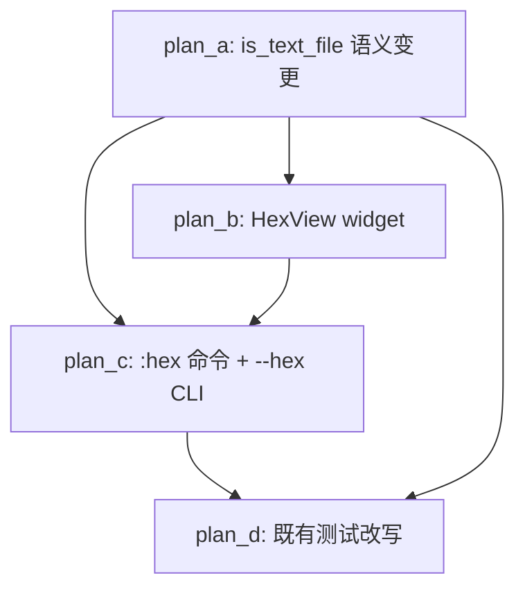

# Hex View Feature - Overview

## 目标

1. **以内容嗅探为准判定是否文本**：`Workspace.is_text_file()` 不再以扩展名白名单作为第一道门槛，
   对未知扩展名文件也读前 2048 字节嗅探（UTF-8 可解码 + 无 NUL 字节）——文本文件一律可以打开；
2. **二进制文件不再拦截**，改为在 **hex editor (view)** 中打开：实现类似 Linux `xxd` 的十六进制只读视图；
3. **普通文本文件也可用 hex view 打开**，两个入口：
   - `:hex` 命令：在当前窗格的文本视图与 hex 视图之间来回切换；
   - CLI 启动选项 `--hex <file>`：启动时直接以 hex 视图打开指定文件。

## 非目标

- 大文件分段加载（留作后续 feature）；本分支实现基础 hex view（一次性读入 + 滚动浏览）；
- hex view 内的编辑功能（只读视图）；
- 修改 `TEXT_SUFFIXES` 白名单本身（保持现状，嗅探逻辑变更不影响它）。

## 子计划索引

| 子计划 | 主题 | 波次 |
|---|---|---|
| [hex-view-sniff-plan-a.md](hex-view-sniff-plan-a.md) | `is_text_file` 语义变更：未知扩展名改为内容嗅探 | wave-1 |
| [hex-view-widget-plan-b.md](hex-view-widget-plan-b.md) | HexView widget + HexScreen 实现（L2） | wave-2 |
| [hex-view-flow-plan-c.md](hex-view-flow-plan-c.md) | `:hex` 命令 + `--hex` CLI 选项 + 流程接入（L3/L4） | wave-3 |
| [hex-view-test-fix-plan-d.md](hex-view-test-fix-plan-d.md) | 既有测试改写与冒烟场景同步 | wave-4 |

## 执行波次表

```
wave-1: plan_a  (is_text_file 语义变更 + 测试改写)
   |
   v
wave-2: plan_b  (HexView widget + HexScreen)
   |
   v
wave-3: plan_c  (:hex 命令 + --hex CLI + 流程接入)
   |
   v
wave-4: plan_d  (既有测试改写与冒烟场景同步)
```

波次间串行：上一波全部子计划验收通过（验收命令退出码 0）才允许进入下一波。

## 依赖关系图



## 关键事实清单（调研取证）

### is_text_file 调用方（语义变更影响面）

| 调用方 | 文件:行号 | 当前行为 | 变更后行为 | 决策 |
|---|---|---|---|---|
| `EditorSession.open()` | `yate/session.py:106` | 非文本 → 返回 None | 同（二进制仍返回 None，由调用方打开 hex view） | 不变 |
| `EditorSession.open_async()` | `yate/session.py:126` | 同上 | 同上 | 不变 |
| `DocumentFlows._open_document()` | `yate/flows/document_flows.py:182-185` | None → 报 "not a text file" | None → 调 `open_hex_view` 回调 | 需改（plan-c） |
| `DocumentFlows._open_document_async()` | `yate/flows/document_flows.py:206-208` | 同上 | 同上 | 需改（plan-c） |
| `OverlayFlows.open_diff()` | `yate/flows/overlay_flows.py:155` | 非文本 → 拒绝 diff | 同（diff 仍需文本） | 不变 |
| `PreviewLog._load_preview()` | `yate/editor_view/palette.py:442` | 非文本 → "(binary file)" 空载荷 | 同（ctrlp 预览仍不显示二进制内容） | 不变 |
| `test_is_text_file_rejects_unknown_suffixes` | `tests/test_workspace_filter.py:486` | 断言旧行为 | 必须改写 | 需改（plan-a/plan-d） |
| `test_diff_integration.py:131` | `tests/test_diff_integration.py:131` | 依赖 TEXT_SUFFIXES 信任语义 | 不变（diff 仍拒绝二进制） | 不变 |
| `smoke_test/scenarios/diffview.py:271` | `tools/smoke_test/scenarios/diffview.py:271` | 断言 "not a text file: blob.bin" | diff 场景不变，该断言仍成立 | 不变 |

### 架构边界标注

- **R11 登记**：
  - `flows/document_flows.py` 不新增 `editor_view` 导入（hex view 打开改走回调注入，
    回调由 Editor 在 `_build_pane_stack` 阶段注入，指向 `ed.overlays.open_hex_view`）；
  - `flows/overlay_flows.py` 已登记 8 个 `editor_view.*` 模块（`test_architecture.py:234-243`），
    须追加 `"yate.editor_view.hexview"`。
- **R9**：HexView 作为 Screen 覆盖层（类似 DiffScreen / OverlayScreen），不引入新外壳 id；
- **R13**：HexView 组件自持主题，订阅 `theme.subscribe` 自行上色（`ThemeListener = Callable[[], None]`，
  `Unsubscribe = Callable[[], None]`，见 `yate/editor_view/theme.py:120-125`）；
- **R3**：HexView 不得 import `yate.editor` / `yate.app`；
- **R10**：HexView 按键消费后 `event.stop()`，未识别键 fall-through；
- **R12**：日志走 `tracing.get_logger(__name__)`。

### 大文件策略

- 文本编辑器现有 >2MB oversize 跳过逻辑在 `yate/editor_view/palette.py:424` 附近；
- hex view 对大文件按 issue 倾向放行，但一次性读入超大文件的内存开销需评估：
  - 上限阈值：**100MB**（`MAX_HEX_VIEW_SIZE`，定义在 `yate/editor_view/hexview.py`，
    OverlayFlows import 该常量）；
  - 100MB 以下一次性读入，渲染按行分页（每行 16 字节，100MB ~ 6.25M 行，Textual ScrollView 可承受）。

### 接线关键事实（plan-c 修正依据）

- **DocumentFlows 无 push/pop/current_screen 能力**：构造器
  （`yate/flows/document_flows.py:54-84`）只注入 spawn/session/workspace/lsp/explorer_tree/
  prompt_bar/events/message/report/refresh_ui/mounted/reveal_explorer/startup_readonly；
- **OverlayFlows 持有全屏覆盖层能力**：构造器（`yate/flows/overlay_flows.py:39-81`）
  已注入 `push_screen` / `pop_screen` / `current_screen` / `message` / `mounted`；
  `open_hex_view` 应落在 OverlayFlows；
- **DocumentFlows 构造早于 OverlayFlows**（`editor.py:188` vs `editor.py:258`）：
  DocumentFlows 的二进制分支需通过回调间接调用 OverlayFlows，回调由 Editor 在
  `_build_pane_stack`（`editor.py:223`）阶段注入（此时 OverlayFlows 已存在）；
- **CLI 接线照 `--diff` 先例**（`cli.py:235-247` + `app.py:171` + `app.py:208-214`）：
  `YateApp.__init__` 存 `self._hex_file`，`on_mount` 用 `call_after_refresh` 调
  `editor.overlays.open_hex_view`；
- **`:hex` 命令照 `:help` 先例**（`commands.py:367-368`）：直接调 `editor.overlays.toggle_hex_view()`。

## 【执行】【审核】迭代记录段

- 2026-10-24 主代理复核修订：plan-c 重写（open_hex_view 移至 OverlayFlows、
  DocumentFlows 改走回调注入、CLI 照 --diff 先例、R11 登记修正为全点分模块名）；
  plan-b 补充 virtual_size / ModalScreen[None] / ThemeListener 签名；
  plan-d 修正冒烟验证命令、增加可选冒烟场景、全仓 grep 旧行为测试。
