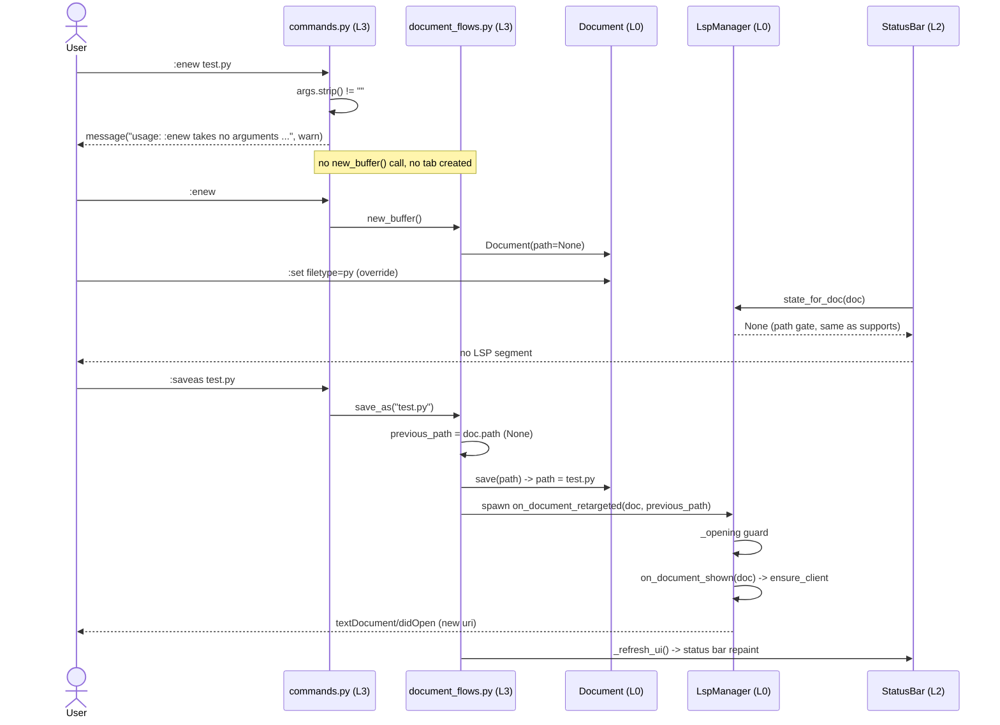
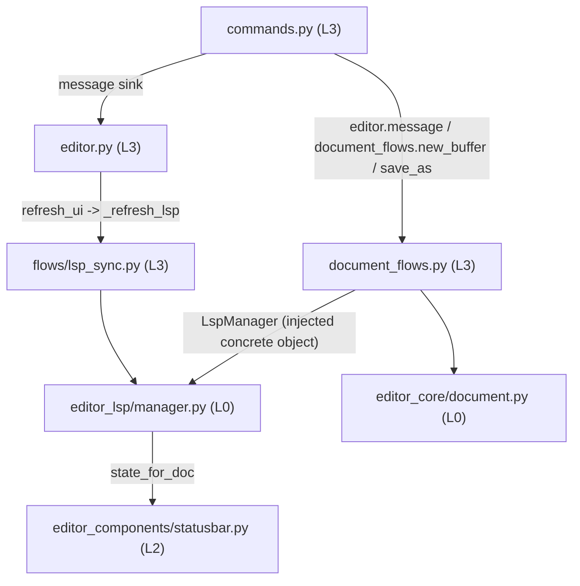

# IKSFS7 fix plan — `:enew` argument handling and unnamed-buffer LSP attach

Issue: <https://gitee.com/jermaine/yate/issues/IKSFS7> (source notes:
[`iksfs7-issue-notes.md`](iksfs7-issue-notes.md)).
Branch: `fix/iksfs7` · worktree: `../yate-iksfs7` (relative to the main repo).

## 0. Process state (closed loop, `task-orchestration.md` §二)

| Step | State | Evidence |
|---|---|---|
| 1 领会 | done | worktree + branch created from `master` `8e60598`; `.venv` rebuilt in the worktree and self-proved (`D:\Programming\yate-iksfs7\yate\__init__.py`); issue notes committed `7011ff2` |
| 2 方案 | done (this document + `iksfs7-plans/`) | plan-architect-designer spawn failed twice with `Model "qwen-3.7-plus" not found` (retry per §一.3.5 exhausted); **main agent executed the role script directly — 子代理零产出**, recorded per §三 |
| 3 批准 | waived | user explicitly requested unattended mode ("进入无人值守模式，所有问题无须过问") on 2026-11-06; per workspace rule §二.5 no approval/question is raised; the plan is treated as approved |
| 4 执行 | wave-1/2 done, wave-3 pending | wave-1: `df91f5c` + `429ff18`; wave-2: `c7fb803` + `383affe`; main agent independently re-ran their tests/pyright/architecture (all exit 0); see [`iksfs7-plans/overview.md`](iksfs7-plans/overview.md) |
| 5 审核 | round 1 done | code-review-expert: **0 blocker / 2 major / 4 minor**, all five gate commands exit 0 (3413 passed / 92.86% coverage / smoke 121/121); report stored in the review record |
| 6 迭代 | in progress | 2 majors → back to step 2: new design rulings in §3 C' and [`iksfs7-plans/iksfs7-review-fixes-plan-e.md`](iksfs7-plans/iksfs7-review-fixes-plan-e.md) (wave-3); minors #3/#4/#6 folded into that wave, minor #5 tracked by the line-count assertion |
| 7 收尾 | pending | main agent runs the full gate, backfills §7 with real numbers, per-step commits, no push |

## 1. Goals / non-goals

### Goals

1. `:enew FILE` must never silently discard its argument: emit a usage warning on
   the message line and create no buffer; bare `:enew` keeps its current behavior.
2. `LspManager.state_for_doc` must use the same gate as `supports` /
   `ensure_client`: an unnamed (`path is None`) document has no server state,
   so the status bar cannot advertise a configured server that will never start.
3. After a buffer first gains a path (`:saveas FILE`, including the `Save as: `
   prompt reached from `:w`), the LSP lifecycle must actually take over:
   `didOpen` for the new URI, `didClose` for a previously opened URI when the
   path changed, and a single `didOpen` even under concurrent refresh events.
4. Keep the user manuals and smoke coverage in sync with the three behaviors.

### Non-goals

- No new `:enew FILE` "create-and-bind" command variant; `:e FILE` already
  provides that semantics (§3).
- No attempt to attach an LSP server to a document that still has no path
  (LSP requires a document URI); syntax highlighting via `:set filetype=` on
  an unnamed buffer stays as-is.
- No changes to the LSP wire protocol, incremental sync, diagnostics storage,
  `:e` open flow, or `EditorSession.new_buffer()` signature.
- No CHANGELOG edits: `CHANGELOG.md` / `CHANGELOG.zh.md` declare they are
  generated by `python -m tools.changelog`; the generator is out of scope.
- No `git push` inside the closed loop.

## 2. Investigation facts (file:line, worktree HEAD `8e60598`)

| # | Fact | Location |
|---|---|---|
| F1 | `_enew(args: str)` ignores `args` entirely and calls `new_buffer()`; the registration description says "open a new empty buffer" | `../../yate/commands.py:344-345`, `:383` |
| F2 | Command-table error reporting convention is `editor.message(..., kind="warn")` with a `usage: :...` prefix | `../../yate/commands.py:405-411`, `:543-548`, `:564-568` |
| F3 | `_strip_quotes` strips one surrounding quote pair; `:e FILE` and `:saveas FILE` use it, `:saveas` accepts `None` for the prompt path | `../../yate/commands.py:142-151`, `:269-270`, `:328-333` |
| F4 | `Document.name` is `[no name]` when `path is None`; `filetype` falls back to `plaintext`, unless `filetype_override` is set | `../../yate/editor_core/document.py:221-238` |
| F5 | `supports` requires `doc.path is not None and config_for(...) is not None`; `ensure_client` and `on_document_shown` both early-return on `path is None` | `../../yate/editor_lsp/manager.py:210-216`, `:286-292`, `:347-353` |
| F6 | `state_for_doc` only looks at `doc.filetype`, so an unnamed buffer with `:set filetype=py` reports `CONFIGURED`/`READY`/`FAILED` while no client can ever start; `states()` baseline is `CONFIGURED` for every registration | `../../yate/editor_lsp/manager.py:218-238` |
| F7 | The only production consumer of `state_for_doc` is `StatusBar._lsp_segment`; it also renders `config_for(doc.filetype)` and `counts_for(doc)` | `../../yate/editor_components/statusbar.py:266-290` |
| F8 | `on_document_shown` checks `is_open` *before* `await ensure_client`, so two overlapping refresh workers can both send `didOpen` for the same URI | `../../yate/editor_lsp/manager.py:347-383` |
| F9 | `on_document_closed` owns URI teardown (`_open`, timers, locks, uri cache, `didClose`) keyed on the document's *current* path — it cannot close a URI after `:saveas` retargets the document | `../../yate/editor_lsp/manager.py:385-408` |
| F10 | `_uri(doc)` caches `path_to_uri` per `Path`; `_drop_uri_cache(uri)` removes cache entries by value | `../../yate/editor_lsp/manager.py:728-736`, `:184-188` |
| F11 | `Document.save(path)` writes atomically and only then assigns `self.path = target`; a failed save leaves the previous path intact | `../../yate/editor_core/document.py:321-325`, `:355-369` |
| F12 | `_submit_save_as` records no previous path, spawns no LSP notification, and calls no `_refresh_ui()`; it only emits `DOCUMENT_SAVED` | `../../yate/flows/document_flows.py:457-509` |
| F13 | `save_document` (`:w`) spawns `lsp.notify_saved` (didSave) and calls `_refresh_ui()`; unnamed buffers are routed to `prompt_save_as()` → `_submit_save_as` | `../../yate/flows/document_flows.py:402-436`, `:438-455` |
| F14 | `Editor.refresh_ui` → `_refresh_lsp` → `LspSync.doc_shown_later` → `on_document_shown`, gated on `supports(doc)` / `is_open(doc)`; `refresh_ui` is a no-op when unmounted | `../../yate/editor.py:432-438`, `:484-488`; `../../yate/flows/lsp_sync.py:69-77` |
| F15 | `DocumentFlows` already owns `lsp: LspManager`, `_spawn` and an injected `refresh_ui` callable, so spawning a manager coroutine from the save path is the established pattern | `../../yate/flows/document_flows.py:67-105`, `:426-429` |
| F16 | The command alias smoke scenario drives bare `:enew`; the `:saveas` smoke scenario asserts retargeting to `renamed.txt` | `../../tools/smoke_test/scenarios/aliases.py:60-67`; `../../tools/smoke_test/scenarios/files.py:298-329` |
| F17 | Headless command tests use a stub editor + `register_commands`, see `tests/test_cmd_cd.py` | `../../tests/test_cmd_cd.py:61-115` |
| F18 | `tests/test_lsp.py` already pins `state_for_doc` for a FAILED client and the didOpen/didSave/didClose lifecycle with fake clients | `../../tests/test_lsp.py:651-656`, `:778-807`, `:1071-1082` |
| F19 | Manuals describe `:enew`, `:saveas` and the "unnamed buffers are unaffected" LSP rule in both languages | `../../yate/resources/manual.en.md:774`, `:1417-1418`; `../../yate/resources/manual.zh.md:708`, `:1269`; `../../yate/docs/lsp.en.md:25-28`, `:94-95`; `../../yate/docs/lsp.zh.md:21-23`, `:82-83` |

### Architecture-impact statement

All touched product modules keep their existing dependency direction:

- `../../yate/editor_lsp/manager.py` is L0 and only uses `editor_core` /
  `editor_lsp` internals + `logs` (R4, §一 L0 leaf row);
- `../../yate/commands.py` is the L3 built-in command table (R5/R7), calling the
  already-injected `editor.message`;
- `../../yate/flows/document_flows.py` is L3 (R11), calling the injected L0
  `LspManager` — no new upward import;
- no new `Protocol`, `TYPE_CHECKING`, `Any`, `# type: ignore`, `print()`,
  `self.app`, class-level scrollbar patch, or widget style painting is introduced
  (R2, R6, R12, R13, §五 checklist).
- No new import edge is added, so `tests/test_architecture.py` needs **no new
  guard case**; the 37 existing guards must stay green. The behavior contracts
  (path gate consistency, single didOpen, saveas attach) are pinned by unit
  tests in the owning test files instead.

## 3. Alternatives and rejection reasons

### A. `:enew FILE` — chosen: reject with a usage warning

Chosen implementation: in `../../yate/commands.py:344`, if `args.strip()` is
non-empty, call `editor.message("usage: :enew takes no arguments; use :e FILE to open/create a named buffer or :saveas FILE to name this buffer", kind="warn")` and return; otherwise `editor.document_flows.new_buffer()`.
The `:enew` registration description is extended with "(no arguments)".

Rejected alternatives:

- **A1 — support `:enew FILE` by creating `Document(Path(args))` (add
  `new_buffer(path)` through `EditorSession` + `DocumentFlows`)**: rejected.
  (a) `Document(path)` means "this buffer is bound to that file"; a blank
  buffer over an *existing* `test.py` would silently shadow it and the next
  `:w` would overwrite real content. (b) `:e FILE` already implements exactly
  the named-new-buffer path (`../../yate/flows/document_flows.py:150-158`
  creates a `Document(path)` for a missing file), so the feature would be
  duplicated in a second, less safe entry point. (c) It would require edits in
  L1 `session.py`, L3 `document_flows.py` and the LSP shown-path lifecycle,
  crossing three layers for a behavior vim deliberately does not have
  (`:enew` takes no argument). (d) The issue explicitly allows the error route.
- **A2 — silently accept but log a debug message**: rejected; the bug is
  precisely that the argument is silently dropped. A `log.debug` is invisible
  without `YATE_TRACE=1`.
- **A3 — raise an exception from the command handler**: rejected; the ex
  command table reports user errors through `editor.message(..., kind="warn")`
  (F2), and an exception would escape the Textual event handler.

### B. Status-bar gate — chosen: `state_for_doc` returns `None` for `path is None`

Chosen implementation: `../../yate/editor_lsp/manager.py:235-238` returns
`None` when `doc.path is None`, otherwise the existing `states().get(cfg.name)`.
This matches `supports` (F5) exactly.

Rejected alternatives:

- **B1 — change the status bar widget to check `doc.path`**: rejected; the
  inconsistency lives in the L0 manager's query API (also reachable through
  embedders/extensions), so every consumer would have to repeat the check.
  L2 must not own LSP policy (R13, §二 L2 row).
- **B2 — remove the `path` gate from `supports` / `ensure_client` so unnamed
  buffers start a server**: rejected; LSP `didOpen` requires a document URI
  (`_uri` asserts `doc.path is not None`, F10), and inventing a synthetic URI
  would desynchronize diagnostics, completion and `didSave` from the real file.
- **B3 — return a new `ServerState` value like `NO_FILE`**: rejected; the enum
  is part of the plugin-facing status API (`api.lsp.statuses()`), and a new
  value would ripple through `states()`, `StatusBar`, `diagnostics.py` and the
  Lua bridge for no behavioral gain — `None` already means "no LSP segment".

### C. `:saveas` attach — chosen: one manager coroutine `on_document_retargeted`

Chosen implementation:

1. `../../yate/editor_lsp/manager.py`: extract the URI teardown of
   `on_document_closed` into `async def _close_uri(self, uri: str) -> None`;
   add `async def on_document_retargeted(self, doc: Document, previous_path: Path | None) -> None`
   which (i) calls `notify_saved(doc)` when `previous_path == doc.path`,
   otherwise (ii) `await self._close_uri(protocol.path_to_uri(previous_path))`
   when `previous_path is not None`, then `await self.on_document_shown(doc)`.
2. `../../yate/editor_lsp/manager.py::on_document_shown`: add an in-flight set
   `_opening: set[str]` so concurrent `doc_shown_later` workers cannot send a
   duplicate `didOpen` while `ensure_client` is awaiting the handshake (F8).
3. `../../yate/flows/document_flows.py::_submit_save_as`: capture
   `previous_path = doc.path` before `doc.save(path)`, and on a successful write
   spawn `partial(self.lsp.on_document_retargeted, doc, previous_path)` in the
   existing `lsp-sync` worker group, then call `self._refresh_ui()` at the end
   of the method (mirroring `save_document`). Failures spawn nothing; the
   `finally` lock restoration is untouched.

Rejected alternatives:

- **C1 — only add `_refresh_ui()` and rely on `doc_shown_later`**: rejected as
  incomplete. It works for the first path (F14) but leaves the old URI's
  `didOpen` state alive when `:saveas` retargets an already-named document
  (F9), and it does nothing in headless/unmounted contexts. It also amplifies
  the duplicate-`didOpen` race (F8).
- **C2 — emit `didSave` from `:saveas` (issue's phrasing) without `didOpen`**:
  rejected; a server has no URI entry before `didOpen`, so `didSave` is either
  dropped by `notify_saved` (`_open` miss, F12) or rejected by the server.
- **C3 — put the retarget orchestration in `LspSync`**: rejected; the save path
  already owns the `LspManager`, the spawn verb and the previous path
  (F12/F15). Routing through `LspSync` would need a new injected callback and
  an event name, adding indirection with no new consumer (§四 1:1 operation →
  direct call on a concrete collaborator).
- **C4 — treat every `:saveas` as `didClose` + `didOpen` even for the same
  path**: rejected; restarting the server-side document on an identical path
  discards diagnostics for no reason. The `previous_path == doc.path` branch
  keeps the existing `didSave` behavior.

### C' Review round-1 boundary rulings (step-6 iteration, wave-3)

Step-5 review round 1 found two majors in the chosen C design, both caused by
treating `Path` equality as document identity. The design is amended (full
detail in [`iksfs7-plans/iksfs7-review-fixes-plan-e.md`](iksfs7-plans/iksfs7-review-fixes-plan-e.md)):

1. **URI identity**: `previous_path` and `doc.path` are compared by
   `protocol.path_to_uri(...)`, which resolves the path (F10). `sub/../a.py`
   and `a.py` are the same server document, so they take the didSave branch
   mandated by rejected alternative C4; the stale spelling's `_uri_cache` key
   is dropped to avoid duplicate keys.
2. **URI ownership**: when `_open[new_uri]` belongs to another tab (reachable
   because `EditorSession` lets two tabs share a path after `:saveas`), that
   entry is closed first so `on_document_shown` can open the retargeted
   document instead of short-circuiting on `uri in self._open`.
3. **Close beats in-flight open**: `_close_uri` discards the URI from
   `_opening`, and `on_document_shown` re-checks membership after both awaits
   before writing `_open`, closing the narrow ghost-entry window.
4. **Rejected here**: normalizing/symlink-resolving the save path in
   `DocumentFlows` (changes which file a save targets), splitting
   `editor_lsp/lifecycle.py` (manager is 783 lines, in-place rewrites stay
   below the 800-line §三.7 guard), and forbidding `:saveas` onto an
   already-open path (a product-behavior change outside this issue; the
   residual "two tabs, one URI" limitation is registered as a follow-up).

The four review minors are folded in as follows: #3 is fixed by ruling 3,
#4 by three new no-path/notify-failure tests, #6 by a multi-argument `:enew`
test, #5 by an explicit `< 800` line-count assertion in the wave-3 acceptance
commands. No minor is silently dropped.

### D. Manual/smoke updates — chosen: bilingual manual sync + one smoke check

Chosen: update `manual.en.md` / `manual.zh.md` (`:enew` command table row,
LSP section note) and `lsp.en.md` / `lsp.zh.md` (unnamed-buffer rule + attach
after save-as); add one `:enew test.py` check to the existing
`command_alias_roundup` smoke scenario and regenerate that single baseline.

Rejected: a brand-new smoke scenario (would need a new baseline file, a new
scenario registration and duplicate app setup); a docs-only change without
smoke coverage (the bug is user-visible through the command line).

## 4. Design / data flow



Dependency / ownership graph (no new import edges):



## 5. Sub-plan index and waves

Full wave table, exclusive-file matrix and per-wave acceptance commands live in
[`iksfs7-plans/overview.md`](iksfs7-plans/overview.md). Summary:

| Wave | Sub-plan | Scope |
|---|---|---|
| wave-1 (∥) | [`iksfs7-enew-args-plan-a.md`](iksfs7-plans/iksfs7-enew-args-plan-a.md) | `:enew` argument guard + headless command tests |
| wave-1 (∥) | [`iksfs7-lsp-state-plan-b.md`](iksfs7-plans/iksfs7-lsp-state-plan-b.md) | `state_for_doc` gate, `_close_uri` extraction, `on_document_retargeted`, single-`didOpen` guard + LSP tests |
| wave-2 (∥) | [`iksfs7-saveas-attach-plan-c.md`](iksfs7-plans/iksfs7-saveas-attach-plan-c.md) | `:saveas`/`Save as:` wiring + DocumentFlows tests |
| wave-2 (∥) | [`iksfs7-docs-smoke-plan-d.md`](iksfs7-plans/iksfs7-docs-smoke-plan-d.md) | bilingual manuals + smoke check/baseline |

Wave-2 starts only after **both** wave-1 plans pass their acceptance commands.

## 6. Risks and rollback

| Risk | Mitigation | Rollback |
|---|---|---|
| A warning on `:enew FILE` breaks scripts/keymaps that pass an argument | No shipped keymap/extension passes an argument (F16 bare `:enew`); check `tests/test_action_table.py` and the smoke alias scenario; warning is non-destructive (no buffer created) | revert `../../yate/commands.py:344-345` + description + `tests/test_cmd_enew.py` |
| `state_for_doc` returning `None` hides a legitimately FAILED server on unnamed buffers | By design no server can start without a path (F5); existing FAILED-state test uses a named doc (`../../tests/test_lsp.py:1071-1075`) and stays green | revert `../../yate/editor_lsp/manager.py:235-238` + the new test |
| `_close_uri` extraction changes existing `didClose` behavior | Keep the exact current statement order and states (`_open`, timers, locks, uri cache, best-effort notify); add a regression test asserting existing close behavior; run full `tests/test_lsp.py` | revert the extraction, keep `on_document_closed` inlined |
| Duplicate `didOpen` after save-as because `_refresh_ui` also schedules `doc_shown_later` | `_opening` in-flight set plus `is_open` check; concurrency test in plan-b; smoke covers the UI path | revert `_opening` guard and the extra spawn in plan-c |
| Save failure spawns a retarget / loses `previous_path` | spawn only inside the successful `try` branch after `saved = True`; `Document.save` leaves `path` untouched on failure (F11); failure-path test in plan-c | revert plan-c edits (the `finally` lock restore is untouched) |
| `_uri_cache` keeps stale entries after retarget | `_close_uri` calls `_drop_uri_cache(old_uri)` (F10); named→named test asserts the old URI is gone and the new URI is live | same as above |
| Manual baseline drift from a new smoke check | regenerate only the one affected baseline with `snapshot --scenario command_alias_roundup`, then verify `compare`; do not bulk-regenerate baselines | revert the scenario + baseline file |
| File-size guard (§三.7, >800 lines) | all touched modules are below 800 lines and grow by <60 lines each; executor re-measures with `python -c "len(Path(...).read_text().splitlines())"` | not applicable |
| **Review major#1**: `:saveas` onto a URI already owned by another tab leaves the server bound to the wrong document | wave-3 ruling 2 closes the previous owner's `_open` entry before re-opening; pinned by `test_on_document_retargeted_to_uri_owned_by_another_document_reopens_for_new_owner` | revert wave-3 commit (majors return; review round 2 must be repeated) |
| **Review major#2**: different spellings of the same path (`sub/../a.py`) trigger a needless didClose+didOpen and split `_uri_cache` keys | wave-3 ruling 1 compares URIs and drops the stale spelling's cache key; pinned by two new same-URI tests | same as above |

Residual backlog (registered, not fixed in this issue): two tabs bound to one
path after `:saveas` still share a single LSP URI, so the tab that is not the
current owner can send didChange against the other tab's `OpenDocState`.
`EditorSession` permits duplicate paths today; forbidding save-as onto an
already-open path is a product-behavior change that needs its own issue.

General rollback: every wave is one commit; `git revert <sha>` of the wave
commit restores the previous state without touching unrelated worktrees.

## 7. Acceptance and backfill (fill in with real numbers at step 7)

Gate commands (main agent, worktree root, parallel CI口径):

```powershell
.venv\Scripts\python.exe -m pyright yate/ tests/ tools/ pack/
.venv\Scripts\python.exe -m pytest tests/ -q -n auto
.venv\Scripts\python.exe -m pytest tests/test_architecture.py -q
.venv\Scripts\python.exe -m pytest tests/ --cov=yate --cov-branch --cov-fail-under=75 -n auto
.venv\Scripts\python.exe -m tools.smoke_test run --jobs 4
```

| Check | Baseline (before) | Result (after) | Exit code |
|---|---|---|---|
| pyright | — | pending | — |
| pytest `-n auto` | — | pending | — |
| architecture | 37 passed | pending | — |
| coverage | — | pending | — |
| smoke | — | pending | — |

Deviations from this plan must be recorded here with measured evidence.
