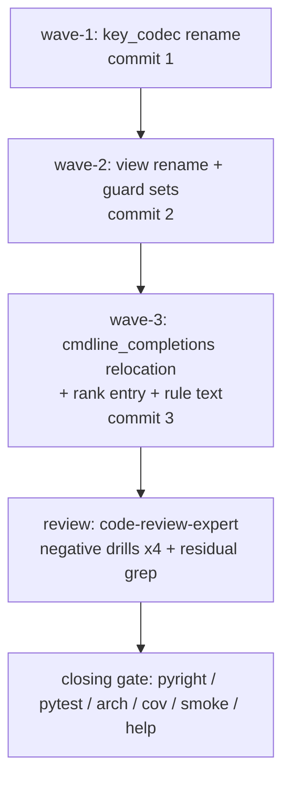
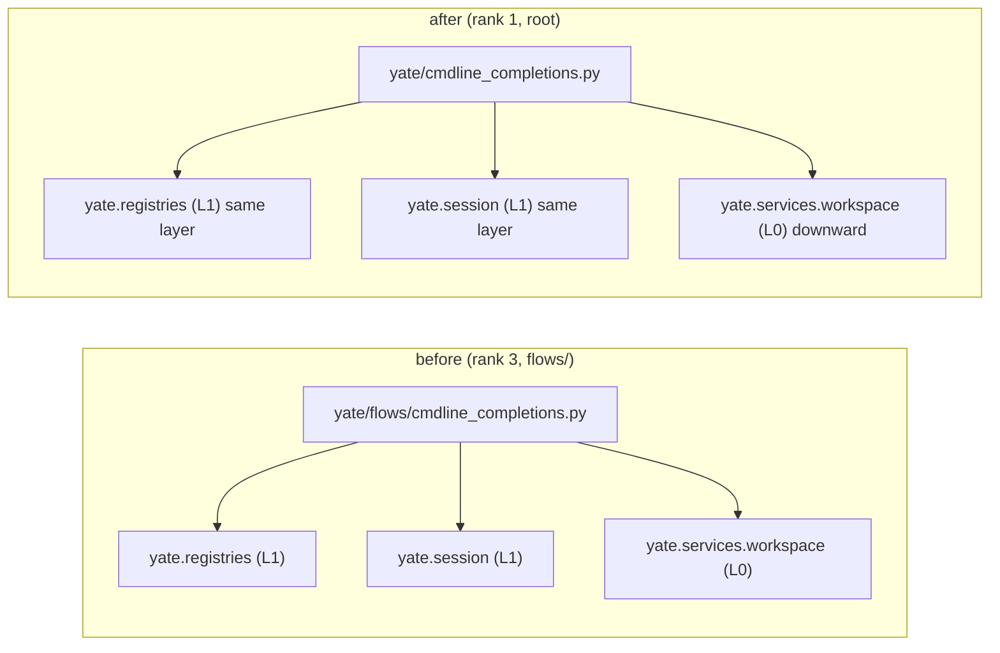

# IKTBXC sub-plan overview (three serial waves)

Main plan: [../iktbxc-plan.md](../iktbxc-plan.md). Facts:
[../iktbxc-reference-inventory.md](../iktbxc-reference-inventory.md), issue text:
[../iktbxc-issue-notes.md](../iktbxc-issue-notes.md).

## 1. Sub-plan index

| Wave | Sub-plan | Subject | Independent commit |
|---|---|---|---|
| wave-1 | [iktbxc-key-codec-plan-a.md](iktbxc-key-codec-plan-a.md) | `keyproto/legacy.py` -> `key_codec.py` | `refactor(keyproto): rename legacy key codec to key_codec` |
| wave-2 | [iktbxc-view-plan-b.md](iktbxc-view-plan-b.md) | `editor_components/editor.py` -> `view.py` | `refactor(editor-components): rename editor module to view` |
| wave-3 | [iktbxc-cmdline-relocation-plan-c.md](iktbxc-cmdline-relocation-plan-c.md) | `flows/cmdline_completions.py` -> root `cmdline_completions.py` (L1) | `refactor(architecture): relocate cmdline_completions out of flows` |

## 2. Wave table (strictly serial)

| Wave | Exclusive source files | Shared files touched | Why serial |
|---|---|---|---|
| wave-1 | `yate/keyproto/key_codec.py` (renamed), `yate/app.py`, `yate/editor_dispatch.py`, `yate/editor_term/keys.py`, `yate/keyproto/__init__.py`, 3 tests | `.trae/rules/architecture-boundaries.md:47`, `.trae/wikis/yate-architecture.md:156/184/194` | wave-2 and wave-3 also edit the same rule file and `tests/test_architecture.py` |
| wave-2 | `yate/editor_components/view.py` (renamed), 11 L2/L3 modules, `yate/resources/editor-view.tcss`, 5 tests, 1 smoke scenario | `tests/test_architecture.py:130/213/225/329`, `.trae/rules/architecture-boundaries.md:113/347`, `.trae/wikis/yate-architecture.md:167` | wave-3 edits `tests/test_architecture.py:25` and `_LAYER_RANKS` in the same file |
| wave-3 | `yate/cmdline_completions.py` (renamed), `yate/editor_compose.py`, `yate/config.py`, `yate/services/extensions/api.py`, 4 tests, 1 smoke docstring | `tests/test_architecture.py:25` + `_LAYER_RANKS`, `.trae/rules/architecture-boundaries.md` §一/R11/§二/§三.6/§六, `.trae/wikis/yate-architecture.md:23/151/159` | final wave; rule text must land with the code |



Dependency rule: a wave starts only when the previous wave's acceptance
commands all returned exit code 0 and its commit exists. No wave reordering.

## 3. Layer change of cmdline_completions



The rank entry `("cmdline_completions.py", 1)` is what keeps the two L1 imports
same-layer instead of upward. Without it, `test_no_unregistered_upward_imports`
reports `cmdline_completions.py -> yate.registries` and
`cmdline_completions.py -> yate.session` (verified by wave-3 negative drill).

## 4. Execution contract

- Unattended session: plan approval treated as granted; no questions/approvals;
  all subagents use `bypassPermissions`.
- `subagent-workflow.md` §一.3 forbids subagent edits to `yate/` product source,
  so the MAIN AGENT executes all three waves under the `plan-executor` script,
  with this plan as the single spec. Only the review step is delegated.
- Each wave: `git mv` (never delete+create) -> exact string edits -> per-wave
  acceptance commands -> `git status --short` review -> one commit with the
  subject in the table -> `git log --follow -- <new path>` spot-check.
- After each wave, the plan's closing backfill section in
  [../iktbxc-plan.md](../iktbxc-plan.md) records the real command results.

## 5. Residual grep surface

Source face: `yate tests tools pack pyproject.toml .trae/rules .trae/wikis
README.md README.zh.md`. Two `git grep -n -E` commands (dotted import forms and
slashed path forms) are listed in the main plan §6; both must report 0 hits.

Exempt: `.trae/documents/**` (historical plans, this task's notes and plans),
`.trae/reviews/**` (read-only fact records), `CHANGELOG*`,
`tools/changelog/zh_overrides.json`, and the `iktbxc-issue-notes.md` input
material. No blind global replacement; `git grep` hits are triaged by hand.

## 6. Negative drills

| Wave | Guard | Temporary violation | Expected failing test |
|---|---|---|---|
| 1 | naming (`BANNED_SUFFIXES`) | add `class RenameProbeController` in new codec | `test_no_banned_identifier_names` |
| 2 | R2 path whitelist | restore old `ALLOWED_PROTOCOLS` key | `test_no_new_protocols` |
| 2 | R11 frozen surface | restore one old `UI_FROZEN_FILES` value | `test_collaborators_keep_widget_coupling_frozen` |
| 3 | layer rank | remove `("cmdline_completions.py", 1)` | `test_no_unregistered_upward_imports` |

Every drill ends with restore + `git status --short` clean + green re-run after
clearing the touched `__pycache__`.

## 7. Commit sequence (all English, `type(scope): subject`)

1. `docs(plan): collect IKTBXC issue input notes` (done, `efd4551`)
2. `docs(plan): record IKTBXC reference-surface inventory` (done, `6539b90`)
3. `docs(plan): add IKTBXC naming refactor plan and wave sub-plans`
4. wave-1 subject (table §1)
5. wave-2 subject (table §1)
6. wave-3 subject (table §1)
7. review record + any review-fix commits
8. `docs(plan): backfill IKTBXC gate results and deviations`

Only commits, no `git push` (task-orchestration.md §二).

## 8. Closing gate (main agent, all exit code 0)

```powershell
.venv\Scripts\python.exe -m pyright yate/ tests/ tools/ pack/
.venv\Scripts\python.exe -m pytest tests/ -q -n auto
.venv\Scripts\python.exe -m pytest tests/test_architecture.py -q
.venv\Scripts\python.exe -m pytest tests/ --cov=yate --cov-branch -n auto --cov-fail-under=75
.venv\Scripts\python.exe -m tools.smoke_test run --jobs 4
.venv\Scripts\python.exe -m yate --help
```

Parallel `-n auto` flakes must be re-checked with `-n 1` and fixed, never
recorded as "occasional". Coverage must be >= 75 with `--cov-fail-under=75`.

## 9. Backfill (2026-11-07, closed)

Wave table (all exit code 0; grep no-match exit 1 = 0 hits):

| Wave | pyright | arch | full pytest | smoke | negative drill | commit |
|---|---|---|---|---|---|---|
| 1 | 0 | 37 | 0 | n/a | naming guard RED 1 / GREEN 0 | `3e615a9` |
| 2 | 0 | 37 | 0 | 121/121 · 1463/1463 | R2 + R11 RED 1 / GREEN 0 | `55aee7e` |
| 3 | 0 | 37 | 0 | 121/121 · 1463/1463 | rank RED 1 (2 upward edges) / GREEN 0 | `f3299a1` |

Review: `code-review-expert` 0 blocker / 1 major / 3 minor; record at
[../reviews/2026-11-07-iktbxc-naming-refactor.md](../reviews/2026-11-07-iktbxc-naming-refactor.md),
fix plan at [../iktbxc-review-fixes-plan.md](../iktbxc-review-fixes-plan.md).
M1 (7 one-shot scripts) deleted, m2/m3 rule text fixed, m1 deferred; the
`stress_rapid_toggles` timing flake was fixed per §二.7 in `c9f5589`.

Closing gate (main agent, real numbers): pyright `0 errors, 0 warnings`;
`pytest -q -n auto` exit 0; architecture 37 dots exit 0; coverage
`TOTAL ... 93%`, `Total coverage: 92.84%`, `3395 passed, 10 skipped`, exit 0;
smoke `1463/1463 checks`, `121/121 scenarios`, exit 0; `python -m yate --help`
exit 0; combined residual grep 0 hits (exit 1).

Final commits (9, no push): `efd4551` / `6539b90` / `e7c2d67` / `3e615a9` /
`55aee7e` / `f3299a1` / `506b38c` / `adca72b` / `c9f5589`, plus this backfill
commit. Deviations, anomalies and deferred items: main plan §9.3 / §9.6.
`git status --short` empty at close.
