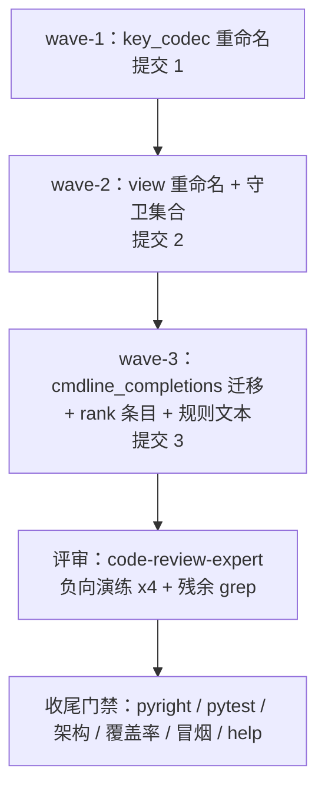
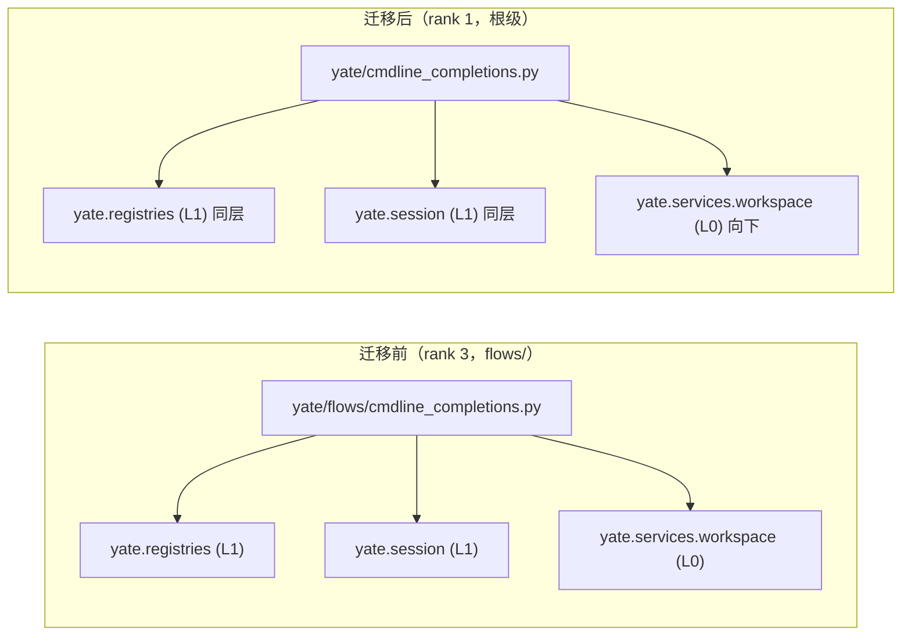

# IKTBXC 子计划总览（三个串行波次）

主计划：[../iktbxc-plan.md](../iktbxc-plan.md)。事实：[../iktbxc-reference-inventory.md](../iktbxc-reference-inventory.md)，issue 文本：[../iktbxc-issue-notes.md](../iktbxc-issue-notes.md)。

## 1. 子计划索引

| 波次 | 子计划 | 主题 | 独立提交 |
|---|---|---|---|
| wave-1 | [iktbxc-key-codec-plan-a.md](iktbxc-key-codec-plan-a.md) | `keyproto/legacy.py` -> `key_codec.py` | `refactor(keyproto): rename legacy key codec to key_codec` |
| wave-2 | [iktbxc-view-plan-b.md](iktbxc-view-plan-b.md) | `editor_components/editor.py` -> `view.py` | `refactor(editor-components): rename editor module to view` |
| wave-3 | [iktbxc-cmdline-relocation-plan-c.md](iktbxc-cmdline-relocation-plan-c.md) | `flows/cmdline_completions.py` -> 根级 `cmdline_completions.py`（L1） | `refactor(architecture): relocate cmdline_completions out of flows` |

## 2. 波次表（严格串行）

| 波次 | 独占源文件 | 触及的共享文件 | 为何串行 |
|---|---|---|---|
| wave-1 | `yate/keyproto/key_codec.py`（重命名）、`yate/app.py`、`yate/editor_dispatch.py`、`yate/editor_term/keys.py`、`yate/keyproto/__init__.py`、3 个测试 | `.trae/rules/architecture-boundaries.md:47`、`.trae/wikis/yate-architecture.md:156/184/194` | wave-2 与 wave-3 也编辑同一规则文件和 `tests/test_architecture.py` |
| wave-2 | `yate/editor_components/view.py`（重命名）、11 个 L2/L3 模块、`yate/resources/editor-view.tcss`、5 个测试、1 个冒烟场景 | `tests/test_architecture.py:130/213/225/329`、`.trae/rules/architecture-boundaries.md:113/347`、`.trae/wikis/yate-architecture.md:167` | wave-3 在同一文件中编辑 `tests/test_architecture.py:25` 与 `_LAYER_RANKS` |
| wave-3 | `yate/cmdline_completions.py`（重命名）、`yate/editor_compose.py`、`yate/config.py`、`yate/services/extensions/api.py`、4 个测试、1 处冒烟 docstring | `tests/test_architecture.py:25` + `_LAYER_RANKS`、`.trae/rules/architecture-boundaries.md` §一/R11/§二/§三.6/§六、`.trae/wikis/yate-architecture.md:23/151/159` | 最后一个波次；规则文本必须与代码一同落盘 |



依赖规则：仅当上一波次的验收命令全部返回退出码 0 且其提交存在时，本波次才开始。不得调换波次顺序。

## 3. cmdline_completions 的层级变化



正是 rank 条目 `("cmdline_completions.py", 1)` 使两处 L1 import 保持同层而非向上。没有它，`test_no_unregistered_upward_imports` 会报告 `cmdline_completions.py -> yate.registries` 与 `cmdline_completions.py -> yate.session`（由 wave-3 负向演练验证）。

## 4. 执行契约

- 无人值守会话：计划审批视为已授予；不提问/不审批；所有子代理使用 `bypassPermissions`。
- `subagent-workflow.md` §一.3 禁止子代理编辑 `yate/` 产品源码，因此主代理在 `plan-executor` 脚本下执行全部三个波次，以本计划为唯一规范。仅评审步骤外包。
- 每波：`git mv`（绝不删除+创建）-> 精确字符串编辑 -> 逐波验收命令 -> `git status --short` 复核 -> 按 §1 表主题提交一次 -> `git log --follow -- <new path>` 抽查。
- 每波之后，[../iktbxc-plan.md](../iktbxc-plan.md) 中计划的收尾回填章节记录真实命令结果。

## 5. 残余 grep 范围

源码面：`yate tests tools pack pyproject.toml .trae/rules .trae/wikis README.md README.zh.md`。主计划 §6 列出两条 `git grep -n -E` 命令（点号 import 形式与斜杠路径形式）；两者都必须报告 0 命中。

豁免：`.trae/documents/**`（历史计划、本任务的笔记与计划）、`.trae/reviews/**`（只读事实记录）、`CHANGELOG*`、`tools/changelog/zh_overrides.json`，以及 `iktbxc-issue-notes.md` 输入素材。不做盲目全局替换；`git grep` 命中手工分诊。

## 6. 负向演练

| 波次 | 守卫 | 临时违规 | 预期失败的测试 |
|---|---|---|---|
| 1 | 命名（`BANNED_SUFFIXES`） | 在新编解码器中加 `class RenameProbeController` | `test_no_banned_identifier_names` |
| 2 | R2 路径白名单 | 恢复旧 `ALLOWED_PROTOCOLS` 键 | `test_no_new_protocols` |
| 2 | R11 冻结面 | 恢复一个旧 `UI_FROZEN_FILES` 值 | `test_collaborators_keep_widget_coupling_frozen` |
| 3 | 层级 rank | 移除 `("cmdline_completions.py", 1)` | `test_no_unregistered_upward_imports` |

每次演练均以还原 + `git status --short` 干净 + 清理所涉 `__pycache__` 后重跑转绿收尾。

## 7. 提交序列（均为英文，`type(scope): subject`）

1. `docs(plan): collect IKTBXC issue input notes`（已完成，`efd4551`）
2. `docs(plan): record IKTBXC reference-surface inventory`（已完成，`6539b90`）
3. `docs(plan): add IKTBXC naming refactor plan and wave sub-plans`
4. wave-1 主题（§1 表）
5. wave-2 主题（§1 表）
6. wave-3 主题（§1 表）
7. 评审记录 + 任何评审修复提交
8. `docs(plan): backfill IKTBXC gate results and deviations`

仅提交，不 `git push`（task-orchestration.md §二）。

## 8. 收尾门禁（主代理，均退出码 0）

```powershell
.venv\Scripts\python.exe -m pyright yate/ tests/ tools/ pack/
.venv\Scripts\python.exe -m pytest tests/ -q -n auto
.venv\Scripts\python.exe -m pytest tests/test_architecture.py -q
.venv\Scripts\python.exe -m pytest tests/ --cov=yate --cov-branch -n auto --cov-fail-under=75
.venv\Scripts\python.exe -m tools.smoke_test run --jobs 4
.venv\Scripts\python.exe -m yate --help
```

并行 `-n auto` 的 flake 必须用 `-n 1` 复核并修复，绝不可记为"偶发"。覆盖率必须在 `--cov-fail-under=75` 下 >= 75。

## 9. 回填（2026-11-07，已关闭）

波次表（均退出码 0；grep 无匹配退出 1 = 0 命中）：

| 波次 | pyright | 架构 | 全量 pytest | 冒烟 | 负向演练 | 提交 |
|---|---|---|---|---|---|---|
| 1 | 0 | 37 | 0 | n/a | 命名守卫 红 1 / 绿 0 | `3e615a9` |
| 2 | 0 | 37 | 0 | 121/121 · 1463/1463 | R2 + R11 红 1 / 绿 0 | `55aee7e` |
| 3 | 0 | 37 | 0 | 121/121 · 1463/1463 | rank 红 1（2 条向上边）/ 绿 0 | `f3299a1` |

评审：`code-review-expert` 0 阻塞项 / 1 严重 / 3 次要；记录见 [../../reviews/2026-11-07-iktbxc-naming-refactor.md](../../reviews/2026-11-07-iktbxc-naming-refactor.md)，修复计划见 [../iktbxc-review-fixes-plan.md](../iktbxc-review-fixes-plan.md)。M1（7 个一次性脚本）已删除，m2/m3 规则文本已修复，m1 延期；`stress_rapid_toggles` 时序 flake 依据 §二.7 在 `c9f5589` 中修复。

收尾门禁（主代理，真实数字）：pyright `0 errors, 0 warnings`；`pytest -q -n auto` 退出 0；架构 37 点 退出 0；覆盖率 `TOTAL ... 93%`、`Total coverage: 92.84%`、`3395 passed, 10 skipped`，退出 0；冒烟 `1463/1463 checks`、`121/121 scenarios`，退出 0；`python -m yate --help` 退出 0；合并残余 grep 0 命中（退出 1）。

最终提交（9 笔，无 push）：`efd4551` / `6539b90` / `e7c2d67` / `3e615a9` / `55aee7e` / `f3299a1` / `506b38c` / `adca72b` / `c9f5589`，外加本次回填提交。偏离、异常与延期项见主计划 §9.3 / §9.6。收尾时 `git status --short` 为空。

合并就绪 PR 评审（2026-11-07，已关闭）：3 名只读评审者加主代理裁决（0 阻塞项 / 3 严重 / 9 次要）-> 修复后 APPROVE。报告：[../../reviews/2026-11-07-pr-review-naming-hygiene.md](../../reviews/2026-11-07-pr-review-naming-hygiene.md)；迭代计划：[../naming-hygiene-pr-review-plan.md](../naming-hygiene-pr-review-plan.md)。主代理门禁均退出 0（pyright 0 / pytest 0 / 架构 37 / 覆盖率 92.88% / 冒烟 121/121 · 1463/1463 / changelog 0）；`git merge-tree` 0 冲突标记；首轮评审记录的失效相对链接已修复。无 push。
