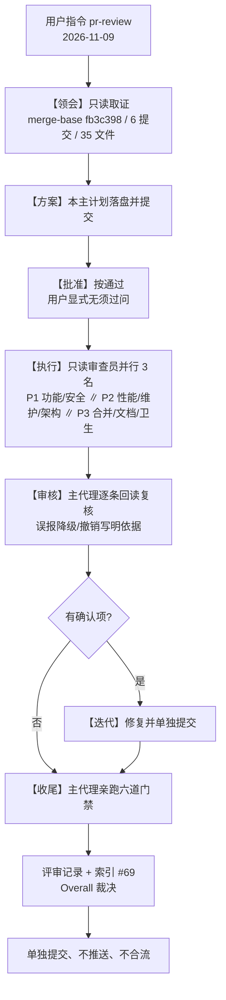

# IKTR5Q 合并前 PR 级预评审 — 主计划

> 闭环流程【方案】产物。依据 [`../skills/pr-review/SKILL.md`](../skills/pr-review/SKILL.md)
> 的 `review` 默认模式（六维度 + 裁决 + 行动清单），并遵循
> [`../rules/task-orchestration.md`](../rules/task-orchestration.md) §二 的七步闭环。
> 本轮只做**AI 预评审**，不合并、不推送；最终合流决策归人工评审者。

## 一、目标与非目标

**目标**

1. 对 `feature/enh-unused-symbols-cleanup` 相对 `master` 的**整条分支 diff**
   （6 笔提交 / 35 文件，非单文件或片段）做合并前 PR 级预评审，覆盖
   `pr-review` skill §三 六个维度：功能正确性、安全性、性能、可维护性、
   架构边界（R1-R15）、硬门禁。
2. 复核前两轮评审（#67 `REQUEST_CHANGES` → #68 `APPROVE`）的结论在**最终提交
   `84074b1` 之后**是否仍成立，重点核对合并就绪度：提交链、分支状态、登记表与
   删除清单对账、评审索引登记、changelog、仓库卫生、偏离登记 D1-D18。
3. 逐条回读复核所有 findings（含审查员的误报降级/撤销），修掉确认项，并由主代理
   **亲自**跑完收尾六道门禁（不得引用他人自述数字代替实测）。
4. 评审记录按 [`../rules/doc-conventions.md`](../rules/doc-conventions.md) §二.1
   落盘并登记为索引 #69。

**非目标**

- 不合并 `master`、不推送、不改 `develop`（已弃用）；
- 不重复实现 IKTR5Q 的清理项（12 删 / 1243 留已完成并封闭）；
- 不为「更 Pythonic」重写已工作的逻辑，不扩大 diff；
- 不新增 linter、架构守卫豁免、`pyproject.toml` 改动或门禁配置改动；
- 不在本轮处理遗留另案（冒烟 `stress.py:157 toggles_back` 负载敏感、
  flake 样本有限、`test` 提交前缀是否补入规则允许集）——只登记。

## 二、范围事实（【领会】只读取证，2026-11-09 06:28）

| 项 | 实测值 | 取证命令 |
| --- | --- | --- |
| 工作目录 | 续作复用既有 worktree（分支目录，含 `.venv`），不另建沙箱 | `.venv\Scripts\python.exe -c "import yate; print(yate.__file__)"` → 该 worktree 下的 `yate/__init__.py` |
| 分支 / 基线 | `feature/enh-unused-symbols-cleanup`，`merge-base(master, HEAD) = fb3c398`；`master` 与 `origin/master` 同为 `fb3c398` | `git merge-base master HEAD`、`git log -1 --oneline master`、`git log -1 --oneline origin/master` |
| 提交链（6 笔） | `1e094db` 领会素材 → `c304147` 方案 → `718ec79` wave-1 → `4b38989` wave-2 → `179fdf6` F1 迭代 → `84074b1` 收尾 | `git log master..HEAD --format="%h %s"` |
| diff 规模 | 35 文件，`+3009 / -57`；主体是登记表 1393 行与评审记录/计划文档 | `git diff --stat master...HEAD` |
| 前两轮评审 | #67 首轮 `REQUEST_CHANGES`（0/1/1）、#68 复验 `APPROVE`（0/0/2）；记录见 [`../reviews/2026-11-08-pr-review-iktr5q-unused-symbols-cleanup.md`](../reviews/2026-11-08-pr-review-iktr5q-unused-symbols-cleanup.md) 与 [`../reviews/2026-11-08-pr-review-iktr5q-unused-symbols-cleanup-r2.md`](../reviews/2026-11-08-pr-review-iktr5q-unused-symbols-cleanup-r2.md) | 索引 [`../reviews/README.md`](../reviews/README.md) #67/#68 |
| 上一轮交付 | 12 条删除 / 1243 条登记保留，对账 1255；删除清单与登记表数量闭合；临时探针已按 D18 删除且工作树干净 | `git status --short --branch` |
| 分支状态 | 远端同名分支已含首笔 `1e094db`（非主代理推送），其余 **5 笔未推送**；`HEAD` 未合流 `master` | `git status --short --branch` → `[ahead 5]` |
| **已发现的空白缺陷** | `git diff --check master...HEAD` 退出码 **2**：`.trae/documents/unused-symbols-cleanup-keep-register.md:1393` 与 `.trae/reviews/2026-11-08-pr-review-iktr5q-unused-symbols-cleanup.md:336` 各有 `new blank line at EOF` | 主代理【领会】只读取证；上一轮只查了工作树 diff，未查累积 diff，故漏掉 |

**噪声过滤**（`pr-review` skill §一）：diff 内无 `*.pyc` / lock 文件 / `*.spec` /
二进制资产 / `.venv/` 内容；35 文件均为源码、测试、计划/评审/登记表文档，
不跳过任何 hunk；纯格式 hunk 合并到对应维度的 MINOR 中一次性说明。

**批准依据登记**：用户 2026-11-08 显式指令「进入无人值守，所有问题无须过问」，
本轮 2026-11-09 明确下达 `pr-review` 且未撤销该授权；按
[`../rules/task-orchestration.md`](../rules/task-orchestration.md) §二.3 与项目
协作偏好（纪律项禁回问），【批准】按通过处理，方案落盘即进入执行，不等待确认。
当前时间 06:28 已过 §二.5 的无人值守时段，故子代理**不强制** `bypassPermissions`
以外的额外豁免；不可逆动作仍按 §二.5 先落盘、后执行、收尾显式列出。

## 三、备选方案与被否路线

| 方案 | 内容 | 裁决 | 否决理由 |
| --- | --- | --- | --- |
| A | 直接沿用 #68 的 `APPROVE`，不再评审 | **否决** | #68 范围止于 `179fdf6`，最终提交 `84074b1` 新增索引登记、评审记录补正、docstring 修订与临时探针清理，且【领会】已实测出 `diff --check master...HEAD` 的 2 处 EOF 空白；合并前必须复核**整条分支** |
| B | 单派 1 名 `code-review-expert` 重跑两轮整套门禁 | **否决** | 与既有 pr-review 惯例（[`multi-dim-review-r2-pr-review-plan.md`](multi-dim-review-r2-pr-review-plan.md)）不符；六维度分域并行更不易漏项，且门禁按 §二.7 必须由**主代理**亲自跑，评审者实测不能替代 |
| C | 只审产品代码 diff，跳过计划/评审/登记表文档 | **否决** | 本分支 35 文件中 31 个是文档；登记表 1393 行是核心交付，索引 #67/#68、D1-D18 偏离登记与提交链都是合并就绪度的一部分 |
| D | 主计划 → 3 名只读审查员分域并行 → 主代理逐条回读复核 → 修复确认项 → 主代理亲跑六道门禁 → 记录 + 索引 #69 | **采纳** | 同时满足 `pr-review` skill 六维度、§二.5 审核纪律、§二.7 主代理门禁、§一.1 可拆分子任务并行下发 |

## 四、分步实施（每步含输入 / 文件清单 / 输出 / 可执行验收命令）

### 步骤 1【领会 + 方案】← 本步骤

- 输入：`pr-review` skill、8 份规则、既有两轮评审记录与索引、`git` 取证。
- 改动文件：本文件 `.trae/documents/iktr5q-pr-review-plan.md`（唯一）。
- 输出：自包含主计划（含 Mermaid、风险回滚、执行记录回填区）。
- 验收命令：
  ```powershell
  git diff --check
  git --no-pager diff --stat
  ```
- 提交：单独一笔，只提交不推送。

### 步骤 2【执行 / 审核】只读审查员并行波（3 名，2~3 个一批）

- 输入：本主计划（唯一规范来源）、`git diff --stat master...HEAD`、
  `git log master..HEAD`、既有两轮评审记录。
- 分工（文件/维度不重叠）：
  - **P1**：功能正确性 + 安全性 + 跨提交一致性 —— 12 条删除项与 17 处调用点
    同步、契约类零误删、`pty_proc.py` 零 diff、Textual 0 参数分派证据、测试
    `wait_until` 三处修复、是否有残留关键字实参调用。
  - **P2**：性能 + 可维护性 + 架构边界 —— R1-R15 自检、pyright strict 风格、
    注释/docstring 英文 ASCII、无 `Any`/`TYPE_CHECKING`/`# type: ignore`、
    无新增 Protocol/禁用命名、100 字符行宽、`python-coding-style.md` §五 清单。
  - **P3**：合并正确性 + 文档一致性 + 仓库卫生 —— 提交链与提交信息格式、
    分支/未推送状态、登记表 1243 + 删除清单 12 = 1255 对账、六类登记齐全、
    索引 #67/#68、D1-D18 偏离、`doc-conventions.md` §五 相对路径与本机绝对路径、
    changelog、临时探针是否残留、`diff --check master...HEAD`。
- 输出：每名成员一份带 `文件:行号` 证据的 finding 清单（BLOCKER/MAJOR/MINOR）
  + 明确「未发现」的维度；**只读，不改文件、不提交**。
- 验收命令（成员侧只读）：`git --no-pager diff master...HEAD -- <path>`、
  `git --no-pager log -p -- <path>`、文本搜索。
- 主代理：逐条回读源码复核，误报降级/撤销必须写明依据（skill §五 反馈环）。

### 步骤 3【迭代】修复确认项

- 输入：主代理复核后的 finding 清单。
- 改动文件：经确认的最小文件集（预期为 2 个文档文件的 EOF 空行；若有其它
  BLOCKER/MAJOR 则按评审结论扩展，并在执行记录区登记）。
- 输出：确认项全部销账，产物变化前后字符级可比对。
- 验收命令：
  ```powershell
  git diff --check master...HEAD
  git diff --check
  ```
- 提交：单独一笔，只提交不推送。

### 步骤 4【收尾】主代理亲跑门禁 + 记录落盘

- 输入：步骤 3 后的最终工作树。
- 改动文件：评审记录
  `.trae/reviews/2026-11-09-pr-review-iktr5q-unused-symbols-cleanup.md`、
  索引 [`../reviews/README.md`](../reviews/README.md) 增量登记 #69、
  本主计划「七、执行记录回填区」。
- 输出：`Overall: APPROVE | REQUEST_CHANGES | BLOCKED` 一行裁决、按严重度分组
  的 findings（含误报降级/撤销说明）、**Strengths** 段、硬门禁实测表（真实退出码）。
- 验收命令（§二.7 主代理亲自跑，逐条独立，不得引用他人数字）：
  ```powershell
  .venv\Scripts\python.exe -m pyright yate/ tests/ tools/ pack/
  .venv\Scripts\python.exe -m pytest tests/ -q -n auto
  .venv\Scripts\python.exe -m pytest tests/test_architecture.py -q
  .venv\Scripts\python.exe -m pytest tests/ --cov=yate --cov-branch -n auto --cov-fail-under=75
  .venv\Scripts\python.exe -m tools.smoke_test run --jobs 4
  .venv\Scripts\python.exe -m tools.changelog check
  git diff --check master...HEAD
  ```
- 提交：单独一笔，只提交不推送；最终不自动合流。



## 五、风险清单与回滚路径

| 风险 | 触发信号 | 缓解 | 回滚 |
| --- | --- | --- | --- |
| 审查员把「无风险」写成「未审」 | 报告缺维度结论 | 任务书要求每个维度显式写「发现 / 未发现」并给 `文件:行号` | 补派或主代理自行补审该维度 |
| 审查员误报导致无谓改动 | 主代理复核与源码不符 | 逐条回读，误报降级/撤销写明依据（skill §五），不改代码 | — |
| EOF 空白修复扩大成文档重写 | diff 出现无关行 | 只删文件末尾 1 个多余空行，字符级比对 | `git revert` 该笔提交 |
| 长时覆盖率命令被工具超时截断 | 命令无汇总、exit 非 0 | 后台进程 + 退出码/日志落盘再读取；`pytest -q` 无汇总行只认退出码 | 重跑，不记为门禁失败 |
| `safe-delete` 钩子杀 pytest 清理 | `count > 9999`、进度 100% 无 FAILED | 每道 pytest 门禁拆到**独立工具调用轮次**，不在一轮内循环多次；不擅清 `%TEMP%` | 拆分重跑，区分环境与用例 |
| 冒烟 `--jobs 4` 负载敏感（既存另案） | `120/121` | 以 `--jobs 1` 复核，登记为遗留另案，不与本轮 findings 混淆 | — |
| 误合流 / 误推送 | `git status` 显示已同步 | 全程不执行 `push` / `merge` / `checkout master`；收尾核对 `[ahead]` | — |

## 六、裁决口径

- `[BLOCKER]`：安全漏洞、架构边界违规、硬门禁红、正常使用崩溃；
  `BLOCKED` 表示人工评审者不得按现状合并。
- `[MAJOR]`：边界条件缺陷、显著性能问题、吞异常。
- `[MINOR]`：风格/可读性/幂等改进，不阻塞；本轮按 §二.6 当轮修掉可 cheaply 修的，
  其余登记待办。
- 只审 diff，不推测 diff 未触及的代码；周边代码普遍偏离 PEP 8 时只记一次。

## 七、执行记录回填区（步骤 2~4 由主代理逐条填写）

> 每步一行，含实测命令退出码 / 产物 / 证据；禁止凭记忆回填。

| 步骤 | 实测结果 | 证据 / 命令退出码 | 提交 |
| --- | --- | --- | --- |
| 1【领会 + 方案】 | 取证完成（`merge-base fb3c398`、6 提交 / 35 文件）+ 主计划落盘 | `git diff --check` exit 0；`git diff --stat` 1 文件 180 行 | `737f186` |
| 2【执行 / 审核】 | 3 名只读审查员并行 spawn 全部 `code=10003 aborted`（零产出）；按 §五.4 不原样重试，主代理按 `pr-review` skill 亲自完成六维度取证与逐条复核 | 累积 `diff --check master...HEAD` 初测 exit 2（2 处 EOF 空行）；`git grep` 8 个调用点文件无残留关键字实参；`yate/docs` 搜索 0 命中；`git show master:...buffer.py` 复核 `type_char` docstring 与 `insert_newline`；新增行禁用模式 / 超长行扫描 0 命中 | — |
| 3【迭代】 | 修 2 处 EOF 空行 + 主计划盘符路径脱敏（3 文件 / `+1 -3`） | `git diff --check master...HEAD` 复验 exit 0；主工作区 2 个 0 字节误产物已清理、`git status` 干净 | `121e291` |
| 4【收尾】 | 七道门禁全绿、评审记录落盘、索引 #69 登记、临时日志清理、用户质疑按 skill §五 反馈环复核 | pyright 0 / 全量 pytest 0 / 架构 37 / 覆盖率 93.02%·3473 passed·10 skipped / 冒烟 121/121·1464 checks / changelog 0 / diffcheck 双 0 | 本笔提交 |
