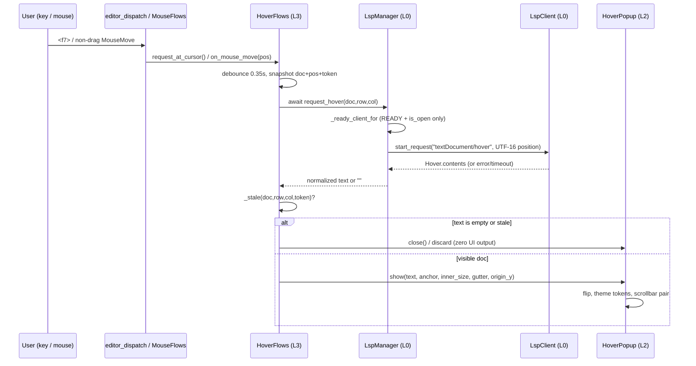

# LSP hover API docs — main plan (issue IKTPC2)

Source brief: [lsp-hover-docs-issue-brief.md](lsp-hover-docs-issue-brief.md)
Sub-plan index and wave table: [lsp-hover-docs-plans/overview.md](lsp-hover-docs-plans/overview.md)
Baseline: `master` @ `8cadbc3`; worktree `yate-lsp-hover-docs`;
branch `feature/feat-lsp-hover-docs`.

## 0. Execution-record note (step 2 / 方案)

`plan-architect-designer` was spawned twice (first with the registered role
definition, then once more with the model changed to `Hy4 preview` and
`subagent_path` pointed at the rule-mandated `.trae/agents/` definition, per
`task-orchestration.md` §一.3.5). Both attempts failed with
`Model "qwen-3.7-plus" not found`. Under `task-orchestration.md` §三 the main
agent executed this planning role itself, following
`.trae/agents/plan-architect-designer.md` as the sole script. **Sub-agent
output for step 2: zero.** Read-only code reconnaissance was delegated to
`code-explorer` and its `file:line` findings were independently re-read by the
main agent before being used here.

Unattended mode: the user explicitly waived all questions/approvals, so step 3
(批准) is recorded as approved without an interactive round, per the workspace
rule loader §一.5. No plan item was executed before this document was written.

## 1. Goals

- Send `textDocument/hover` for the symbol at the cursor, with UTF-16 position
  encoding and client capability declaration (AC1).
- One new action `show_hover_docs`, bound to **one shared key constant** used
  identically by the vsc and vim tables; no mode-specific key, no two-stroke
  chord (AC2).
- Mouse hover on a non-drag `MouseMove` triggers the same request after a short
  debounce; `support_mouse=False` disables the path entirely (AC3).
- A floating card renders normalized `Hover.contents` (MarkupContent
  markdown/plaintext, MarkedString, string arrays, mixed arrays), positions near
  the anchor with flipping, uses theme tokens, self-owns theme + scrollbar
  painting, never grabs focus, never swallows unhandled keys (AC4, R13, R15).
- **Hard silence on empty results**: `null`, `{}`, empty/whitespace text,
  empty array, no server, server not ready, request failure and timeout all
  produce zero UI output — no card, no message-bar text, no status-bar change,
  no flash. A card already visible is removed when a later result is empty
  (AC5).
- Isolation: hover never starts a server, never emits `didOpen`/`didChange`,
  never changes completion/diagnostics; stale responses (buffer switch, file
  close, cursor move, newer request) are dropped; no residual card (AC6).
- Bilingual docs synchronized, including one identical default key in both
  keymap sections of the cheat sheet (AC7).
- Full gate: pyright strict zero diagnostics, `pytest tests/ -q -n auto`,
  architecture guards, coverage `--cov-fail-under=75`, smoke (AC8).

## 2. Non-goals (verbatim scope from the issue)

No `signatureHelp`, no definition/references/rename; no changes to the
completion popup and no reuse of completion-item `documentation`/`detail` as a
card; no per-keymap default key or extra "dedicated key"; no two-stroke chord;
no source-side fallback when the server returns nothing (no guessing a
signature, no scraping a buffer docstring) and no placeholder text; no new
dependencies; no change to LSP full-sync protocol or server startup policy.

## 3. Baseline facts (re-read at `8cadbc3`, `file:line`)

| Fact | Location |
| --- | --- |
| `_initialize_params()` is the single initialize payload; `documentationFormat: []` | `yate/editor_lsp/client.py:591`, `:612-620` |
| `LspClient.request()` has no timeout; `start_request` throws immediately for FAILED/no transport | `yate/editor_lsp/client.py:394`, `:413-429` |
| `ensure_client()` **starts** a client when none exists (`create_task(_start_client)`) | `yate/editor_lsp/manager.py:300-329` |
| `request_completion()` flushes a pending `didChange` before requesting | `yate/editor_lsp/manager.py:541-618`, `:560-572` |
| `_to_utf16` / `_from_utf16` already exist and are re-exported by the manager | `yate/editor_lsp/parsing.py:43-64`, `yate/editor_lsp/manager.py:45-46` |
| `<ctrl-k>` and `<ctrl-shift-k>` both parse to `\x0b`; vsc binds it to `delete_line`; a smoke test presses `ctrl+k` for that binding | `yate/keymaps/keys.py:113-145`, `yate/keymaps/vsc.py:47`, `yate/keyproto/key_codec.py:132-138`, `tools/smoke_test/scenarios/edit.py:48-52` |
| `<f7>` = `\x1b[18~` in `SPECIAL_KEYS`; `key_codec._NAMED_KEYS` is built from it; vim `_FUNCTION_KEYS` covers f1-f12 and dispatches before mode handling | `yate/keymaps/keys.py:49`, `yate/keyproto/key_codec.py:20`, `yate/keymaps/vim.py:80`, `:252-261` |
| vsc/vim tables each hold their own bindings; `bind_key(keymap="both")` loops over both | `yate/keymaps/vsc.py:36-122`, `yate/keymaps/vim.py:145-233`, `yate/services/extensions/api.py:295-305`, `:476-500` |
| actions are synchronous callables; `ActionRegistry.execute` does not await | `yate/actions.py:26-32`, `yate/registries.py:78-84` |
| `App.on_event` is the single `support_mouse` gate; `MouseFlows._on_move` returns `False` for non-drag moves; `_forward_mouse` stops only consumed events | `yate/app.py:268-271`, `yate/flows/mouse_flows.py:43-58`, `:96-106`, `yate/editor_components/view.py:279-283` |
| `buffer_pos_from_mouse()` maps pointer to `(row, col)` | `yate/editor_components/view.py:252-267` |
| completion popup is a non-focusable `Widget` with `styles.offset = ScalarOffset.from_offset`, flips on overflow, closes on empty items | `yate/editor_components/completion.py:78-179` |
| `render_doc_lines()` is a pure Markdown-to-`Strip` renderer with a theme palette | `yate/editor_components/manual.py:146-165` |
| `apply_slim_scrollbars` / `apply_scrollbar_theme` are per-widget; `theme.attach/detach` own subscription | `yate/editor_components/scrollbars.py:94-130`, `yate/editor_components/theme/__init__.py:174-193` |
| `UI_FROZEN_FILES`, `SCROLLABLE_BASES`, `SIZE_EXEMPT_FILES`, `_LAYER_RANKS` are the guard constants | `tests/test_architecture.py:141`, `:198`, `:360`, `:436` |
| Docs: `FEATURES.md` (no `FEATURES.en.md`), `FEATURES.zh.md`, `yate/docs/lsp.{en,zh}.md`, `yate/resources/manual.{en,zh}.md` §5 / §16 / §18 | `FEATURES.md:118`, `yate/docs/lsp.en.md:11-23`, `yate/resources/manual.en.md:354`, `:1345`, `:1583` |

## 4. Key design decisions

### D1 — Resolve the default key to `<f7>` (deviation, registered)

The issue suggests `<ctrl-k>`. That is **not usable**: `parse_key("<ctrl-k>")`
and `parse_key("<ctrl-shift-k>")` both yield `\x0b`; vsc already binds `\x0b`
to `delete_line` (`vsc.py:47`), the smoke suite asserts `ctrl+k` deletes a
line, and four manual sections document `Ctrl+Shift+K` as delete-line. AC2
requires no conflict with `<ctrl-shift-k>`. Per the issue's own fallback rule
("if the implementation finds a conflict, both keymaps must switch to the same
new value and the manuals / cheat sheet must be updated"), the single default
is **`<f7>`**: absent from both tables, present in `SPECIAL_KEYS` (`keys.py:49`)
and in `key_codec._NAMED_KEYS`, and covered by vim's `_FUNCTION_KEYS` fast path
so INSERT/NORMAL/VISUAL all dispatch it identically. No two-stroke chord, no
bare motion letter, no collision with `Ctrl+Space` / `<f1>` / `<f2>` / `<f8>` /
`<f9>` / `<ctrl-shift-k>`.

The constant `HOVER_DOC_KEY: str = "<f7>"` lives in the L0 notation module
`yate/keymaps/keys.py`; vsc/vim (both L1) import it from `yate.keymaps.base`
(which already re-exports notation names). Putting it in another `keymaps/`
file would create an L1→L1 edge, forbidden by `architecture-boundaries.md` §一.

### D2 — What "declare hoverProvider / documentationFormat" means

`hoverProvider` is a **server** capability; a client must not declare it.
The client declares `textDocument.hover.contentFormat = ["markdown",
"plaintext"]` (LSP 3.17 `HoverClientCapabilities`) and, to satisfy the issue's
`documentationFormat` wording, sets
`textDocument.completion.completionItem.documentationFormat` from `[]` to the
same list. Tests assert both client-side fields. This is a spec-faithful
reading of AC1, registered here as an explicit interpretation, not a silent
design change.

### D3 — `request_hover` must not call `ensure_client`

`ensure_client()` starts a missing server (`manager.py:319-329`) and
`request_completion()` flushes `didChange` (`:560-572`), both forbidden by
AC6. Add a private `_ready_client_for(doc)` that only looks up an existing
client whose state is `ServerState.READY` and whose URI is already open, then
`async def request_hover(doc, row, col) -> str` builds
`{"textDocument": {"uri": uri}, "position": {"line": row, "character":
_to_utf16(line, col)}}`, awaits `asyncio.wait_for(future,
HOVER_TIMEOUT_S)`, settles the request in `finally`, and maps every
failure/shape error to `""`. `CancelledError` is re-raised.

### D4 — Card ownership: L2 self-contained, L3 orchestration only

`HoverPopup` (L2, `yate/editor_components/hover_popup.py`) subclasses
`VerticalScroll` so R15 applies: `on_mount` calls `apply_slim_scrollbars(self)`
+ `apply_scrollbar_theme(self)` and `theme.attach(self, self._apply_theme)`;
`on_unmount` calls `theme.detach(self)`. `can_focus = False`. Rendering uses a
`Static` updated with `rich.markdown.Markdown` (the same Markdown source as
`manual.py`), while `render_doc_lines()` is used to measure the rendered row
count for sizing. Positioning mirrors `CompletionPopup.show` (`styles.offset`,
horizontal/vertical flipping). `DEFAULT_CSS = load_tcss("hover-popup.tcss")`
with theme tokens (`$panel`, `$foreground`, `$accent`); the widget id
`#hover-docs` is passed in by the Editor (R9) and frozen in the tcss header,
following the `#statusbar` / `#which-key` precedent. `show("")` calls `close()`
— a second line of defence for AC5.

`HoverFlows` (L3, `yate/flows/hover_flows.py`, class `HoverFlows`) owns
debounce, worker spawning, result normalization via the manager, staleness
tokens and dismissal. `MouseFlows` receives a plain
`Callable[[Pos | None], None]` callback and never imports `HoverFlows`, so no
new L3→L3 import edge is created. `HoverFlows` imports `HoverPopup` (L3→L2,
allowed) and must be registered in `UI_FROZEN_FILES` (R11).

### D5 — Keyboard and mouse paths converge on one worker

`action show_hover_docs` (`actions.py` view group, synchronous) calls
`editor.hover.request_at_cursor()`. Mouse `MouseMove` calls
`editor.hover.on_mouse_move(pos)` through the injected callback after the
existing `support_mouse` gate. Both funnel into `_request(doc, row, col, token)`.
`editor_dispatch._handle_key` dismisses the card on any key but **does not
consume** it (except no exception: every key keeps its existing dispatch),
so R10 and "no swallowed keys" hold.

### D6 — Silence and staleness invariants

`_stale()` compares `session.doc is doc`, `doc.path`, `buf.row`, `buf.col`,
popup mounted state and a monotonically increasing token. An empty string or
any failure calls `popup.close()` and returns without touching `prompt`,
`message`, `status_bar` or `report`. Only `log.debug` is allowed (tracing is
explicitly exempt in the issue).

### D7 — Documentation filename deviation

AC7 names `FEATURES.en.md`, which does not exist at baseline; the English file
is `FEATURES.md`. Both `FEATURES.md` and `FEATURES.zh.md` are updated, and the
deviation is recorded.

## 5. Rejected alternatives (with reasons)

1. **Reuse `CompletionPopup` for hover** — rejected: it renders a list of
   `Completion` rows with selection/Tab/Enter semantics; mixing a Markdown
   document into it would change completion behavior (non-goal) and break
   AC6 isolation. Its positioning/empty-close pattern is reused instead.
2. **Drive the card's styles/position directly from `Editor` (L3)** — rejected:
   violates R13 (component owns theme painting) and T2 guard
   (`test_editor_does_not_paint_widget_styles`).
3. **`<ctrl-k>` / `Ctrl+K Ctrl+I` chord** — rejected: `\x0b` collides with
   `delete_line` (D1); a chord needs `Ctrl+I` which shares a code with Tab and
   the notation supports only single keys/modifier combos (`keys.py:18-22`).
4. **Start the server lazily from hover via `ensure_client`** — rejected:
   violates AC6 ("hover 不启动 server") and would emit `didOpen`.
5. **Show "No documentation" / write a message-bar hint on empty** — rejected:
   AC5 demands zero UI feedback; the existing `:diagnostics` hint is the
   documented anti-example.
6. **A new L3 `HoverFlows` method invoked directly from `MouseFlows` via a
   concrete cross-flow import** — rejected: same-layer edge; a `Callable`
   injection keeps the dependency graph strictly downward.

## 6. Architecture impact (R clauses and guards)

| Change | Clause | Guard / action |
| --- | --- | --- |
| `hover_flows.py` imports `editor_components.hover_popup`, `editor_components.view`, `editor_components.theme` | R11 | add `UI_FROZEN_FILES["flows/hover_flows.py"]` in `tests/test_architecture.py:198` |
| `HoverPopup(VerticalScroll)` | R15, R13 | `apply_slim_scrollbars` + `apply_scrollbar_theme` in the same module; `theme.attach/detach`; existing guard `test_scrollable_widgets_apply_theme_scrollbar_pair` covers it |
| new flow module | §三.8 | `*_flows.py` / `*Flows`, Editor class attribute + `None`-free type annotation, `_build_pane_stack` construction with injected collaborators, assembly-order comment |
| new widget id | R9 | `HoverPopup(id="hover-docs")` in `_build_widgets`; id frozen in `hover-popup.tcss` header; no shell CSS reference |
| key handling | R10, §五 | dispatch dismisses but does not consume; no unconditional `return True` |
| logging | R12 | module-level `tracing.get_logger(__name__)`, lazy `%` |
| style/type | `python-coding-style.md` | `from __future__ import annotations`, full annotations, `X | None`, no `Any`/`TYPE_CHECKING`/relative imports, ASCII comments |
| file size | §三.7 | every new module stays under 800 lines; no `SIZE_EXEMPT_FILES` change |
| key drift | AC2 | new guard `test_hover_key_is_shared_and_identical` in `tests/test_architecture.py` (AST + runtime) |

## 7. Data flow



## 8. Wave plan (details in the overview)

| Wave | Sub-plans (parallel) | Gate before next wave |
| --- | --- | --- |
| 1 | a (L0 parsing) ∥ b (L0 capabilities) ∥ c (L1 keymaps + drift guard) | all three targeted pytest + pyright zero |
| 2 | d (L0 manager) ∥ e (L2 popup) ∥ f (docs) | targeted pytest + docs consistency + pyright |
| 3 | g (L3 HoverFlows + unit tests) | targeted pytest + pyright |
| 4 | h (wiring: editor/compose/dispatch/mouse/actions + architecture guards + integration tests) | integration pytest + architecture 37+ guards |
| 5 | i (smoke scenario + registration) | smoke `--jobs 4` |

Full wave table, exclusive file lists, Mermaid dependency graph and per-wave
commands: [lsp-hover-docs-plans/overview.md](lsp-hover-docs-plans/overview.md).

## 9. Risks and rollback

| Risk | Mitigation | Rollback |
| --- | --- | --- |
| `<f7>` not delivered by a terminal/driver | `key_codec._NAMED_KEYS` covers it; smoke + pilot test press `f7`; if a real conflict appears, change **one** constant and re-run wave-1 c / wave-2 f | revert `HOVER_DOC_KEY`; both tables + all docs follow the constant |
| Textual `VerticalScroll` + `Static(Markdown)` sizing | measure with pure `render_doc_lines`; unit test asserts box width/height and flip; keep widget under 800 lines | swap to a hand-drawn `Widget` renderer (same public API), R15 guard then does not apply — must be re-registered explicitly |
| LSP server returns hostile shapes | `parse_hover_contents` is total (never raises), manager catches parse errors | revert parsing + manager methods; card never opens |
| MouseMove storm | single `call_later` timer cancelled on each move; no worker per event | remove callback injection from `MouseFlows` |
| Stale card after tab switch | token + doc identity + row/col + popup mounted checks; dismiss on any key | disable the feature by unregistering the action |
| Coverage drop | every new branch has a targeted test in the same wave | n/a (gate blocks) |

Rollback unit is one wave: each wave is committed separately on
`feature/feat-lsp-hover-docs`, so `git revert <wave-commit>` removes exactly
that wave's files. No `git push`, no merge, no work on `master` during the
closed loop.

## 10. Final gate (main agent, step 7)

```powershell
.venv\Scripts\python.exe -m pyright yate/ tests/ tools/ pack/
.venv\Scripts\python.exe -m pytest tests/ -q -n auto
.venv\Scripts\python.exe -m pytest tests/test_architecture.py -q
.venv\Scripts\python.exe -m pytest tests/ --cov=yate --cov-branch -n auto
.venv\Scripts\python.exe -m tools.smoke_test run --jobs 4
```

Local/partial coverage runs must add `--cov-fail-under=0`. Any timing flake
under `-n auto` is re-checked with `-n 1` and the test fixed, never recorded as
"occasional". Step outputs, real numbers and deviations are written back into
this document before the final commit.
