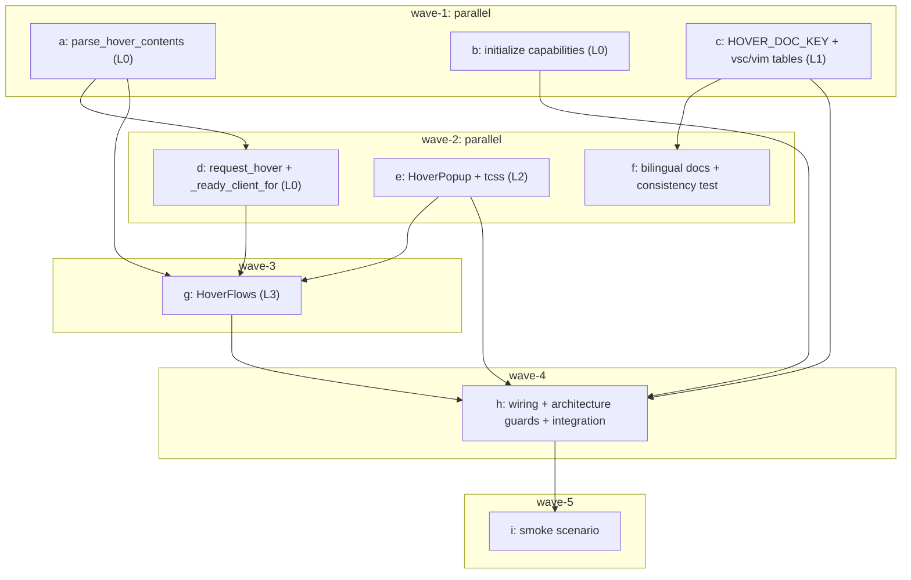

# LSP hover docs — sub-plan overview (issue IKTPC2)

Main plan: [../lsp-hover-docs-plan.md](../lsp-hover-docs-plan.md)
Issue brief: [../lsp-hover-docs-issue-brief.md](../lsp-hover-docs-issue-brief.md)
Baseline `master` @ `8cadbc3`; worktree `yate-lsp-hover-docs`;
branch `feature/feat-lsp-hover-docs`; Python 3.13.2 in the worktree's own
`.venv`.

## 1. Goals and non-goals

See main plan §1/§2. One-sentence summary: add `textDocument/hover` with a
shared `<f7>` action and a mouse-hover path, render one Markdown card, and stay
completely silent for every empty/failed result without disturbing LSP startup,
completion, diagnostics, existing keys or mouse behavior. No `signatureHelp`,
no completion-popup changes, no per-keymap key, no placeholders, no new deps.

## 2. Sub-plan index

| Plan | File | Wave | Exclusive product files | Exclusive test/doc files |
| --- | --- | --- | --- | --- |
| a | [lsp-hover-docs-parsing-plan-a.md](lsp-hover-docs-parsing-plan-a.md) | 1 | `yate/editor_lsp/parsing.py` | `tests/test_lsp_hover_parsing.py` |
| b | [lsp-hover-docs-capabilities-plan-b.md](lsp-hover-docs-capabilities-plan-b.md) | 1 | `yate/editor_lsp/client.py` | `tests/test_lsp_client_capabilities.py` |
| c | [lsp-hover-docs-keymap-plan-c.md](lsp-hover-docs-keymap-plan-c.md) | 1 | `yate/keymaps/keys.py`, `yate/keymaps/base.py`, `yate/keymaps/vsc.py`, `yate/keymaps/vim.py` | `tests/test_hover_key_binding.py` |
| d | [lsp-hover-docs-manager-plan-d.md](lsp-hover-docs-manager-plan-d.md) | 2 | `yate/editor_lsp/manager.py` | `tests/test_lsp_hover.py` |
| e | [lsp-hover-docs-popup-plan-e.md](lsp-hover-docs-popup-plan-e.md) | 2 | `yate/editor_components/hover_popup.py`, `yate/resources/hover-popup.tcss` | `tests/test_hover_popup.py` |
| f | [lsp-hover-docs-docs-plan-f.md](lsp-hover-docs-docs-plan-f.md) | 2 | `yate/docs/lsp.en.md`, `yate/docs/lsp.zh.md`, `yate/resources/manual.en.md`, `yate/resources/manual.zh.md`, `FEATURES.md`, `FEATURES.zh.md` | `tests/test_hover_docs.py` |
| g | [lsp-hover-docs-flows-plan-g.md](lsp-hover-docs-flows-plan-g.md) | 3 | `yate/flows/hover_flows.py` | `tests/test_hover_flows.py`, `tests/test_architecture.py` (R11 whitelist entry only) |
| h | [lsp-hover-docs-integration-plan-h.md](lsp-hover-docs-integration-plan-h.md) | 4 | `yate/editor.py`, `yate/editor_compose.py`, `yate/editor_dispatch.py`, `yate/flows/mouse_flows.py`, `yate/actions.py` | `tests/test_architecture.py` (new drift guard only), `tests/test_hover_integration.py`, `tests/test_app_mouse.py`, `tests/test_action_table.py`, `tests/test_editor_dispatch.py`, `tests/test_dispatch_guards.py` |
| i | [lsp-hover-docs-smoke-plan-i.md](lsp-hover-docs-smoke-plan-i.md) | 5 | `tools/smoke_test/scenarios/hover.py`, `tools/smoke_test/scenarios/__init__.py` | — |

Exclusive file lists are disjoint inside each wave. Registered deviation
(2026-11-09, before wave 3 started): `tests/test_architecture.py` is touched
**sequentially** by plan g (wave 3, `UI_FROZEN_FILES` whitelist for the new L3
flow's L2 imports, R11) and plan h (wave 4, the new key-drift guard case).
**Why:** a new `flows/hover_flows.py` importing `editor_components` fails
`test_collaborators_keep_widget_coupling_frozen` immediately, so leaving the
whitelist to wave 4 would leave the architecture gate red between two waves.
**Evidence:** baseline `tests/test_architecture.py:198` whitelist plus the R11
guard at `:830`. The two edits are in different waves, never parallel.
`tools/smoke_test/scenarios/__init__.py` is only touched by plan i. No plan
writes `.trae/` documents (the main agent owns them).

## 3. Wave table (strict; approved, no ad-hoc reordering)

| Wave | Composition | Depends on | Main-agent wave gate (exit code 0 for all) |
| --- | --- | --- | --- |
| 1 | `plan_a ∥ plan_b ∥ plan_c` | none | 3 targeted pytest files; `pyright yate/ tests/ tools/ pack/`; `pytest tests/test_architecture.py -q` |
| 2 | `plan_d ∥ plan_e ∥ plan_f` | wave 1 (a for parsing, c for key) | 3 targeted pytest files; docs consistency test; full pyright; architecture tests |
| 3 | `plan_g` | wave 2 (d manager API, e popup API) | `pytest tests/test_hover_flows.py tests/test_architecture.py -q`; full pyright |
| 4 | `plan_h` | wave 3 (g `HoverFlows` signature) | `pytest tests/test_hover_integration.py tests/test_app_mouse.py tests/test_architecture.py -q`; full pyright |
| 5 | `plan_i` | wave 4 (wiring) | `pytest tests/test_hover_docs.py -q`; `tools.smoke_test run --jobs 4`; full pyright |

Rules: 2-3 parallel sub-plans per wave (hard cap 6); a wave starts only after
**every** sub-plan in the previous wave passed its own acceptance commands and
the main agent's wave gate; wave composition may not be changed mid-execution —
a justified change must be written back here with measured evidence. Each
sub-plan is committed separately by the main agent after its wave passes
(`git-commit-message.md`, English subject, `type(scope): subject`).

## 4. Dependency graph

## 5. Global implementation constraints (every plan)

- Absolute imports only; `from __future__ import annotations` first statement
  after the module docstring; full annotations; `X | None`; PEP 695 `type`
  aliases; no new `Protocol`, `TYPE_CHECKING`, `Any`, `# type: ignore`,
  relative imports, f-strings in log calls.
- Module-level `log = tracing.get_logger(__name__)`; ASCII comments/docstrings.
- Dependency direction strictly downward: L3 `flows/` → L2 `editor_components`
  / L1 / L0; L2 → L1 / L0; L1 → L0. No `import yate.editor` / `yate.app`
  from L2. L3 flows hold no App handle; worker spawning uses the injected
  `SpawnFn` (bound to `App.run_worker` by the compose factory).
- Registry of new `editor_components` imports in `UI_FROZEN_FILES` (R11) and
  new widget id in `hover-popup.tcss` header (R9) are plan-h deliverables.
- Every new public function/class/method has a prose docstring; new modules
  stay below 800 lines (`SIZE_EXEMPT_FILES` unchanged).
- Test names `test_<behavior>_<condition>_<expected>`; arrange/act/assert;
  no real-sleep assertions — debounce constants are monkeypatched to 0 and
  assertions poll with `wait_until` (`python-coding-style.md` §4.7).
- Interpreter for every command: `.venv\Scripts\python.exe` inside
  `D:/Programming/yate-lsp-hover-docs/`. Partial coverage runs add
  `--cov-fail-under=0`.
- Empty-result paths must not call `prompt.write`, `ed.message`,
  `status_bar.refresh_status`, `report` or `log.info/warning` for user-facing
  feedback; `log.debug` only.

## 6. AC → sub-plan coverage

| AC | Covered by |
| --- | --- |
| AC1 request contract / UTF-16 | b (capabilities), d (params, position, unit tests) |
| AC2 one shared key / both keymaps / toggle / `keymap="both"` | c (constant + tables + drift test), h (runtime toggle + `bind_key` test + architecture guard), i (smoke) |
| AC3 mouse hover / debounce / `support_mouse` gate | g (debounce), h (`MouseFlows` callback + app gate), i (smoke) |
| AC4 contents variants / flip / theme / scrollbars | a (parse variants), e (card + tcss + R13/R15 tests), h (architecture guard scan) |
| AC5 zero UI on every empty shape | a (normalization), d (failure→`""`), g (silent close, prior-card removal), h (integration assertion on message/status bar) |
| AC6 isolation / stale results / no focus grab | d (no startup, no didOpen/didChange), g (tokens), e (`can_focus=False`), h (key dispatch) |
| AC7 bilingual docs | f (6 docs + consistency test), c (key constant), h (cheat-sheet value check) |
| AC8 full gate | main agent step 7 + plan i smoke |

## 7. Risks and rollback

Per-plan risks live in each sub-plan; the global risk table and wave-level
rollback are in the main plan §9. Cross-plan contract changes (function
signatures) are forbidden without writing back to this overview first.

## 8. Step-2 execution record

`plan-architect-designer` produced zero output (model unregistered twice); the
main agent executed the planning role under `task-orchestration.md` §三.
`code-explorer` delivered read-only `file:line` reconnaissance which the main
agent re-verified. Step 3 (批准) is approved under the user's unattended-mode
instruction; no execution started before these documents were written.

Step-7 write-back obligation: plan h adds one architecture guard case
(37 -> 38). The main agent must update the count and case table in
`../../rules/architecture-boundaries.md` §六 with the measured number, and
fill real before/after numbers plus deviations into
`../lsp-hover-docs-plan.md` §10 before the final commit.

**Completed 2026-11-09:** §六 count/table now says 38 with the new case
`test_hover_key_is_shared_and_identical`; real gate numbers, the two review
rounds and all ten registered deviations are in `../lsp-hover-docs-plan.md`
§10; the two review records are archived in `../../reviews/` and indexed as
#70 / #71. Final verdict after iteration: **APPROVE** (0 blocker / 0 major).
