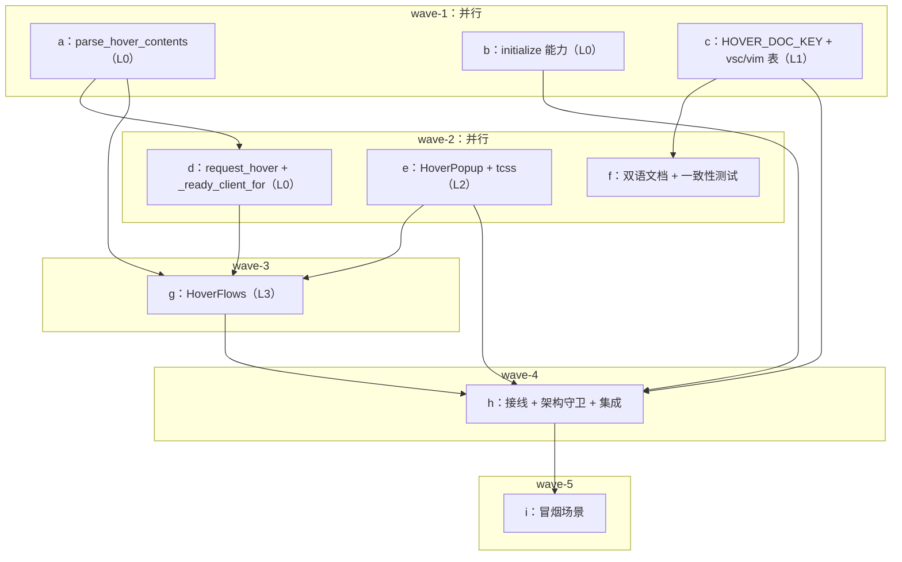

# LSP hover 文档 — 子计划总览（issue IKTPC2）

主计划：[../lsp-hover-docs-plan.md](../lsp-hover-docs-plan.md)
Issue 简报：[../lsp-hover-docs-issue-brief.md](../lsp-hover-docs-issue-brief.md)
基线 `master` @ `8cadbc3`；worktree `yate-lsp-hover-docs`；
分支 `feature/feat-lsp-hover-docs`；worktree 自带的 `.venv` 中为 Python 3.13.2。

## 1. 目标与非目标

见主计划 §1/§2。一句话概括：新增 `textDocument/hover`，配以一个共享 `<f7>` 动作和鼠标悬停路径，渲染一张 Markdown 卡片，并对每个空/失败结果保持完全静默，不干扰 LSP 启动、补全、诊断、既有按键或鼠标行为。不实现 `signatureHelp`，不改动补全弹窗，不设置按 keymap 区分的按键，不用占位符，不新增依赖。

## 2. 子计划索引

| 计划 | 文件 | 波次 | 独占产品文件 | 独占测试/文档文件 |
| --- | --- | --- | --- | --- |
| a | [lsp-hover-docs-parsing-plan-a.md](lsp-hover-docs-parsing-plan-a.md) | 1 | `yate/editor_lsp/parsing.py` | `tests/test_lsp_hover_parsing.py` |
| b | [lsp-hover-docs-capabilities-plan-b.md](lsp-hover-docs-capabilities-plan-b.md) | 1 | `yate/editor_lsp/client.py` | `tests/test_lsp_client_capabilities.py` |
| c | [lsp-hover-docs-keymap-plan-c.md](lsp-hover-docs-keymap-plan-c.md) | 1 | `yate/keymaps/keys.py`, `yate/keymaps/base.py`, `yate/keymaps/vsc.py`, `yate/keymaps/vim.py` | `tests/test_hover_key_binding.py` |
| d | [lsp-hover-docs-manager-plan-d.md](lsp-hover-docs-manager-plan-d.md) | 2 | `yate/editor_lsp/manager.py` | `tests/test_lsp_hover.py` |
| e | [lsp-hover-docs-popup-plan-e.md](lsp-hover-docs-popup-plan-e.md) | 2 | `yate/editor_components/hover_popup.py`, `yate/resources/hover-popup.tcss` | `tests/test_hover_popup.py` |
| f | [lsp-hover-docs-docs-plan-f.md](lsp-hover-docs-docs-plan-f.md) | 2 | `yate/docs/lsp.en.md`, `yate/docs/lsp.zh.md`, `yate/resources/manual.en.md`, `yate/resources/manual.zh.md`, `FEATURES.md`, `FEATURES.zh.md` | `tests/test_hover_docs.py` |
| g | [lsp-hover-docs-flows-plan-g.md](lsp-hover-docs-flows-plan-g.md) | 3 | `yate/flows/hover_flows.py` | `tests/test_hover_flows.py`, `tests/test_architecture.py`（仅 R11 白名单条目）|
| h | [lsp-hover-docs-integration-plan-h.md](lsp-hover-docs-integration-plan-h.md) | 4 | `yate/editor.py`, `yate/editor_compose.py`, `yate/editor_dispatch.py`, `yate/flows/mouse_flows.py`, `yate/actions.py` | `tests/test_architecture.py`（仅新增漂移守卫）、`tests/test_hover_integration.py`、`tests/test_app_mouse.py`、`tests/test_action_table.py`、`tests/test_editor_dispatch.py`、`tests/test_dispatch_guards.py` |
| i | [lsp-hover-docs-smoke-plan-i.md](lsp-hover-docs-smoke-plan-i.md) | 5 | `tools/smoke_test/scenarios/hover.py`、`tools/smoke_test/scenarios/__init__.py`、`tools/smoke_test/harness.py`（评审后新增：`TAGS` 增加了 `"hover"`）| — |

每个波次内的独占文件清单互不相交。已登记偏离（2026-11-09，wave 3 开始前）：`tests/test_architecture.py` 在整个过程中接受**三次顺序编辑**——wave-2 将 `yate/editor_lsp/manager.py` 加入 `SIZE_EXEMPT_FILES`（独立提交），wave-3 为新的 L3 flow 的 L2 导入加入 `UI_FROZEN_FILES` 白名单条目（plan g，R11），wave-4 加入新的按键漂移守卫用例（plan h）。**原因：** 新增的 `flows/hover_flows.py` 导入 `editor_components` 会立即让 `test_collaborators_keep_widget_coupling_frozen` 失败，因此把白名单留到 wave 4 会使架构门禁在两个波次之间变红。**证据：** 基线 `tests/test_architecture.py:198` 白名单以及 `:830` 处的 R11 守卫。三处编辑位于不同波次，严格串行，绝不并行。`tools/smoke_test/scenarios/__init__.py` 仅由 plan i 触碰。没有任何计划写入 `.trae/` 文档（由主代理拥有）。

## 3. 波次表（严格；已批准，不得临时重排）

| 波次 | 组成 | 依赖 | 主代理波次门禁（全部退出码 0） |
| --- | --- | --- | --- |
| 1 | `plan_a ∥ plan_b ∥ plan_c` | 无 | 3 个针对性 pytest 文件；`pyright yate/ tests/ tools/ pack/`；`pytest tests/test_architecture.py -q` |
| 2 | `plan_d ∥ plan_e ∥ plan_f` | wave 1（a 负责解析，c 负责按键）| 3 个针对性 pytest 文件；文档一致性测试；完整 pyright；架构测试 |
| 3 | `plan_g` | wave 2（d 的 manager API、e 的弹窗 API）| `pytest tests/test_hover_flows.py tests/test_architecture.py -q`；完整 pyright |
| 4 | `plan_h` | wave 3（g 的 `HoverFlows` 签名）| `pytest tests/test_hover_integration.py tests/test_app_mouse.py tests/test_architecture.py -q`；完整 pyright |
| 5 | `plan_i` | wave 4（接线）| `pytest tests/test_hover_docs.py -q`；`tools.smoke_test run --jobs 4`；完整 pyright |

规则：每波次 2-3 个并行子计划（硬上限 6）；只有当上一波次的**每个**子计划都通过其自身的验收命令以及主代理的波次门禁后，下一波次才能开始；波次组成不得在执行中途更改——有正当理由的更改必须附带实测证据写回此处。每个子计划在其波次通过后由主代理单独提交（`git-commit-message.md`，英文主题，`type(scope): subject`）。

## 4. 依赖图

## 5. 全局实现约束（每个计划）

- 只用绝对导入；`from __future__ import annotations` 是模块 docstring 之后的第一条语句；完整注解；`X | None`；PEP 695 `type` 别名；不新增 `Protocol`、`TYPE_CHECKING`、`Any`、`# type: ignore`、相对导入、日志调用中的 f-string。
- 模块级 `log = tracing.get_logger(__name__)`；ASCII 注释/docstring。
- 依赖方向严格向下：L3 `flows/` → L2 `editor_components` / L1 / L0；L2 → L1 / L0；L1 → L0。L2 不得 `import yate.editor` / `yate.app`。L3 flow 不持有 App 句柄；worker 派生使用注入的 `SpawnFn`（由 compose 工厂绑定到 `App.run_worker`）。
- 在 `UI_FROZEN_FILES` 中登记新的 `editor_components` 导入（R11）以及在 `hover-popup.tcss` 文件头登记新 widget id（R9）属于 plan h 的交付物。
- 每个新增的公开函数/类/方法都有散文式 docstring；新模块保持在 800 行以下（`SIZE_EXEMPT_FILES` 不变）。
- 测试名 `test_<behavior>_<condition>_<expected>`；arrange/act/assert；不用真实 sleep 断言——防抖常量被 monkeypatch 为 0，断言用 `wait_until` 轮询（`python-coding-style.md` §4.7）。
- 每条命令的解释器：worktree 根的 `.venv\Scripts\python.exe`（以仓库根为工作目录）。部分覆盖率运行添加 `--cov-fail-under=0`。
- 空结果路径不得调用 `prompt.write`、`ed.message`、`status_bar.refresh_status`、`report` 或 `log.info/warning` 来做面向用户的反馈；只允许 `log.debug`。

## 6. AC → 子计划覆盖

| AC | 覆盖方 |
| --- | --- |
| AC1 请求契约 / UTF-16 | b（能力）、d（参数、位置、单元测试）|
| AC2 单一共享按键 / 两个 keymap / 切换 / `keymap="both"` | c（常量 + 表 + 漂移测试）、h（运行时切换 + `bind_key` 测试 + 架构守卫）、i（冒烟）|
| AC3 鼠标悬停 / 防抖 / `support_mouse` 门控 | g（防抖）、h（`MouseFlows` 回调 + app 门控）、i（冒烟）|
| AC4 contents 变体 / 翻转 / 主题 / 滚动条 | a（解析变体）、e（卡片 + tcss + R13/R15 测试）、h（架构守卫扫描）|
| AC5 每种空形状都零 UI | a（规范化）、d（失败→`""`）、g（静默关闭、移除先前卡片）、h（对消息/状态栏的集成断言）|
| AC6 隔离 / 过期结果 / 不抢焦点 | d（不启动、无 didOpen/didChange）、g（令牌）、e（`can_focus=False`）、h（按键分发）|
| AC7 双语文档 | f（6 份文档 + 一致性测试）、c（按键常量）、h（速查表取值检查）|
| AC8 完整门禁 | 主代理 step 7 + plan i 冒烟 |

## 7. 风险与回滚

各计划的风险见各子计划；全局风险表与波次级回滚见主计划 §9。跨计划的契约变更（函数签名）在先写回本总览之前是被禁止的。

## 8. Step-2 执行记录

`plan-architect-designer` 零产出（model 两次未注册）；主代理依据 `task-orchestration.md` §三执行了规划角色。`code-explorer` 交付了只读 `file:line` 侦察，主代理对其进行了复核。step 3（批准）依据用户的无人值守模式指令视为已批准；这些文档撰写之前未开始任何执行。

Step-7 写回义务：plan h 新增一项架构守卫用例（37 -> 38）。主代理必须用实测数字更新 `../../rules/architecture-boundaries.md` §六中的计数与用例表，并在最终提交前将真实的前后数字与偏离填入 `../lsp-hover-docs-plan.md` §10。

**于 2026-11-09 完成：** §六的计数/表现在为 38，含新用例 `test_hover_key_is_shared_and_identical`；真实门禁数字、两轮评审与全部十项已登记偏离都在 `../lsp-hover-docs-plan.md` §10；两份评审记录已归档在 `../../reviews/` 并登记为 #70 / #71。迭代后的最终结论：**APPROVE**（0 阻塞项 / 0 严重）。
