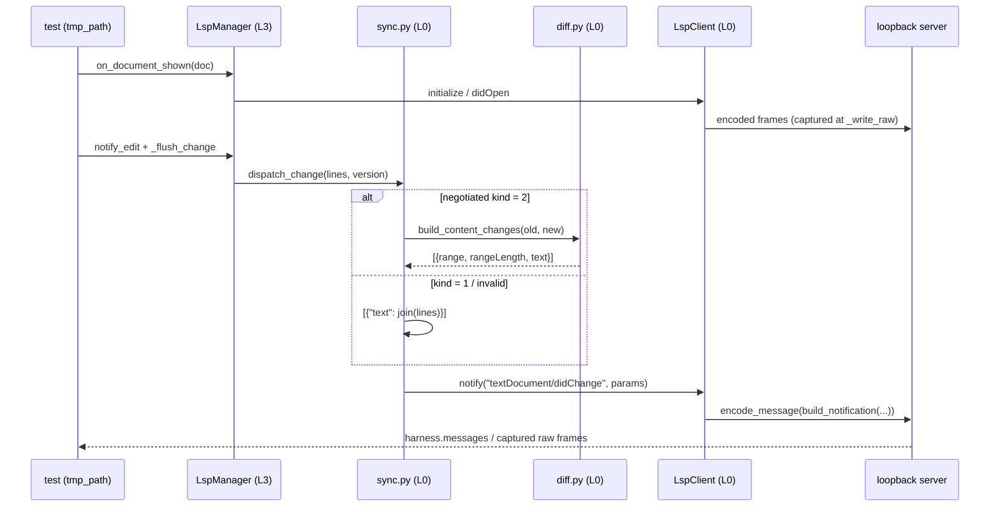
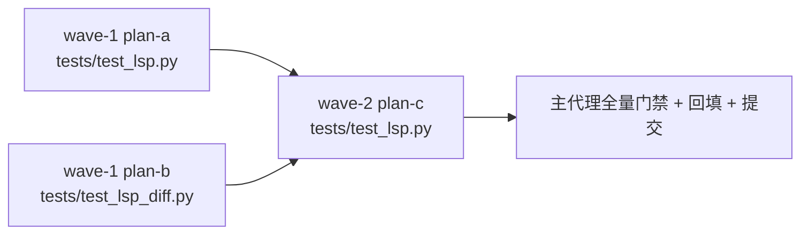

# lsp-incremental-sync-acceptance-plan（Gitee IKXQFK）

> 任务：把 IKXQFK 的「增量同步协议级验收补强」落到可复跑的测试证据：真实 didChange 线上帧捕获、大文件 payload 体积与文档长度解耦、跨行/astral 补丁逐字节重放、Full-only 回退与失败/关闭竞态回归。
> 分支：`feature/enh-lsp-incremental-sync`（parent `master`，基线 `1f0ee5a0`）；worktree：`../yate-lsp-incremental-sync`。
> 解释器：全部命令在 worktree 根目录用 `.venv\Scripts\python.exe`。
> 子计划：[`lsp-incremental-sync-acceptance-plans/overview.md`](lsp-incremental-sync-acceptance-plans/overview.md)。

## 〇、编排事实登记

- 规划角色 `plan-architect-designer` 两次 spawn 均因运行时模型 `qwen-3.8-plus` 未注册失败；按 `task-orchestration.md` §一.3 的任务书模型重试（Hy4 preview）同样被运行时按 agent 类型回退到该模型，仍失败。按 §三 兜底，**子代理零产出**，本计划由主代理亲自按规划剧本产出。
- issue 正文自带「提交前核实」：目标二、三（除大文件 payload 体积实测外）已在 master 落地。本任务据此把范围收敛为**协议级验收补强**，不重复实现同步逻辑。

## 一、目标与非目标

### 目标

1. **协议捕获**：在真实 JSON-RPC 帧层面捕获 `textDocument/didChange`，证明增量分支的 `contentChanges` 只有变更区间：`range` 坐标按 UTF-16 code unit 正确、`text` 是片段而非全文、`rangeLength` 随附。
2. **payload 体积解耦**：同一单键编辑在 200 行与 4000 行文档上产生的线上帧字节数相同且远小于全文，证明大文件按键不再 join/序列化全文。
3. **重放等价性**：在 manager/wire 层用服务器模拟器逐条应用 `contentChanges`，对含多字节、astral（U+1F600/U+1F40D）与跨行编辑的序列，终态与 Full 模式及 buffer 文本逐字节一致。
4. **回退与既有行为**：Full-only 服务器（协商 kind=1）发送全量文本；`LspError` 失败重试、didChange 与 didClose 并发、版本号推进、补全前 flush 语义全部保持。
5. **单测补口**：为 `build_content_changes` 增加直接单测，钉死 `range/rangeLength/text` 线格式与空补丁早退。
6. 全量门禁退出码 0：pyright 零诊断、`pytest -q -n auto`、架构测试、覆盖率、冒烟、changelog check。

### 非目标

- 不改 `CHANGE_DEBOUNCE_S = 0.25`（仍在 [`manager.py`](../../yate/editor_lsp/manager.py):63-64）。
- 不扩展 `TextBuffer` 公共面；不触碰消费型 `take_dirty_range`（高亮独占）与补全侧只读 `dirty_range`。
- 不安装/打包语言服务器；不改诊断、补全、hover 的既有行为。
- 不修改 `yate/` 下任何产品源码；不新增 `Protocol` / `TYPE_CHECKING`；LSP 逻辑仍全部留在 L0 `editor_lsp` 叶包。
- 不重做 IKQQNM 的实现与评审记录；既有计划 [`lsp-incremental-sync-plan.md`](lsp-incremental-sync-plan.md) 只作事实来源。

## 二、调研事实（文件:行号）

| 事实 | 证据 |
|---|---|
| 协商声明 `change=2`、解析非法值回退 Full | [`client.py`](../../yate/editor_lsp/client.py):595-643、646-663；已有守卫 `tests/test_lsp.py:1808-1848` |
| 增量/Full 双路径与成功才推进 | [`sync.py`](../../yate/editor_lsp/sync.py):62-105、128-155；Full 的 `"\n".join` 只在 `:133` |
| 行快照 diff 产出 `range/rangeLength/text` | [`diff.py`](../../yate/editor_lsp/diff.py):116-257、260-287 |
| 防抖、O(1) 闸门、补全前 flush | [`manager.py`](../../yate/editor_lsp/manager.py):534-556、558-583、623-639 |
| 线上帧由 `notify` → `build_notification` → `_write_raw` → `encode_message` 生成 | [`client.py`](../../yate/editor_lsp/client.py):443-451、462-470；[`protocol.py`](../../yate/editor_lsp/protocol.py):39-42、55-60 |
| 已有 manager 级增量补丁/重试/在途/关闭竞态用例 | [`test_lsp.py`](../../tests/test_lsp.py):2027-2045、2090-2129、2132-2237、2240-2286 |
| 已有 diff 层 astral/跨行随机差分 | [`test_lsp_diff.py`](../../tests/test_lsp_diff.py):156-159、168-191、245-293 |
| 缺口：无原始帧捕获/帧大小断言 | 生产无 hook（`client.py:449` 刻意不打 didChange 日志）；测试只在 `notify`/解码后 dict 层记录（`test_lsp.py:590`、176-215；`test_lsp_real_server.py:48-59`） |
| 缺口：Full-only 只有 FakeClient 生命周期覆盖，无 wire 级回退证据 | `test_lsp.py:775-818` |
| 缺口：`build_content_changes` 无直接单测 | `diff.py:260-287` 仅被 `sync.py:131` 间接调用 |

## 三、备选方案与否决理由

1. **【否决】接回 `take_dirty_range()` / undo `_Delta` 作为增量素材**：`take_dirty_range` 是高亮 diff 独占的消费型契约（[`buffer.py`](../../yate/editor_core/buffer.py):377），LSP 抢用会破坏高亮；`_Delta` 在 undo 栈内部，公开会扩大 `TextBuffer` 面；issue 与 IKQQNM 计划 [`lsp-incremental-sync-plan.md`](lsp-incremental-sync-plan.md) §二均已否决。本任务不碰该路径。
2. **【否决】改产品代码增加 wire logger/hook**：`client.py:449` 刻意不记录 didChange 以免逐键日志放大；新增公共 hook 会扩大 API 面并触碰 L0 叶包。测试可在 `_write_raw` 边界用 `cast(Any, ...)` 包装实例方法取得**生产真实编码帧**，零产品改动、零行为影响。
3. **【否决】只延长既有 diff 随机差分轮数**：随机差分只覆盖纯计算层，不能证明「线上帧不携带全文」「Full-only 服务器真的回退」「帧体积与文档长度解耦」这三条协议级验收。
4. **【采纳】纯测试补强 + 最小测试夹具扩展**：`ServerHarness` 增加可选 `server_capabilities` 参数（默认值完全兼容既有调用），新增帧捕获助手；其余全部为新增测试。产品源码零 diff，因此架构守卫、层秩、文件体量阈值均不受影响。

## 四、分步实施计划与验收命令

| 步骤 | 子计划 | 输入 | 独占文件 | 输出 | 验收命令 |
|---|---|---|---|---|---|
| 1a（wave-1） | [`plan-a`](lsp-incremental-sync-acceptance-plans/lsp-incremental-sync-acceptance-wire-capture-plan-a.md) | `client.py:443-470`、`protocol.py:39-60`、现有 `ServerHarness` | `tests/test_lsp.py` | 可选 capabilities 的 harness、帧捕获助手、增量/Full-only 两条 wire 级用例 | `.venv\Scripts\python.exe -m pytest tests/test_lsp.py -q -k "wire_capture or full_only" -n 1` |
| 1b（wave-1） | [`plan-b`](lsp-incremental-sync-acceptance-plans/lsp-incremental-sync-acceptance-wire-shape-plan-b.md) | `diff.py:260-287` | `tests/test_lsp_diff.py` | `build_content_changes` 直接单测 2 条 | `.venv\Scripts\python.exe -m pytest tests/test_lsp_diff.py -q -k "build_content_changes" -n 1` |
| 2（wave-2） | [`plan-c`](lsp-incremental-sync-acceptance-plans/lsp-incremental-sync-acceptance-regression-plan-c.md) | 步骤 1a 的 harness/助手；现有 `_sync_session` / `apply_changes` | `tests/test_lsp.py` | 体积解耦、astral/跨行重放、`LspError` 重试、Full 关闭竞态 4 条用例 | `.venv\Scripts\python.exe -m pytest tests/test_lsp.py -q -k "payload_is_decoupled or astral_and_cross_line or lsp_error_keeps_snapshot or full_mode_did_change_race" -n 1` |
| 3（收尾） | 主代理 | 全部改动 | 计划文档回填 | 全量门禁 + 提交 | 见 §七 |

wave-1 两子计划文件不重叠，可并行；wave-2 与 plan-a 同文件，必须等 wave-1 全部验收通过后串行执行。波次严禁临时重排，偏离须回填实测依据。

## 五、Mermaid：协议捕获与执行波次





## 六、风险与回滚

| 风险 | 处置 |
|---|---|
| `ServerHarness` 新增可选参数破坏既有调用 | 参数默认 `None`，默认 capabilities 保持 `completionProvider.triggerCharacters=[".", "["]`；wave-1 验收含既有 handshake 用例回归 |
| 包装实例 `_write_raw` 触发 pyright strict | 文件已有 `# pyright: reportPrivateUsage=false`；赋值用 `cast(Any, client)` 并加 `# noqa: Any - test seam` 注释 |
| 真实 loopback 下帧到达有延迟导致 flake | 一律用有界轮询谓词等待帧数增长，禁止固定 `sleep` 后断言；超时明确失败 |
| 4000 行文档让测试变慢 | 只构造字符串并写入一次文件；不跑高亮/渲染；单行长度固定 80 字符 |
| 捕获帧包含 initialize/didOpen | 按 `method == "textDocument/didChange"` 过滤，不假设帧序号 |
| 产品行为被误改 | 全任务 `yate/` 零 diff；收尾用 `git diff --name-only` 核验 |

回滚：每个子计划单独提交；任一步验收失败即 `git revert` 该步提交，产品行为天然保持 master 现状。

## 七、全量门禁与提交纪律

子计划验收通过后主代理亲自跑（并行口径，退出码 0 才算数）：

```powershell
.venv\Scripts\python.exe -m pyright yate/ tests/ tools/ pack/
.venv\Scripts\python.exe -m pytest tests/ -q -n auto
.venv\Scripts\python.exe -m pytest tests/test_architecture.py -q
.venv\Scripts\python.exe -m pytest tests/ --cov=yate --cov-branch -n auto
.venv\Scripts\python.exe -m tools.smoke_test run --jobs 4
.venv\Scripts\python.exe -m tools.changelog check
```

- 并行下出现时序 flake 用 `-n 1` 复核并修用例，不记成偶发。
- 每步产物单独提交（英文 conventional message），只提交不推送；收尾回填真实数字与偏离记录后再提交。
- 产物文档：本计划 + 子计划目录；不新建评审记录（本任务不是评审任务）。

## 八、验收标准对照

| issue 验收项 | 本计划对应证据 |
|---|---|
| 协议捕获：`contentChanges` 只含变更区间、range 正确、text 为片段 | plan-a `test_did_change_wire_capture_carries_only_changed_range`；plan-b `test_build_content_changes_emits_range_length_and_text` |
| 大文件单次按键编辑不再全文传输 | plan-c `test_large_file_single_key_edit_payload_is_decoupled_from_document_length` |
| 多字节/astral/跨行逐条重放与全量一致 | plan-c `test_incremental_wire_replay_matches_full_mode_for_astral_and_cross_line_edits`；既有 `test_lsp_diff.py` 随机差分 |
| Full-only / notify 失败重试 / 关闭中途飞不变 | plan-a `test_full_only_server_wire_capture_sends_whole_document`；plan-c `test_incremental_send_lsp_error_keeps_snapshot_and_retries`、`test_full_mode_did_change_race_with_did_close_sends_nothing_after_close` |
| 全量门禁退出码 0 | §七 |

## 九、偏离登记

1. issue 原题「全文同步升级为增量同步」的实现部分已在 master 完成（issue 自带核实段），本任务按建议定位为验收补强，不重复实现。
2. 规划子代理零产出（见 §〇），主代理兜底产出本计划；执行阶段仍按闭环派发 plan-executor / code-review-expert，若同样失败则如实登记并由主代理兜底。
3. 测试夹具 `ServerHarness` 为测试代码，新增可选参数不属于产品 API 变更；不触发架构边界 R 条款。
4. plan-c 原写「跨行补丁 end.line > start.line 或 rangeLength 反映换行计数」，实测为 LSP 零宽插入（`range.start == range.end`、`rangeLength == 0`、换行在 `text` 中）；实现断言正确，计划文本已按实测修正（pr-review MINOR #8）。

## 十、执行与收尾记录（2026-11-24）

### 10.1 产物与提交

| 提交 | 内容 |
|---|---|
| `b12e0598` | 本计划 + 子计划目录（规划产物） |
| `783c31c3` | plan-a：wire 帧捕获、增量/Full-only 两条线上用例 |
| `573e9846` | plan-b：`build_content_changes` 两条线格式单测 |
| `ab6a87ea` | plan-c：体积解耦 / astral+跨行重放 / `LspError` 重试 / Full 关闭竞态四条用例 |
| `64d3f306` | 自审修复两处测试健壮性问题 |
| `1f967488` | 回填首轮门禁与子代理状态 |
| `e67f5f23` | pr-review minor：删除 wire 助手冗余 `managers` 列表 |
| `c301bfc3` | 归档 pr-review 记录、索引与本计划回填 |
| `1098c28e` | 合并 `master`（`b97a695c`，`tests/test_lsp_navigation.py` +6），消除落后 1 笔 |

`git diff --name-only master...HEAD` 含本计划 5 份文档、评审记录 2 份与 `tests/test_lsp.py`、`tests/test_lsp_diff.py`、`tests/test_lsp_navigation.py`（后者来自 master 合流）；**`yate/` 零 diff**。

### 10.2 子代理状态

- 规划者：两次 spawn 均因静态模型未注册失败，按规则重试一次后由主代理兜底（§〇），**零产出**。
- 执行者：wave-1 `exec-a` / `exec-b` 与 wave-2 `exec-c` 均有落盘，主代理逐项重跑其验收命令（pytest / pyright 全部退出码 0）后才接收；三个团队均按纪律 `shutdown_request` + `team_delete` 回收。
- 评审者：合并前 pr-review 的 `pr-a` 仅回 shutdown ack、无报告（**零产出**）；`pr-b` 在团队删除后迟到交付完整报告（APPROVE / 0 blocker / 0 major / 8 minor），已逐条复核并并入 §10.3/§10.5。首轮 code-review-expert 同样零产出，均由主代理按 `.trae/skills/python-code-review/SKILL.md` 与 agent 剧本自审兜底。

### 10.3 自审发现与迭代

| 级别 | 问题 | 处置 |
|---|---|---|
| minor | 两条 wire 用例的 `finally` 用 `assert mgr is not None`，setup 失败时会掩盖原始异常 | 改为 `if mgr is not None:` 条件清理（`64d3f306`） |
| minor | 体积解耦用例的「无全文」断言用原始含换行字符串匹配 `json.dumps`，JSON 转义会令断言恒真 | 改用 80 个连续 `a` 的行片段匹配（`64d3f306`） |
| minor | pr-review：wire 助手冗余 `managers` 列表 | 删除两行（`e67f5f23`） |
| minor | pr-review：plan-b 把测试侧断言误写为 `diff.py:245-252` | 改为 `tests/test_lsp_diff.py:245-252` 并注明 diff.py 只构造 patch |
| minor | pr-review：plan-c 跨行补丁预期与实测零宽插入不符 | 按实测改写 §2.2，并在 §九第 4 条登记偏差 |
| minor（登记） | pr-review：`LspError` 与 `OSError` 重试用例近乎重复、重放脚手架重复约 60 行 | 两用例断言侧重不同，非功能缺陷；参数化/抽 helper 留作后续维护项 |
| minor（登记） | pr-review：4 笔 `test(lsp):` 不在规则允许值内但 master 已有 14 处先例 | 属规则文本滞后，不改历史提交；建议另案追加 `test` 类型 |

无 blocker / major；未发生波次重排、阈值或范围偏离。4000 行文档规模按计划保留，`>100 × frame_size` 断言成立。

### 10.4 全量门禁（主代理亲自，并行口径）

| 命令 | 实测结果（合并 `master` 后终态 `1098c28e`） | 退出码 |
|---|---|---|
| `.venv\Scripts\python.exe -m pyright yate/ tests/ tools/ pack/` | 0 errors, 0 warnings, 0 informations | 0 |
| `.venv\Scripts\python.exe -m pytest tests/ -q -n 4` | 4060 passed, 10 skipped（`-n auto` 在 `1f967488` 上亦 exit 0） | 0 |
| `.venv\Scripts\python.exe -m pytest tests/test_architecture.py -q` | 47 passed | 0 |
| `.venv\Scripts\python.exe -m pytest tests/ --cov=yate --cov-branch --cov-report=term --cov-fail-under=75 -n 4` | Total coverage 92.74%（阈值 75%）；4060 passed, 10 skipped | 0 |
| `.venv\Scripts\python.exe -m tools.smoke_test run --jobs 4` | 128/128 scenarios passed（82.06s） | 0 |
| `.venv\Scripts\python.exe -m tools.changelog check` | released sections up to date；unreleased 为发布时刷新惯例 | 0 |

`-n auto` 在本机两次被工具空闲超时取消，等价 `-n 4` 完成同一全量套件；未把工具超时记成测试失败。闭环结论：**完成**；未推送、未合入 `master`（按规则须用户显式要求后才推送）。

### 10.5 合并前 pr-review（2026-11-25）

- 记录：[`../reviews/2026-11-25-pr-review-incremental-sync-acceptance.md`](../reviews/2026-11-25-pr-review-incremental-sync-acceptance.md)；索引已登记。
- 结论：**APPROVE**，0 blocker / 0 major。`pr-a` 零产出；`pr-b` 迟到交付完整报告（8 minor），已逐条复核：3 条当轮修复（`e67f5f23` 与两份计划文档更正），5 条登记为后续维护/规则/流程项。
- 唯一合并前动作项已完成：`master` 新进 `b97a695c`，本分支曾落后 1 笔；已以 `1098c28e` 合入，三方 merge-tree 无冲突。
- 合并后终态六门禁全 exit 0（见 §10.4）：pyright 0、pytest 4060 passed/10 skipped、架构 47、覆盖率 92.74%、冒烟 128/128、changelog 0。
- 闭环结论仍为**完成**，未推送、未合入 `master`。
