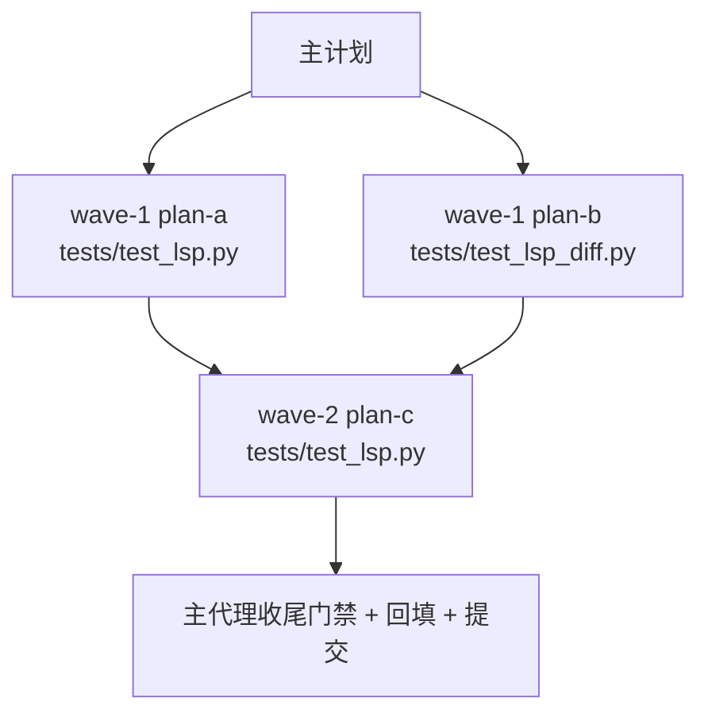

# lsp-incremental-sync-acceptance-plans（总纲）

> 主计划：[`../lsp-incremental-sync-acceptance-plan.md`](../lsp-incremental-sync-acceptance-plan.md)
> 任务：IKXQFK 增量同步协议级验收补强；产品源码零改动，全部产物在 `tests/`。

## 一、目标 / 非目标

- 目标：wire 帧捕获、payload 体积解耦、astral/跨行重放等价、Full-only 回退与失败/关闭竞态回归、`build_content_changes` 单测补口。
- 非目标：不改 `yate/`、不改防抖常量、不碰 `take_dirty_range`/`dirty_range`、不安装 LSP、不改诊断/补全/hover。

## 二、子计划索引

| 子计划 | 独占文件 | 职责 |
|---|---|---|
| [`lsp-incremental-sync-acceptance-wire-capture-plan-a.md`](lsp-incremental-sync-acceptance-wire-capture-plan-a.md) | `tests/test_lsp.py` | `ServerHarness` 可选 capabilities + `_write_raw` 帧捕获；增量/Full-only 两条 wire 级用例 |
| [`lsp-incremental-sync-acceptance-wire-shape-plan-b.md`](lsp-incremental-sync-acceptance-wire-shape-plan-b.md) | `tests/test_lsp_diff.py` | `build_content_changes` 线格式直接单测 2 条 |
| [`lsp-incremental-sync-acceptance-regression-plan-c.md`](lsp-incremental-sync-acceptance-regression-plan-c.md) | `tests/test_lsp.py` | 体积解耦 / astral+跨行重放 / `LspError` 重试 / Full 关闭竞态 4 条用例 |

## 三、执行波次

| 波次 | 内容 | 并行性 | 进入下一波条件 |
|---|---|---|---|
| wave-1 | plan-a ∥ plan-b | 文件不重叠，可并行 | 两条验收命令退出码均为 0 |
| wave-2 | plan-c | 与 plan-a 同文件，必须串行 | wave-1 全部通过 |
| 收尾 | 主代理全量门禁、文档回填、逐笔提交 | 串行 | 六道门禁全部退出码 0 |

## 四、纪律

- 独占文件清单即硬边界；子代理不得改 `yate/`，需要改产品源码先停下上报。
- 每步只跑本子计划验收命令，不做全量套件（全量门禁由主代理收尾统一执行）。
- 只认落盘结果与实测退出码；报告必须含改动清单、执行命令与结果、未解决项。
- 子代理 spawn 若因模型未注册失败，按 `task-orchestration.md` §一.3 重试一次，再失败由主代理兜底并如实登记。
