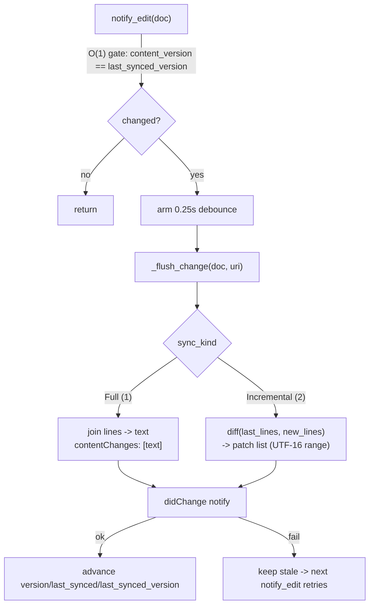
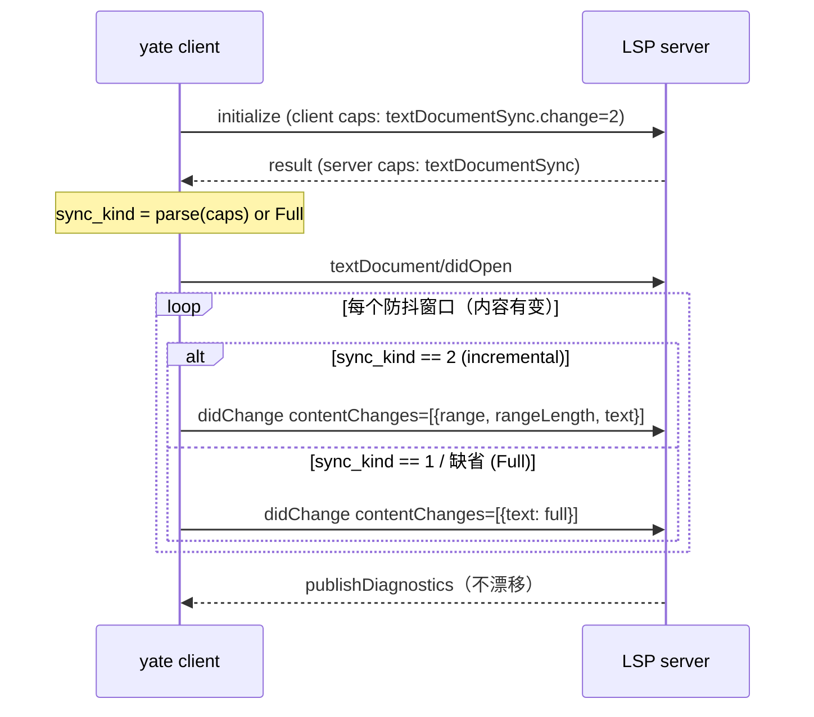

# lsp-incremental-sync-plan（Gitee IKQQNM）

> 任务：LSP didChange 改增量同步（range/rangeLength），Full 模式按服务器能力回退。
> worktree：`../yate-lsp-incremental-sync/`，分支 `enh/lsp-incremental-sync`（基线 master cdb4e0b）。
> 执行者统一用沙箱解释器 `.venv\Scripts\python.exe`，所有命令先 `Set-Location d:\Programming\yate-lsp-incremental-sync`。
> 计划来源：主代理亲自调研（plan-architect-designer 子代理两次 spawn 均因模型未注册失败、任务书指定模型重试仍失败，按 task-orchestration.md §三 兜底，**子代理零产出**，本计划为主代理按剧本产出）。

## 一、目标与非目标

### 目标

1. 客户端能力声明改 `textDocument.synchronization`：`{"didSave": True, "dynamicRegistration": False, "didChange": True}`，并以 `textDocumentSync: {"openClose": True, "change": 2, "save": True}` 顶层形态声明 incremental（change=2）。
2. 启动期按服务器 `serverCapabilities.textDocumentSync` 协商 sync kind：int 直接取值；object 取 `.change`；缺省/非法 → Full（1）。Full-only 服务器走现有全量路径，零回退风险。
3. 增量路径：防抖窗口结束时，对 `last_synced` 行快照与新行列表做行级对齐 diff，产出**有序 contentChanges 补丁**（range 为 UTF-16 code unit 坐标，用现有 `_to_utf16`），不再 join/序列化全文。
4. 同步状态从"全文 str"切换为"行快照"：`OpenDocState.last_synced: tuple[str, ...]`，双保险（`last_synced_version` O(1) gate + 内容比对）语义不变。
5. 失败重试语义不变：notify 成功后才推进 `state.version / last_synced / last_synced_version`。
6. 差分护栏：同一编辑序列下，增量补丁在"服务器模拟器"（按 LSP 规范逐条应用 contentChanges）上重放的终态文本，与全量模式发送的文本**逐字节一致**。

### 非目标

- 不实现 LSP `workspace/didChangeWatchedFiles`、`willSave/willSaveWaitUntil`。
- 不做 dynamicRegistration（声明中显式 False，维持现状）。
- 不改防抖时长（`CHANGE_DEBOUNCE_S = 0.25`）与补全/诊断路径。
- 不做跨服务器的增量语义兼容矩阵测试（以差分护栏 + pyright 真实联测为主要验收）。

## 二、备选方案与否决理由

- **【否决】issue 原方向：增量素材用 `buffer.take_dirty_range()` + 撤销 `_Delta`**：
  1. `take_dirty_range` 是**消费型单消费者契约**（`yate/editor_core/buffer.py:377`），当前消费者是高亮 diff（`yate/editor_view/highlighting.py:264` 的 `_rebuild_tokens_on_edit` 与 `:434` 的 worker 落盘丢弃）。LSP manager 抢 take 会破坏高亮 diff 的正确性（区间被消费后高亮 miss），多消费者时序耦合正是 perf-audit P2-API 明确避免的形态；
  2. `_Delta` 在 undo 栈内部（`buffer.py:62`），公开读取需要新 test-seam/公开 API，扩大 buffer 公共面；
  3. 防抖窗口内多次编辑需要区间合并逻辑，而行快照 diff 天然覆盖任意多次编辑的合成效果。
  → **采纳替代**：manager 自持行快照（`last_synced` 改 tuple[str, ...]），`_flush_change` 时与新 `buffer.lines` 做行级对齐 diff。素材是既有双保险状态本身，零新契约耦合。此偏离在 §七 显式登记。
- **【否决】last_synced 保留全文 str + 发送前 join**：增量路径的核心收益是不做 O(文档) `"\n".join` + encode + 管道写全文；若仍 join 则只省了服务器侧，客户端序列化底噪仍在（issue 问题陈述第 3 条）。
- **【否决】只发行级整行补丁不做行内精修（一步到位派 vs 精修派）**：行级补丁正确但偏大（每次编辑重发整行）；行内字符级前缀/后缀精修缩小 range，实现成本低（str 前缀/后缀公共长度 + `_to_utf16`）。**采纳：分两步落地**——步骤 2 先行级，步骤 3 行内精修，差分护栏全程保证等价。
- **【采纳】rangeLength 按 UTF-16 code unit 计数随补丁发送**：LSP 规范已将 rangeLength 标记 deprecated，服务器不依赖；但带上便于调试与部分老服务器兼容，成本低。

## 三、调研事实（文件:行号，worktree 内同 master）

- `yate/editor_lsp/manager.py:46`：`_SYNC_FULL: int = 1`（唯一 sync kind 常量）。
- `manager.py:62-81`：`OpenDocState`（uri/config_name/client_key/language_id/version/last_synced/last_synced_version/doc）。
- `manager.py:420-443`：`notify_edit` O(1) gate（`content_version == last_synced_version`）+ `get_text()` 双保险 + 0.25s 防抖。
- `manager.py:445-470`：`_flush_change` 物化全文 → `_spawn_bg(_send_change(...))`。
- `manager.py:478-503`：`_send_change` 全量 didChange（`contentChanges: [{"text": text}]`），成功后推进 state。
- `manager.py:41-42`：`_to_utf16` / `_from_utf16` 已 re-export 自 `yate.editor_lsp.parsing`。
- `yate/editor_lsp/parsing.py:43-63`：`_to_utf16(line, col)`（ASCII 快路径 + 非 BMP 双计）/ `_from_utf16`。
- `yate/editor_lsp/client.py:236-255`：initialize 结果解析点（`server_capabilities` 存 dict；`completionProvider` 解析先例）。
- `client.py:574-608`：`_initialize_params` 客户端能力声明（synchronization 仅 `didSave`/`dynamicRegistration`）。
- `yate/editor_core/buffer.py:377-396`：`take_dirty_range`（消费型）/`dirty_range`（只读 peek）契约。
- `buffer.py:62-72`：`_Delta(top, old, new)` 行区间结构（本任务**不**依赖，见否决理由）。
- `tests/test_lsp.py:173+`：`ServerHarness`（loopback TCP fake server）；`:792-794` 既有全量 didChange 断言（`"text" in changed[0]["contentChanges"][0]`）。
- 真实服务器：`pyright-langserver.exe` 在本机 PATH（`D:\Python\Python313\Scripts\`），pyright 声明 change=2（增量），联测可行。
- `py-tree-sitter`/`tree-sitter` 0.25.2 与本任务无关（属 IKQQNO worktree）。

## 四、目标设计

### 4.1 同步状态与 sync kind（client.py + manager.py）



- `client.py`：
  - `_initialize_params` 的 capabilities 顶层加 `"textDocumentSync": {"openClose": True, "change": 2, "save": True}`；`textDocument.synchronization` 保留 `didSave: True`（`save: True` 挪到 textDocumentSync 内，两处并存无害——执行时以服务器实际行为为准，联测确认后取一种，优先只留顶层 `textDocumentSync`）。
  - initialize 结果解析点（`client.py:243-254` 先例）新增 `sync_kind: int` 属性：`caps["textDocumentSync"]` 为 int → 取值（1/2）；为 dict → 取 `change`；缺省/非法 → 1（Full）。常量 `SYNC_FULL = 1` / `SYNC_INCREMENTAL = 2` 定义在 `client.py`（模块级，`manager.py` 导入），`manager._SYNC_FULL` 保留为 Full 路径内部判别或改引 client 常量（执行者二选一，保持单一事实来源）。
- `manager.py`：
  - `OpenDocState.last_synced: str` → `last_synced_lines: tuple[str, ...]`（didOpen 处 `manager.py:388-394` 存 `tuple(doc.buffer.lines)`）；`last_synced_version` 不变。
  - `notify_edit` 双保险第二段（`manager.py:432-436` 的 `get_text()` + 全文比较）改为行列表比较：`tuple(doc.buffer.lines) == state.last_synced_lines`（O(n) 行比较，不 join 不 encode）。
  - `_flush_change`：`new_lines = list(doc.buffer.lines)`（只读快照，不 join）；`new_lines == state.last_synced_lines` 早退；按 `client.sync_kind` 分支调 `_send_change_full`（现 `_send_change` 改名或保留名，内部 Full 分支）或 `_send_change_incremental`。
  - `_send_change_incremental(client, uri, state, version, new_lines, buffer_version)`：调 `yate.editor_lsp.diff.build_change_patches(state.last_synced_lines, new_lines)` 得补丁列表 → `contentChanges` 逐条 `{"range": {...}, "rangeLength": n, "text": ...}` → 成功后 `state.last_synced_lines = tuple(new_lines)`、version 推进同现状。
  - `notify_saved` 前的全量兜底发送（`manager.py:544-551`）同步走分支。
  - 关闭文档路径（didClose/drop）不涉及 last_synced 形态，仅跟随改名。

### 4.2 增量 diff 模块（新文件 `yate/editor_lsp/diff.py`，L0 包内新模块）

纯函数、无 I/O、无 Textual 依赖（editor_lsp 是 L0 叶子，禁 import 上层）：

- `build_change_patches(old_lines: Sequence[str], new_lines: Sequence[str]) -> list[ChangePatch]`
  - 行级对齐：公共前缀行数 `pre`、公共后缀行数 `suf`（不重叠），变更区间 `old[pre : len(old)-suf]` vs `new[pre : len(new)-suf]`；
  - 区间内若两侧完全相等（不可能，前缀/后缀已吞）→ 空补丁；区间数恒为 1 个连续区间（前后缀对齐保证）；
  - 行内精修：区间首行做字符前缀公共长度 `pc`、尾行做字符后缀公共长度 `sc`（满足 `pc + sc <= min(len(old_first), len(new_first))` 与尾行对应约束，且不越过中间行）→ start 列右移 `pc`、end 列左移 `sc`；
  - `ChangePatch`（`@dataclass(frozen=True)`，模块内定义，不新建 Protocol）字段：`start_row/start_col_utf16/end_row/end_col_utf16/range_length_utf16/text`（text 为替换文本）；
  - range 坐标基于 **old_lines**（旧文档）：`start = (pre + 0 行内精修行, utf16(old_first[:pc]))`，`end = (last_old_row, utf16(old_last 去掉后缀 sc))`；
  - `range_length_utf16`：被替换区段（old 坐标）的 UTF-16 code unit 总数（跨行按每行末尾 +1 计 LSP 换行约定：rangeLength 计字符不明确计换行，**执行时以差分护栏实测为准——模拟器只按 range+text 应用，rangeLength 仅随附不参与比对**）；
  - `text`：`"\n".join(new_lines 区间收缩后内容)`；
  - 全部经 `_to_utf16`（`from yate.editor_lsp.parsing import _to_utf16`，绝对导入，包内已 re-export 先例 `manager.py:41-42`）。
- 边界：全删（new_lines 空且 old 非空）→ 单补丁覆盖全文；didOpen 后首次增量（old == new？不可能，早退）；行内精修与多字节/astral：字符前缀/后缀按 Python str（code point）比较，`_to_utf16` 换算 UTF-16——差分护栏用 astral 字符用例覆盖。

### 4.3 服务器模拟器（差分护栏，tests 侧）

`tests/test_lsp_diff.py` 内实现 `apply_changes(snapshot_lines, content_changes) -> list[str]`：按 LSP 规范逐条应用（range 为 UTF-16 → code point 换算用 `_from_utf16`，替换 text 按行切分插入），UTF-16 换算在模拟器侧独立实现（不复用 diff.py 的正向逻辑，避免同源错误互证——模拟器只用 `parsing._from_utf16` 与协议语义）。

## 五、分步实施计划（波次与独占文件）

### Wave a（并行 2 成员）

**A1：client.py 能力声明与 sync kind 解析**
- 输入：本计划 §三/§4.1；独占文件：`yate/editor_lsp/client.py`、`tests/test_lsp.py`（仅新增 client 侧用例段）。
- 输出：capabilities 含 `textDocumentSync`；`LspClient.sync_kind` 按 §4.1 解析（int/object/缺省三形态单测，含非法值回退 Full）。
- 验收命令：
  ```powershell
  .venv\Scripts\python.exe -m pytest tests/test_lsp.py -q
  .venv\Scripts\python.exe -m pyright yate/editor_lsp/client.py
  ```

**A2：diff.py 纯函数 + 差分护栏**
- 输入：本计划 §4.2/§4.3；独占文件：`yate/editor_lsp/diff.py`（新建）、`tests/test_lsp_diff.py`（新建）。
- 输出：`build_change_patches` + `ChangePatch`；护栏用例：
  1. 随机差分：seed 固定，随机文档（含 astral 字符/空行/CJK）+ 随机编辑序列（插入/删除/跨行/整行替换），每步：模拟器应用增量补丁 == 全量文本，**默认 2000 组**（CI 口径），`YATE_LSP_DIFF_STRESS=1` 时 **100000 组**（收尾主代理跑一次并回填数字）；
  2. 定向用例：astral 字符（U+1F600 等）编辑点前后、行首/行尾/空行、全文删空、首行编辑；
  3. 模拟器自身：`_from_utf16` 往返恒等性。
- 验收命令：
  ```powershell
  .venv\Scripts\python.exe -m pytest tests/test_lsp_diff.py -q
  .venv\Scripts\python.exe -m pyright yate/editor_lsp/diff.py tests/test_lsp_diff.py
  ```

### Wave b（串行 1 成员，依赖 Wave a 两个 API）

**B1：manager.py 接线**
- 输入：本计划 §4.1 + A1 的 `sync_kind` API + A2 的 `build_change_patches` 签名；独占文件：`yate/editor_lsp/manager.py`、`tests/test_lsp.py`（manager 侧用例）。
- 输出：
  1. `OpenDocState.last_synced_lines` 行快照迁移（didOpen/notify_edit/_flush_change/notify_saved 全链）；
  2. `_flush_change` 按 `client.sync_kind` 分支；增量路径零 join（只有 Full 路径 join）；
  3. 失败重试语义保持（notify 成功才推进）；
  4. 测试：fake client 断言增量模式 contentChanges 含 range 且**不含全文 text**（text 等于补丁文本）；Full 模式（服务器声明 1 / 缺省）行为与既有用例全兼容；模拟服务器重放差分（同一编辑序列，增量终态 == 全量 text，管理器级）。
- 验收命令：
  ```powershell
  .venv\Scripts\python.exe -m pytest tests/test_lsp.py tests/test_lsp_diff.py -q
  .venv\Scripts\python.exe -m pyright yate/editor_lsp/manager.py
  ```

### Wave c（串行 1 成员，依赖 B1）

**C1：真实服务器联测（pyright-langserver）**
- 输入：B1 完成的增量路径；独占文件：`tests/test_lsp_real_server.py`（新建）。
- 输出：用 `ServerHarness` 同款 stdio 形态（或直接 spawn `pyright-langserver --stdio`）的 pytest 用例：initialize → 协商出 sync_kind=2 → didOpen → 多步编辑 → 断言 (a) 客户端发出的 didChange 为 range 补丁；(b) pyright 正常返回诊断（文档状态不漂移的间接证据）；(c) `server_capabilities` 协商链路真实数据。`skipif shutil.which("pyright-langserver") is None`（CI 无 pyright 时跳过，不阻塞门禁）。
- 验收命令：
  ```powershell
  .venv\Scripts\python.exe -m pytest tests/test_lsp_real_server.py -q -rs
  ```

### 收尾（主代理亲自）

全量门禁（task-orchestration.md §二.7 并行口径）+ `YATE_LSP_DIFF_STRESS=1` 差分压力轮 + 文档回填 + 提交（每步一笔，`git-commit-message.md` 格式，只提交不推送）。

## 六、风险清单与回滚路径

| 风险 | 等级 | 缓解/护栏 |
|---|---|---|
| UTF-16 坐标换算边界（astral 字符） | 中 | A2 定向用例 + 随机差分必含 astral；`_to_utf16`/`_from_utf16` 往返恒等 |
| 服务器对增量实现差异 | 中 | 协商缺省回退 Full（零风险路径）；pyright 真实联测；Full 路径保持现状不动 |
| 行内精修边界（前缀+后缀越过区间） | 中 | 精修长度约束在 diff.py 内自检（越界即回退行级补丁）；差分护栏 |
| notify 失败后状态不一致 | 低 | 现状"成功才推进"语义原样保留；失败路径既有测试覆盖 |
| Full↔增量协商在 initialize 前（时序） | 低 | didOpen 前必有 READY（现 gate 已保证）；sync_kind 在 client 上，读时 client 已 READY |
| 内存：行快照 tuple 与 buffer.lines 引用 | 低 | last_synced_lines 是独立 tuple（didOpen 时刻快照），大小同旧全文 str，无额外驻留 |

回滚：全部改动在 `enh/lsp-incremental-sync` 分支逐波提交；任一波失败 revert 其名下提交；协商回退 Full 保证最坏情况行为与 master 等价。

## 七、偏离登记

1. **增量素材不用 `take_dirty_range()` + `_Delta`**（issue 修复方向 2），改行快照 diff。理由见 §二否决第 1 条：消费型单消费者契约与高亮 diff 冲突 + undo 栈结构不宜公开 + 快照 diff 天然覆盖多编辑合帧。`_to_utf16` 复用与 issue 方向一致。
2. **rangeLength 不参与差分比对**（模拟器按 range+text 应用）：LSP 已 deprecated 该字段，服务器语义以 range 为准；字段照发便于调试。
3. 真实服务器联测选 pyright（pylsp 未安装，探测无果）；pyright 声明增量，满足"至少一个真实增量服务器"验收。

## 八、Mermaid：协商与回退


