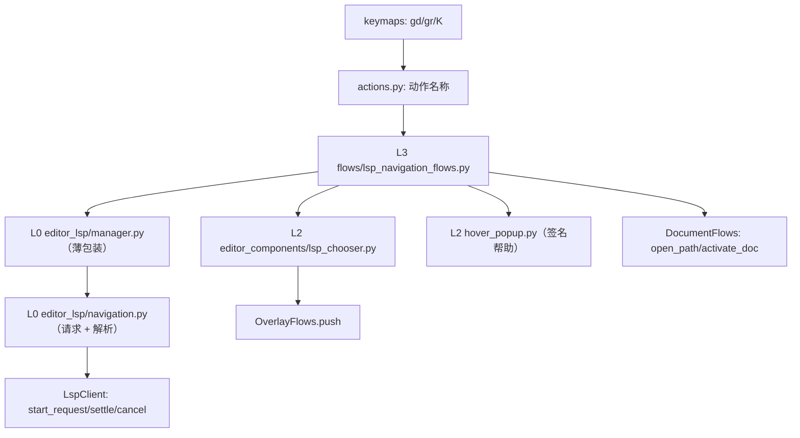

# LSP 导航与交互实现计划（IKX5EP）

来源简报：[lsp-navigation-issue-brief.md](lsp-navigation-issue-brief.md)。
Worktree：`<repo-parent>/yate-lsp-navigation`（相对于主检出目录）；
分支 `feature/enh-lsp-navigation`；父分支 `master` 位于 `c6d6e89a`
（与 `origin/master` 同步）。

## 1. 目标与非目标

目标：按价值顺序实现 P0-P6，并满足 issue 中的验收标准 AC1-AC8：
`gd` 定义跳转（跨文件，LocationLink）、`K` hover（保留 `<f7>`）、文档
符号/大纲、带可导航列表的 `gr` 引用、通过 workspaceEdit 重命名、
代码操作、签名帮助；全部异步，并具备显式的能力降级。

非目标：安装/打包语言服务器、tree-sitter/regex 导航后端、多根工作区搜索、
重命名预览面板、代码操作按键自定义、丰富的签名模板、LSP 连接/增量同步重写。

## 2. 代码调研中的关键事实（证据）

- `yate/editor_lsp/client.py:211,249-255`：来自 `initialize` 的服务器能力仅存在于
  `LspClient.server_capabilities` 中；没有 manager 层的 provider 检查。
- `client.py:417-441,453-460,512-556`：`start_request` / `send_cancel` /
  `settle_request` 已支持异步请求生命周期；`request_hover`
  （`manager.py:656-704`）是被动请求的模板。
- `manager.py:893` 行（SIZE_EXEMPT_FILES）；`_ready_client_for`（`:259-284`）、
  `_uri`（`:881-889`）、`handle_notification`（`:718-749`）是共享的接缝点。
- `protocol.py:137-185`：`uri_to_path` 已解码 `%3A`；真正的不匹配在于 pyright 回显的是
  经过驱动器转义的 URI，而 manager 以原始的 `params["uri"]` 作为诊断键
  （`tests/test_lsp_real_server.py:182-184`）。
- `keymaps/keys.py:57-86`：共享的 L0 按键常量；`parse_key("<shift-k>")`
  归一化为 `K`（`keys.py:124-183`）。Vim 普通模式的 `g` 前缀解析
  位于 `vim.py:861-916`，扩展绑定回退位于 `vim.py:1095-1097`。
- `tests/test_architecture.py:1666-1701`：共享按键的精确 AST+运行时守卫模式；
  `:199-260` `UI_FROZEN_FILES`；`:391-399` 行数表。
- `editor_components/marks_palette.py:59-119`：可复用的浮层选择器模式；
  `hover_popup.py:72-79` 是现有的 hover 卡片 API。
- `actions.py:267-268`：动作注册；`editor_compose.py:250-257,304-311`
  是流程注入点。

## 3. 设计决策与被否决的备选方案

- **新增 L0 `editor_lsp/navigation.py` 承载所有新请求/解析逻辑**，而非继续扩充
  `manager.py`：manager 保持为薄委派层；navigation 辅助函数是针对 `LspClient`、
  uri 和位置的纯函数，无需 UI 即可测试。被否决的方案：把 6 个请求方法连同解析器
  直接加入 `manager.py`，会使这个已被豁免的 893 行模块超过 1000 行，并把协议解析
  与状态编排混在一起。
- **在边界处规范化 URI**（`protocol.canonical_uri`）：通过 `uri_to_path` + `path_to_uri`
  规范化所有传入/传出的 URI。被否决的方案：只修补 diagnostics 或只修补 definition，
  会在其他地方留下同样的不匹配。
- **Vim 和弦键 `gd`/`gr`；vsc 单键 `<alt-g>` / `<alt-r>`**；这四个键加上
  `<shift-k>` 都是 `keymaps/keys.py` 中的共享常量。被否决的方案：用 F12 做定义跳转
  （已绑定到宏回放，`keys.py:66`）以及在 vsc 中使用多键和弦（keymap 表只处理单个原始按键）。
- **一个通用的 L2 选择器界面**（`editor_components/lsp_chooser.py`），用于
  多定义 / 引用 / 大纲 / 代码操作，由纯数据行 + 回调驱动。被否决的方案：四个定制界面
  会重复 R13/R15 的接线。
- **签名帮助复用 `HoverPopup`**，使用格式化的 markdown。被否决的方案：新增一个弹窗控件
  会徒增第二套 id/主题/滚动条界面，没有任何收益。
- **在 L3 流程中应用 WorkspaceEdit**，配合预校验和缓冲区快照以便回滚。被否决的方案：
  在 L0 应用会违反分层；跳过回滚会破坏 AC5。

## 4. 子计划与波次

| 波次 | 子计划 | 文件（独占） | 依赖 |
|---|---|---|---|
| 1 | [a：LSP 请求层](lsp-navigation-plans/lsp-navigation-request-layer-plan-a.md) | `editor_lsp/navigation.py`（新增）、`editor_lsp/protocol.py`、`editor_lsp/manager.py`、`tests/test_lsp_navigation.py`（新增） | — |
| 1 | [b：按键与动作](lsp-navigation-plans/lsp-navigation-keys-plan-b.md) | `keymaps/keys.py`、`keymaps/vim.py`、`keymaps/vsc.py`、`actions.py`、`tests/test_lsp_navigation_keys.py`（新增） | — |
| 2 | [c：选择器组件](lsp-navigation-plans/lsp-navigation-chooser-plan-c.md) | `editor_components/lsp_chooser.py`（新增）、`tests/test_lsp_chooser.py`（新增） | a？否；b？否 |
| 3 | [d：流程与接线](lsp-navigation-plans/lsp-navigation-flow-plan-d.md) | `flows/lsp_navigation_flows.py`（新增）、`editor_compose.py`、`editor.py`、`tests/test_lsp_navigation_flows.py`（新增） | a, b, c |
| 4 | [e：守卫、文档、冒烟、真实服务器 AC](lsp-navigation-plans/lsp-navigation-guards-docs-plan-e.md) | `tests/test_architecture.py`、`.trae/rules/architecture-boundaries.md`、`docs/lsp.{zh,en}.md`、`resources/manual.{zh,en}.md`、`tools/smoke_test/scenarios/lsp_navigation.py`（新增）、`scenarios/__init__.py`、`tests/test_lsp_real_server.py` | a-d |

波次 1 并行运行 a ∥ b（文件互不重叠）；波次 2 单独运行 c；波次 3 单独运行 d；
波次 4 单独运行 e。各波次串行：每个波次的验收命令都必须以 0 退出，下一个波次
才能开始。除非在本文件中记录有实测原因，否则禁止调整波次顺序。

## 5. 风险与回滚

- **能力语义**：`renameProvider` / `codeActionProvider` 可能是对象，而非布尔值。
  `supports_feature` 必须把 `False`/`None`/缺失视为不可用，其余视为可用；
  反向测试覆盖每种形态。
- **过期结果 / 文档身份**：每个流程 worker 在派生前都会快照 token + 文档路径
  + 光标，遵循 `HoverFlows._stale`（`hover_flows.py:190`）。
- **WorkspaceEdit 失败**：先预校验所有目标文件，为每个缓冲区做快照，自底向上应用编辑；
  发生异常时恢复快照。绝不自动写入磁盘；未打开的目标会作为新缓冲区打开。
- **文件大小守卫**：编辑 `keymaps/vim.py`、`editor.py` 和 `editor_lsp/manager.py`
  会改变实测的 `splitlines()` 计数；计划 e 会测量并在两处同步
  `.trae/rules/architecture-boundaries.md` §三.7 表格和
  `tests/test_architecture.py::SIZE_EXEMPT_LINE_COUNTS`。
- **回滚**：每个波次是 feature 分支上的一笔或多笔提交；若验收失败则回退该波次的提交
  并重新设计。在评审和门禁通过之前，不强制推送、不合并到 master。

## 6. 批准与门禁

用户在 2026-11-22 的指令使本次会话进入无提问的无人值守模式；因此计划批准步骤
自动通过（在此记录），所有评审和门禁要求保持不变。最终门禁由主代理运行：pyright、
`pytest -n auto`、架构测试、覆盖率 >= 75、冒烟 `--jobs 4`，以及一项有文档记录的
真实 pyright 双文件导航检查。
