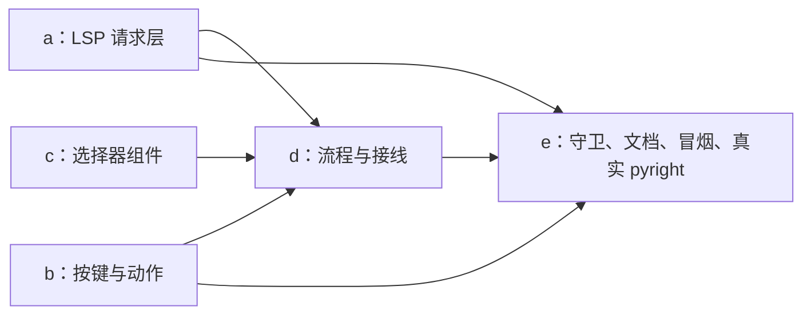

# LSP 导航子计划总览

父计划：[../lsp-navigation-plan.md](../lsp-navigation-plan.md)。
来源：[../lsp-navigation-issue-brief.md](../lsp-navigation-issue-brief.md)。

## 子计划

| 文件 | 范围 | 波次 | 独占文件 |
|---|---|---|---|
| [a：请求层](lsp-navigation-request-layer-plan-a.md) | URI 规范化、新 LSP 请求包装、能力门控 | 1 | `yate/editor_lsp/navigation.py`（新增）、`protocol.py`、`manager.py`、`tests/test_lsp_navigation.py`（新增） |
| [b：按键与动作](lsp-navigation-keys-plan-b.md) | 共享按键常量、vim `gd`/`gr`、vsc alt 键、`K`、动作注册 | 1 | `yate/keymaps/keys.py`、`vim.py`、`vsc.py`、`yate/actions.py`、`tests/test_lsp_navigation_keys.py`（新增） |
| [c：选择器](lsp-navigation-chooser-plan-c.md) | 用于定义/引用/大纲/代码操作的通用 L2 选择器浮层 | 2 | `yate/editor_components/lsp_chooser.py`（新增）、`tests/test_lsp_chooser.py`（新增） |
| [d：流程与接线](lsp-navigation-flow-plan-d.md) | L3 流程、异步/过期处理、跳转、重命名事务、签名弹窗、编辑器接线 | 3 | `yate/flows/lsp_navigation_flows.py`（新增）、`yate/editor_compose.py`、`yate/editor.py`、`tests/test_lsp_navigation_flows.py`（新增） |
| [e：守卫、文档、冒烟](lsp-navigation-guards-docs-plan-e.md) | 架构守卫与行数同步、双语文档/手册、冒烟与真实 pyright AC | 4 | `tests/test_architecture.py`、`.trae/rules/architecture-boundaries.md`、`yate/docs/lsp.{zh,en}.md`、`yate/resources/manual.{zh,en}.md`、`tools/smoke_test/scenarios/lsp_navigation.py`（新增）、`tools/smoke_test/scenarios/__init__.py`、`tests/test_lsp_real_server.py` |

## 波次表

```text
wave-1: plan_a ∥ plan_b     (file-disjoint)
wave-2: plan_c              (depends on no wave-1 file; waits anyway for a clean baseline)
wave-3: plan_d              (depends on a, b, c)
wave-4: plan_e              (depends on a, b, c, d; final line counts measured here)
```

每个波次都必须通过自身的验收命令（退出 0），下一个波次才能开始。
最终的全量门禁由主代理在波次 4 之后运行。

## 依赖图



## 关键跨波次契约

- 动作名（波次 b）必须恰好是：`goto_definition`、`find_references`、
  `show_outline`、`rename_symbol`、`show_code_actions`、`show_signature_help`，
  再加上供 `K` 使用的现有 `show_hover_docs`。
- LSP manager 方法名（波次 a）必须恰好是：`supports_feature`、
  `request_definition`、`request_references`、`request_document_symbols`、
  `request_rename`、`request_code_actions`、`request_signature_help`、
  `execute_command`。
- 选择器行类型（波次 c）：`LspRow(label, detail, uri, row, col, end_row,
  end_col, kind)`；回调接收选中的 `LspRow`。
- 流程方法名（波次 d）必须与上述动作名一致。
- 波次 e 测量 `keymaps/vim.py`、`editor.py`、`editor_lsp/manager.py` 的最终行数，
  并在规则表和守卫中同步它们。
