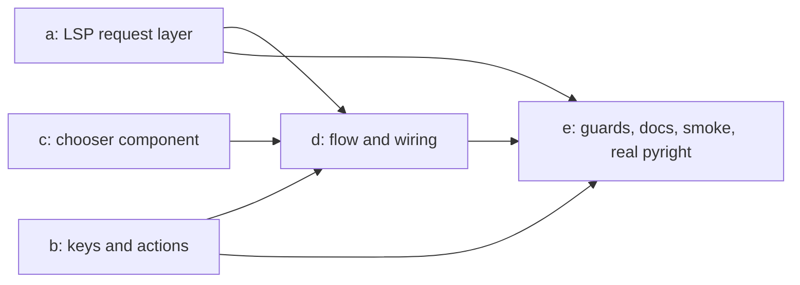

# LSP navigation sub-plans overview

Parent plan: [../lsp-navigation-plan.md](../lsp-navigation-plan.md).
Source: [../lsp-navigation-issue-brief.md](../lsp-navigation-issue-brief.md).

## Sub-plans

| File | Scope | Wave | Exclusive files |
|---|---|---|---|
| [a: request layer](lsp-navigation-request-layer-plan-a.md) | URI canonicalization, new LSP request wrappers, capability gating | 1 | `yate/editor_lsp/navigation.py` (new), `protocol.py`, `manager.py`, `tests/test_lsp_navigation.py` (new) |
| [b: keys and actions](lsp-navigation-keys-plan-b.md) | shared key constants, vim `gd`/`gr`, vsc alt keys, `K`, action registrations | 1 | `yate/keymaps/keys.py`, `vim.py`, `vsc.py`, `yate/actions.py`, `tests/test_lsp_navigation_keys.py` (new) |
| [c: chooser](lsp-navigation-chooser-plan-c.md) | generic L2 chooser overlay for definitions/references/outline/code actions | 2 | `yate/editor_components/lsp_chooser.py` (new), `tests/test_lsp_chooser.py` (new) |
| [d: flow and wiring](lsp-navigation-flow-plan-d.md) | L3 flow, async/staleness, jump, rename transaction, signature popup, editor wiring | 3 | `yate/flows/lsp_navigation_flows.py` (new), `yate/editor_compose.py`, `yate/editor.py`, `tests/test_lsp_navigation_flows.py` (new) |
| [e: guards, docs, smoke](lsp-navigation-guards-docs-plan-e.md) | architecture guard and line-count sync, bilingual docs/manual, smoke and real pyright AC | 4 | `tests/test_architecture.py`, `.trae/rules/architecture-boundaries.md`, `yate/docs/lsp.{zh,en}.md`, `yate/resources/manual.{zh,en}.md`, `tools/smoke_test/scenarios/lsp_navigation.py` (new), `tools/smoke_test/scenarios/__init__.py`, `tests/test_lsp_real_server.py` |

## Wave table

```text
wave-1: plan_a ∥ plan_b     (file-disjoint)
wave-2: plan_c              (depends on no wave-1 file; waits anyway for a clean baseline)
wave-3: plan_d              (depends on a, b, c)
wave-4: plan_e              (depends on a, b, c, d; final line counts measured here)
```

Each wave must pass its own acceptance commands (exit 0) before the next wave
starts. Final full gates are run by the main agent after wave 4.

## Dependency graph



## Key cross-wave contracts

- Action names (wave b) must be exactly: `goto_definition`, `find_references`,
  `show_outline`, `rename_symbol`, `show_code_actions`, `show_signature_help`,
  plus existing `show_hover_docs` for `K`.
- LSP manager method names (wave a) must be exactly: `supports_feature`,
  `request_definition`, `request_references`, `request_document_symbols`,
  `request_rename`, `request_code_actions`, `request_signature_help`,
  `execute_command`.
- Chooser row type (wave c): `LspRow(label, detail, uri, row, col, end_row,
  end_col, kind)`; callback receives the selected `LspRow`.
- Flow method names (wave d) must match the action names above.
- Wave e measures final line counts for `keymaps/vim.py`, `editor.py`,
  `editor_lsp/manager.py` and syncs them in both the rule table and the guard.
