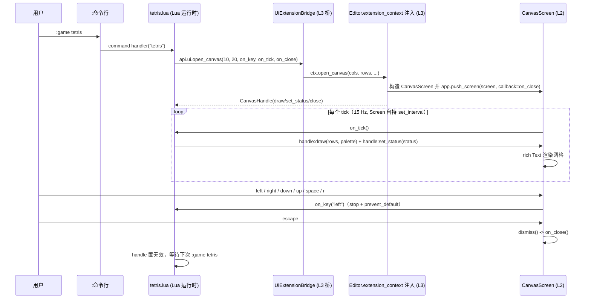

# lua-tetris-game 方案：Lua 俄罗斯方块扩展 + `:game tetris`

> 任务：使用 lua 扩展脚本实现一个俄罗斯方块小游戏，作为内置扩展随随身包发布，
> 并添加 `:game tetris` 命令启动。
> 状态：待批准（无人值守时段按任务编排 §二.5 bypass 处理）。
> 执行环境：worktree `../yate-lua-tetris-game`（分支 `feat/lua-tetris-game`，沙箱 venv 已重建并自证）。

## 一、目标与非目标

### 目标

1. 新增内置 Lua 扩展 `yate/extensions/tetris.lua`：完整俄罗斯方块
   （10x20 棋盘、7 种方块、Bag-7 随机、旋转 + 踢墙、软降/硬降、消行计分、
   等级加速、Game Over 重开），**游戏逻辑全部在 Lua 侧实现**。
2. 新增通用画布能力，让 Lua 扩展能弹出全屏界面并接收按键 / 定时驱动：
   `yate.ui.open_canvas(cols, rows, on_key, on_tick, on_close) -> handle`，
   `handle:draw(rows, palette)` / `handle:set_status(text)` / `handle:close()`。
3. `tetris.lua` 注册 `:` 命令 `game`：`:game tetris` 启动；空参数给 usage 提示；
   未知游戏名报错提示；重复启动给已运行提示；扩展 teardown 时关闭活动画布。
4. 随身包发布零配置达成：`yate/extensions/` 整目录已经
   `pack/_common.py` Tree 进 bundle，lupa 经 `[lua]` extra 随包（`pack/pack.ps1`
   安装 `.[build,ts,lua]` 已就位）；新增 `.lua` 文件即随包。
5. 双语手册（`yate/docs/extensions.en.md` / `extensions.zh.md`）同步更新
   内置扩展清单与 open_canvas API 文档。

### 非目标

- 不做音效、存档、排行榜；不做联机。
- 不新增 Python 侧通用游戏框架（画布保持最小通用面：网格绘制 + 状态行）。
- 不改 `pack/` 构建脚本与 `pyproject.toml`（依赖与 Tree 均已就位，见 §四核查）。
- 不给其它游戏占位实现（`:game` 仅 tetris 一个子命令，可扩展点留 Lua 侧表结构）。

## 二、备选方案与否决理由

### 选型：游戏画面渲染路径

| 路线 | 描述 | 结论 |
|---|---|---|
| **A（采纳）** | Lua 持有全部游戏状态与规则；Python 侧新增 L2 通用 `CanvasScreen`（ModalScreen，网格渲染 + tick 时钟 + 按键转发）与 L3 桥注入（`UiExtensionBridge.open_canvas`，回调注入，桥零 widget 依赖） | 逻辑归 Lua（符合任务本体），渲染归 L2（组件自持，R13），桥只持 `Callable`（R4 不 import widget），不动门面 14 名冻结（`EXTENSION_FACADE_NAMES` 不变） |
| B（否决） | 游戏全部用 Python 写（如 `editor_view/tetris.py`），Lua 只注册 `:game` 薄命令 | 否决：违背任务本体「使用 lua 扩展脚本实现」——游戏规则/状态不落在 Lua，扩展只是名义入口 |
| C（否决） | 复用屏保精灵管道（`api.sprites` + `ScreensaverScreen`）做游戏 | 否决：屏保是"轮询 + 触发"的只读展示屏（任意按键即退出，R10 语义是 dismiss），无按键交互与 tick 回调通道；改造成本高于新画布且污染屏保职责 |
| D（否决） | 扩展 API 暴露裸 `ui.push_screen(Screen)` | 否决：Screen 实例无法从 Lua 构造（Lua 拿不到 Textual 类），且把任意 UI 能力开给扩展违反最小面原则；回调式画布面窄且可回滚（A13 语义可扩展） |

### 次级决策

- **tick 时钟归 Screen 自持**（`set_interval(1/TICKS_PER_SECOND)`，屏保同款模式，
  见 `yate/editor_view/screensaver.py:147`）；tick 频率固定 15 Hz，加速由 Lua 侧
  计数实现（`gravity_every = max(2, 15 - level)` tick），画布不感知游戏规则。
- **按键语义**：画布为模态游戏屏，`on_key` 一律 `stop() + prevent_default()`
  并转发 Textual 键名（`left` / `right` / `down` / `up` / `space` / `r` ...）给 Lua；
  `escape` 由画布自身消费并 `dismiss()`（= 退出游戏）。消费语义与屏保先例一致
  （`screensaver.py:328-334`），且画布是模态屏，不与 R10 的编辑器内
  "fall-through" 场景冲突（R10 管的是编辑器视图内的二次派发）。
- **`:game` 子命令解析归 Lua**：命令注册本来就是 Lua 侧能力
  （`yate.register_command`），Python 侧零改动。
- **关闭回调挂 push callback**：`open_canvas` 注入实现里以
  `app.push_screen(screen, callback=on_close)` 接关闭事件（屏自身 `dismiss()`
  与外部 pop 两条路径都覆盖），画布 `escape` 只 `dismiss()`，不直接调 `on_close`。
- **关闭后防泄漏**：editor 侧闭包在关闭回调后置 `closed` 标志，`draw` /
  `set_status` / `close` 再调用一律静默忽略（Lua 侧 tick 与屏幕生命周期竞态防护）。

## 三、交互总览



## 四、现状核查清单（方案依据，均已实测取证）

| # | 事实 | 证据 |
|---|---|---|
| 1 | Lua 运行时为 lupa，每扩展独立 `LuaRuntime(unpack_returned_tuples=True)`，缺 lupa 时 loader 跳过并提示 `pip install yate[lua]` | `yate/services/extensions/lua/runtime.py:85-86`、`yate/services/extensions/loader.py:169-173` |
| 2 | `yate.register_command(name, fn, desc?)` 注册 `:` 命令，自动进命令面板与 `:help` | `yate/extensions/_yate.lua:99-109` |
| 3 | `api.ui` 目前只有状态栏 segment（`add_segment` / `remove_segment` / `segments`），桥"never touches widgets itself" | `yate/services/extensions/bridges.py:382-466` |
| 4 | `ExtensionContext` 是具体服务包 dataclass，由 `Editor.extension_context()` 构造，回调一律 lambda/绑定方法注入 | `yate/services/extensions/api.py:59-89`、`yate/editor.py:402-428` |
| 5 | 屏保先例：`ModalScreen` + `set_interval` tick + `on_key` 全消费 + `self.dismiss()` 自关 | `yate/editor_view/screensaver.py:85-149, 328-334` |
| 6 | 组件样式为打包 tcss 资源经 `yate.paths.load_tcss` 装载 | `yate/editor_view/screensaver.py:101` |
| 7 | `yate/extensions/` 整目录 Tree 进 bundle（除 `__pycache__`），lupa 经 `_LUA_PACKAGES` 收集 | `pack/_common.py:71, 179-183` |
| 8 | 随身包构建安装 `.[build,ts,lua]`；`pyproject.toml` `lua = ["lupa>=2.0"]` | `pack/pack.ps1:96`、`pyproject.toml:59` |
| 9 | `_yate.lua` 与 `_yate.d.lua` 签名镜像由 `tests/test_lua_defs.py` 强制同步 | `yate/extensions/_yate.lua:58-62` |
| 10 | 门面 14 名冻结由架构测试守卫；`tests/**` 直测内部机件不在拦截面 | `tests/test_architecture.py`（R14 两条用例） |
| 11 | 下划线前缀文件不被自动加载；bundled 扩展启动期自动装载 | `yate/services/extensions/loader.py:84, 211-299` |
| 12 | 手册 L49-58 手工列内置扩展清单（双语镜像同构） | `yate/docs/extensions.en.md:49-58` |

## 五、分步实施计划

### Step 1：L3 桥层（Python，回调注入，零 widget 依赖）

- **输入**：本方案 §三、§四。
- **改动文件**：
  - `yate/services/extensions/bridges.py`（+~95 行）：
    - 新增 `CanvasHandle` 类（持有注入的 `draw` / `set_status` / `close` 三个
      `Callable`，纯转发）；
    - 新增 PEP 695 类型别名 `type CanvasOpener = Callable[[int, int, Callable[[str], None], Callable[[], None], Callable[[], None]], CanvasHandle]`；
    - `UiExtensionBridge.__init__` 增加第二参数 `open_canvas: CanvasOpener | None = None`
      （默认 `None` = headless：`open_canvas` 调用抛 `RuntimeError`，测试与无 App
      构造路径不受影响）；新增 `open_canvas(cols, rows, on_key, on_tick, on_close)`
      方法转发。
  - `yate/services/extensions/api.py`（+~8 行）：`UiExtensionBridge(self._record_undo, ctx.open_canvas)`。
  - `yate/services/extensions/api.py` `ExtensionContext`（+~6 行）：末尾追加字段
    `open_canvas: CanvasOpener = <default: raise RuntimeError("no UI host")>`
    （dataclass 尾部带默认值字段，既有测试构造不破坏）。
  - `yate/editor.py`（+~45 行）：`extension_context()` 传入
    `open_canvas=self._open_canvas`；新增私有方法 `_open_canvas(cols, rows, on_key,
    on_tick, on_close)`：构造 L2 `CanvasScreen`，`self.app.push_screen(screen,
    callback=on_close)`，返回 `CanvasHandle`（draw/set_status/close 闭包带
    `closed` 标志防关闭后调用）。import `CanvasScreen` / `CanvasHandle`
    （L3→L2 向下、L3→门面公共名，均合法）。
- **输出**：桥层可用，headless 安全。
- **验收命令**（worktree 内）：
  - `.venv\Scripts\python.exe -m pyright yate/`
  - `.venv\Scripts\python.exe -m pytest tests/test_extensions.py tests/test_extension_api.py tests/test_extension_bridges.py tests/test_architecture.py -q`

### Step 2：L2 画布组件

- **输入**：Step 1 的注入契约；屏保先例（`screensaver.py`）。
- **改动文件**：
  - `yate/editor_view/canvas_screen.py`（新文件，~200 行）：
    `CanvasScreen(ModalScreen[None])`，构造参数 `(cols, rows, on_key, on_tick,
    on_close)`；`DEFAULT_CSS = load_tcss("canvas.tcss")`；`on_mount` 里
    `set_interval(1 / TICKS_PER_SECOND, ...)`（`TICKS_PER_SECOND = 15`）与首次
    绘制；公开方法 `draw(rows: Sequence[str], palette: Mapping[str, str]) -> None`
    （按字符取 palette 颜色构建 `rich.text.Text`，空格格保持默认色）、
    `set_status(text: str) -> None`；`on_key` 全消费并转发（`escape` →
    `self.dismiss()`）；尺寸不足时居中裁剪/留白。日志走
    `tracing.get_logger(__name__)`（R12），注释全英文。
  - `yate/resources/canvas.tcss`（新文件，~30 行）：网格容器与状态行样式，
    颜色用主题 CSS 变量（R13 组件自持主题）。
- **输出**：可独立测试的模态画布。
- **验收命令**：
  - `.venv\Scripts\python.exe -m pyright yate/`
  - `.venv\Scripts\python.exe -m pytest tests/test_canvas_screen.py -q`（新增，
    见 Step 5）
  - `.venv\Scripts\python.exe -m pytest tests/test_architecture.py -q`

### Step 3：Lua 层（API 库 + 游戏本体）

- **输入**：Step 1/2 的桥契约；`_yate.lua` 既有风格。
- **改动文件**：
  - `yate/extensions/_yate.lua`（+~45 行）：`yate.ui.open_canvas(cols, rows,
    on_key, on_tick, on_close)` 薄包装（参数校验 + 透传 `api.ui.open_canvas`）；
    顶部导出清单补两行。注释全英文（`--`）。
  - `yate/extensions/_yate.d.lua`（+~35 行）：签名镜像（`---@param` /
    `---@return`），保持 `tests/test_lua_defs.py` 同步。
  - `yate/extensions/tetris.lua`（新文件，~340 行，module-table 风格
    `return { setup = ..., teardown = ... }`）：
    - 棋盘 `W=10, H=20`；Bag-7 随机；7 种方块以旋转态坐标表定义；
    - 旋转尝试踢墙偏移 `{0, -1, +1, -2, +2}`；
    - 重力：tick 计数，`gravity_every = math.max(2, 15 - level)`；
    - 消行计分 `100/300/500/800 * level`，`level = 1 + lines // 10`；
    - 按键：`left`/`right` 移动、`down` 软降、`up`/`x` 旋转、`space` 硬降、
      `p` 暂停、`r` 重开（Game Over 与暂停态）；
    - 渲染：棋盘行字符串 + palette（`I` 青 `#00e5ff`、`O` 黄 `#ffd54f`、
      `T` 紫 `#ba68c8`、`S` 绿 `#81c784`、`Z` 红 `#e57373`、`J` 蓝 `#64b5f6`、
      `L` 橙 `#ffb74d`），`set_status("score 1234  lines 12  level 3  next: T")`；
    - Game Over：棋盘上覆盖文字 + `r` 提示；
    - `yate.register_command("game", handler, "launch a game (tetris)")`：
      空参 → usage 消息；`tetris` → 开画布（已开则提示）；
      未知 → `unknown game: <name> (available: tetris)`；
    - `teardown` 关闭活动画布。
- **输出**：`:game tetris` 端到端可玩。
- **验收命令**：
  - `.venv\Scripts\python.exe -m pytest tests/test_lua_defs.py tests/test_lua_tetris.py -q`（后者新增）
  - `.venv\Scripts\python.exe -m pyright yate/`

### Step 4：文档与手册

- **输入**：Step 1-3 定稿的 API 面。
- **改动文件**：`yate/docs/extensions.en.md`（内置清单 + `ui.open_canvas`
  章节，~+60 行）；`yate/docs/extensions.zh.md`（镜像，~+60 行）。
  双语同时新增同时更新（doc-conventions §三硬约束）。
- **输出**：手册与实现一致。
- **验收命令**：
  - `.venv\Scripts\python.exe -m pytest tests/test_extension_examples.py tests/test_lua_defs.py -q`
  - `.venv\Scripts\python.exe -m pytest tests/ -q`（全量回归）

### Step 5：测试补齐

- **输入**：Step 1-4 产物。
- **改动文件**：
  - `tests/test_canvas_screen.py`（新，~150 行）：Textual pilot 驱动——
    `draw` 渲染色与字符、`on_key` 转发且全消费（编辑器不收键）、`escape`
    关闭并触发 `on_close`、`set_interval` 驱动 `on_tick`、尺寸裁剪。
  - `tests/test_lua_tetris.py`（新，~200 行）：lupa 运行时装载捆绑
    `tetris.lua`（fake api 记录注册），断言：`game` 命令已注册；空参/未知名
    走 `message`；驱动 tick 完成下落/着底/消行计分/等级/游戏终局/重开；
    按键映射（移动/旋转/软降/硬降）；teardown 关闭画布。
  - `tests/test_extension_bridges.py`（追加，~40 行）：headless 默认
    `open_canvas` 抛 `RuntimeError`；注入后 `CanvasHandle` 转发参数。
- **验收命令**：`.venv\Scripts\python.exe -m pytest tests/ -q`

### 波次

- 波次 a：Step 1 与 Step 2（文件不重叠，可并行）。
- 波次 b：Step 3 + Step 5（依赖 a 的契约定稿）。
- 波次 c：Step 4（依赖 b 的 API 面定稿）。
- 收尾：审核（code-review-expert）→ 全量门禁 → 回填 → 提交。

## 六、风险清单与回滚路径

| 风险 | 缓解 |
|---|---|
| lupa `LuaTable` 对 `Mapping[str, str]` palette 的鸭子类型兼容性 | Step 1 落地时先跑 5 行探针验证（`lupa.LuaTable` 支持 items/索引）；不兼容则桥内改收 `Iterable[tuple[str, str]]` 并由 `_yate.lua` 转换，契约不变 |
| Textual 键名跨驱动差异（Windows 驱动） | 只用单键与方向键名（`left/right/down/up/space/r/p/x/escape`），pilot 测试 + 真机冒烟双验 |
| 模态屏按键焦点（Static 不可聚焦时键是否到达 Screen） | 屏保同构先例已验证 Screen 级 `on_key` 可达；Step 2 测试用 pilot 实测断言 |
| 扩展 teardown 时画布仍开（A13 不覆盖运行态 UI） | `tetris.lua` teardown 显式 `handle:close()`；editor 闭包 `closed` 标志防竞态 |
| 覆盖率门禁 `--cov-fail-under=75` | Step 5 对 canvas_screen 与 tetris.lua 的 Python 面充分覆盖；Lua 逻辑经 lupa 驱动测试计入 `services/extensions/lua` 行 |
| 单文件体量 | 预估全部 < 800 行（tetris.lua ~340、canvas_screen.py ~200），无豁免需求 |

回滚路径：全部改动集中在 5 个新文件 + 4 个既有文件的小幅接线（bridges /
api / editor / 手册 ×2 / _yate ×2），`git revert` 分支级回滚即可，无数据迁移
与配置变更。门禁全红时的最小回滚单元：删除 `tetris.lua` + `_yate*` 增量，
画布桥退化为 headless 异常路径（不可达）。

## 七、验收门禁（收尾由主代理亲自跑）

```powershell
.venv\Scripts\python.exe -m pyright yate/ tests/
.venv\Scripts\python.exe -m pytest tests/ -q
.venv\Scripts\python.exe -m pytest tests/test_architecture.py -q
.venv\Scripts\python.exe -m pytest tests/ -q --cov=yate --cov-fail-under=75
```

外加随身包冒烟口径核对：`pack/_common.py` Tree 无需改动，`yate/extensions/tetris.lua`
出现在 bundle 清单（构建期核对或以 Tree 规则 + 测试文件存在性为准）。

## 八、执行记录（回填区）

### 偏离记录

1. **`open_canvas` 契约改为"裸回调三元组 + 桥内包装"**（2026-10-19，执行波次 a）：
   原 Step 1 设计 editor 直接构造并返回 `CanvasHandle`，但 `CanvasHandle` 不是
   门面 14 名冻结成员，`editor.py` 直引 `yate.services.extensions.bridges` 子模块
   会被 `test_extension_machinery_hides_behind_facade` 拦截（实测 exit 1）。
   改为：`ExtensionContext.open_canvas` 返回 `(draw, set_status, close)` 裸回调
   三元组（`type CanvasControls`），`UiExtensionBridge.open_canvas` 包装成
   `CanvasHandle`。效果：零冻结名单改动，editor 只 import 门面公共名（R14 合规，
   架构测试转绿 101 passed）。实测依据：`.venv\Scripts\python.exe -m pyright yate/`
   → 0 errors；`pytest tests/test_architecture.py tests/test_extension_bridges.py
   tests/test_extension_api.py tests/test_extensions.py -q` → 101 passed。
2. **`draw` 网格契约改为单个换行拼接字符串**（2026-10-19，lupa 探针实证）：
   `list(LuaTable)` 迭代出的是**键**（`[1, 2, 3]`），`t[:2]` 静默返回 `None`，
   `isinstance(LuaTable, Mapping)` 为 `False` 但 `.items()` 可用 —— Lua 表不能
   直接当 `Sequence[str]` 跨界。改为 `handle:draw(grid, palette)`，`grid` 是
   整幅画布换行拼接的单个字符串（Lua 侧 `table.concat(rows, "\n")`）；
   palette 在 `CanvasScreen.draw` 边界用 `dict(palette.items())` 规范化。
   探针脚本已按 misc-rules §二 验证后删除。
3. **Step 1/2 实现细节**：CanvasScreen 回调字段命名 `_key_sink` / `_tick_sink` /
   `_close_sink`（`_on_*` 与 Textual 消息处理器命名约定冲突，pyright 实测报错）；
   `on_mount` 不加 `@override`（与 `screensaver.py` 先例一致）。

### 步骤结果

- [x] Step 1+2（波次 a，plan-executor 执行 + 主代理契约微调）：
  pyright 0 errors；架构/桥层 4 文件 101 passed exit 0；提交 `f007e84` / `7a67b79`。
- [ ] Step 3 结果（命令退出码、pyright/pytest 数字）
- [ ] Step 4 结果
- [ ] Step 5 结果
- [ ] 审核（code-review-expert）结论
- [ ] 全量门禁数字（前后对比）
