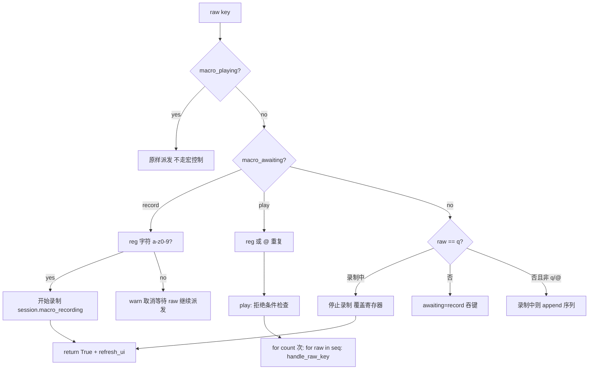

# 宏录制与回放 —— 主计划（issue IKUOAM，2026-11-11）

> 【历史产物 · 方案已排除】本组文档记录 2026-11-11 第一轮宏录制回放方案
> （`<f6>` 单前缀 chord：`r` 录制 / `p` 回放 / `@` 重复），其实现**未并入**现行代码。
> 现行实现是 2026-11-12 第二轮方案（`<f10>` / `<f11>` / `<f12>` 三单键，
> 见 `macro-record-replay-unified-progress.md`），键位、API 与命令契约以产品源码为准。
> 本文出现的 `MACRO_PREFIX_KEY`、`pre_dispatch`、`macro_awaiting`、`<f6>` 等符号
> 在现行代码中不存在，**不得**作为开发或施工依据。
> 2026-11-12 合并 `replay` 分支时仅为保留历史轨迹收录本组文档，代码未采纳。

> 来源：Gitee issue IKUOAM（正文已落盘 `macro-record-replay-issue.md`，AC1–AC8）；
> 兼为 IKUCKM P0 第一条（宏录制与回放）。子计划总纲：
> `macro-record-replay-plans/overview.md`（含 API 契约与互斥矩阵，子计划唯一
> 依赖来源）。规则：`.trae/rules/` 8 份必读本会话已全文加载；子代理模型按
> 记忆口径 2026-11-11..15 全角色 Hy4；worktree `yate-macro-record-replay`
> / 分支 `feature/feat-macro-record-replay`（parent `master` `18e96d2a`），
> 独立 `.venv` 已建并自证生效。
> 【方案】由主代理按 `plan-architect-designer` 剧本亲自产出：该角色在本机
> 运行时 `qwen-3.7-plus` 与改派 `Hy4 preview` 前轮均已 spawn 失败（见
> pack-dist-zip 进度文档失败记录），同环境不再重试，按
> `task-orchestration.md` §三 兜底并如实标注「子代理零产出」。
> 无人值守【批准】按通过处理（用户常设指令「所有问题无须过问」），登记于
> 本文件 §11；本文引用仓库文件相对路径以 `.trae/documents/` 为基准。

## 1. 目标与非目标

**目标**：按 issue 全部功能需求实现宏能力——`q{reg}`/`@{reg}`/`@@` 按键语义
与 `:macro-*` 命令等价入口，vim/vsc 两套 keymap 共用同一键弦常量与动作名
（守卫用例锁定）；宏状态归 L1 `session.py`；录制挂点在 L3 派发层 raw 键弦
一侧，回放复用同一派发路径（R10 不破坏）；录制态 statusbar 指示（R13 pull）；
which-key 等待提示；AC1–AC8 全过；评审迭代至 0 blocker / 0 major，全量门禁
全绿，文档与记忆回填。

**非目标**：寄存器持久化（跨会话保存）；回放合并为单步 undo（v1 跟随自然
undo 粒度）；vsc 侧数字 count 状态机（count 前缀仅 vim，vsc 用 `:` 命令
指定次数）；嵌套宏展开（回放中 `@`/`q` 按普通键派发）；marks/jump list
（IKUCKM 另一条目）；LSP / 远端调试器（IKJLFW 另案）。

## 2. AC 对照裁定表

| AC | 裁定 | 落点 |
| --- | --- | --- |
| AC1 录制→停止→回放一致 | 实现 | `pre_dispatch` 记录 + `play` 逐 raw 重派发；pilot e2e 断言 buffer |
| AC2 count 回放 / 重复上次 | 实现 | vim count 前缀经 `take_pending_count()`（基类默认 1、vim 覆写）；`@@` 等待态收 `@` 回放 `macro_last_register`；`:macro-play {reg} [count]` |
| AC3 双表同键弦同动作 + 守卫 | 实现 | `keys.py` 加 `MACRO_RECORD_KEY` / `MACRO_PLAY_KEY` 单常量；两表 `build_bindings()` 仅引常量；`tests/test_macro_key_binding.py` 复刻 hover 守卫（AST + 运行时 + 冲突扫描） |
| AC4 回放中再回放被拒 | 实现 | `session.macro_playing` 旗标；`play` 入口与 `pre_dispatch` 双重拒绝 + warn，无死循环 |
| AC5 录制态指示 / 空 reg warn | 实现 | statusbar `refresh_status` 直读 session（pull，R13）；空寄存器回放 warn |
| AC6 同名覆盖 / 未录制不干扰 | 实现 | 录制完成覆盖 `macro_registers[reg]`；回放缺 reg 仅 warn |
| AC7 `:` 命令一致 + 报错 | 实现 | `commands.py` 三个命令；非法 reg / 参数报 `error:` message |
| AC8 pyright 0 + pytest 全绿 | 门禁 | 收尾主代理亲跑七项 |

## 3. 关键备选与否决理由

| 决策 | 选中 | 否决 |
| --- | --- | --- |
| 宏控制状态机（q/@ 前缀等待）位置 | L3 `flows/macro_flows.py`（`pre_dispatch` 纯逻辑，状态在 session） | keymap 基类内实现：L1 基类需要回放回调（L3 `handle_raw_key`），方向违规；vim/vsc 各自实现：两套漂移，违背 AC3 |
| 录制记录点 | `_handle_raw_key` 顶部 `pre_dispatch`（raw 规范化后、keymap 派发前全量记录） | keymap 层记录：两表各写一份；`EditorView.on_key` 记 Textual event：携带 Textual 依赖且绕开 raw 规范化 |
| 回放执行 | 注入 `ed.handle_raw_key` 回调，逐 raw 循环 | 直接调 `execute_action`：丢 chord/count/未映射键语义，违背「录制什么重放什么」 |
| vsc count | 无数字前缀，`:` 命令给 count | 给 vsc 建 count 状态机：大改纯表派发模型，v1 范围外 |
| 键弦选择 | `<f6>` 单前缀 chord（`r` record / `p` play / `@` repeat last）——两表空闲、不吞 vsc 文本输入、AC3 两表同键弦同动作；issue 明文授权「具体键弦在方案文档定稿」 | `q`/`@` 可打印前缀：vsc 无模式编辑器里是文本字符（存量守卫 `test_colon_is_inserted_literally` 锁定），绑定即破坏输入；f10+ 有终端吞键风险 |
| awaiting 状态归属 | `session.macro_awaiting`（L1） | MacroFlows 实例属性：which-key 流程模块需直读，放 session 免新依赖 |

## 4. 总体设计

- **状态（L1 `session.py`）**：`macro_registers: dict[str, list[str]]`、
  `macro_recording: tuple[str, list[str]] | None`、`macro_playing: bool`、
  `macro_last_register: str | None`、`macro_awaiting: str | None`
  （`"record"` / `"play"` / `None`）。
- **键弦（L0 `keymaps/keys.py`）**：`MACRO_RECORD_KEY = "q"`、
  `MACRO_PLAY_KEY = "@"`；vim/vsc `build_bindings()` 各引一次（动作名
  `macro_record_prefix` / `macro_play_prefix`，注册于 `actions.py`，仅设
  awaiting，真正语义在 `pre_dispatch`）。
- **逻辑（L3 `flows/macro_flows.py`）**：`MacroFlows` 构造注入
  `EditorSession`、`handle_raw_key` 回调、`message` 回调；`pre_dispatch(raw)
  -> bool`（True = 已消费，派发层 stop + `refresh_ui`）；`play` /
  `repeat_last` / `toggle_record`；回放循环逐 raw 调 `handle_raw_key`
  （每次 handled 自动 `refresh_ui`，dispatch 契约不变）。
- **接线（L3）**：`editor_compose.py` 工厂构造 `MacroFlows`；
  `editor.py` 声明类属性（接入清单 §三.8）；`editor_dispatch._handle_raw_key`
  顶部调用 `pre_dispatch`。
- **指示与提示（L2/L3）**：statusbar `refresh_status` 直读 session 显示
  `rec @a`；`whichkey_flows.refresh()` 优先级链在 ctrl+w 之后插 awaiting
  提示分支。
- **count**：`Keymap.take_pending_count()` 基类默认 1，vim 以 `count_str`
  覆写（读后清零）；`pre_dispatch` 触发回放时取 count；vsc 恒 1，
  `:macro-play {reg} [count]` 补齐。

## 5. 波次与文件互斥矩阵

| wave | 子计划 | 独占文件 |
| --- | --- | --- |
| 1 | a 宏状态与核心逻辑 | `yate/session.py`、`yate/flows/macro_flows.py`（新）、`tests/test_macro_flows.py`（新） |
| 1 | b 键弦常量与双表绑定 | `yate/keymaps/keys.py`、`yate/keymaps/base.py`、`yate/keymaps/vim.py`、`yate/keymaps/vsc.py`、`tests/test_macro_key_binding.py`（新） |
| 1 | c 派发接线与组装 | `yate/editor_dispatch.py`、`yate/editor_compose.py`、`yate/editor.py` |
| 2 | d 指示 / 提示 / 命令 | `yate/editor_components/statusbar.py`、`yate/flows/whichkey_flows.py`、`yate/actions.py`、`yate/commands.py`、`tests/test_macro_commands.py`（新） |
| 3 | e 端到端与全量验收 | `tests/test_macro_app.py`（新）+ 主代理七项门禁 |
| 4 | 【审核】+【收尾】 | 评审记录、回填、提交、记忆 |

wave-1 三执行者按 overview §二 API 契约并行（文件互斥）；wave-2 依赖
wave-1 全绿；wave-3 依赖 wave-2；wave-4 收尾。产品源码文件
（`yate/**`）按 `subagent-workflow.md` §一.3 **一律主代理亲改**，
plan-executor 仅承担 `tests/` 新文件——执行时如子代理不可用，主代理按
剧本兜底并如实登记。

## 6. API 契约（波内并行唯一规范来源）

见 `macro-record-replay-plans/overview.md` §二（签名逐条定死，波内执行者
不得偏离；偏离须回填总纲 §六并附实测依据）。

## 7. 风险与回滚

| 风险 | 缓解 | 回滚 |
| --- | --- | --- |
| `q` / `@` 与既有键占用冲突 | b 波开工前冲突扫描探针（RESERVED_KEYS / motions / 两表现有绑定）；守卫用例含冲突断言 | 换键弦并同步常量与文档（issue 允许方案定稿） |
| 回放递归 / 死循环 | `macro_playing` 旗标双检查（入口 + pre_dispatch）；回放循环内宏控制键按普通键派发 | 移除回放入口（守卫用例先行锁定拒绝语义） |
| vim count 状态污染（`3@a` 后 count 残留） | `take_pending_count()` 读后清零（`_take_count` 先例） | 单测断言回放后 count 归零 |
| 录制键 / reg 字符泄入序列 | pre_dispatch 分支顺序（awaiting → 控制键 → 记录）；单测逐态断言序列内容 | 按失败用例修正分支序 |
| R10 二次派发 / 吞键回归 | pre_dispatch 返回 False 必须继续原链路；fallback 键（awaiting 取消）fall-through；pilot e2e 覆盖未映射键 | dispatch 接线独立成 wave-1c，可单独 revert |
| 架构守卫（UI_FREE / R11 / print / ASCII） | session 无 UI 导入；flows 不 import editor_components（无需登记）；日志惰性 %；注释英文 | 按守卫诊断修正 |
| 全角/中文输入进入录制序列 | raw 键弦层只见规范化字符串，原样记录原样重放（v1 不做 IME 过滤，issue 未要求） | 不适用（登记范围外） |

回滚总路径：改动集中在 10 个产品文件 + 4 个新测试文件；各波独立提交，
`git revert` 对应波次提交即可；键弦常量单点（`keys.py`），换键成本 O(1)。

## 8. 验收总口径

- 波内验收命令见各子计划；全绿才进下一波。
- 全量七项门禁（主代理收尾亲跑，并行口径）：`pyright yate/ tests/ tools/ pack/`、
  `pytest tests/ -q -n auto`、`pytest tests/test_architecture.py -q`（38+1 宏守卫=39）、
  `pytest tests/ --cov=yate --cov-branch -n auto`（`--cov-fail-under=75`）、
  `tools.smoke_test run --jobs 4`、`tools.changelog check`、
  `git diff --check master...HEAD` + `git diff --check`。
- AC8 附加：`pytest tests/test_macro_flows.py tests/test_macro_key_binding.py
  tests/test_macro_commands.py tests/test_macro_app.py -q` 全绿。
- 并行时序 flake 用 `-n 1` 复核并修用例，不得记「偶发」。

## 9. 文档同步（wave-3 一并）

- 双语手册：`yate/docs/` 键位/命令文档按既有键位文档形态补宏节
  （执行时按 doc-conventions 双语同步硬约束）。
- `CHANGELOG.md` 由生成器管理（`tools.changelog`），不手编。
- which-key pinned sheet 与 `chord_hints` 提示随绑定自动更新，不需手登记。

## 10. 剩余 open issue 处置登记（本会话范围裁定）

- IKTRDV：另一并行会话已在 `feature/feat-pack-dist-zip` 完成 fix-all 轮
  wave-1/2 并提交 `44bd6c0e`，issue 已从 open 列表消失（已关闭）；本会话
  在该 worktree 的 wave-1/wave-2 提交（`1472c10b` / `f9a0cd4d`）已被其
  登记为并发事实。为避免同 worktree 双写冲突，本会话不再介入其收尾。
- IKU55P：已实现（`feature/enh-which-key-auto-trigger` APPROVE），待用户
  显式合并，无代码工作。
- IKJLFW（DAP）/ IKQ509（音乐扩展包）：均为大型功能（远端有
  `origin/feature/feat-dap-support` 计划分支可作 IKJLFW 输入），单会话
  不宜与宏功能并行开线；登记为下一会话候选，不做半成品。
- IKUCKM：路线图条目随对应功能逐条闭环（宏 = IKUOAM 本计划）。

## 11. 批准结论（无人值守）

- 用户常设指令「所有问题无须过问」→ `plan-before-execute.md` §二.3 /
  `task-orchestration.md` §二.3 的批准按通过处理，不冒充用户答复；
  批准范围 = 本计划 + 总纲 §二契约 + 5 个子计划；执行中任何阈值 / 范围 /
  选型偏离须当轮回填总纲 §六并附实测依据，波次表不得执行中临时重排。
