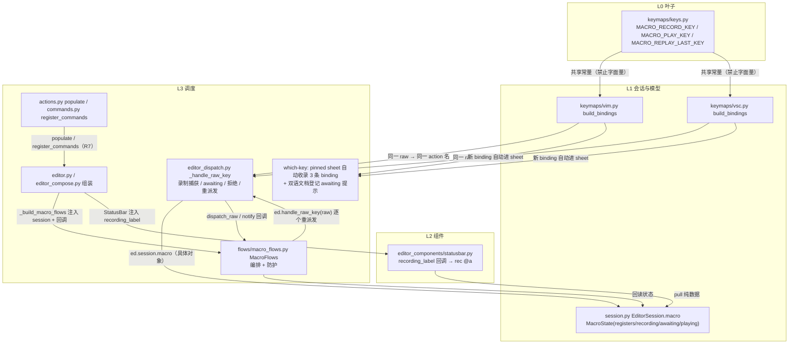
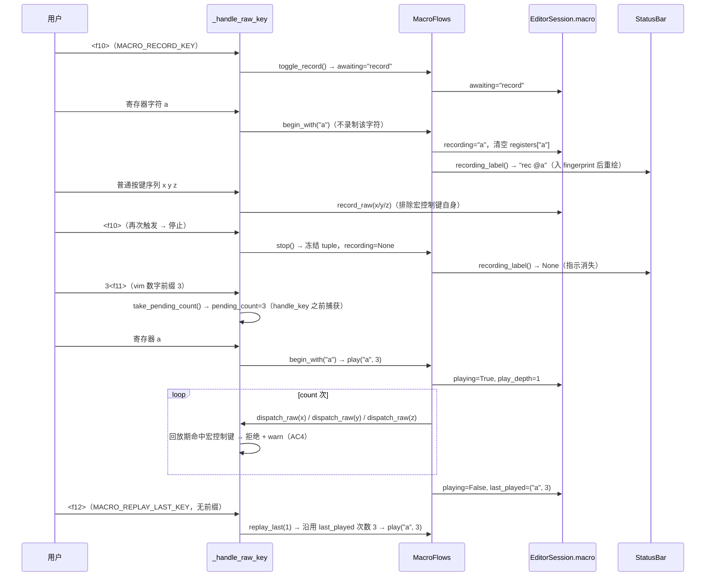

# 宏录制与回放（VIM/VSC 统一键位）实施方案

> issue：Gitee IKUOAM「FEAT - 宏录制与回放（VIM/VSC 统一同一套按键与命令）」
> 基线：`master` `be6b4a54`（与 `origin/master` 同步），本轮 worktree 分支
> `feature/feat-macro-record-replay-unified`，parent 为该 `master`。
> 角色：`plan-architect-designer`【方案】环节产物；状态：**待批准，未进入实施**。
> 唯一输入素材：`macro-record-replay-unified-issue.md`（issue 全文 + 只读情报）、
> `macro-record-replay-unified-progress.md`（进度事实）。
> 路径基准：本文内所有仓库内文件路径一律相对**仓库根**（如 `yate/session.py`），
> 同目录方案互引直接写文件名；不含任何本机绝对路径。

---

## 0. 任务分析（需求拆解 / 范围界定 / 可行性）

**需求拆解**：从零实现「录制一段 raw 键弦序列 → 回放 N 次」的经典宏语义，且 vim 与
vsc 两套 keymap 使用**同一套键弦、同一组动作**，`:` 命令提供等价入口。可拆为 7 个
能力点：① 共享键位常量与双表登记；② 会话级寄存器存储（内存、跨标签、不落盘）；
③ 录制开始 / 停止与状态栏指示；④ 回放（含 count、重复上次回放、递归防护）；
⑤ 派发链路上的 raw 捕获与回放重派发；⑥ 动作表与 `:` 命令表登记；⑦ 键位漂移守卫、
架构守卫与双语手册同步。

**范围界定（v1）**：AC1–AC8 全覆盖；明确不做持久化、回放合并单步 undo、宏编辑 /
查看 / 寄存器列表 UI、跨寄存器嵌套录制（issue「暂不做」）。本轮【方案】环节**只写
方案文档**，不触碰 `yate/**`、`tests/**`、`.trae/rules/**`、`.trae/agents/**`、
进度文档，不 commit、不 push、不合流。

**可行性**：派发链路存在唯一 raw 收口点 `yate/editor_dispatch.py::_handle_raw_key`，
录制捕获与回放重派发都能挂在此处；`EditorSession`（L1）是跨层共享的具体对象，
宏状态挂它天然跨标签共享；`KeyUi` / statusbar 已有 `Callable` 注入通道；动作表与
命令表都有 `populate` / `register_commands` 装载入口（R7）。无需要新增 Protocol /
EventBus / 字符串事件名，符合既有架构。

**大任务判定**：预计改动 ≥ 3 个文件（实际横跨 L0 `keys.py`、L1 `session.py` /
`vim.py` / `vsc.py`、L2 `statusbar.py`、L3 `flows/macro_flows.py` / `editor_dispatch.py` /
`actions.py` / `commands.py` / `editor.py` / `editor_compose.py` / `whichkey_flows.py`）、
跨 L0–L4 多层、底层与共享模型多处修改 → **判定为大任务，必须拆子计划**，见
`macro-record-replay-unified-plans/overview.md`。

---

## 1. 目标与非目标

**目标**

- G1 录制→停止→回放：回放后缓冲区状态与手动执行同序列按键一致（AC1）。
- G2 回放支持精确 N 次（N 缺省 1）与「重复上次回放」；**按键 count 前缀 + `:` 命令参数双入口一致**（AC2 / AC7）。
- G3 vim / vsc 两套表同一键弦、同一动作名，键弦来自 `keys.py` 共享常量，含 AST
  负向守卫（AC3）。
- G4 回放中再次触发回放（直接或间接自递归）被拒绝且有用户可见提示，无死循环（AC4）。
- G5 录制态状态栏指示 `rec @a`；停止后消失；空寄存器回放 warn 提示（AC5）。
- G6 寄存器同名覆盖、未录制寄存器互不干扰（AC6）。
- G7 `:` 命令入口与按键入口行为一致；非法寄存器名 / 语法错误明确报错（AC7）。
- G8 全量门禁 `pyright ... / pytest tests/ / 架构守卫` 全绿，含新增守卫（AC8）。
- G9 双语手册与键位文档同步（doc-conventions §三）。

**非目标**

- N1 寄存器持久化（跨会话保存宏）——不做。
- N2 回放合并为单步 undo——v1 跟随自然 undo 粒度；是否原子化留待执行阶段评估，
  本方案不给结论、不实现。
- N3 宏编辑 / 查看 / 寄存器列表 UI——不做。
- N4 跨寄存器嵌套录制（录制中调用其它寄存器回放）——按 AC4 一并拒绝。
- N5 vsc 不实现数字 count 状态机（其 `Keymap.take_pending_count()` 恒 1）；vim 按键入口数字前缀 N 次按 §5.5 实现，`1<f12>` 与无前缀并入「沿用上次次数」的边界已登记（不改变 f10/f11/f12 键位与 5 波结构）。
- N6 本轮不实现代码、不跑门禁、不提交；既有未合流分支只作情报，不合流不复制。

---

## 2. 调研取证：文件:行号 → 事实

> 全部为本轮只读取证；行号以当前基线文件为准；行数经 `splitlines()` 实测。

| # | 文件:行号 | 事实 |
|---|---|---|
| F1 | `yate/keymaps/keys.py:1-9,60` | `keys.py` 是 **L0 叶子**（零上层依赖）；`HOVER_DOC_KEY: str = "<f7>"` 是两侧共享常量的既定先例；模块 docstring 声明 `base.py`(L1) 仅 re-export 其记法名，L0 代码必须直引本模块。 |
| F2 | `yate/keymaps/keys.py:43-55,98-157,160-209` | `SPECIAL_KEYS` 定义 f1–f12 的 raw 序列（`f6`=`\x1b[17~`、`f7`=`\x1b[18~`、`f9`=`\x1b[20~`、`f10`=`\x1b[21~`、`f11`=`\x1b[23~`、`f12`=`\x1b[24~`）；`parse_key()` 把 `<ctrl-s>` / `<f7>` 规范化为 raw 字符串；`key_name()` 为逆变换，供 help / which-key 显示。 |
| F3 | `yate/keymaps/vsc.py:26-31,41-128` | `VscKeymap.build_bindings()` 用 `_k(spec,...)`（内部 `parse_key`）与 `_raw(raw,...)` 造表；第 127 行 `_k(HOVER_DOC_KEY, "show_hover_docs", ...)` 引用共享常量；第 125/126 行 `<f8>` manual、`<f9>` toggle_whichkey 为字面量；第 98-101 行注明 vsc 模式 `:` 不绑定、ex 命令走 `<f5>`。 |
| F4 | `yate/keymaps/vim.py:81,92-95,255-264,213-234` | `_FUNCTION_KEYS` = f1–f12 全部 raw；`handle_key` 第 255-264 行对**任何** f 键先 `_clear_pending()`（清 count / register 等状态）再 `lookup` + `dispatch`，**未绑定的 f 键也被吞掉**；第 234 行 `parse_key(HOVER_DOC_KEY)` 引用共享常量；`RESERVED_KEYS` 含数字 `1`–`9`（count digits）。 |
| F5 | `yate/keymaps/vim.py:126-141,286-327,330-370` | `VimKeymap` 已持有 `count_str` / `op_count` / `pending_register`（`"` 命名寄存器前缀，与宏寄存器同名但用途不同）/ `op_register`；`pending_prefix()` 与 `chord_hints()` 是 which-key 前缀提示面，register wait 显示 `a-z` 行。 |
| F6 | `yate/keymaps/base.py:21-27,33-37,40-52,55-69,72-87,90-127` | `base.py`(L1) 从 `keys.py` re-export 记法名；`type ActionFunc` / `type ActionRunner` 为 PEP 695 别名；`KeyBinding(key, action, description, category)`；`KeyUi` 是 frozen dataclass，含 `execute_action: Callable[[str], bool]`、`message: Callable[[str], None]` 等注入回调；`ActionContext` 持有 `session` + `ui`；`Keymap.build_bindings()` / `_index` / `chord_hints()` / `reserved_keys`。 |
| F7 | `yate/keyproto/key_codec.py:74-106,109-133` | `event_to_raw(key, character)` 是 raw 规范化入口（无修饰可打印字符优先取 `character`，否则查表 / C0 兜底，未知返回 `None`）；`textual_key_to_raw` 处理命名键与组合键。 |
| F8 | `yate/editor_dispatch.py:40-160,163-181,203-223,243` | `_handle_key` 第 153 行 `raw = event_to_raw(...)`、第 160 行 `return ed.handle_raw_key(raw)`；`_handle_raw_key`(**raw 唯一收口点**) 第 166-168 行 `ed.keymaps.active.handle_key(ActionContext(ed.session, ed.key_ui), raw)`，第 178-179 行 handled 则 `ed.refresh_ui()`；`_readonly_notice` 用 `ed.message(..., kind="warn")`；文件末 `import yate.editor` 防循环。 |
| F9 | `yate/editor.py:100-181,423,435,485,495-501,634` | `Editor`(L3) 类体集中声明各 `*Flows` 类属性（第 103-143 行），`__init__` 第 168-181 行「Assembly order」注释 + `_build_models/_build_widgets/_build_pane_stack/_build_key_ui` 工厂调用；`message(text, kind="info")`、`refresh_ui()`（内含 `whichkey.refresh()`）、`handle_raw_key(raw)` 薄委托到 `editor_dispatch`；`mode_chip(...)` 取状态栏 chip。**当前 800 行（splitlines 实测，恰为阈值）**。 |
| F10 | `yate/editor_compose.py:57-64,127-168,377-387` | `__all__` 列出 4 个 `_build_*` 工厂；`_build_widgets` 第 163-168 行构造 `StatusBar(... extension_segments=..., loaded_extensions=..., id="statusbar")`；`_build_key_ui` 第 384 行构造 `KeyUi(execute_action=ed.execute_action, message=ed.message, ...)`；R9 的 `#statusbar` id 由此传入。 |
| F11 | `yate/session.py:1-19,46-64` | `EditorSession`(**L1，UI-free**) 是文档模型单一所有者，「every layer can share the same concrete object」；`__init__` 持有 `config/docs/index/search/welcome_visible` 等**会话级**字段；`type ClosedHook` / `type OpenedHook` 为 PEP 695 别名；`log = tracing.get_logger(__name__)`。当前 437 行。 |
| F12 | `yate/actions.py:26-32,211-240` | `populate(registry: ActionRegistry, editor: Editor)` 用闭包 `reg("name", handler, "description")` 注册内置动作（R7）；view 类动作（第 211-238 行）调 `editor.whichkey.toggle()` / `editor.command_prompt()` / `editor.hover.request_at_cursor()` 等；`show_hover_docs`、`toggle_whichkey`、`toggle_keymap` 为先例。 |
| F13 | `yate/commands.py:260-294,312-324,340-351,187-243` | `register_commands(registry: CommandRegistry, editor: Editor)` 第 262 行 `reg = registry.register`；命令处理器形如 `def _w(args: str)`，`reg("w", _w, "desc")`，支持别名与 `arg_completer=`；第 344-351 行 `_enew` 用 `editor.message("usage: ...", kind="warn")` 给出明确语法报错（AC7 模板）；`editor.message(..., kind="ok"/"info"/"warn")` 为提示通道。 |
| F14 | `yate/registries.py:24-28,33-49,52-93,95-129` | `type CommandFunc = Callable[[str], object]`（`：` 命令处理器接收**原始参数字符串**）、`type ArgCompleter`；`ActionRegistry.register/execute`、`CommandRegistry.register(name, func, description, arg_completer=None)`；`Command` dataclass 带 `arg_completer`。 |
| F15 | `yate/editor_components/statusbar.py:1-12,43-46,88-91,122-193,238-254` | statusbar 是 **L2 自持**（R13/R14，只接注入回调、不 import L3）；`type SegmentRow` 为 PEP 695 别名；`mode_chip(...)` 产出 `(label, bg)`；`refresh_status()` 第 173-190 行 **fingerprint 短路**（状态未变则跳过重绘）；第 140-144 行 left/right 扩展段采用 pull 模型；`_extension_texts` 每次 refresh 调 provider。 |
| F16 | `yate/flows/whichkey_flows.py:55-115,141-196` | `WhichKeyFlows.refresh()` 第 100 行读 `keymaps.active.pending_prefix()`；`_candidates(pending)` 第 167-180 行合并 binding 表行与 `chord_hints()`；`_sheet_entries()` 第 189-195 行**遍历全部 binding** 生成 pinned sheet（故新增宏 binding 自动进 sheet）；第 144-148 行注明 raw-byte spec（f 键 / 控制键）不作为 printable 前缀的延续。 |
| F17 | `tests/test_architecture.py:141-168,198-215,324-375,909-931,1611-1646` | `_LAYER_RANKS` 含 `("flows/", 3)`（新 flows 模块自动归 L3）、`("keymaps/keys.py", 0)`、`("keymaps/", 1)`；`UPWARD_EDGES_FROZEN` 为空集；`UI_FROZEN_FILES` 冻结 flows 的 `editor_components` 导入；`SIZE_EXEMPT_FILES` 现 5 项、**不含 `editor.py`**（第 333/358-362 行记载 2026-11-04 拆分后摘除）；`test_source_files_within_size_threshold` 第 926-930 行仅在 `lines > 800` 且未登记时报错（**登记一个未越线文件不会失败**）；`test_hover_key_is_shared_and_identical`(第 1611 行) 是 AC3 键位漂移守卫模板：AST 断言两侧 `build_bindings` 引用 `HOVER_DOC_KEY` 且无 `<f7>` 字面量，运行时 `VscKeymap().lookup(parse_key(...))` / `VimKeymap().lookup(...)` 断言同一 action。 |
| F18 | `tools/smoke_test/scenarios/guards.py:11-22,63-66,140-188` | 冒烟场景 `unknown_command_and_action` **借 `<f6>`**：`_F6_RAW = "\x1b[17~"`，第 150-155 行明文「`<f6>` has no built-in binding」，第 167 行 `add_binding("<f6>", "nosuch_action")`、第 170 行 `press("f6")`、第 185-186 行 `binding_not_leaked` 断言全新 `VscKeymap()` 无 f6 条目。**本基线 f6 未被产品占用，但被冒烟测试占用其「无内建绑定」前提**。 |
| F19 | `yate/resources/manual.en.md:266,287,354,373,455-475,490-591,716` | 双语手册实际在 `yate/resources/manual.{en,zh}.md`（**不是** issue 备注写的 `yate/docs/manual.*.md`，后者不存在）；键位章节：`## 5. Key Bindings`、`### 5.1 vsc keymap`、`### 5.2 vim keymap`（含 `F7` hover 行）、`## 8. Command Line (ex commands)`、`### 3.6 Status bar`。 |
| F20 | `yate/docs/which-key.en.md:15-63,69-101` | which-key 双语文档 `## 2. Keymap differences`（第 35-63 行）描述 register wait / argument prefix 的提示面，是「前缀提示同步登记」的落点；`## 4. Limitations` 记限制。 |
| F21 | `.trae/rules/architecture-boundaries.md:60-112,414-429,431-457` | 依赖方向图与 R1–R15；§四跨模块交互规定「具体对象注入 / `Callable` 回调 / Textual messages」，**禁止**全局 EventBus / 字符串事件名 / 新 Protocol；§五自检清单要求状态放对层、`editor.py` 不反向 import 内置表、不新增 `Protocol`/`TYPE_CHECKING`/`Any`/`# type: ignore`、R10 一次按键只派发一次。 |
| F22 | `macro-record-replay-unified-progress.md:1-27` | 本轮【方案】为待办；无人值守【批准】按通过处理；既有 `feature/feat-macro-record-replay`（14 提交、未合流未推送）为上一轮产物，本轮作**只读情报、不合流不推送**；上一轮两条教训：键位比较必须过 `parse_key` 取 raw、冒烟场景键位借用。 |
| F23 | `yate/keymaps/base.py:90,196-201,228-234`；`yate/keymaps/vim.py:241-269,1256-1266`；`yate/keymaps/vsc.py:34`；`yate/editor_dispatch.py:163-181` | `Keymap`(L1) 基类 `handle_key` 在 196 行、`pending_prefix` 在 228 行；`VscKeymap`（vsc.py:34）继承 `Keymap`、不覆写 `handle_key`、无 `count_str`；`vim.py` f 键分支（255-264）先 `_clear_pending()` 再 lookup，会清掉 `count_str`，但已有私有计数原语 `_typed_count() -> int \| None`(1256) / `_take_count()`(1260，读并清空) / `_peek_count()`(1265)；`_handle_raw_key`(163) 是 raw 唯一收口点、`ed.keymaps.active.handle_key(...)` 调用在 166 行。全仓 grep `take_pending_count` 零命中 → 该方法为本次新增公共方法。故 count 可在 dispatch 调 keymap **之前**捕获，不必改 vim 状态机主体。 |

---

## 3. AC1–AC8 对照裁定表

| AC | 要求 | 裁定 | 落地机制（文件） | 验收方式 |
|---|---|---|---|---|
| AC1 | 录制→停止→回放，缓冲区与手动同序列一致 | **满足** | 录制存 raw 键弦 `list[str]`；回放逐个经 `ed.handle_raw_key(raw)` 重派发（`editor_dispatch.py`） | `tests/test_macro_integration.py` 录制序列与手动序列做缓冲区逐行 / cursor 断言相等 |
| AC2 | count 回放精确 N 次；重复上次回放 | **满足（按键 count 前缀 + `:` 命令参数双入口，口径见 §5.5）** | 按键入口：dispatch 在 `handle_key` 之前调 `take_pending_count()` 捕获 vim 数字前缀写入 `MacroState.pending_count`，`begin_with(reg)` 读之调 `play(reg, count)`；`:` 命令：`commands.py` 的 `:macro-play <reg> [count]` / `:macro-replay-last [count]` 显式传参；两路共用 `MacroFlows.play(reg, count)` 循环 N 次，`last_played` 记录 `(reg, count)` | 单测 / 集成断言 `3<play>` / `3<replay-last>` 精确 3 次、vsc 恒 1、N=1 缺省、count 非法 / 越界 warn、重复上次回放沿用次数；按键与 `:` 命令双入口结果一致（AC7） |
| AC3 | 双表同一键弦 / 同一动作名，来自 `keys.py` 常量；含负向演练 | **满足** | `keys.py` 3 个共享常量；`vim.py` / `vsc.py` 的 `build_bindings()` 只引用常量、无字面量；`tests/test_architecture.py::test_macro_keys_are_shared_and_identical` | AST 守卫 + 运行时 `lookup(parse_key(...))`；负向演练：任一侧临时硬编码字面量 → 守卫必须失败 |
| AC4 | 回放中触发回放被拒绝且有用户可见提示，无死循环 | **满足（选「拒绝」不排队）** | `MacroFlows` 持有 `playing` 标志 + `play_depth` 上限；回放期再触发 `macro_record` / `macro_play` / `macro_replay_last` 一律拒绝并 `ed.message(..., kind="warn")` | 单测断言拒绝路径不进入循环、`message` 收到 warn 文案、缓冲区无额外变化 |
| AC5 | 录制态状态栏指示；停止后消失；空寄存器回放 warn | **满足** | `statusbar.py` 注入 `recording_label: Callable[[], str | None]`，渲染 `rec @a` 并**加入 fingerprint**；空寄存器回放调 `ed.message(..., kind="warn")` | statusbar 单测断言 label 出现/消失触发重绘；命令单测断言 warn 文案 |
| AC6 | 同名覆盖；未录制寄存器不干扰 | **满足** | `EditorSession.macro.registers: dict[str, tuple[str, ...]]`，开始录制即清空同名旧序列 | 单测断言覆盖后长度/内容精确、读未录制寄存器返回空且其它寄存器不变 |
| AC7 | `:` 命令与按键入口一致（含 count 口径）；非法寄存器 / 语法错误明确报错 | **满足** | `commands.py` 4 个 `:macro-*` 命令与 `actions.py` 3 个动作共用 `MacroFlows` 编排；按键入口 count 前缀与 `:` 命令参数在 N≥2 / 无前缀两情形结果一致（§5.5(3)）；非法名（非 `a-z0-9`）/ 参数个数错误 → `editor.message("usage: ...", kind="warn")` | 命令单测逐条断言合法与非法输入（含空参数、多参数、非 ASCII、越界 count）；补按键入口与 `:` 命令 count 双入口一致断言 |
| AC8 | pyright 零诊断、pytest 全绿含新增架构守卫 | **由执行者验收**（本轮不跑门禁、不写实测数字） | 每步验收命令 + 波次收尾全量门禁 | 各子计划验收命令退出码 0；`test_architecture.py` 无违规 |

---

## 4. 备选方案与否决理由

### 方案 A（采纳）：本基线从零实现，状态归 session、编排归 flows、挂点在 dispatch

分层落点严格按 issue「架构落点」：宏状态 L1 `session.py`；编排 L3 新增
`yate/flows/macro_flows.py`（`MacroFlows`，按 §三.8 接入清单接线）；录制 / 回放挂
`editor_dispatch.py::_handle_raw_key` 一侧；动作走 `actions.py::populate()`（R7）；
命令走 `commands.py::register_commands()`（R7）；录制指示走 L2 `statusbar.py` 注入回调
（R13）；共享键位常量走 L0 `keys.py`；vim/vsc 双表只引用常量。跨模块交互全用既定
机制（具体对象 + `Callable` 回调 + 现有派发路径），不新增 Protocol / EventBus /
字符串事件名。理由：与既有架构逐条对齐，改动可局部化、可独立验收、可逐波回归。

### 方案 B（**明确否决**）：移植未合流的 `feature/feat-macro-record-replay` 分支 14 提交

> **裁决：不合流、不 cherry-pick、不复制其文档 / 代码、不写其绝对路径；仅采纳其
> 进度记录中登记的两条教训（键位比较过 `parse_key`、冒烟场景键位借用）作为情报。**

否决依据：

1. **分支基线不兼容**：该分支（14 提交、末笔 `c80daf58`）未出现在 `origin/master`；
   本轮 parent 是已同步的 `master be6b4a54`，闭环流程（`task-orchestration.md` §二）
   规定工作分支以 `master` 为 parent、只合入 `master`，移植 14 提交会引入未经本轮
   评审的历史，且违反「既有分支本轮作只读情报、不合流不推送」的进度记录口径。
2. **需求口径不同**：本轮 issue 标题为「VIM/VSC 统一同一套按键与命令」，硬性要求
   `keys.py` 共享常量 + 键位漂移守卫（AC3）；上一轮产物（据进度记录：主计划
   `macro-record-replay-plan.md`、子计划目录 `a..e`）不保证满足本轮统一键位与守卫
   形态，直接移植无法证明 AC3。
3. **会继承已知缺陷**：进度记录登记上一轮两条 MINOR（`:macro-play` / count 无上限
   同步阻塞、录制序列无界）与「`<f6>` 已被宏占用导致冒烟借 `<f10>`」的键位事实；
   本轮基线 f6 被冒烟 `unknown_command_and_action` 借用（F18），直接移植会与本基线
   冒烟前提冲突。本方案从设计上规避（§5.2 选 f10/f11/f12、§5.5 设回放防护上限与
   录制序列长度上限）。
4. **纪律约束**：用户指令限定「唯一输入素材」为两份 issue / progress 文档，且「既有
   分支的文档只读参考，不复制、不 cherry-pick、不写其绝对路径」；本轮【方案】环节
   独占文件清单仅允许写本主计划与子计划目录。

### 方案 C（否决）：宏状态 / 逻辑放 `Editor`（L3）或组件层（L2）

否决：违反 issue「宏寄存器状态归 L1 `session.py`（EditorSession 持有，模型状态不进
组件层）」与 `architecture-boundaries.md` §五「状态放在正确的层」；L2 组件自持主题
（R13）只接数据 / 回调，不持有会话级模型；`session.py` 属 R4 UI-free 面，放它是
唯一能让 L0–L3 各层共享同一具体对象（R8）的位置。

### 方案 D（否决）：新增 Protocol / EventBus / 字符串事件名做回放通知

否决：R2 禁新增 Protocol（4 类冻结白名单）、§四明文禁止全局 EventBus 与字符串
事件名、R6 禁 `TYPE_CHECKING`、R12 日志统一 tracing。本方案改用「具体对象
`EditorSession` + 构造注入的 `Callable` + 既有 `ed.handle_raw_key` / `ed.message`
派发路径」，不引入任何新信号。

### 方案 E（否决）：录制高层操作（action 名）而非 raw 键弦

否决：issue「录制内容」明确「原始键弦序列（raw key chords），回放时经当前活跃
keymap 重新派发——录制什么就重放什么，不做高层操作抽象」；AC1 要求回放结果与
手动同序列按键一致，只有 raw 重派发能保证。

### 方案 F（否决，键位备选）：选 `<f6>` 作宏键并同步改冒烟场景

否决：`guards.py`（F18）以「f6 无内建绑定」为前提并断言 `binding_not_leaked`；
占 f6 会打破该前提、需额外改冒烟场景并重新取证。f10/f11/f12 在当前双表均空闲，
选它们可做到**零冒烟改动**。进度记录中「上一轮 f10 借冒烟」是上一轮分支事实，
不适用于本基线（本基线是 f6 借冒烟），不可照搬。

---

## 5. 总体设计

### 5.1 分层落点与依赖边

| 层 | 文件 | 职责 | 新增 / 删除的依赖边 |
|---|---|---|---|
| L0 | `yate/keymaps/keys.py` | 3 个共享键位常量 | 无（纯数据） |
| L1 | `yate/keymaps/vim.py` / `vsc.py` | `build_bindings()` 各加 3 行，只引用常量；`VimKeymap` 覆写 `take_pending_count()` 委托 `_take_count()`、`VscKeymap` 继承缺省恒 1 | 仍只依赖 `base.py` → `keys.py`（既有） |
| L1 | `yate/keymaps/base.py` | 新增 `Keymap.take_pending_count(self) -> int` 公共方法（缺省 `return 1`），归 plan-d（wave-2）独占 | 无新增依赖边（L1 内部方法）；不新增 `Protocol` / `Any` / `TYPE_CHECKING`（R2 / R6） |
| L1 | `yate/session.py` | `MacroState`（寄存器 / 录制态 / awaiting / 回放态）挂 `EditorSession` | 无（纯数据，UI-free） |
| L2 | `yate/editor_components/statusbar.py` | 注入 `recording_label` 回调，渲染 `rec @a` | 新增一个构造参数（`Callable`），不 import 任何 L3 名字（R13/R14） |
| L3 | `yate/flows/macro_flows.py`（**新增**） | `MacroFlows` 编排开始 / 停止 / 回放 / 重复 / 防护 | 依赖 L1 `session.MacroState`；`dispatch_raw` / `notify` 由工厂注入；不 import `editor_components`（免登记 `UI_FROZEN_FILES`）、不持 App 句柄 |
| L3 | `yate/editor_dispatch.py` | `_handle_raw_key` 增录制捕获 / awaiting 消费 / 回放拒绝分支 | 仍只依赖 `ed.session` / `ed.handle_raw_key` / `ed.message` |
| L3 | `yate/actions.py` / `commands.py` | 注册 3 动作 / 4 命令 | 闭包捕获 `editor`（既有 R7 形态） |
| L3 | `yate/editor.py` / `editor_compose.py` | 类属性注解 + `_build_macro_flows` 工厂 + StatusBar 回调注入 + 组装注释 | `editor.py` import 新 flows 类（L3→L3 同层）；不反向 import 内置表（R5） |
| L3 | `yate/flows/whichkey_flows.py` | **不改代码**：新增宏 binding 由 `_sheet_entries()` 自动进入 pinned sheet（F16）；awaiting 语义由双语文档登记 | 无新增依赖边（R11 导入面不变） |
| 守卫 | `tests/test_architecture.py` | 新增键位漂移守卫 + `editor.py` 体量豁免登记 | 镜像 `.trae/rules/architecture-boundaries.md` §三.7 / §三.8 |

### 5.2 键位裁定（统一键位硬性要求）

**既有占用矩阵**（F2/F3/F4/F18）：

| 键 | raw | 当前占用 |
|---|---|---|
| `<f1>` `<f2>` `<f3>` `<f4>` `<f5>` | … | help / shell_prompt / find_next / replace / command_prompt |
| `<f6>` | `\x1b[17~` | **冒烟 `unknown_command_and_action` 借用其「无内建绑定」前提** |
| `<f7>` | `\x1b[18~` | `HOVER_DOC_KEY` → `show_hover_docs` |
| `<f8>` | `\x1b[19~` | `manual` |
| `<f9>` | `\x1b[20~` | `toggle_whichkey` |
| `<f10>` `<f11>` `<f12>` | `\x1b[21~` `\x1b[23~` `\x1b[24~` | **空闲** |

**定稿常量**（写入 `yate/keymaps/keys.py`，`:` 注释说明用途，风格对齐 `HOVER_DOC_KEY`）：

```
MACRO_RECORD_KEY: str = "<f10>"      # 录制开关（开始需 awaiting 寄存器名，再按停止）
MACRO_PLAY_KEY: str = "<f11>"        # 回放（awaiting 寄存器名）
MACRO_REPLAY_LAST_KEY: str = "<f12>" # 重复上次回放
```

两侧 `build_bindings()` 只写 `parse_key(MACRO_*_KEY)` / `_k(MACRO_*_KEY, ...)`，动作名
统一为 `macro_record` / `macro_play` / `macro_replay_last`，**禁止任何宏键字面量**。
选单键 f 键（无终端易吞的组合修饰），与项目既有 f 键族一致；避开 f6 使
`tools/smoke_test/scenarios/guards.py` **本轮零改动**（登记依据：F18）。

### 5.3 API 契约（逐条定死见 `overview.md`）

主计划只给契约摘要，**逐条签名、字段、回调、动作 / 命令名、错误文案、常量名以
`macro-record-replay-unified-plans/overview.md` 为唯一规范来源**，执行者不得凭常识
改写。摘要：

- `EditorSession.macro: MacroState`（L1，`@dataclass`，字段：`registers`、
  `recording`、`awaiting`、`last_played`、`playing`、`play_depth`、
  `pending_count`（缺省 1）、`recording_label()` 查询方法）。
- L1 `Keymap.take_pending_count(self) -> int`（`base.py`，plan-d）：缺省 `return 1`；
  `VimKeymap` 覆写委托既有 `_take_count()`；`VscKeymap` 不覆写、恒 1。
- `MacroFlows`（L3）：构造注入 `session: EditorSession`、`dispatch_raw: Callable[[str], bool]`、
  `notify: Callable[[str, str], None]`；方法 `toggle_record()`、
  `request_play(count: int = 1)`、`replay_last(count: int | None = None)`、
  `begin_with(reg)`（读 `pending_count`）、`play(reg, count)`、`stop()`、
  `record_raw(raw)`、`reject_if_playing()`、`is_playing` 等（详见 overview）。
- 3 动作 / 4 命令 / 3 常量 / 1 个 statusbar 回调 / 1 个 which-key 提示文案。

### 5.4 数据流（Mermaid）





### 5.5 关键设计裁定

1. **录制内容 = raw 键弦**：`MacroState.registers: dict[str, tuple[str, ...]]`，录制态
   下 `_handle_raw_key` 在**派发之后**追加 raw；录制序列不含宏控制键自身（`<f10>` /
   `<f11>` / `<f12>`）与 awaiting 消费的寄存器字符，否则回放会触发录制 / 回放形成
   递归。回放逐个调 `ed.handle_raw_key(raw)`，遵守 R10（一次按键只派发一次）。
2. **寄存器名 `a-z0-9`**：按键入口采用 **awaiting 链**——按录制 / 回放键后等待一个
   `a-z0-9` 字符，统一在 `editor_dispatch.py::_handle_raw_key` 消费（**不改 vim / vsc
   各自状态机**，保证两套表行为一致）；非法字符 → `ed.message(..., kind="warn")` 并
   取消 awaiting。`:` 命令入口直接以参数给出寄存器名，等价（AC7）。按 `<f11>` /
   `<f12>` 回放键时的 count 前缀由 dispatch 在 `handle_key` 之前捕获并写入
   `pending_count`，awaiting 消费字符时随寄存器名一起交给 `play`（见第 3 条）。
3. **count 语义（AC2 / AC7 双入口）**：issue 功能需求 2 明文要求「回放指定寄存器
   的按键序列，支持 **count 前缀语义**（回放 N 次，N 缺省 1）」，AC7 要求按键入口与
   `:` 命令入口行为一致，故**按键入口必须支持 N 次**。`vim.py:255-264` 的
   `_FUNCTION_KEYS` 分支会先 `_clear_pending()` 清掉 `count_str`，但 `VimKeymap`
   已有私有计数原语 `_take_count()`（F23，`vim.py:1260-1263`，读并清空、无前缀
   返回 1），因此 count 可在 **dispatch 调用 keymap 之前**捕获，无需改 vim 状态机
   主体。落地：L1 `base.py` 新增公共方法 `Keymap.take_pending_count(self) -> int`
   （缺省 `return 1`），`VimKeymap` 覆写并 `return self._take_count()`，
   `VscKeymap` 不覆写（无 count 状态机，恒 1，登记为 N5）；不新增 `Protocol` /
   `Any` / `TYPE_CHECKING`。dispatch（`editor_dispatch.py::_handle_raw_key`）在
   `ed.keymaps.active.handle_key(...)` **之前**、仅当 `raw` 命中 `MACRO_PLAY_KEY` /
   `MACRO_REPLAY_LAST_KEY` 时调 `take_pending_count()` 写入
   `MacroState.pending_count`；`macro_record`（`<f10>`）与普通按键不消耗 count。
   awaiting 消费寄存器字符时 `begin_with(reg)` 读 `pending_count` 调
   `play(reg, count)` 并复位为 1；`<f12>` 的 `replay_last(count)` 取「有前缀用前缀
   值（≥2）、无前缀 / `count == 1` 沿用 `last_played` 次数」，vsc 恒 1 即沿用。
   `1<f12>` 与「无前缀」因 `take_pending_count() -> int` 无法区分而并入「沿用」，
   登记为 v1 已知边界；`:macro-replay-last 1` 命令仍精确 1 次，双入口在 N≥2 与
   无前缀两情形一致。count 非法 / 越界（`< 1` 或 `> MAX_MACRO_KEYS`）统一由
   `MacroFlows.play` warn（第 4 条防护不变），按键入口捕获值同样过该校验。`:` 四命令
   契约（`:macro-play <reg> [count]` / `:macro-replay-last [count]`，N 缺省 1）不变。
   回放防护（`playing` + `MAX_PLAY_DEPTH`）与 R10 单次派发不变。
4. **递归防护（AC4）**：`playing` 标志 + `play_depth` 上限（`MAX_PLAY_DEPTH = 1`，
   即回放中禁止再次触发任何宏动作，含间接自递归）；命中即拒绝并
   `ed.message("macro replay already in progress", kind="warn")`，不排队（v1 选拒绝，
   理由：实现简单、可观测、无任务队列引入）。空寄存器回放同样 warn（AC5）。
5. **录制序列长度上限**：为避免上一轮登记的「录制序列无界」MINOR，设
   `MAX_MACRO_KEYS`（具体值在 overview 契约定死），达到上限即拒绝继续追加并 warn；
   上限为**设计常量**，本方案不写未实测的门禁数字。
6. **状态栏指示（AC5 / R13）**：`StatusBar` 新增构造参数
   `recording_label: Callable[[], str | None] | None = None`（缺省 `None` 保持独立构造
   兼容），`refresh_status()` 把 label 文本**加入 fingerprint**（F15 否则状态变化不重绘），
   拼在 mode chip 旁；`editor_compose.py::_build_widgets` 注入
   `lambda: ed.session.macro.recording_label()`。L2 不 import 任何 L3 名字。
7. **`editor.py` 体量裁定（§三.7）**：当前 800 行（F9 实测）。按 §三.8 接入清单需新增
   ≥1 行 import + ≥1 行类属性注解 + 组装顺序注释 → **必然 > 800 行**（推断，非实测
   门禁数字）。裁定按 §三.7「单一职责长文件可登记豁免」登记 `editor.py`（对齐
   `editor_lsp/manager.py` 2026-11-09 先例），由 wave-3 子计划同步
   `.trae/rules/architecture-boundaries.md` §三.7 名单与
   `tests/test_architecture.py::SIZE_EXEMPT_FILES` 两处；F17 证明提前登记不会使守卫
   误报。理由：`Editor` 是 L3 薄委托单一职责，拆分无行为收益。若执行阶段实测新增
   行数后仍 ≤ 800，须按「偏离计划」显式回填并撤销登记（不得静默改设计）。
8. **新增模块体量**：`yate/flows/macro_flows.py` 预计远低于 800 行；`session.py`
   437 行 + `MacroState` 仍远低于阈值；`statusbar.py` 290 行、`editor_dispatch.py`
   243 行、`commands.py` 617 行、`actions.py` 240 行、`editor_compose.py` 399 行、
   `whichkey_flows.py` 196 行、双表 `vsc.py` 128 行 / `vim.py` 1534 行（**已在
   `SIZE_EXEMPT_FILES` 名单，单一键映射域职责，维持豁免**）——所有新增 / 膨胀模块
   结论：除 `editor.py` 按上条登记豁免外，均无需拆分或新增豁免。
9. **包 `__init__.py` 惰性（§三.5）**：不新增包、不改任何 `__init__.py`；
   `yate/flows/__init__.py` 保持不 re-export；`keymaps/__init__.py` 不动。

---

## 6. 分步实施（每步：输入 / 改动文件 / 输出 / 可执行验收命令）

> 逻辑步骤对应 `overview.md` 的执行波次；**计划制定者不运行测试**，验证由执行者
> 按各步骤 / 各子计划的验收命令完成。命令均在 worktree 根目录执行，解释器统一
> `.venv\Scripts\python.exe`。

**S1（wave-1，3 并行）底层契约与纯数据**

- 输入：F1/F2（keys.py）、F11（session.py）、F15（statusbar.py）、overview API 契约。
- 改动文件：`yate/keymaps/keys.py`、`yate/session.py`、
  `yate/editor_components/statusbar.py`、`tests/test_macro_constants.py`、
  `tests/test_macro_state.py`、`tests/test_statusbar_macro.py`。
- 输出：3 个共享常量；`MacroState` 挂 `EditorSession`（含 `pending_count` 缺省 1）；
  `recording_label` 注入 + fingerprint；两组纯数据单测。
- 验收命令：
  `.venv\Scripts\python.exe -m pyright yate/keymaps/keys.py yate/session.py yate/editor_components/statusbar.py`
  `.venv\Scripts\python.exe -m pytest tests/test_macro_state.py tests/test_statusbar_macro.py -q`

**S2（wave-2，2 并行）双表登记 + 编排模块 + 键位守卫**

- 输入：S1 常量与 `MacroState`；F3/F4/F5/F17；overview 契约。
- 改动文件：`yate/keymaps/vim.py`、`yate/keymaps/vsc.py`、
  `yate/keymaps/base.py`（新增 `Keymap.take_pending_count()`，`VimKeymap` 覆写委托
  `_take_count()`，`VscKeymap` 继承缺省恒 1），
  `tests/test_architecture.py`（新增 `test_macro_keys_are_shared_and_identical`、
  `test_macro_take_pending_count_is_defined_on_both_keymaps_and_vsc_is_one` 与
  `SIZE_EXEMPT_FILES` 的 `editor.py` 条目）、`yate/flows/macro_flows.py`（新增）、
  `tests/test_macro_flows.py`。
- 输出：双表 3 行共享常量引用（无字面量）+ `take_pending_count()` 公共方法两侧定义；
  `MacroFlows` 编排（回放循环 / `request_play(count)` / `replay_last(count)` /
  `begin_with` 读 `pending_count` / `playing` 防护 / 长度上限 / `last_played`）；
  AST 漂移守卫 + `take_pending_count` 轻量守卫（含负向演练记录）。
- 验收命令：
  `.venv\Scripts\python.exe -m pyright yate/keymaps/vim.py yate/keymaps/vsc.py yate/keymaps/base.py yate/flows/macro_flows.py`
  `.venv\Scripts\python.exe -m pytest tests/test_macro_flows.py tests/test_architecture.py -q`

**S3（wave-3，2 并行）组装接线 + 派发挂点**

- 输入：S1/S2 产物；F8/F9/F10/F12/F13、F21；R 条款与 §三.8 接入清单。
- 改动文件：`yate/editor.py`、`yate/editor_compose.py`、
  `.trae/rules/architecture-boundaries.md`（§一 L3 清单 / §三.8 接入清单 / §三.7
  豁免名单，执行阶段改）、`yate/editor_dispatch.py`、
  `tests/test_macro_wiring.py`、`tests/test_macro_dispatch.py`。
- 输出：`Editor.macro_flows` 类属性 + `_build_macro_flows` 工厂 + StatusBar 回调注入 +
  组装注释；`_handle_raw_key` 在 `handle_key` 之前对 `MACRO_PLAY_KEY` /
  `MACRO_REPLAY_LAST_KEY` 调 `take_pending_count()` 捕获 count 写入 `pending_count`
  （卫语句 0，`macro_record` 不消耗）+ 录制捕获 / awaiting 消费（`begin_with` 读
  `pending_count`）/ 回放拒绝分支；规则文本与守卫集合两处同步。
- 验收命令：
  `.venv\Scripts\python.exe -m pyright yate/editor.py yate/editor_compose.py yate/editor_dispatch.py yate/flows/macro_flows.py`
  `.venv\Scripts\python.exe -m pytest tests/test_macro_dispatch.py tests/test_architecture.py -q`

**S4（wave-4，2 并行）动作 / 命令入口 + which-key 文档登记 + 冒烟复核**

- 输入：S3 的 `Editor.macro_flows` 契约；F12/F13/F14/F16/F18。
- 改动文件：`yate/actions.py`、`yate/commands.py`、`tests/test_macro_commands.py`、
  `yate/docs/which-key.en.md`、`yate/docs/which-key.zh.md`、
  `tests/test_macro_whichkey.py`。
- 输出：3 个动作、4 个 `:macro-*` 命令（含参数解析与 warn 报错）、which-key 双语
  文档登记 awaiting 提示面；`tools/smoke_test/scenarios/guards.py` 本轮零改动
  （F18「f6 无内建绑定」前提登记于此步复核）。
- 验收命令：
  `.venv\Scripts\python.exe -m pyright yate/actions.py yate/commands.py`
  `.venv\Scripts\python.exe -m pytest tests/test_macro_commands.py tests/test_macro_whichkey.py -q`
  `.venv\Scripts\python.exe -m tools.smoke_test run --jobs 4`

**S5（wave-5，2 并行）双语文档 + 端到端集成与冒烟**

- 输入：S1–S4 全部产物；F19/F20；doc-conventions §三。
- 改动文件：`yate/resources/manual.en.md`、`yate/resources/manual.zh.md`、
  `tests/test_macro_docs.py`、`tests/test_macro_integration.py`、
  （可选）`tools/smoke_test/scenarios/macro.py` 与
  `tools/smoke_test/scenarios/__init__.py` 登记。
- 输出：manual 双语键位表 / 命令 / 状态栏同步（which-key 双语提示已在 S4 完成）；
  AC1–AC7 端到端用例；冒烟新增场景（若采用）。
- 验收命令：
  `.venv\Scripts\python.exe -m pytest tests/test_macro_integration.py -q`
  `.venv\Scripts\python.exe -m tools.smoke_test run --jobs 4`

**S6（wave-6，主代理亲跑，收尾门禁，本方案不写实测数字）**

- 输入：S1–S5 全部落盘产物。
- 改动文件：无（只跑命令 + 回填方案 / 进度文档的真实数字与偏离记录）。
- 输出：门禁实测结论、偏离记录、按步提交（不 push、不合流）。
- 验收命令（与 `task-orchestration.md` §二.7 一致）：
  `.venv\Scripts\python.exe -m pyright yate/ tests/ tools/ pack/`
  `.venv\Scripts\python.exe -m pytest tests/ -q -n auto`
  `.venv\Scripts\python.exe -m pytest tests/test_architecture.py -q`
  `.venv\Scripts\python.exe -m pytest tests/ --cov=yate --cov-branch -n auto`
  `.venv\Scripts\python.exe -m tools.smoke_test run --jobs 4`

---

## 7. 架构边界与守卫对照

| 条款 | 本方案触碰情况 | 守卫 / 复核 |
|---|---|---|
| R1 / R5 | 无 `import yate.app`；`editor.py` 不反向 import `yate.actions` / `yate.commands` | `test_only_cli_imports_app` / `test_editor_does_not_import_action_tables`（既有） |
| R2 / R6 / §五 | 不新增 `Protocol` / `TYPE_CHECKING` / `Any` / `# type: ignore` | `test_no_new_protocols` / `test_no_type_checking` / `test_app_annotations_are_precise`（既有） |
| R2 / R6 / §五（补充） | `base.py` 新增 `Keymap.take_pending_count()` 为普通公共方法、`VimKeymap` 覆写委托既有私有 `_take_count()`，不改 vim 状态机主体、不新增任何协议 / 别名模块 | `test_no_new_protocols` / `test_no_type_checking` / `test_app_annotations_are_precise`（既有，回归） |
| R3 / R4 | `statusbar.py` 只接 `Callable`，不 import L3；`session.py` 保持 UI-free | `test_editor_components_does_not_import_upward` / `test_keymaps_services_and_models_stay_ui_free`（既有） |
| R7 | 动作 / 命令经 `populate` / `register_commands` 装载，外壳不改 | `test_shell_loads_the_builtin_tables`（既有） |
| R8 / §四 | 跨层传 `EditorSession` 具体对象 + 构造注入 `Callable`，无 EventBus / 字符串事件名 / `self.app` 链 | `test_flow_modules_hold_no_app_handle`（既有） |
| R9 | 不新增 widget / id，`#statusbar` 沿用 | 既有 id 守卫 |
| R10 | 录制 / 回放只经 `_handle_raw_key` 一次派发；回放逐个 raw 走同一路径 | `tests/test_macro_dispatch.py` 断言单次派发、`tests/test_macro_integration.py` 断言缓冲区一致 |
| R11 | `macro_flows.py` **不** import `editor_components`；`whichkey_flows.py` 不改其 `editor_components` 导入面 → 无需动 `UI_FROZEN_FILES` | `test_collaborators_keep_widget_coupling_frozen`（既有）+ wave-3 复核 |
| R12 | 新模块用 `log = tracing.get_logger(__name__)`；不碰 devtools 通道；日志惰性 `%` 格式 | `test_logging_never_touches_devtools_channel` / `test_log_calls_use_lazy_percent_formatting`（既有） |
| R13 | 录制指示由 L2 自持渲染，L3 只注入 `Callable` | `test_editor_does_not_paint_widget_styles`（既有）+ statusbar 单测 |
| §三.5 | 不改任何包 `__init__.py` | `test_leaf_package_reexports_carry_exception_note` / `test_editor_lsp_package_root_is_light`（既有） |
| §三.7 | `editor.py` 登记体量豁免（两处同步）；`vim.py` 维持既有豁免 | `test_source_files_within_size_threshold`（既有）+ wave-2 plan-d 新增断言用例 |
| §三.8 | 新增 `MacroFlows` 按 6 条接入清单接线（命名 / 类属性 / 工厂注入 / 组装注释 / 免 `UI_FROZEN_FILES` / L3 清单同步） | wave-3 验收命令 + 规则文本同步复核 |
| 层秩 | 新 `flows/macro_flows.py` 由 `("flows/", 3)` 自动归 L3；无新增向上连线（`UPWARD_EDGES_FROZEN` 保持空集） | `test_no_unregistered_upward_imports`（既有） |
| 命名 / 别名 / 注释 | `MacroFlows` 符合 `*Flows`；回调别名用 PEP 695 `type`；注释 / docstring ASCII | `test_no_banned_identifier_names` / `test_callable_aliases_use_type_statements` / `test_comments_and_docstrings_stay_ascii`（既有） |
| 源码路径 | 新增代码不写本机家目录路径 | `test_no_machine_local_home_paths_in_sources`（既有） |
| **新增守卫** | `test_macro_keys_are_shared_and_identical`（3 常量 × 两侧 AST 无字面量 + 运行时 `lookup` 同 action；负向演练：任一侧硬编码字面量必须失败） | 落入 `tests/test_architecture.py`（wave-2 plan-d） |
| **新增守卫** | `test_editor_size_exemption_is_registered`（断言 `editor.py` 在 `SIZE_EXEMPT_FILES` 且与规则 §三.7 名单一致） | 落入 `tests/test_architecture.py`（wave-2 plan-d，随豁免登记） |
| **新增守卫** | `test_macro_take_pending_count_is_defined_on_both_keymaps_and_vsc_is_one`（断言 `Keymap` / `VimKeymap` 两侧均有 `take_pending_count` 定义、`VscKeymap().take_pending_count() == 1`） | 落入 `tests/test_architecture.py`（wave-2 plan-d） |

---

## 8. 双语文档同步清单（doc-conventions §三）

> **路径裁决**：issue 备注写 `yate/docs/manual.en.md` / `manual.zh.md`，但当前基线
> 不存在该路径；实际手册为 `yate/resources/manual.en.md` / `manual.zh.md`（F19）。
> 以实际路径为准，并在执行记录回填该偏离依据。

| 文档（成对，同时新增 / 同时更新） | 落点 |
|---|---|
| `yate/resources/manual.en.md` + `manual.zh.md` | `### 5.1 vsc keymap` 键位表加 `<f10>` / `<f11>` / `<f12>` 三行；`### 5.2 vim keymap` 同三行（同一键弦 / 同一动作名）；`## 8. Command Line (ex commands)` 加 `:macro-record` / `:macro-stop` / `:macro-play` / `:macro-replay-last` 用法与 count 口径；`### 3.6 Status bar` 说明 `rec @a` 指示；`### 5.x` 明确「vim 数字前缀 N 次 / vsc 无 count 状态机恒 1（`take_pending_count()` 恒 1）/ `:` 命令参数双入口」count 口径（含 `1<f12>` 沿用边界） |
| `yate/docs/which-key.en.md` + `which-key.zh.md` | `## 2. Keymap differences` 登记宏 awaiting 寄存器提示面（`a-z0-9` 行）；`## 4. Limitations` 补 f 键不参与 printable 前缀（F16）与 **新 count 口径**（vim 数字前缀 N 次 / vsc 恒 1 / `:` 命令双入口） |

---

## 9. 风险清单与回滚路径

| # | 风险 | 影响 | 缓解 | 回滚 |
|---|---|---|---|---|
| R1 | 键位与既有 / 冒烟占用冲突 | AC3 失败、冒烟回归 | §5.2 占用矩阵 + 选 f10/f11/f12（f6 让位冒烟）；wave-2 漂移守卫 + 负向演练 | 回退 `keys.py` / 双表 3 行；`guards.py` 本不动 |
| R2 | 回放递归 / 死循环 | AC4 失败、卡死 | `playing` + `MAX_PLAY_DEPTH=1` 拒绝并 warn；录制排除宏控制键；单测覆盖直接与间接自递归 | 回退 `macro_flows.py` 防护分支、`editor_dispatch.py` 拒绝分支 |
| R3 | 录制序列无界 / 无限增长 | 内存增长（上一轮 MINOR） | `MAX_MACRO_KEYS` 上限 + warn；overview 定死常量 | 同上 |
| R4 | `vim.py::_FUNCTION_KEYS`（255-264）先 `_clear_pending()` 清掉 `count_str`，若 dispatch 在 `handle_key` 之后才取 count 会恒得 1，按键入口 N 次落空 | AC2 / AC7 失败 | §5.5(3) 裁定在 `handle_key` **之前**调 `take_pending_count()` 捕获并写入 `pending_count`（委托既有 `_take_count()`，F23）；`3<play>` / `3<replay-last>` / vsc 恒 1 用例覆盖；wave-3 实测捕获时序 | 回退 `editor_dispatch.py` 卫语句 0 与 `base.py` / `vim.py` 的 `take_pending_count()`，回填 AC2 口径偏离 |
| R5 | awaiting 链吞掉普通输入 / 两套表行为不一致 | AC1/AC7 偏差 | awaiting 统一在 `editor_dispatch.py::_handle_raw_key` 消费，不改双表状态机；非法字符 warn 并取消 | 回退 `editor_dispatch.py` awaiting 分支 |
| R6 | statusbar fingerprint 漏加 label → 指示不刷新 | AC5 失败 | 把 `recording_label()` 文本加入 fingerprint（F15 第 173-190 行）；statusbar 单测断言重绘 | 回退 `statusbar.py` 注入与 fingerprint 改动 |
| R7 | `editor.py` 越 800 行未登记 → 架构守卫红 | AC8 失败 | wave-2 提前登记 `SIZE_EXEMPT_FILES` + wave-3 同步规则 §三.7；新增断言用例 | 撤销登记并回填偏离（若实测仍 ≤ 800） |
| R8 | 新增 flows 模块被判层秩 / `self.app` 违规 | AC8 失败 | `flows/` 前缀自动 L3；不持 App 句柄、不 import `editor_components`；wave-3 跑架构守卫 | 回退 `macro_flows.py` / `editor_compose.py` 接线 |
| R9 | 双语文档漏一侧 / 路径写错 | G9 失败 | §8 成对清单；执行者逐对 diff；路径以 `yate/resources/manual.*.md` 为准 | 回退对应文档 |
| R10 | 规则文本与守卫集合两处不同步 | AC8 失败 | §三.7 名单 / §三.8 清单 / `SIZE_EXEMPT_FILES` 由同一 wave-3 子计划一次性改 | 同时回退两处 |

**整体回滚**：所有改动按子计划独占文件切分、按波次串行推进；任一波验收命令退出码
非 0 → 停止后续波次，按该波子计划清单 `git checkout -- <独占文件>` 逐文件还原
（未 commit 前直接还原工作区）；极端情况整分支丢弃（本轮不 push、不合流，主仓
`changelog.{en,zh}.md` 未提交改动不触碰）。回滚后须在方案文档回填偏离与实测依据。

---

## 10. 大任务拆分与执行波次

完整子计划索引、API 契约逐条、文件互斥矩阵、执行者任务书模板与 Mermaid 依赖图见
**`macro-record-replay-unified-plans/overview.md`**；子计划文件命名
`macro-record-replay-unified-<subtask>-plan-<a|b|...>.md`（doc-conventions §一，
目录总纲固定 `overview.md`）。波次表是调度唯一依据，一经批准不得在执行中临时重排；
确需调整须回填文档并说明实测依据。

---

## 11. 无人值守【批准】记录（已回填）

> 依据 `macro-record-replay-unified-progress.md` §0（用户 2026-11-12 指令「进入无人
> 值守，无须过问；严格按纪律执行」；`task-orchestration.md` 闭环流程【批准】按通过
> 处理，不向用户发起询问或审批）。本节由主代理在【批准】环节回填，方案环节未代填、
> 未虚构实测。

| 项 | 回填（主代理，2026-11-12 08:22） |
|---|---|
| 批准方式 | 无人值守按通过处理：用户 2026-11-12 指令「进入无人值守，无须过问」，依 `.trae/rules/task-orchestration.md` §二.3 与总纲 §二.5，不向用户发起询问或审批。 |
| 批准对象 | 本主计划（含 AC2 count 前缀定点修订）+ `macro-record-replay-unified-plans/` 的 `overview.md` 与 11 份子计划 a–k，共 13 份方案文档。 |
| 批准时间 | 2026-11-12 08:22（本地时间，无人值守会话）。 |
| 批准结论 | **通过，进入【执行】**。硬性约束：① 波次严格按 `overview.md` §3，上一波验收命令退出码全 0 才进下一波；② 每波 2~3 个执行者并行（硬上限 6），文件互斥；③ `yate/**` 产品源码改动由主代理按 `subagent-workflow.md` §一.3 在任务书中显式授权给 `plan-executor` 并按独占清单执行；④ 只认落盘结果，成员数据独立复核；⑤ 执行者不 commit / push / 合流（提交与回填由主代理统一做）；⑥ 全程 Hy4 模型，限流时按用户指令切 GLM-5.3-Flash；⑦ 收尾门禁由主代理亲跑并回填真实数字。 |
| 偏离记录 | D1 方案文件名：issue 备注建议 `macro-record-plan.md`，本轮按 `doc-conventions.md` §一 取 `macro-record-replay-unified-plan.md`（与 worktree / 分支 topic 一致）。D2 手册路径：issue 备注写 `yate/docs/manual.*.md`，实测基线为 `yate/resources/manual.*.md`，以实际路径为准（F19）。D3 既有未合流的 `feature/feat-macro-record-replay`（14 提交）按方案 B 明确否决：不合流、不 cherry-pick、不复制其产物，仅采纳两条只读教训。D4 模型：用户唯一例外为全程 Hy4；本机 `task` 工具无模型参数、运行时按 `.trae/agents/*.md` frontmatter 解析，实测有效名为 `Hy4`（`Hy4 preview` 与 `qwen-3.7-plus` 均未注册）；主仓并发提交 `68c4d781` 曾把方案角色模型改为未注册的 `qwen-3.8-plus`，恢复 `Hy4` 后修订 spawn 成功；未触发 GLM-5.3-Flash 回退。D5 方案迭代：【批准】前主代理审查发现 AC2「count 前缀语义」被缩减为仅 `:` 命令参数，退回【方案】由 `plan-architect-designer` 定点修订（新增 `Keymap.take_pending_count()` 与 dispatch 捕获），13 份文档一致性已复核，修订先于任何代码改动。D6 主工作区存在 `yate/resources/changelog.{en,zh}.md` 未提交改动（生成器刷新），本轮不触碰。 |

---

## 12. 未解决项 / 待执行阶段复核

1. `vim.py::_FUNCTION_KEYS`（F4 / F23）对 f10/f11/f12 的实际 dispatch 路径需在
   wave-2 实测：确认 `lookup` 命中新 binding（未绑定 f 键会被吞），必要时在双表补
   description；并实测 `take_pending_count()` 在 `handle_key` **之前**捕获 `3` 后，
   `_FUNCTION_KEYS` 分支的 `_clear_pending()` 再清一次 `count_str` 不影响已捕获值
   （wave-3 dispatch 联调）。
2. `guards.py`（F18）「f6 无内建绑定」前提在 wave-4 以冒烟命令复核；本轮裁定
   **不改** `guards.py`，若实测与裁定不符须回填偏离依据。
3. `MAX_MACRO_KEYS` / `MAX_PLAY_DEPTH` 具体常量值在 `overview.md` API 契约定死；
   本主计划不写未实测的门禁数字。
4. `yate/resources/manual.*.md` 与 `yate/docs/which-key.*.md` 的精确插入行号由
   wave-5 执行者按实际章节复核（本方案只给章节，不给臆测行号）。
5. `editor.py` 新增接线后的实际 `splitlines()` 行数由 wave-3 实测回填；若 ≤ 800
   须撤销豁免登记并附实测依据。
6. N2（回放合并单步 undo）按 issue「暂不做」留待执行阶段评估，本方案不给结论。
7. `Keymap.take_pending_count()` / `VimKeymap` 覆写委托 `_take_count()`（F23）在
   wave-2 实测：vsc 恒 1、vim `3<f11>` 取到 3；`1<f12>` 与「无前缀」并入「沿用
   上次次数」的边界（§5.5(3)）在 wave-5 手册 / 集成用例登记。若 issue 评审要求精确
   区分「显式前缀 1」，须先改 `overview.md` §1.8 契约与本主计划再回填，不得静默改设计。
