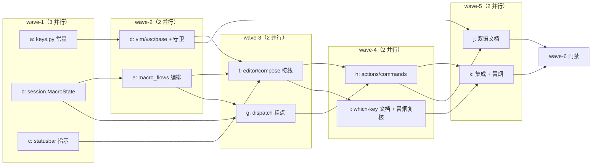

# 宏录制与回放（统一键位）子计划总纲

> 主计划：`../macro-record-replay-unified-plan.md`（相对本目录；仓库内引用一律相对
> 仓库根，如 `yate/session.py`）。本目录文件命名遵循 `doc-conventions.md` §一：
> 总纲固定 `overview.md`，子计划 `<task>-<subtask>-plan-<a|b|...>.md`。
> 状态：**待批准**；本轮【方案】环节只写方案文档，不改 `yate/**`、`tests/**`、
> `.trae/rules/**`、进度文档，不 commit / push / 合流。

---

## 0. 目标 / 非目标

目标：把主计划 §5 的总体设计拆成可独立验收、文件互斥、按波次串行推进的子计划，
并把**跨子计划的 API 契约逐条定死**，使每个执行者只认本文件 + 自己的子计划文档，
不凭常识猜接口。本版按 issue 功能需求 2 补齐**按键入口 count 前缀语义**（vim 数字
前缀 N 次 / vsc 恒 1 / `:` 命令参数双入口一致），键位 f10/f11/f12 与 5 波结构不变。
非目标：不在本文件重述主计划的 AC 裁定 / 备选方案 / 风险总表
（见主计划 §3 / §4 / §9）；不写未实测的门禁数字。

---

## 1. API 契约逐条定死（唯一规范来源）

> 下列每一条都是**硬契约**：名称、签名、类型、常量值、文案一字不改。执行者若发现
> 契约与现有代码冲突，**停下来上报主代理**，不得自行改契约（偏离须回填方案并附
> 实测依据）。所有新代码遵守 `python-coding-style.md`：`from __future__ import
> annotations`、原生小写泛型、`X | None`、PEP 695 `type` 语句、散文式 docstring、
> 绝对导入、无 `Protocol` / `TYPE_CHECKING` / `Any` / `# type: ignore`、
> 日志走 `tracing.get_logger(__name__)` + 惰性 `%` 格式、注释与 docstring ASCII。

### 1.1 L0 共享常量（`yate/keymaps/keys.py`，归 plan-a）

| 契约 | 值 / 签名 |
|---|---|
| `MACRO_RECORD_KEY: str` | `"<f10>"` |
| `MACRO_PLAY_KEY: str` | `"<f11>"` |
| `MACRO_REPLAY_LAST_KEY: str` | `"<f12>"` |
| `MACRO_CONTROL_KEYS: frozenset[str]` | `frozenset(parse_key(k) for k in (MACRO_RECORD_KEY, MACRO_PLAY_KEY, MACRO_REPLAY_LAST_KEY))` —— 供 dispatch 判断「录制时排除宏控制键自身」 |

常量以 `#:` 注释说明用途（对齐 `HOVER_DOC_KEY` 先例），不得改变 `HOVER_DOC_KEY`、
`SPECIAL_KEYS`、`parse_key` / `key_name` 的任何行为。`vim.py` / `vsc.py` 的
`build_bindings()` **只引用常量名**，禁止出现 `"<f10>"` / `"<f11>"` / `"<f12>"`
字面量（守卫负向演练会拦截）。

### 1.2 动作名（归 plan-h，动作体表在 `yate/actions.py::populate`）

| 动作名 | 键 | 描述 |
|---|---|---|
| `macro_record` | `MACRO_RECORD_KEY` | 录制开关（开始 → awaiting 寄存器名；录制中 → 停止） |
| `macro_play` | `MACRO_PLAY_KEY` | 回放（awaiting 寄存器名） |
| `macro_replay_last` | `MACRO_REPLAY_LAST_KEY` | 重复上次回放 |

三个动作体统一形态 `reg(name, lambda ctx: editor.macro_flows.<方法>(), desc)`；
`toggle_record()` 不带参数（`<f10>` 不消耗 count）；`macro_play` / `macro_replay_last`
两个动作体改为 `request_play(editor.session.macro.pending_count)` /
`replay_last(editor.session.macro.pending_count)`（读 dispatch 在 `handle_key` 之前
捕获并写入的 `pending_count`，见 §1.8；动作体具体形态由 plan-h §2.1 落盘）。
`:` 四命令处理器（§1.3）契约不变。

### 1.3 `:` 命令名（归 plan-h，注册表 `yate/commands.py::register_commands`）

| 命令 | 参数 | 行为 |
|---|---|---|
| `:macro-record [reg]` | 可选单字符寄存器（`a-z0-9`）；缺省 = awaiting | 开始录制（若已在录制则先停止再按参数开始） |
| `:macro-stop` | 无 | 停止录制；未在录制 → warn |
| `:macro-play <reg> [count]` | 必填 `reg`，可选 `count`（正整数，缺省 1） | 回放 `count` 次 |
| `:macro-replay-last [count]` | 可选 `count`（正整数，缺省 1） | 以 `count` 覆盖上次回放的次数再回放 |

命令处理器签名一律 `def _xxx(args: str) -> None`（对齐 `registries.py` 的
`type CommandFunc = Callable[[str], object]`）；参数解析用 `args.split()` +
`_strip_quotes(args.strip())`（既有辅助）。`:macro-play` / `:macro-replay-last` 带
`arg_completer`（候选为已录制寄存器名 / 常量提示，纯值列表）。

### 1.4 错误 / 提示文案（逐字定死，`ed.message(text, kind="warn")`）

| 场景 | 文案 |
|---|---|
| 非法寄存器名 | `"macro register must be one character in a-z0-9"` |
| awaiting 收到非法字符 | `"macro register must be one character in a-z0-9"` |
| 空寄存器回放 | `"macro register @<reg> is empty"` |
| 回放中再次触发（AC4） | `"macro replay already in progress"` |
| 无上次回放 | `"no last macro replay"` |
| `:macro-stop` 未在录制 | `"not recording a macro"` |
| 录制序列达到上限 | `"macro sequence limit reached"` |
| count 非法 / 越界 | `"macro count must be a positive integer"` |
| 命令语法错误 | `"usage: :macro-record [reg] | :macro-stop | :macro-play <reg> [count] | :macro-replay-last [count]"` |

录制指示文案（statusbar 渲染）：`f"rec @{reg}"`（如 `rec @a`）。

### 1.5 L1 状态：`MacroState`（归 plan-b，落在 `yate/session.py`）

```
@dataclass
class MacroState:
    registers: dict[str, tuple[str, ...]]      # 已停止的宏：寄存器 → raw 键弦序列
    recording: str | None                      # 当前录制中的寄存器名，None = 未录制
    buffer: list[str]                          # 当前录制中的临时 raw 序列
    awaiting: Literal["record", "play"] | None # 等待寄存器字符
    last_played: tuple[str, int] | None        # (reg, count)
    playing: bool                              # 回放防护标志
    play_depth: int                            # 回放嵌套深度
    pending_count: int                         # 本次按键捕获的回放次数（缺省 1）

    def recording_label(self) -> str | None: ...   # "rec @a" / None
    def get(self, reg: str) -> tuple[str, ...]: ...  # 未录制返回 ()
```

`EditorSession.__init__` 增加 `self.macro = MacroState()`（会话级字段 → 跨标签共享；
不持久化、不落盘）。`MacroState` 是纯数据 + 只读查询，不 import 任何上层 / Textual
（R4 / §五）。`Literal` 从 `typing` 导入（项目既有风格）。
`pending_count: int = 1`（plan-b 落盘时给缺省值）：承载**按键入口**由 dispatch 在
`handle_key` 之前调 `take_pending_count()`（§1.8）捕获的回放次数；`begin_with(reg)`
读之传给 `play(reg, count)` 后复位为 1，避免泄漏到下一次回放。`:` 命令入口不写
该字段（直接给 `play` 传参），两入口在 N≥2 与无前缀两种情形结果一致（AC7）。

### 1.6 L3 编排：`MacroFlows`（归 plan-e，新增 `yate/flows/macro_flows.py`）

```
type DispatchRaw = Callable[[str], bool]        # PEP 695，注入 ed.handle_raw_key
type Notify = Callable[[str, str], None]        # (text, kind)，注入 ed.message

MAX_PLAY_DEPTH: int = 1
MAX_MACRO_KEYS: int = 10000                     # 录制序列长度上限（规避无界）
MACRO_REGISTER_CHARS: str = "abcdefghijklmnopqrstuvwxyz0123456789"  # 合法寄存器字符

class MacroFlows:
    def __init__(self, session: EditorSession, dispatch_raw: DispatchRaw,
                 notify: Notify) -> None: ...
    def toggle_record(self) -> None: ...        # 录制中→stop()；否则 awaiting="record"（不消耗 count）
    def request_play(self, count: int = 1) -> None: ...  # 写 pending_count=count、置 awaiting="play"
    def replay_last(self, count: int | None = None) -> None: ...  # None/1→沿用 last_played 次数；>=2→覆盖
    def begin_with(self, reg: str) -> None: ... # awaiting 消费：record→开始 / play→读 pending_count 调 play(reg,pending_count) 后复位=1
    def play(self, reg: str, count: int) -> None: ...  # 回放主循环（含 count 合法性校验）
    def stop(self) -> None: ...                 # 冻结 buffer 成 tuple 写入 registers，覆盖同名
    def record_raw(self, raw: str) -> None: ... # 录制态追加（含上限）
    def reject_if_playing(self) -> bool: ...    # True = 已拒绝（回放中触发宏动作）
```

`play()` 契约：① `reject_if_playing()` 为真则 warn 并 return；② 空寄存器 → warn 并
return；③ `count` 非正整数 / 越界 → warn 并 return；④ 置 `playing=True`、
`play_depth += 1`（超过 `MAX_PLAY_DEPTH` 拒绝）；⑤ 循环 `count` 次、每次遍历
`registers[reg]` 逐个调 `dispatch_raw(raw)`；⑥ `finally` 复位 `playing=False`、
`play_depth -= 1`；⑦ 成功写 `last_played = (reg, count)`。回放期间 `dispatch_raw`
命中宏控制键由 `editor_dispatch.py` 拒绝（见 1.8），形成双保险。
`MacroFlows` 不 import `editor_components`（免 `UI_FROZEN_FILES` 登记）、不持
`self.app`（`test_flow_modules_hold_no_app_handle`）。类型别名放本模块内（不建全局
别名模块，`python-coding-style.md` §3.5）。

**count 来源与口径（AC2，硬契约）**：`count` 只经两条路径进入 `play(reg, count)`：
① `:` 命令（plan-h）显式传参；② 按键入口由 dispatch 在 `handle_key` 之前调
`ed.keymaps.active.take_pending_count()` 捕获，写入 `MacroState.pending_count`
（§1.5 / §1.8），`begin_with(reg)` 读之传给 `play` 后复位 `pending_count = 1`。
`request_play(count)` 把参数写回 `pending_count`（幂等）；`replay_last(count)` 中
`count is None or count == 1` 沿用 `last_played[1]`、`count >= 2` 覆盖（登记
`1<f12>` 边界见 §1.8）。`MacroFlows` **不直接调用** `take_pending_count()`（那是 L1
keymap 公共方法，由 dispatch 调用），只消费已落盘的 `pending_count` 值；不因此
新增 `Protocol` / `Any` / `TYPE_CHECKING`（R2 / R6 / §五）。

### 1.7 L2 注入（归 plan-c / plan-f）

- `StatusBar.__init__` 新增构造参数
  `recording_label: Callable[[], str | None] | None = None`（**缺省 None**，保持既有
  独立构造兼容）；`refresh_status()` 把 `self.recording_label()` 的文本**加入
  fingerprint 元组**（否则 F15 短路导致指示不重绘），并拼在 mode chip 之后。
- `editor_compose.py::_build_widgets` 的 `StatusBar(...)` 调用追加
  `recording_label=lambda: ed.session.macro.recording_label()`。
- L2 不得 import 任何 L3 名字（R13 / R14）；只接纯数据 / 回调。

### 1.8 L3 派发挂点（归 plan-g，`yate/editor_dispatch.py::_handle_raw_key`）

**依赖的 L1 公共方法（硬契约，归 plan-d，`yate/keymaps/base.py`）**：
`Keymap.take_pending_count(self) -> int` —— 基类缺省 `return 1`（表驱动 keymap 无
count 状态机，恒 1）；`VimKeymap` 覆写并 `return self._take_count()`（委托既有
`vim.py:1260-1263` 私有原语，读并清空 `count_str`，无数字前缀返回 1）；`VscKeymap`
**不覆写**，继承基类 → `take_pending_count()` 恒 1。**不新增** `Protocol` / `Any` /
`TYPE_CHECKING`。取值**必须**在 `handle_key` 之前：`vim.py:255-264` 的
`_FUNCTION_KEYS` 分支会先 `_clear_pending()` 清掉 `count_str`，过了这一分支就取不到。

在 `ed.keymaps.active.handle_key(...)` **之前**按序插入卫语句：

0. **（新增，count 捕获）** 仅当 `raw` 命中 `parse_key(MACRO_PLAY_KEY)` /
   `parse_key(MACRO_REPLAY_LAST_KEY)` 且 `macro.playing is False` 且
   `macro.awaiting is None` 时：`macro.pending_count =
   ed.keymaps.active.take_pending_count()`（写 L1 状态）。`MACRO_RECORD_KEY`
   （`<f10>`）**不**在此集合 → 不消耗 count；普通按键也不调 `take_pending_count()`
   → 不干扰 vim 正常 count；`playing` / `awaiting` 分支提前 return，不会误捕获。
   随后 `handle_key` 触发按键动作：`macro_play` →
   `request_play(macro.pending_count)`（幂等写回 + 置 awaiting）、
   `macro_replay_last` → `replay_last(macro.pending_count)`（动作体由 plan-h 传参）。
1. `if raw in MACRO_CONTROL_KEYS and ed.session.macro.playing:` → `ed.message(..., kind="warn")`、
   `return True`（AC4 拒绝，含间接自递归）。
2. `if ed.session.macro.awaiting is not None:` → 校验 raw 是单个 `a-z0-9` 字符
   （`len(raw) == 1 and raw in "abcdefghijklmnopqrstuvwxyz0123456789"`）；合法则
   `ed.macro_flows.begin_with(raw)`（`begin_with` 读 `pending_count` 调
   `play(reg, count)` 并复位 `pending_count = 1`），非法则 warn 并清空 awaiting；
   `return True`（该字符不进入录制、不进 keymap）。
3. 正常派发 `handled = ed.keymaps.active.handle_key(...)` 后：若
   `ed.session.macro.recording is not None` 且 `raw not in MACRO_CONTROL_KEYS` 且
   非 awaiting 消费 → `ed.macro_flows.record_raw(raw)`。
4. 其余分支（`BufferReadOnlyError` / `refresh_ui` / `completion.after_editor_key`）
   一行不改（R10 一次按键只派发一次）。

**count 口径（AC2 / AC7 双入口一致，硬契约）**：

- `<f11>` 按键：vim 数字前缀 `3<f11>` → `take_pending_count() == 3` → awaiting 消费
  寄存器字符时 `play(reg, 3)`（精确 3 次）；无前缀 / vsc 恒 1 → 1 次（N 缺省 1）。
- `<f12>` 按键：`replay_last(count)` 中 `count is None or count == 1` → 沿用
  `last_played[1]`；`count >= 2`（如 `3<f12>`）→ 用该值覆盖后回放。vsc 恒 1 →
  沿用上次次数。**已登记边界**：vim 显式 `1<f12>` 与「无前缀」都并入「沿用」，
  因 `take_pending_count() -> int` 无法区分二者；`:macro-replay-last 1` 命令
  （plan-h 走 `play(last_reg, 1)`）仍精确 1 次，双入口在 N≥2 与无前缀两情形一致。
- `:macro-play <reg> [count]` / `:macro-replay-last [count]` 四命令契约（§1.3）
  **不变**；count 非法 / 越界（`< 1` 或 `> MAX_MACRO_KEYS`）由 `MacroFlows.play`
  统一 warn（§1.6 ③），按键入口捕获到的非法值同样经 `play` 校验，不绕过防护。

`MACRO_CONTROL_KEYS` 从 `yate.keymaps.keys` 导入（L3 → L0 合法）；keys.py 是 L0，
不反向依赖。`take_pending_count()` 定义在 `yate/keymaps/base.py`（L1），dispatch 经
`ed.keymaps.active` 具体对象调用，不新增依赖边 / 协议（R8 / §四）。

### 1.9 L3 组装（归 plan-f）

- `editor.py` 类体：`from yate.flows.macro_flows import MacroFlows`；类属性注解
  `macro_flows: MacroFlows`（紧随其它 `*Flows`，第 103-143 行区）；`__init__`
  「Assembly order」注释补一句 macro_flows 的构造时机。
- `editor_compose.py`：新增 `_build_macro_flows(ed)` 工厂（`__all__` 追加），构造
  `ed.macro_flows = MacroFlows(ed.session, dispatch_raw=ed.handle_raw_key,
  notify=ed.message)`（`ed.message` 签名 `(text, kind="info")` 与 `Notify` 一致）；
  在 `Editor.__init__` 的 `_build_*` 序列中调用（位置：models 之后、key_ui 之前，
  因 `macro_flows` 依赖 session、被 key_ui 动作间接使用）。
- **不改 `yate/flows/whichkey_flows.py` 代码**（裁定）：其 `__init__` 仅有 6 个既有
  注入、无 `session` / `editor`，构造点又在 plan-f 独占文件，新增注入会造成波间
  依赖倒置。新增的 3 条宏 binding 由 `WhichKeyFlows._sheet_entries()`
  （第 189-195 行）自动进入 pinned sheet（F16）；awaiting 寄存器提示面由
  `yate/docs/which-key.{en,zh}.md` §2 与 `yate/resources/manual.*.md` §5 双语登记
  （归 plan-i / plan-j）。`UI_FROZEN_FILES` 与 R11 导入面零改动。

### 1.10 守卫与测试文件清单（定死）

| 文件 | 归属 | 内容 |
|---|---|---|
| `tests/test_architecture.py` | **plan-d 独占** | 新增 `test_macro_keys_are_shared_and_identical`、`test_editor_size_exemption_is_registered`、`test_macro_take_pending_count_is_defined_on_both_keymaps_and_vsc_is_one`；`SIZE_EXEMPT_FILES` 追加 `"editor.py"` |
| `tests/test_macro_constants.py` | plan-a | 3 个共享常量值 / `MACRO_CONTROL_KEYS` 与 `parse_key` 一致 / `HOVER_DOC_KEY` 不回归 |
| `tests/test_macro_wiring.py` | plan-f | `Editor.macro_flows` 注入、StatusBar 回调接线、规则文本与守卫集合两处同步 |
| `tests/test_macro_docs.py` | plan-j | manual 双语手册成对含宏键行 / `:macro-*` 命令 / `rec @a` 指示 / **新 count 口径**（vim 数字前缀 N 次 / vsc 恒 1 / `:` 双入口） |
| `tests/test_macro_state.py` | plan-b | `MacroState` 正 / 边界 / 异常流 + `pending_count` 缺省 1 与复位 |
| `tests/test_macro_statusbar.py` | plan-c | 指示出现 / 消失 / fingerprint 重绘 |
| `tests/test_macro_flows.py` | plan-e | 编排、覆盖、count、递归拒绝、上限、重复上次 + `request_play(count)` / `replay_last(count)` / `begin_with` 读 `pending_count` 的 N 次与沿用 / 越界用例 |
| `tests/test_macro_dispatch.py` | plan-g | 录制捕获、awaiting、回放拒绝、单次派发 + `take_pending_count()` 捕获 / `3<play>` / `3<replay-last>` / vsc 恒 1 / `macro_record` 不消耗 count / count 非法与越界 |
| `tests/test_macro_commands.py` | plan-h | 4 命令合法 / 非法 / 语法错误 / 双入口一致 + 按键入口与 `:` 命令 count 口径一致断言 |
| `tests/test_macro_whichkey.py` | plan-i | 新 binding 自动进 pinned sheet + which-key 双语文档登记（**新 count 口径**）+ `guards.py` f6 前提未破坏 |
| `tests/test_macro_integration.py` | plan-k | AC1–AC7 端到端 + 按键 `3<play>` / `3<replay-last>` / vsc 恒 1 / count 非法与越界 |
| （可选）`tools/smoke_test/scenarios/macro.py` + `scenarios/__init__.py` | plan-k | 冒烟新增场景与登记 |

---

## 2. 产品源码 `yate/**` 改动归属裁定（含依据）

> `subagent-workflow.md` §一.3 规定「子代理**不得修改产品源码**（`yate/`），确实需要
> 改就停下来上报，由主代理决定」。本任务几乎全部改动都在 `yate/**`，故在此**显式
> 裁定并登记依据**，供 task-coordinator 下发时使用。

**裁定**：本方案全部 `yate/**` 改动由**主代理或经主代理显式授权的 `plan-executor`**
按各子计划的独占文件清单执行；**不得以 `general-purpose` 子代理直接下发含
`yate/**` 的子计划**。若调度方只能派 `general-purpose`，须先由主代理按
`subagent-workflow.md` §一.3 作出「授权改产品源码」的决定并在任务书中登记该授权
依据，否则该成员必须停在「上报」而非动代码。依据：

1. 规则明文（§一.3）把产品源码改动保留给主代理决定，本方案不绕过；
2. 波内并行要求「文件互不重叠 + 各自可独立验证」，只有 `plan-executor` 剧本带
   「独占文件清单 + 计划内验收命令」纪律（task-orchestration §二.4）；
3. `yate/**` 是门禁扫描面（pyright / pytest / 架构守卫 / 覆盖率 / 冒烟），越权改动
   会污染收尾实测，须由主代理统一监管（subagent-workflow §一.4）。

逐文件归属（同波内互斥，见 §4 矩阵）：

| `yate/**` 文件 | 归属子计划 | 依据 |
|---|---|---|
| `yate/keymaps/keys.py` | plan-a (w1) | 纯 L0 数据，无上游依赖，可最先独立验收 |
| `yate/session.py` | plan-b (w1) | 纯 L1 状态（含 `pending_count`），与 keys / statusbar 无耦合 |
| `yate/editor_components/statusbar.py` | plan-c (w1) | L2 只加注入回调，用假回调即可单测 |
| `yate/keymaps/base.py` | plan-d (w2) | 新增 `Keymap.take_pending_count()`（缺省 1）；与 vim.py / vsc.py 同子计划、同波，波内不冲突（§4 补登） |
| `yate/keymaps/vim.py` / `vsc.py` | plan-d (w2) | 依赖 plan-a 常量；`VimKeymap` 覆写 `take_pending_count()` 委托 `_take_count()`、`VscKeymap` 继承缺省恒 1；两表 + base.py 同一子计划避免波内冲突 |
| `yate/flows/macro_flows.py`（新增） | plan-e (w2) | 依赖 `MacroState`（w1），不依赖双表 |
| `yate/editor.py` / `editor_compose.py` | plan-f (w3) | 为 w4 提供 `editor.macro_flows` 契约；跨边界单独成计划 |
| `yate/editor_dispatch.py` | plan-g (w3) | 只依赖 w1 状态 + w2 编排，不依赖 `editor.macro_flows` 属性 |
| `yate/actions.py` / `commands.py` | plan-h (w4) | 依赖 w3 的 `editor.macro_flows` |
| `yate/docs/which-key.en.md` / `which-key.zh.md` | plan-i (w4) | 与 plan-h 文件互斥；awaiting 提示面双语登记（文档改动，不改 `whichkey_flows.py`） |

`.trae/rules/architecture-boundaries.md`（规则文本）由 **plan-f (w3)** 在执行阶段
同步（§一 L3 清单 / §三.8 接入清单 / §三.7 豁免名单）；本轮【方案】环节**不触碰**
`.trae/rules/**`（独占文件清单约束）。

---

## 3. 执行波次表（调度唯一依据）

> 波内并行（2~3 个一批）、波间**严格串行**：上一波全部子计划验收命令退出码 0
> 才允许进入下一波。一经批准不得临时重排；确需调整须回填本文档并说明实测依据。

| 波次 | 子计划（并行） | 前置 | 本波出口判据 |
|---|---|---|---|
| wave-1 | **plan-a ∥ plan-b ∥ plan-c** | 主计划批准 | 三者验收命令退出码 0 |
| wave-2 | **plan-d ∥ plan-e** | wave-1 全绿 | 双表守卫 + 编排单测退出码 0 |
| wave-3 | **plan-f ∥ plan-g** | wave-2 全绿 | 接线 / 派发单测 + 架构守卫退出码 0 |
| wave-4 | **plan-h ∥ plan-i** | wave-3 全绿 | 命令 / which-key 双语文档 + 冒烟复核退出码 0 |
| wave-5 | **plan-j ∥ plan-k** | wave-4 全绿 | 双语文档成对 diff + 集成 / 冒烟退出码 0 |
| wave-6 | 主代理亲跑全量门禁（**非子计划**） | wave-5 全绿 | 主计划 §6 S6 命令全部退出码 0，回填真实数字与偏离 |

子计划索引（文件名同目录）：

- `macro-record-replay-unified-constants-plan-a.md`
- `macro-record-replay-unified-state-plan-b.md`
- `macro-record-replay-unified-statusbar-plan-c.md`
- `macro-record-replay-unified-keymaps-guard-plan-d.md`
- `macro-record-replay-unified-flows-plan-e.md`
- `macro-record-replay-unified-wiring-plan-f.md`
- `macro-record-replay-unified-dispatch-plan-g.md`
- `macro-record-replay-unified-entries-plan-h.md`
- `macro-record-replay-unified-whichkey-plan-i.md`
- `macro-record-replay-unified-docs-plan-j.md`
- `macro-record-replay-unified-integration-plan-k.md`



---

## 4. 文件互斥矩阵

> `●` = 该子计划独占改动；波内任一文件不得被两个子计划同时标记为 `●`。
> `tests/test_architecture.py` 全局归 plan-d 独占（含两个新守卫 + 豁免登记），
> 其余子计划**只跑不改**它。

| 文件 | a | b | c | d | e | f | g | h | i | j | k |
|---|:-:|:-:|:-:|:-:|:-:|:-:|:-:|:-:|:-:|:-:|:-:|
| `yate/keymaps/keys.py` | ● | | | | | | | | | | |
| `yate/session.py` | | ● | | | | | | | | | |
| `yate/editor_components/statusbar.py` | | | ● | | | | | | | | |
| `yate/keymaps/vim.py` | | | | ● | | | | | | | |
| `yate/keymaps/vsc.py` | | | | ● | | | | | | | |
| `yate/keymaps/base.py` | | | | ● | | | | | | | |
| `tests/test_architecture.py` | | | | ● | | | | | | | |
| `yate/flows/macro_flows.py`（新） | | | | | ● | | | | | | |
| `yate/editor.py` | | | | | | ● | | | | | |
| `yate/editor_compose.py` | | | | | | ● | | | | | |
| `.trae/rules/architecture-boundaries.md` | | | | | | ● | | | | | |
| `yate/editor_dispatch.py` | | | | | | | ● | | | | |
| `yate/actions.py` | | | | | | | | ● | | | |
| `yate/commands.py` | | | | | | | | ● | | | |
| `yate/resources/manual.en.md` | | | | | | | | | | ● | |
| `yate/resources/manual.zh.md` | | | | | | | | | | ● | |
| `yate/docs/which-key.en.md` | | | | | | | | | ● | | |
| `yate/docs/which-key.zh.md` | | | | | | | | | ● | | |
| `tests/test_macro_state.py` | | ● | | | | | | | | | |
| `tests/test_macro_statusbar.py` | | | ● | | | | | | | | |
| `tests/test_macro_flows.py` | | | | | ● | | | | | | |
| `tests/test_macro_dispatch.py` | | | | | | | ● | | | | |
| `tests/test_macro_commands.py` | | | | | | | | ● | | | |
| `tests/test_macro_whichkey.py` | | | | | | | | | ● | | |
| `tests/test_macro_constants.py` | ● | | | | | | | | | | |
| `tests/test_macro_wiring.py` | | | | | | ● | | | | | |
| `tests/test_macro_docs.py` | | | | | | | | | | ● | |
| `tests/test_macro_integration.py` | | | | | | | | | | | ● |
| `tools/smoke_test/scenarios/macro.py` + `__init__.py`（可选） | | | | | | | | | | | ● |

**波内互斥校验**：w1 = keys / session / statusbar（+各单测）互不相交；w2 =
vim+vsc+base+architecture / flows（+单测）互不相交（base.py 与双表同属 plan-d，
波内不冲突）；w3 = editor+compose+rules /
dispatch（+单测）互不相交；w4 = actions+commands / which-key 双语文档（+单测）
互不相交；w5 = manual 双语 2 文档 / 集成+冒烟 互不相交。校验通过。

---

## 5. 执行者任务书模板（task-coordinator 直接套用）

```
【任务】执行子计划 <文件名>，所属 wave-<n>。
【唯一规范来源】先读 .trae/documents/macro-record-replay-unified-plans/overview.md
  （API 契约逐条定死，以它为准，不凭常识猜）+ 本子计划文档 + 主计划
  .trae/documents/macro-record-replay-unified-plan.md；再读
  .trae/agents/plan-executor.md 严格按剧本执行。
【独占文件清单】只改本子计划 §「独占文件清单」列出的文件，不要动其它任何文件
  （尤其其它子计划名下文件、yate/** 非本计划文件、进度文档）。
【产品源码授权依据】本子计划含 yate/** 改动时：依据 overview.md §2 的裁定，由
  主代理或经主代理显式授权的 plan-executor 执行；若以 general-purpose 下发，
  须先取得主代理按 subagent-workflow.md §一.3 作出的授权决定并登记，否则停在上报。
【上游依赖】确认上一波全部子计划验收命令退出码 0 后才开工。
【验证命令】逐条执行本子计划「可执行验收命令」，逐条记录输出与退出码。
【门禁纪律】pyright strict 零诊断；pytest 断言全绿；架构守卫无违规；
  不得用 # type: ignore / 豁免注释绕过；不写未实测的门禁数字。
【报告格式】改动清单（文件 + 行数）+ 实际执行的命令与结果 / 退出码 +
  关键取证（文件:行号）+ 未解决项与原因；只认落盘文件，声称完成但文件无变化 = 零产出。
【纪律】不 commit / push / 合流；不改 .trae/rules/**（本轮方案环节）；
  偏离计划（阈值 / 范围 / 选型）必须显式列出并附实测依据。
```

---

## 6. 上下文管理

context 占用超过 75% 立即压缩：先落盘已完成调研结论（文件:行号级事实）、已写好的
方案段落、未完成事项到 `.trae/documents/**`，再压缩；压缩后凭落盘记录续作，
不得凭记忆重建事实。本目录 11 个子计划 + 主计划即为落盘基座。
