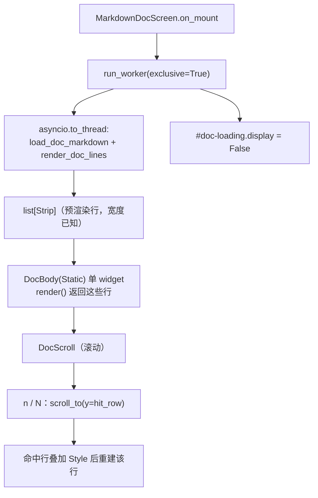

# markdown-doc-perf 方案：manual / changelog 覆盖层挂载成本优化

> 上游来源：[`smoke-perf-plan.md`](smoke-perf-plan.md) §二.3「热点 1」与 §一「非目标 1」。
> 该任务把 manual/changelog 覆盖层登记为产品侧性能问题并留给独立计划，本文件即该计划。
>
> 分支：`fix/smoke-perf`（延续同一 worktree `../yate-smoke-perf`）；如需独立评审可另开
> `enh/markdown-doc-perf`。

## 一、目标与非目标

### 目标

1. 把「打开手册」的等待从 **11.0s** 压到亚秒级，关闭从 **2.0s / 8.4s** 压到瞬时；
2. 功能等价：搜索（`/`、ctrl+f）、`n` / `N` 命中跳转、`pgup/pgdn` 滚动、`esc/q` 关闭、
   主题着色、载入中占位（`#doc-loading`）全部保留；
3. 冒烟两个手册场景的耗时同步下降（`manual_changelog_modals` 30.05s、`view_manual_command` 21.44s），
   使冒烟并行后的墙钟下限从 31.5s 降到个位数。

### 非目标

- 不改文档内容、不改 `yate/resources/manual.*.md` / `changelog.*.md` 的渲染语义
  （标题、代码块、表格仍按 Markdown 呈现）；
- 不引入新依赖（复用已装的 `rich`，它是 `textual` 的传递依赖且项目已直接用 rich）；
- 不改搜索的**键盘契约**（绑定、debounce 时长、Enter/Shift+Enter 行为）。

## 二、调研事实（实测，2026-10-21）

### 2.1 现状成本

```text
base: Screen widgets=21
manual open press+pause: 11.010s  MarkdownDocScreen widgets=1788
manual close:             2.043s
changelog open:           3.473s  MarkdownDocScreen widgets=3733
changelog close:          8.440s
```

- `yate/editor_view/manual.py:236` 用 Textual `Markdown("", id="doc-md")`；
  `:279` `await markdown.update(source)` 已在 executor 里解析、并分块挂载
  （`manual.py:11-12` 的模块 docstring 自述），但**每个 block 一个 widget**
  （manual 1788 个 / changelog 3733 个）的挂载与卸载本身就把时间吃光。
- `cProfile`（`manual_changelog_modals`，67.5s 采样）热区全在样式与布局：
  `textual/css/stylesheet.py:470(apply)` 26274 次 / 累计 23.3s、
  `widget.py:1736(_get_box_model)` 16.5s、`_resolve.py:218(resolve_box_models)` 17.4s。
  即成本 ∝ widget 数量，与 Markdown 解析几乎无关。

### 2.2 单渲染可绘制对象原型（本次实测）

把整份文档构造成**一个** `rich.markdown.Markdown` 并预渲染成行：

```text
manual    source= 78733B lines= 1674 read=   2.0ms build=  75.2ms render= 379.7ms paint=0.0ms
changelog source=176045B lines= 1471 read=   1.4ms build= 235.2ms render= 286.0ms paint=0.0ms
```

即：**一份文档一次性 ~0.45s（manual）/ ~0.52s（changelog）**，且都在 worker 线程里完成
（不阻塞事件循环），挂载 1 个 widget，关闭 1 个 widget。

对比现状：manual 11.0s → ~0.5s（**20x**），changelog 3.5s+8.4s → ~0.55s（**20x 以上**）。

## 三、备选方案与否决理由

| 选项 | 内容 | 裁决 |
|---|---|---|
| **A（推荐）单 Rich 渲染可绘制对象 + 预渲染行缓存** | worker 线程内 `rich.markdown.Markdown` → `Console.render_lines(...)` 得到 `list[Strip]`，存为屏幕状态；`DocScroll` 内放**一个** `Static`（渲染这些行）。搜索改为在预渲染行上做子串扫描，命中记 `(行号, 列, 长度)`；高亮通过给命中行叠加 style 后 `Static.update()`（或自定义 `render_line`）实现；`n/N` 用 `scroll_to(y=行号)` | 采纳：唯一能把成本从 O(widgets) 降到 O(1) 且不牺牲功能的路线 |
| B 懒挂载 / 分块挂载（保持 Textual `Markdown`） | 先挂前 N 个 block，滚动时继续挂；关闭时取消剩余挂载 | 否决：总工作量不减（滚动到文档尾仍要挂 3733 个 widget），滚动会周期性卡顿；且"载入完成"信号语义被打破，现有 5 个手册测试与 2 个冒烟场景都要改判据 |
| C 只减 CSS 刷新（把 masthead 的 `refresh_css` 合并） | 在 Textual 层减少样式重算 | 否决：改的是 Textual 内部行为，升级即碎；且成本仍 ∝ widget 数，治标 |
| D 不动（保持现状） | 只保留上游任务里的登记 | 否决：打开手册 11s 是用户可感知缺陷，且它是冒烟并行后 31.5s 的墙钟下限 |
| E 换 `TextArea` 显示纯文本 | 用 TextArea 承载原文 | 否决：丢 Markdown 呈现（标题/代码块/表格），手可读性明显下降 |

## 四、分步实施计划

波次：**W1 → W2（串行）→ W3（串行）**，每步单独提交。

### W1 预渲染管线（不触碰 UI 结构）

- **改动文件**：`yate/editor_view/manual.py`（新增纯函数）、`tests/test_manual.py`（新增单测）。
- **动作**：新增模块级函数
  `render_doc_lines(source: str, width: int) -> list[Strip]`
  （`rich.markdown.Markdown` → `Console(file=StringIO(), width=width)` →
  `console.render_lines(...)`，`pad=False`），纯函数、无 widget、可单测；
  线程安全：仅在 worker 线程调用一次。
- **输出**：函数返回行数（manual 1674 / changelog 1471）。
- **验收命令**：
  ```powershell
  .venv\Scripts\python.exe -m pytest tests/test_manual.py -q
  ```

### W2 屏幕改为单 widget 承载预渲染行

- **改动文件**：`yate/editor_view/manual.py`、`yate/resources/markdown-doc-screen.tcss`、
  `tests/test_manual.py`、`tests/test_app_manual.py`。
- **动作**：
  1. `compose()` 用 `DocBody(Static)` 取代 `Markdown("", id="doc-md")`，id 保持 `#doc-md`
     （现有测试与 CSS 选择器不变）；`DocBody` 持 `list[Strip]` 并在 `render()` 里返回它们。
  2. `_load_doc` 在 `asyncio.to_thread` 里读文件 + `render_doc_lines(...)`（需要宽度：用
     `self.size.width` 或首次布局后的 `#doc-scroll` 宽度，取不到时回退 80 并在 resize 时重渲染）。
  3. 载入占位 `#doc-loading` 语义不变（预渲染完成后 `display = False`）。
- **输出**：`manual_changelog_modals` 场景内 open 从 11.0s 降到 <1.0s。
- **验收命令**：
  ```powershell
  .venv\Scripts\python.exe -m pytest tests/test_manual.py tests/test_app_manual.py -q
  .venv\Scripts\python.exe -m tools.smoke_test run --scenario manual_changelog_modals --no-color
  ```

### W3 搜索 / 高亮 / 跳转改到行模型

- **改动文件**：`yate/editor_view/manual.py`、`tests/test_manual.py`、`tests/test_app_render.py`。
- **动作**：
  1. `_run_search` 改为遍历预渲染行的纯文本（`Strip.text`），命中记 `(row, col, len)`，
     保持 `self._hits` 的公开读取口径（测试直接读 `_hits` / `_search_timer`）；
  2. 高亮：命中行按区间叠加 `Style` 后重建该行（只重建命中行，O(命中数)）；
  3. `_goto_current_hit` 用 `scroll_to(y=row, animate=False)`；`n/N` 循环语义不变；
  4. debounce（`_SEARCH_DEBOUNCE_S = 0.12`）与 `on_unmount` 取消定时器的契约不变。
- **输出**：搜索、跳转、高亮与现状等价；`view_manual_command`（3 次 open/close）从 21.4s 降到 <2s。
- **验收命令**：
  ```powershell
  .venv\Scripts\python.exe -m pytest tests/test_manual.py tests/test_app_manual.py tests/test_app_render.py -q
  .venv\Scripts\python.exe -m tools.smoke_test run --tag view --no-color
  ```

### W4 收尾门禁

```powershell
.venv\Scripts\python.exe -m pyright
.venv\Scripts\python.exe -m pytest tests/ -q -n auto
.venv\Scripts\python.exe -m pytest tests/ --cov=yate --cov-branch -n auto
.venv\Scripts\python.exe -m pytest tests/test_architecture.py tests/test_gate_config.py -q
.venv\Scripts\python.exe -m tools.smoke_test run --no-color --jobs 4
```

回填本文件：open/close 真实秒数、冒烟两场景前后数字、偏离记录。

## 五、风险与回滚

| 风险 | 影响 | 缓解 |
|---|---|---|
| 行模型与 widget 模型的坐标语义差异（`region` vs 渲染行） | 命中跳转偏几行 | W3 只保留行号+列，跳转用 `scroll_to`；用现有手册搜索测试（`test_app_manual.py` 的"落在精确渲染行"用例）逐条对照 |
| 主题切换后预渲染行不跟着变色 | 主题不一致 | 预渲染用无颜色 `Console`，颜色交给 Textual 的 widget 样式（与现状 `Markdown` 的 tcss 着色一致）；主题切换时重建（复用现有 `theme.subscribe` 路径） |
| 宽度变化（resize / 分屏）导致换行错位 | 文字溢出或跳行 | 记录渲染宽度，`on_resize` 且宽度变化时重渲染（<0.5s，可接受） |
| 表格 / 代码块在单 renderable 下渲染差异 | 观感退化 | W1 先出对照：把同一份 manual 用两种方式渲染后的前 N 行做文本对照 |
| 关闭路径仍有 worker 在预渲染 | 泄漏 / 卡顿 | 沿用现有 `if not self.is_mounted: return` 与 `run_worker(exclusive=True)` 取消语义 |

回滚：三步各自独立提交，任一步 `git revert <sha>` 即回到上一个可用状态；W1 是纯新增函数，
回滚零影响。

## 六、结构图



## 七、验收口径

| 项 | 判据 |
|---|---|
| 功能 | `tests/test_manual.py` / `test_app_manual.py` / `test_app_render.py` 全绿；冒烟 112/112、1354/1354 |
| 打开耗时 | `manual_changelog_modals` 内 manual open < 1.0s（现状 11.0s） |
| 关闭耗时 | manual close < 0.1s（现状 2.0s）、changelog close < 0.1s（现状 8.4s） |
| 冒烟总时长 | `manual_changelog_modals` 30.05s → ≤ 4s；`view_manual_command` 21.44s → ≤ 3s；`--jobs 4` 全量 39–48s → ≤ 20s |
| 覆盖面 | 检查条数与场景数不得减少（1354 / 112） |
| 门禁 | pyright 0 诊断；`-n auto` 全绿；覆盖率 ≥ 75（预期 ~92%）；架构守卫 36 条全绿 |
