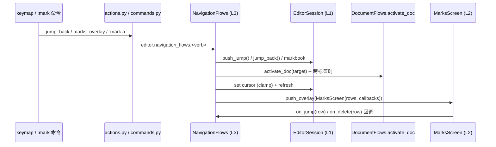

# plan-c — L3 NavigationFlows + L2 marks_palette 屏 + 组装接线 + 命令（wave-2）

父文档：[overview.md](overview.md)。输入：F5-F13；设计决策 D2/D5/D6/D7/D8。
前置：wave-1 的 plan-a（session 契约）与 plan-b（常量）验收通过。

## 目标与非目标

- 目标：按 §三.8 六步接入新 L3 流程模块 `flows/navigation_flows.py`
  （类 `NavigationFlows`）；新增 L2 自持屏组件 `editor_components/marks_palette.py`
  （MarksScreen/JumpsScreen）；`Editor`/`editor_compose.py` 组装接线；actions.py
  注册三动作；commands.py 注册四命令；R11 登记与规则文本同步。
- 非目标：goto_line 推入接线（plan-d）；文档（plan-e）。

## 独占文件清单

- `yate/flows/navigation_flows.py`（新建）
- `yate/editor_components/marks_palette.py`（新建）
- `yate/editor_compose.py`
- `yate/editor.py`
- `yate/actions.py`
- `yate/commands.py`
- `tests/test_architecture.py`
- `tests/test_marks_navigation_flows.py`（新建）
- `tests/test_marks_commands.py`（新建）
- `.trae/rules/architecture-boundaries.md`（规则文本同步）

## 架构边界说明（本计划触碰的条款）

- **R7**：动作走 `actions.py::populate()`，表单向（`editor` 可 import actions，
  反向禁止——不新增反向边）。
- **R11**：`flows/navigation_flows.py` 新增 `editor_components` 导入 → 必须先在
  `tests/test_architecture.py` 的 `UI_FROZEN_FILES` 登记新键
  `"flows/navigation_flows.py"`（allowed：`yate.editor_components`、
  `yate.editor_components.marks_palette`、`yate.editor_components.panes`）。
  先登记、后加 import；守卫 `test_collaborators_keep_widget_coupling_frozen`
  自动执法。
- **R13/R15**：marks_palette 屏复用 `editor_components/modals.py` 的
  `_OverlayScreen`/`_OverlayScroll`（包内复用，二者已内置主题订阅与滚动条
  接线），新模块不定义新 `SCROLLABLE_BASES` 命中类，守卫 #37 自动满足；
  流程不直改任何 widget `.styles.*`。
- **能力注入**（issue IKJB0Q）：`NavigationFlows` 不持 App 句柄——
  `push_overlay`、`activate_doc` 等全部构造注入；守卫
  `test_flow_modules_hold_no_app_handle` 已覆盖 `yate/flows/*.py`。
- **§三.8**：模块命名 `navigation_flows.py`/类 `NavigationFlows`；editor.py
  类属性注解 + 工厂构造 + 组装顺序注释；不 import editor_components 之外
  的向上依赖。

交互顺序（跨标签标记跳转）：



## 具体修改（定位到行号）

### 1. `yate/editor_components/marks_palette.py`（新建，约 230 行，L2 自持）

- 头部 `from __future__ import annotations`；导入
  `from yate.editor_components.modals import _OverlayScreen, _OverlayScroll`、
  `paths.load_tcss`、theme / scrollbars（若直接用 `_OverlayScroll` 已含）。
- 纯数据行类型（模块级，frozen dataclass）：

```python
@dataclass(frozen=True)
class MarkRow:
    """One row of the marks overview: pure display data (R13 injection)."""

    uid: int
    name: str
    doc_name: str
    line_no: int  # 1-based for display
    preview: str

@dataclass(frozen=True)
class JumpRow:
    """One row of the jumps overview: stack side + entry + current flag."""

    entry: JumpEntry
    side: str  # "back" | "forward"
    current: bool
```

（`JumpEntry` 从 `yate.session` 导入——L2 消费 L1 模型是合法方向
`EV --> SES`。）

- `MarksScreen(ModalScreen[None])`：构造注入 `(rows: list[MarkRow],
  on_jump: Callable[[MarkRow], None], on_delete: Callable[[MarkRow], None])`；
  `DEFAULT_CSS = load_tcss("overlay-screen.tcss")`（复用 #overlay/#overlay-body
  冻结 id，R9 组件自持先例）；BINDINGS：`enter` 跳转（`on_jump` 后
  `self.dismiss()`）、`d` 删除当前行（行内移除并重渲染，屏不关）、
  `escape`/`q`/`ctrl+c` 关闭；选中行用模块内私有高亮 helper 维护游标；
  标题行 `<name>  doc  line  text` 布局。
- `JumpsScreen(ModalScreen[None])`：构造注入 `(rows: list[JumpRow],
  on_jump: Callable[[JumpRow], None])`；enter 跳转并关闭；`current=True` 的
  行渲染分隔标记（当前指针位置，AC3）；键位同上（无 d）。
- 两屏都走 `_OverlayScreen` 的 esc/q/ctrl+c 语义与 `_OverlayScroll` 滚动体
  （R15 双调用在其中，勿再手写第二份）。
- 组件不 import editor/app，不持 App 句柄（R3/能力注入守卫自动执法）。

### 2. `yate/flows/navigation_flows.py`（新建，约 200 行，L3）

`from __future__ import annotations`；导入：`MessageFn`（yate.flows）、
`MARK_NAME_CHARS/JumpEntry`（yate.session）、`MARKS_OVERLAY_KEY` 不需要
（键位只在 keymap 表）；`yate.editor_components.marks_palette` 的
MarksScreen/JumpRow/JumpScreen；`yate.editor_components.panes.PaneManager`；
`textual.screen.Screen`（push_overlay 签名）。

```python
class NavigationFlows:
    """Marks and jump-list navigation flow (issue IKUOCI, L3 orchestration).

    State lives in EditorSession (L1); this module only orchestrates:
    resolve targets, switch tabs via activate_doc, reveal cursors, and
    push the L2 overview screens through the injected push_overlay verb.
    """

    def __init__(
        self,
        session: EditorSession,
        panes: PaneManager,
        activate_doc: Callable[[Document], None],
        push_overlay: Callable[[Screen[None]], None],
        message: MessageFn,
        refresh: Callable[[], None],
    ) -> None: ...
```

方法（全部先改 L1 状态，再 UI 反馈）：

- `set_mark(name: str) -> None`：校验 `MARK_NAME_CHARS`（非法 → message
  warn `mark name must be a-z: <x>`，return）；`session.markbook.set(...)`
  以 `session.doc.uid` + 当前光标；message info `mark <n> set at line <N>`；
  refresh。
- `jump_to_mark(name: str, uid: int | None = None) -> None`：带 uid 时按
  指定 buffer 取标记（面板路径），否则按"任一打开 buffer 存在该名标记则跳，
  否则当前 buffer 设置"语义（D6）。目标文档 `session.doc_by_uid` 为 None →
  warn `mark target buffer not open`；取标记成功后：
  `session.push_jump()`（AC3，记录跳转前位置）→ 若目标非当前 doc 先
  `activate_doc(doc)` → clamp（`row = min(row, buf.line_count - 1)`、
  `col = min(col, len(buf.lines[row]))`，D3）→ `buf.set_cursor(row, col)`、
  `buf.anchor = None` → `for view in self.panes.views_for(doc): view.reveal_cursor()`
  → refresh + info message。
- `delete_mark(name: str, uid: int | None = None) -> bool`：删除指定（面板）
  或当前 buffer 的标记；False → warn `no such mark: <n>`（AC6）。
- `jump_back()`：`target = session.jump_back()`；None → info
  `no earlier jump`（边界提示，不循环，AC2）；否则 `_go_to(target)`
  （复用 clamp/reveal 逻辑，closed doc 兜底 warn 并 return）。
- `jump_forward()`：对称。
- `show_marks() -> None`：从 `session.markbook.all_marks()` 构建
  `MarkRow` 列表（`doc_by_uid` 解析 doc 名与预览行，closed 跳过；行号
  1-based；预览 = `doc.buffer.lines[clamp(row)]` 截断）；构造
  `MarksScreen(rows, on_jump=lambda r: self._on_panel_jump(r),
  on_delete=lambda r: self._on_panel_delete(r))` → `self.push_overlay(screen)`
  （底栏消息先清，quick_open 同语义，F9）。
- `show_jumps() -> None`：`session.jumps.stacks()` + `_current_entry` 构建
  `JumpRow`（back 旧→新、分隔 current 行、forward 新→旧）→ push
  `JumpsScreen(rows, on_jump=...)`；enter 直接 `push_jump()` 后
  `_go_to(entry)`（D7：直跳语义，forward 分支随 push 清空——在面板消息中
  注明）。

### 3. `yate/editor.py`（+4 行左右，豁免内）

- import（L77 `mouse_flows` 与 L78 `overlay_flows` 之间，字母序）：
  `from yate.flows.navigation_flows import NavigationFlows`。
- 类属性（L146 `macro_flows: MacroFlows | None` 之后）：
  `navigation_flows: NavigationFlows | None = None`。
- 组装顺序注释（L171-182）：在 macro_flows 行后补
  `navigation_flows` 一行（built in _build_pane_stack, right after overlays）。

### 4. `yate/editor_compose.py`（+12 行左右）

- import（L42/43 之间字母序）：
  `from yate.flows.navigation_flows import NavigationFlows`。
- `_build_pane_stack`（L228-388）：在 overlays 组装块（L276-296，
  `bind_hex_opener` L300 之后）插入：

```python
    ed.navigation_flows = NavigationFlows(
        session=ed.session,
        panes=ed.panes,
        activate_doc=ed.document_flows.activate_doc,
        push_overlay=ed.overlays.push,
        message=ed.message,
        refresh=ed.refresh,
    )
```

（`LspSync(push_overlay=ed.overlays.push)` L330 同款动词注入。）

### 5. `yate/actions.py`：三动作（L249 macro_replay_last reg 之后）

```python
    reg("jump_back", lambda ctx: editor.navigation_flows.jump_back(),
        "Jump back in jump history (alt+left)")
    reg("jump_forward", lambda ctx: editor.navigation_flows.jump_forward(),
        "Jump forward in jump history (alt+right)")
    reg("marks_overlay", lambda ctx: editor.navigation_flows.show_marks(),
        "Open the marks overview (alt+m)")
```

（R7 单向：actions import editor，反向禁止；现有 `reg(..., lambda ctx: ...)` 形态。）

### 6. `yate/commands.py`：四命令（L22 附近导入追加
`from yate.session import MARK_NAME_CHARS`，向下依赖合法；handler + reg 插在
macro 命令块 L703-707 之后）

- `_mark(args)`：`args.strip()` 为单字符且在 `MARK_NAME_CHARS` →
  `editor.navigation_flows.jump_to_mark(name)`（D6 语义由流程实现）；否则
  `editor.message("usage: :mark <a-z> (jump if set, else set here)", "warn")`。
- `_delmark(args)`：空参 → warn usage；非法名 → warn；其余 →
  `delete_mark(name)`，返回 False 已由流程 warn（AC6 重复删除有提示）。
- `_marks(args)` → `editor.navigation_flows.show_marks()`。
- `_jumps(args)` → `editor.navigation_flows.show_jumps()`。
- 注册名：`"marks"`、`"mark"`、`"delmark"`、`"jumps"`（cmdline_completions
  自动进 `:` 补全，F14；执行期核实一次）。

### 7. `tests/test_architecture.py`：UI_FROZEN_FILES 新键（L240-250 的
`flows/overlay_flows.py` 键之后插入）

```python
        "flows/navigation_flows.py": {
            "yate.editor_components",
            "yate.editor_components.marks_palette",
            "yate.editor_components.panes",
        },
```

### 8. `.trae/rules/architecture-boundaries.md`：规则文本同步

- §一 L3 清单 `flows/` 子包枚举追加 `navigation_flows.py`（带日期注记
  "2026-11-16 marks-jumplist wave-2 接入"）。
- R11 枚举与 `UI_FROZEN_FILES` 说明处同步提及新键（三个 allowed 模块）。
- §三.8 接入清单追加一条已接入记录（对齐 2026-11-12 macro_flows 记录形态）。
- §三.7 editor.py 豁免行数由执行阶段实测回填（不新增豁免，`SIZE_EXEMPT_FILES`
  仍 6 项，F11）。

## 新增测试

### `tests/test_marks_navigation_flows.py`

fixture：stub `PaneManager` 子集（`views_for` 返回一个记录
`reveal_cursor()` 的假 view）、`activate_doc`/`push_overlay`/`message`/
`refresh` 全部记录器；session 用 plan-a 的 `_session()` 形态（两个手工
Document）。

| 用例 | 前置/操作/断言 |
|---|---|
| `test_set_mark_records_cursor_and_messages` | 光标 (5,2) → set_mark("a") → markbook 有 (uid,row=5,col=2)、message 含 "mark a set"、refresh 调用过 |
| `test_set_mark_rejects_illegal_name` | set_mark("A") → markbook 空、message kind == "warn" |
| `test_jump_to_mark_same_doc_moves_cursor_clamped` | set 标记在 (50,0) 但 buffer 只有 20 行 → jump_to_mark("a") → 光标 row=19（clamp）、push 产生一条 (AC3)、reveal 调用过 |
| `test_jump_to_mark_switches_tab_via_activate_doc` | 标记在 doc2 → jump_to_mark("a") → activate_doc 收到 doc2、push_jump 记录的是 doc1 的跳转前位置 |
| `test_jump_to_mark_missing_name_warns` | 未设标记 → message warn、光标不动 |
| `test_jump_to_mark_closed_target_warns` | markbook.set(uid=999,...) 造死条目 → warn "mark target buffer not open" |
| `test_delete_mark_missing_warns` | delete_mark("z") → 返回 False、warn |
| `test_jump_back_boundary_is_info_not_loop` | 空历史 jump_back() → info "no earlier jump"、光标不动、不抛异常（AC2） |
| `test_jump_back_moves_cursor_to_entry` | push 后移动光标 → jump_back() → 光标回到条目位置 |
| `test_show_marks_pushes_screen_with_rows` | 两 doc 各一标记 → show_marks() → push_overlay 收到 MarksScreen、rows 含两行且 line_no 1-based |
| `test_show_jumps_rows_mark_current_side` | push 两次 → show_jumps() → rows 的 side/current 标注与栈一致（AC3 指针一致） |

### `tests/test_marks_commands.py`

fixture：stub editor（仅暴露 `navigation_flows` 记录器 + `message` 记录器），
`CommandRegistry` + `register_commands(stub_editor)`（R7 形态）。

| 用例 | 操作/断言 |
|---|---|
| `test_marks_and_jumps_commands_open_overlays` | registry.run("marks")/run("jumps") → 记录器收到 show_marks/show_jumps |
| `test_mark_command_valid_name_calls_flow` | run("mark a") → jump_to_mark("a") 被调 |
| `test_mark_command_illegal_name_warns` | run("mark A") / run("mark") → message warn，flow 未被调 |
| `test_delmark_command_routes_to_flow` | run("delmark a") → delete_mark("a") |
| `test_delmark_command_empty_warns` | run("delmark") → warn usage |

### 架构守卫（tests/test_architecture.py）

- R11 登记项落在第 7 节（新键）；无需新守卫用例——负向拦截由既有
  `test_collaborators_keep_widget_coupling_frozen` 执行（漏登记即红）。

## 验证方案与验收命令

```powershell
.venv\Scripts\python.exe -m pytest tests/test_marks_navigation_flows.py tests/test_marks_commands.py -q
.venv\Scripts\python.exe -m pytest tests/test_architecture.py -q
.venv\Scripts\python.exe -m pyright yate/ tests/
.venv\Scripts\python.exe -m pytest tests/test_marks_keys.py tests/test_marks_session.py -q
```

- 通过判定：全部退出码 0（pyright strict 零诊断）；架构测试含新 R11 键全绿。
- 手工冒烟（UI 面，无法自动化部分）：pilot 冒烟可用 textual-pilot-smoke——
  打开双标签、`:mark a` → alt-m 面板见行号与预览 → enter 跳转切标签 →
  alt-left 回到跳转前 → alt-right 复位；边界再按各一次确认提示；d 删除后
  行消失。预期现象与 AC1/AC2/AC6 一致。

## 风险与回滚

- 风险1：R11 漏登顺序 → 计划明确"先登记后 import"，架构测试负向拦截。
- 风险2：editor.py/editor_compose.py 行号漂移（前序任务改动）→ 以符号锚点
  （`macro_flows` / `bind_hex_opener`）定位而非死行号，实施时重新 grep。
- 风险3：`_OverlayScreen` 私有复用评审异议 → 备选：在 modals.py 把基类改名
  为公开（`OverlayScreenBase`），单文件小改；默认走包内私有复用。
- 风险4：`:jumps` enter 直跳清 forward 的语义与"指针一致"理解偏差 → 屏内
  消息明示；如评审要求"从历史中点跳转保持分支"，属 v1 增强，不改契约。
- 回滚：`git checkout -- yate/editor.py yate/editor_compose.py yate/actions.py
  yate/commands.py tests/test_architecture.py .trae/rules/architecture-boundaries.md`
  + 删除 `yate/flows/navigation_flows.py`、`yate/editor_components/marks_palette.py`、
  两个新测试文件；plan-a/b 产物不受影响。
