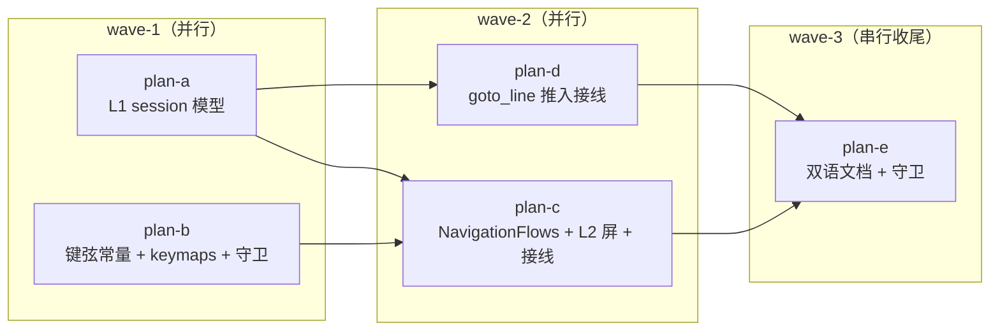
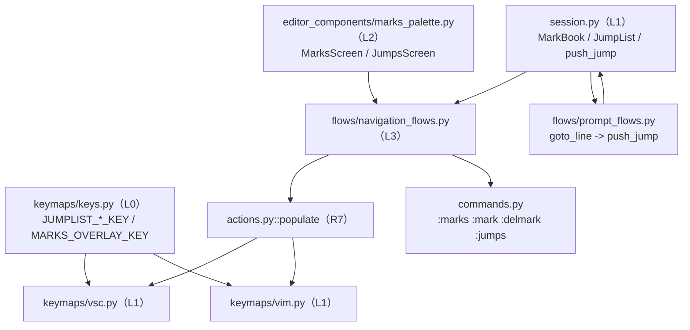

# marks & jump list 实施总纲（issue IKUOCI）

## 目标

为 yate 实现 buffer 局部 marks（v1 限 a-z）与会话级 jump list，vim/vsc 两套键位
共用同一套键弦常量与动作；为未来 LSP goto-definition 提供单一推入契约
（session 级 push_jump），alt-left/alt-right 原路返回。

## 非目标（v1 范围外，issue 明确）

- vim 模态补充键（m{a-z} / 'a / \`a）；全局标记 A-Z 与 changelist；
- 未打开文件的跳转目标解析；标记的可视化渲染；持久化。
- 精确列平移（随编辑平移标记列）——评估后否决，见下。

## 调研事实清单（文件:行号，均相对仓库根）

- F1 键弦 raw 形态：终端对 alt+方向键发送 modified CSI；`yate/keyproto/key_codec.py`
  L43-48 的 `_MOD_ARROWS[("alt",)]` 把 Textual 事件名 `alt+left`/`alt+right` 映射为
  `\x1b[1;3D`/`\x1b[1;3C`。而 `parse_key("<alt-left>")`（keymaps/keys.py L145-146
  对 base 加 `\x1b` 前缀）产出 `\x1b\x1b[D`——**终端不会发送**。既有先例：
  keymaps/vsc.py L54-55 用 `_raw("\x1b[1;3A", ...)` 直接绑 CSI 字节。
- F2 `KEY_ALIASES` 已收录 `"\x1b[1;3D": "alt-left"` / `"\x1b[1;3C": "alt-right"`
  （keymaps/keys.py L92-93），`key_name()` 反查后 help/which-key 显示 `<alt-left>`；
  两字节 alt 形态 `\x1bm` 由 keys.py L202-212 命名为 `<alt-m>`。
- F3 共享常量先例：`HOVER_DOC_KEY = "<f7>"`（keys.py L60）、`MACRO_*_KEY`
  （L62-66）、`MACRO_CONTROL_KEYS = frozenset(parse_key(...))`（L173-176，证明
  keys.py 可在 parse_key 定义之后于模块级调它）。守卫先例：
  `test_hover_key_is_shared_and_identical`（tests/test_architecture.py L1615-1650）、
  `test_macro_keys_are_shared_and_identical`（L1653-1706）。
- F4 vim 模式分派前消费 raw 键先例：`VimKeymap.handle_key` 先处理 ctrl+/（vim.py
  L258-261）再处理 `_FUNCTION_KEYS`（L262-271），均先 `_clear_pending()`；新增
  alt-* 分支插在 F-keys 分支之后。
- F5 L1 会话模型：`EditorSession`（session.py L73-292）已持 `MacroState()`（L92）
  同类会话级状态先例；`Document.uid`（editor_core/document.py L42）是稳定身份键；
  `is_open`/`activate`/`close_active`（L229-249）/`close_under`（L251-277）是
  关闭清理钩点。
- F6 流程组装：`Editor.__init__` 组装序列（editor.py L183-188）、
  `_build_pane_stack`（editor_compose.py L228-388）中 overlays 建于 L276-296、
  `push_overlay` 注入先例 `LspSync(push_overlay=ed.overlays.push)`（L330）；
  `MacroFlows` 按 §三.8 六步接入（editor.py L146 / editor_compose.py L129-135）。
- F7 行跳转落点：`:42`/ctrl-g 汇于 `PromptFlows.goto_line`（flows/prompt_flows.py
  L291-308）；`editor.run_command` L754-756 把裸数字路由到它。
- F8 跨标签切换动词：`DocumentFlows.activate_doc`（flows/document_flows.py L176-187），
  TabBar 同样注入它（editor_compose.py L208）。
- F9 overlay 先例：`OverlayFlows.push`（flows/overlay_flows.py L86-99）推送前清
  底部消息；`PaletteScreen`（editor_components/palette.py L112+）是 quick_open 的
  L2 自持先例；`_OverlayScreen`/`_OverlayScroll`（editor_components/modals.py
  L23-68）已内置 R13 主题订阅 + R15 滚动条接线。
- F10 UI_FROZEN_FILES（tests/test_architecture.py L198-265）：flows 新增
  editor_components 导入必须登记；`flows/overlay_flows.py` 键在 L240-250。
- F11 体量守卫：`SIZE_EXEMPT_FILES`（test_architecture.py L372）现有 6 项，
  `test_editor_size_exemption_is_registered`（L1708-1724）断言 editor.py 在集合且
  `len == 6`——editor.py 已豁免（现 808 行），本次仅 +4 行左右，**不新增豁免**。
- F12 手册真实路径是 `yate/resources/manual.{en,zh}.md`（issue 写的 yate/docs/
  已过期；tests/test_macro_docs.py L145-149 明文钉住该事实）。双语守卫先例：
  test_macro_docs.py（行配对 L135-142、无本机路径 L165-182）。
- F13 which-key 面板与 f1 帮助均为数据驱动（读 keymap 表行 + category 分组，
  editor_components/whichkey.py `show_entries`、modals.py HelpScreen._body
  L89-106），新表行自动出现，无需改组件。
- F14 `:42` 命令补全由 cmdline_completions.py（51 行）从 CommandRegistry 动态
  生成，新命令自动进入 `:` 补全（执行期核实，不需改）。

## 关键设计决策

| # | 决策 | 理由 |
|---|---|---|
| D1 | 键弦常量持 **raw CSI 字节**：`JUMPLIST_BACK_KEY="\x1b[1;3D"`、`JUMPLIST_FORWARD_KEY="\x1b[1;3C"`（keys.py，L0）；`MARKS_OVERLAY_KEY=parse_key("<alt-m>")`（=`\x1bm`，终端对 alt+字母即发该字节） | parse_key 对 alt+方向键产出终端不发的 meta-prefix 形态（F1）；vsc `_raw` 先例 |
| D2 | marks/jumps 状态归 L1 session.py：`MarkBook`（按 `Document.uid` 键控）、`JumpList`（**双栈** back/forward + 容量 100）；`EditorSession.push_jump()` 是唯一推入契约；`EditorSession.jump_back()/jump_forward()` 是仅有的两个导航动词（簿记全部收在 L1） | issue 架构落点；双栈无指针错位问题，边界=空栈，天然不循环 |
| D3 | 编辑后标记 **clamp 到有效行/列**（跳转时 clamp），不做精确平移 | 精确平移需在 editor_core/buffer.py（L0，1566 行）每条变更原语上加钩子，底层多点改动波及全部上层，v1 收益不成比例 |
| D4 | 搜索命中（n/N）**不推入** jump list（v1 定稿） | n/N 高频连按会灌满历史；契约已收敛，未来只需在 find_next 命中分支加一行 `session.push_jump()` |
| D5 | 新 L3 流程模块 `flows/navigation_flows.py`（类 `NavigationFlows`，§三.8 六步接入）；直接 import 新 L2 屏组件 `editor_components/marks_palette.py` 并经注入的 `push_overlay`（= `overlays.push`）推送 | 对齐 quick_open 先例（F9）；R11 需在 UI_FROZEN_FILES 新键登记（F10） |
| D6 | `:mark <name>` 语义 = 已存在于任一打开 buffer 则跳转（可跨标签），否则在当前光标处设置 | issue "设置/跳转" 单入口要求；v1 无模态 m{a-z}，此为唯一创建入口 |
| D7 | marks 一览列出**所有打开 buffer** 的标记（名字 + 所在文档 + 行号 + 预览），enter 跳转（自动切标签）、d 删除；:jumps 一览显示 back 栈（旧→新）+ 当前位置分隔 + forward 栈 | 否则跨标签跳转（AC1）无法从面板触发 |
| D8 | marks 一览面板不设面板内新建入口（新建走 `:mark` 命令） | 模态屏下光标语义歧义；issue AC1 认可 `:mark a` 路径；偏差已在评审记录 |

## 子计划索引与波次表（调度唯一依据）

| 子计划 | 主题 | 波次 | 独占文件（互不重叠） |
|---|---|---|---|
| [plan-a](marks-jumplist-plan-a.md) | L1 会话模型：MarkBook/JumpList/push_jump/导航动词/关闭清理 | wave-1 | yate/session.py；tests/test_marks_session.py |
| [plan-b](marks-jumplist-plan-b.md) | 键弦常量 + 两套 keymap + vim 分派前消费 + AC4 守卫 | wave-1 | yate/keymaps/keys.py；yate/keymaps/vsc.py；yate/keymaps/vim.py；tests/test_architecture.py；tests/test_marks_keys.py |
| [plan-c](marks-jumplist-plan-c.md) | L3 NavigationFlows + L2 marks_palette 屏 + 组装接线 + actions/commands + R11 登记 + 规则文本同步 | wave-2 | yate/flows/navigation_flows.py；yate/editor_components/marks_palette.py；yate/editor_compose.py；yate/editor.py；yate/actions.py；yate/commands.py；tests/test_architecture.py；tests/test_marks_navigation_flows.py；tests/test_marks_commands.py；.trae/rules/architecture-boundaries.md |
| [plan-d](marks-jumplist-plan-d.md) | 行跳转推入接线（goto_line 调 push_jump）+ 集成测试 | wave-2 | yate/flows/prompt_flows.py；tests/test_marks_integration.py |
| [plan-e](marks-jumplist-plan-e.md) | 双语手册与键位文档同步 + 双语守卫测试 | wave-3 | yate/resources/manual.en.md；yate/resources/manual.zh.md；tests/test_marks_docs.py |



- wave-1：plan-a ∥ plan-b（文件零重叠；plan-b 的运行时等价断言只比较两套表内
  动作名字符串，不执行动作，故不依赖 plan-a）。
- wave-2：plan-c ∥ plan-d（plan-d 只碰 prompt_flows.py 与自己的测试文件；
  依赖 wave-1 的 push_jump 已存在）。
- wave-3：plan-e（依赖功能全部落地；随后跑全量门禁收尾）。
- 波次间串行：上一波全部子计划验收命令退出码 0 才进下一波；波次内文件互不
  重叠，可按 subagent-workflow 2~3 个一批并行下发。

## 依赖关系（产品代码）



## 全局风险与回滚

- **回滚单元 = 子计划**：每个子计划独占文件，git 按文件回滚互不牵连；
  总回滚 = 逐 plan 反向 revert（e → d/c → b/a）。
- R1 键弦冲突：alt-left/right/m 全仓未绑定（issue 已核对），vsc 表与 vim
  `_index` 冲突风险由 `tests/test_marks_keys.py` 的注册断言兜底。
- R2 vim 三态一致性：alt-* 在模式分派前消费（plan-b），NORMAL/INSERT/VISUAL
  各有一条用例；半途 chord 由 `_clear_pending()` 清除。
- R3 editor.py 体量：仅 +4 行左右（import + 类属性 + 注释行），仍远低于豁免
  记录口径；不触碰 `SIZE_EXEMPT_FILES`（F11），`len == 6` 断言不受影响。
- R4 R11 漏登：plan-c 先登记 UI_FROZEN_FILES 再加 import，守卫
  `test_collaborators_keep_widget_coupling_frozen` 负向拦截。
- R5 双语漂移：plan-e 双语守卫测试（F12 先例）锁定两语言同节奏更新。

## 全量收尾门禁（wave-3 末尾，task-coordinator 执行）

```powershell
.venv\Scripts\python.exe -m pyright yate/ tests/ tools/
.venv\Scripts\python.exe -m pytest tests/ -q -n auto
.venv\Scripts\python.exe -m pytest tests/test_architecture.py -q
```

退出码全 0 为通过；架构测试失败 = 阻塞合并，不得用豁免注释绕过。

## 执行偏差登记（各子计划回写）

- plan-a：`test_push_jump_clears_forward_branch` 计划草图与 `JumpList` 逐字实现矛盾，按实现语义断言（jump_back 后 forward 长 1；新 push 清空 forward）并在 docstring 说明；两个导航用例补 `session.activate(doc_b)`（`_current_entry` 只读活动文档，fixture 细节）。
- plan-b：fixture 用真 `EditorSession`（经 conftest.make_action_context）替代计划字面的 stub（`ActionContext` 注解要求具体类型）；`test_vim_unrelated_keys_unaffected` 按 vim.py 事实改断言 "x" 走硬编码 delete_forward 分支（返回 True、新分支未介入、buffer 生效）。
- plan-c：`ed.refresh` → `ed.refresh_ui`（Editor 无 `refresh` 方法）；`navigation_flows` 类属性改裸注解（与兄弟 flows 形态一致，`| None = None` 会致 actions.py lambda 严格诊断）；D6 正文与单条测试预期矛盾，按 D6 正文拆三例（illegal-name warn / panel 缺标 warn / unset-name 落 D6 设置）；私有基线复用初版以 `# pyright: ignore[reportPrivateUsage]` 落地（评审后已消除，见评审轮次）；面板 BINDINGS 补 `up`/`down` 游标移动（palette 同款 on_key 拦截）。
- plan-d：计划验收命令 2 所指 tests/test_prompt_flows.py 不存在，以 test_app_find + test_action_table 替代（exit 0，76 passed）；`test_goto_line_same_position_dedups` 补起始位置语义说明。
- plan-e：全量套件暴露 wave-1 接缝缺口——actions.py 新增 `editor.navigation_flows.*` 转发但 test_action_table.py 的 `FORWARDED_HOOKS` 未登记（AttributeError），做最小修复 +4 行（独占清单外，显式登记）；§18 键位速查表未加新键（宏键 F10-F12 先例同未入表，无冲突）。

## 评审轮次记录（2026-11-16，code-review-expert）

结论：0 blocker / 0 major / 6 minor；门禁实测全过（pytest 全绿、架构 42、pyright 0、覆盖率 92.69%、冒烟 124/124）。

| # | 严重级 | 位置 | 处置 |
|---|---|---|---|
| 1 | minor | marks_palette.py JumpsScreen 表头与数据行错位 1 列 | 已修（`STACK:<10` 抵消对齐） |
| 2 | minor | marks_palette.py LINE 1-based 与 COL 0-based 口径不一 | 已修（COL 统一 +1） |
| 3 | minor | `_current_entry` session/flow 两处重复 | 已修（session 公共 `current_jump_entry`，flow 删副本） |
| 4 | minor | navigation_flows.py 模块级 log 零调用 | 已修（删除） |
| 5 | minor | marks_palette.py 全仓首个 `# pyright: ignore` | 已修（modals.py 增公共别名 OverlayScreen/OverlayScroll，消除抑制） |
| 6 | minor | 面板跳转 back 栈条目不弹出，二次 alt-left 一次空按 | **TODO（v2）**：符合文档化 D7 契约，可选改进为 `take_*` 对 current 位置去重 |
| - | 建议 | MarksScreen/JumpsScreen `on_key` 交互缺运行时用例 | **TODO（v2）**：补 textual-pilot 用例或冒烟场景 |

修复后复验：pytest 全量 -n auto 全绿、pyright 0 诊断、marks_palette.py 抑制计数 0。

## 遗留 TODO（v2 候选）

- T1：面板跳转 back 栈条目不弹出（评审 #6），随 LSP goto-definition 落地一并评估。
- T2：marks/jumps 两屏按键交互的运行时用例（textual-pilot 或冒烟场景）。**已闭合**：pr-review 终审指出 marks_palette.py 覆盖 44% 后补 tests/test_marks_palette.py（6 例 pilot），覆盖升至 100%。
- T3：搜索命中推入 jump list 的接入点已预留（契约收敛为 `push_jump`），v1 定稿不推入。
- T4（pr-review 终审 minor）：VISUAL 模式下导航键分发后模式停留 VISUAL（anchor 已清、无高亮）——与 F-key 全模式先例一致，可恢复不崩溃；v2 评估分发后回 NORMAL 的语义（勿在 v1 单独改，保持与 F-key 行为面一致）。
- T5（pr-review 终审 minor）：JumpsScreen 光标可停在 current 行，Enter 静默 no-op。**已闭合**（迭代轮 3）：经注入 `MessageFn` 回调改发 "already at latest jump" info 提示，屏幕不关、光标不动；行过滤变体仍可选，归入 v2 打磨。
- T6（pr-review 轮 4 minor）：navigation_flows.py 4 条防御分支未覆盖（closed-buffer warn、`_on_jump_entry` current 双保险、closed-target）——屏幕层已拦截双保险路径；v2 可删冗余守卫或补 flows 层用例。**已闭合**（2026-11-18）：实测未覆盖实为 3 处 4 语句（closed-buffer warn 已有既有用例），补 4 条 flows 层用例保留全部守卫，navigation_flows.py 覆盖 95%→100%。
- T7（pr-review 轮 4 minor）：`JumpEntry.path` 为 push 时刻 display 快照，buffer save-as 后 `:jumps` 显示旧名（uid 解析不受影响）——v2 可在渲染/`_go_to` 时经 `doc_by_uid` 重解析。**已闭合**（2026-11-18）：`show_jumps` 行构建经 `_display_entry` helper 重解析（closed buffer 回退快照），`_go_to` 本就只用 uid 无需改；新增 save-as 等价状态与 closed-buffer 回退两条用例。
