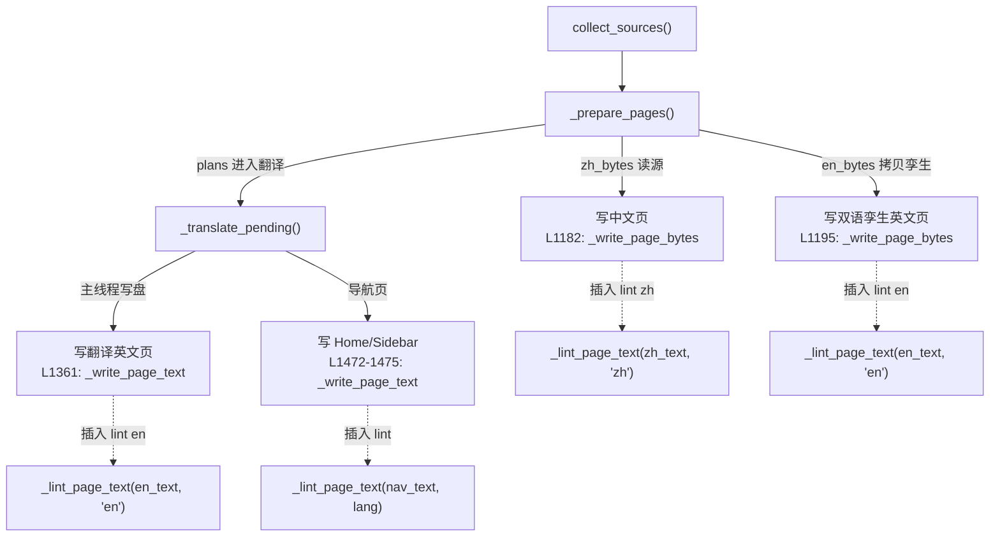

# mdlint wiki 集成 (plan_b)

**波次**: wave-2（依赖 wave-1 的 plan_a + plan_c 全部验收通过）

## 一、输入

- plan_a 产出的 `tools.mdlint.lint.LintEngine`；
- `tools/pack/wiki.py` 的三条产出路径（已定位行号）；
- `tools/pack/errors.py` 的 `Code` 枚举。

## 二、独占文件清单

**修改**：

| 文件 | 改动类型 | 改动量 |
|---|---|---|
| `tools/pack/wiki.py` | 新增 `_lint_page_text` 函数 + 4 处调用插入 | ~50 行新增 |
| `tools/pack/errors.py` | 新增 `Code.WIKI_LINT_FAILED` 枚举值 | ~3 行新增 |

**新增测试**：

| 文件 | 用例数 |
|---|---|
| `tests/test_pack_wiki_lint.py` | ~8 |

**不触碰**：`tools/translate/`、`yate/`、`tools/mdlint/`、`.githooks/`、`pyproject.toml`。

## 三、wiki 产出链路的 lint 插入点

### 3.1 路径总览



### 3.2 逐处插入点（文件:行号）

#### 插入点 1: 中文页原样写盘

**位置**: `tools/pack/wiki.py` L1180-1182

**现状**:

```python
zh_bytes = _read_source_bytes(page.zh_source)
digest = hashlib.sha256(zh_bytes).hexdigest()
_write_page_bytes(target / page.zh_target, zh_bytes)
```

**改后**:

```python
zh_bytes = _read_source_bytes(page.zh_source)
digest = hashlib.sha256(zh_bytes).hexdigest()
zh_bytes = _lint_page_bytes(zh_bytes, "zh")
_write_page_bytes(target / page.zh_target, zh_bytes)
```

`_lint_page_bytes` 是新辅助函数，内部解码 -> fix -> 编码。

#### 插入点 2: 双语孪生英文页拷贝写盘

**位置**: `tools/pack/wiki.py` L1191-1195

**现状**:

```python
try:
    en_bytes = page.en_source.read_bytes()
except OSError:
    en_bytes = None
if en_bytes is not None:
    _write_page_bytes(en_path, en_bytes)
```

**改后**:

```python
try:
    en_bytes = page.en_source.read_bytes()
except OSError:
    en_bytes = None
if en_bytes is not None:
    en_bytes = _lint_page_bytes(en_bytes, "en")
    _write_page_bytes(en_path, en_bytes)
```

#### 插入点 3: 翻译产出英文页落盘

**位置**: `tools/pack/wiki.py` L1361

**现状**:

```python
_write_page_text(target / page.en_target, outcome.english)
```

**改后**:

```python
linted_english = _lint_page_text(outcome.english, "en")
_write_page_text(target / page.en_target, linted_english)
```

此处用 `_lint_page_text`（文本版）因为 `outcome.english` 已是 `str`。

#### 插入点 4: 导航页写盘

**位置**: `tools/pack/wiki.py` L1472-1475

**现状**:

```python
_write_page_text(target / "Home.md", home_zh)
_write_page_text(target / "_Sidebar.md", sidebar_zh)
_write_page_text(target / "Home.en.md", home_en)
_write_page_text(target / "_Sidebar.en.md", sidebar_en)
```

**改后**:

```python
_write_page_text(target / "Home.md", _lint_page_text(home_zh, "zh"))
_write_page_text(target / "_Sidebar.md", _lint_page_text(sidebar_zh, "zh"))
_write_page_text(target / "Home.en.md", _lint_page_text(home_en, "en"))
_write_page_text(target / "_Sidebar.en.md", _lint_page_text(sidebar_en, "en"))
```

### 3.3 新增辅助函数

在 `tools/pack/wiki.py` 中新增（位于 `_write_page_text` 之后，约 L224）：

```python
def _lint_page_text(text: str, lang: str) -> str:
    """Run the mdlint fix pass on *text* and return the cleaned version.

    Remaining violations (not auto-fixable) are logged as warnings;
    they do not abort the wiki run.  The lint engine is created lazily
    and cached for the process lifetime (one per *lang*).
    """
    engine = _get_lint_engine(lang)
    fixed, remaining = engine.fix(text)
    if remaining:
        for v in remaining[:5]:  # cap warning noise
            errors.log.warning(
                "wiki lint: %s:%d:%d %s %s",
                "<page>", v.line, v.column, v.rule_id, v.message,
            )
    return fixed


def _lint_page_bytes(data: bytes, lang: str) -> bytes:
    """Decode *data* as UTF-8, lint, and re-encode."""
    text = data.decode("utf-8", errors="replace")
    fixed = _lint_page_text(text, lang)
    return fixed.encode("utf-8")


_LINT_ENGINES: dict[str, LintEngine] = {}


def _get_lint_engine(lang: str) -> LintEngine:
    """Return a cached :class:`LintEngine` for *lang*."""
    if lang not in _LINT_ENGINES:
        from tools.mdlint.lint import LintEngine
        _LINT_ENGINES[lang] = LintEngine(lang)
    return _LINT_ENGINES[lang]
```

### 3.4 `Code` 枚举扩展

在 `tools/pack/errors.py` L55 后新增：

```python
WIKI_LINT_FAILED = "WIKI-0109"
```

此 code 用于 lint 引擎本身不可用（import 失败、插件加载失败等）的极端场景。
常规 lint 违规（fix 后仍有残留）只记 warning，不上报 error。

### 3.5 多线程约束

- `_get_lint_engine` 在主线程调用（`_prepare_pages` 与 `_translate_pending` 的
  写盘循环均在主线程）；
- `LintEngine` 实例线程安全（pymarkdown API 每次 `scan_string` / `fix_string`
  创建独立内部状态）；
- worker 线程（`_run_batch`）不碰 lint 引擎——它们只做翻译，不写盘。

### 3.6 manifest digest 不受影响

- digest 在 `_prepare_pages` L1181 按 `zh_bytes`（**源原始字节**）计算；
- lint 在 L1182 之后执行，修改的是写盘内容，不改 `zh_bytes` 变量；
- 因此 freshness 判定（下一轮 run 比较 manifest 记录的 digest 与源字节）不受影响。

## 四、具体修改

### 4.1 `tools/pack/errors.py`

在 `Code` 枚举的 `WIKI_GIT_FAILED = "WIKI-0108"` 之后新增一行：

```python
WIKI_LINT_FAILED = "WIKI-0109"
```

### 4.2 `tools/pack/wiki.py`

1. **新增 import**（文件头部，L76 附近）：

```python
from tools.mdlint.lint import LintEngine, LintViolation
```

注意：这是延迟 import（在 `_get_lint_engine` 内），不在模块顶部。
原因：`tools.mdlint` 依赖 `pymarkdownlnt`（可选依赖），wiki 不应在 import 时
强制要求安装。

1. **新增辅助函数**（L224 附近，`_write_page_text` 之后）：

```python
_LINT_ENGINES: dict[str, LintEngine] = {}


def _lint_page_text(text: str, lang: str) -> str:
    ...


def _lint_page_bytes(data: bytes, lang: str) -> bytes:
    ...


def _get_lint_engine(lang: str) -> LintEngine:
    ...
```

1. **插入点 1**（L1182）：在 `_write_page_bytes` 调用前加 `zh_bytes = _lint_page_bytes(zh_bytes, "zh")`

2. **插入点 2**（L1195）：在 `_write_page_bytes(en_path, en_bytes)` 前加 `en_bytes = _lint_page_bytes(en_bytes, "en")`

3. **插入点 3**（L1361）：将 `_write_page_text(target / page.en_target, outcome.english)` 改为
   `_write_page_text(target / page.en_target, _lint_page_text(outcome.english, "en"))`

4. **插入点 4**（L1472-1475）：4 处 `_write_page_text` 调用包裹 `_lint_page_text`

## 五、测试用例

### 5.1 `tests/test_pack_wiki_lint.py`

| 用例 | 前置 | 操作 | 断言 |
|---|---|---|---|
| `test_zh_page_written_with_lint_fix` | repo fixture 含 CJK-Latin 无空格源 | `wiki.run(target, None, repo_root=repo)` | 写出的 zh 页中 CJK-Latin 已加空格 |
| `test_en_twin_page_written_with_lint_fix` | repo fixture 含 trailing spaces 的 en 孪生页 | `wiki.run(target, None, repo_root=repo)` | 写出的 en 页 trailing spaces 已清除 |
| `test_translated_en_page_linted` | mock translate_cmd 返回含 MD047 违规的译文 | `wiki.run(target, cmd, repo_root=repo)` | 写出的 en 页末尾有换行 |
| `test_nav_pages_linted` | 正常 repo | `wiki.run(target, None, repo_root=repo)` | Home.md / _Sidebar.md 合法 |
| `test_lint_does_not_affect_manifest_digest` | 含 lint 违规源的 repo | 两轮 `wiki.run` | manifest 中 digest 一致（按源字节算） |
| `test_lint_engine_import_error_reported` | mock `tools.mdlint.lint` import 失败 | `wiki.run(...)` | 报 `WIKI-0109` 错误或优雅降级 |
| `test_lint_violations_logged_not_aborting` | 含不可修复违规的源 | `wiki.run(...)` | run 返回 0（不中止），warning 日志含违规信息 |
| `test_existing_wiki_tests_unaffected` | 原 test_pack_wiki.py 的 fixture | 原测试全部运行 | 全绿（lint 对合法 Markdown 零干预） |

## 六、验收命令

```powershell
# 1. pyright strict 零诊断
pyright --pythonplatform Windows tools/pack/wiki.py tools/pack/errors.py tests/test_pack_wiki_lint.py

# 2. wiki 相关测试全绿（含既有 + 新增；-n auto 依赖 pytest-xdist）
.venv\Scripts\python.exe -m pytest tests/test_pack_wiki.py tests/test_pack_wiki_errors.py tests/test_pack_wiki_parallel.py tests/test_pack_wiki_lint.py -q -n auto

# 3. 架构测试无回归
.venv\Scripts\python.exe -m pytest tests/test_architecture.py -q
```

## 七、风险与回滚

| 风险 | 缓解 |
|---|---|
| lint 修改了 wiki 产出导致与源不同步 | 源不改，产出是"发布态"；用户看到 fix 后的版本 |
| lint 引擎 import 失败导致 wiki run 崩溃 | `_get_lint_engine` 内 try/except，失败时记 warning 并返回原文本 |
| 既有 wiki 测试因 lint 介入而行为变化 | 测试 fixture 均为合法 Markdown，lint 零干预 |
| 回滚 | 删除 4 处插入点 + 辅助函数 + `WIKI-0109` 枚举值 |

## 八、执行结果与偏离记录（2026-10-20）

### 8.1 实测：全量 lint 成本与 profile 泄漏修正

- 本仓库 `.trae/documents` 共 **293 篇 / 2.32MB**；按修正后的 allowlist 配置
  （见 plan_a §8.1）跑一遍 zh 档 `fix` 实测 **184s**（≈ 630ms/篇，其中约
  50ms 是 pymarkdown 每次调用的固定开销）。修正前同一批文档因 44 条默认规则
  叠加，量级为 20~30 分钟。
- 结论：wiki 全量发布（zh 页 + 英文孪生 + 翻译页 + 导航页）新增约 **4~6 分钟**
  CPU 时间，与翻译阶段（外部 LLM 命令，按页计秒级到分钟级）相比可接受，
  因此**保留 plan_b 原定的 4 处插入点**，不做覆盖率妥协。

### 8.2 偏离：单页 lint 崩溃降级（新增）

pymarkdown 在 3 个真实文档上自行抛异常（详见 plan_a §8.2）。`_lint_page_text`
在 `engine.fix()` 外层捕获异常，记 `wiki lint: <page> could not be linted (...)；
published as-is` 警告并返回原文：

- 引擎**构造**失败（依赖缺失 / 插件加载失败）仍按原方案报
  `error[WIKI-0109]`（环境问题）；
- **单页**处理失败只降级为 warning，绝不阻断发布。

验收：新增 `tests/test_pack_wiki_lint.py::test_lint_backend_crash_publishes_page_as_is`。

### 8.3 偏离：两个既有测试的适配

| 测试 | 问题 | 处理 |
|---|---|---|
| `test_pack_wiki.py::test_keyboard_interrupt_maps_to_exit_130` | 未隔离 `_util.repo_root`，走真实仓库时会对 293 篇真实文档跑 lint（分钟级，实测挂起） | 补 `monkeypatch.setattr("tools._util.repo_root", lambda: repo)`，与 `test_pack_wiki_parallel.py` / `test_pack_wiki_errors.py` 既有写法一致 |
| `test_pack_wiki_parallel.py::test_interrupt_leaves_the_queued_batches_untranslated` | 墙钟阈值 1.6s 被 lint 的固定开销（25 篇 × 2 次 API 调用）挤爆（实测 2.2s） | 该用例关注中断延迟而非 lint 吞吐：测试内把 `wiki._lint_page_text` 换成透传，阈值与断言保持原样 |

### 8.4 收尾验收

| 命令 | 结果 |
|---|---|
| `python -m pytest tests/test_pack_wiki.py tests/test_pack_wiki_errors.py tests/test_pack_wiki_parallel.py tests/test_pack_wiki_lint.py tests/test_mdlint.py tests/test_mdlint_plugins.py tests/test_githook.py -q` | 全绿（详见收尾汇报） |
| `python -m pyright --pythonplatform Windows tools/pack/wiki.py tools/pack/errors.py tools/mdlint tests/test_pack_wiki_lint.py` | 0 errors |

### 8.5 评审修复（code-review-expert，2026-10-20）

| 发现 | 处置 |
|---|---|
| `fix_file` 在 Windows 上把 LF 写成 CRLF（绕开 `core.autocrlf=false`，修复内容以 CRLF 进库） | [lint.py](../../tools/mdlint/lint.py) 改为 `write_text(..., newline="")`；新增 `test_fix_file_keeps_lf_line_endings` 与 hook 集成用例的 `b"\r" not in stored` 断言 |
| CLI 退出码优先级：任一文件后端失败即返回 2，吞掉其他文件的违规 | [cli.py](../../tools/mdlint/cli.py) 改为"违规优先（1），无违规时才用 2 表示失败"；新增 `test_cli_violations_win_over_a_failed_file` |
| `functools.cache` 共享引擎的线程安全前提未固定 | `_get_lint_engine` docstring 明示"所有 lint 调用都在主线程" |
| `plugin_dir` 在 `rules.py` / `lint.py` 双份定义 | `LintEngine` 改用 `rules.plugin_dir()`，删除私有副本；形参改名 `custom_plugin_dir` 以免与函数重名 |
| `lang_for_path` 中 `README/CHANGELOG` 分支为死分支，且 `.trae` 判断先于 `.en.md` | 删除死分支，`.en.md` 提前判定；新增 `test_lang_for_path_en_suffix_wins_inside_trae` |
| 已知限制（评审第二轮已修复）：YM001/YM002 用正则跟踪围栏，列表内 4 空格缩进围栏、`~~~` 夹杂与双反引号 code span 会误报 | 抽出 `tools/mdlint/fences.py`（`FenceTracker` + `mask_code_spans`），按围栏字符与长度配对关闭、按反引号串长度匹配 code span；四个插件共用该实现，新增 4 条回归用例 |
| YM004 只匹配列 0 的 ATX 标题，1–3 空格缩进的合法标题漏报 | 正则改为 `^ {0,3}#{1,6}\s+...`，新增 `test_ym004_detects_indented_atx_heading` |
| `--auto-lang` 帮助文本与 `lang_for_path` 契约不符（`.trae/**/*.en.md` 实际走 en） | 帮助文本补齐三条路由规则 |
| `_LANG_CHOICES` 与 `rules._VALID_LANGS` 两份语言清单 | `rules.LANGS` 单点定义，CLI 直接复用 |
| `--fix` 的后端失败分支无测试 | 新增 `test_cli_fix_backend_failure_exits_2` |
| hook 注释仍指向已删除的 grep 过滤器 | 注释改为 `case` 过滤 |
