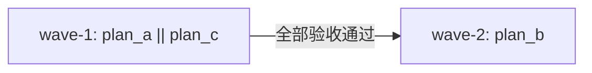
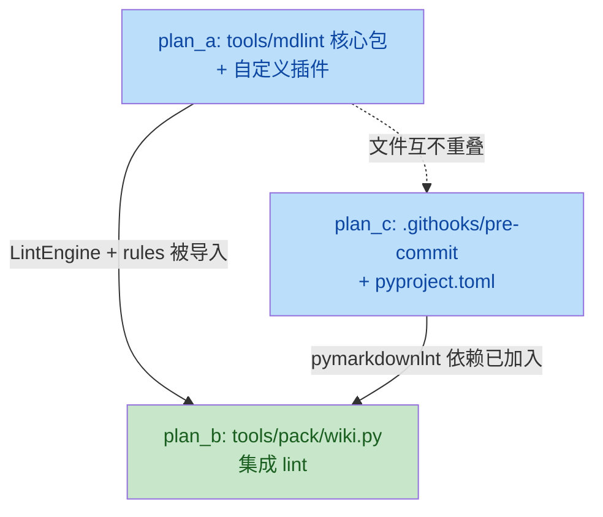

# mdlint -- Markdown lint tool & wiki integration (overview)

## 一、目标与非目标

### 目标

1. 新建 `tools/mdlint` 包：封装 `pymarkdownlnt` 作后端，提供 `python -m tools.mdlint`
   CLI（`--lang zh|en`、`--check`/`--fix`、`--list-rules`）；
2. 两套独立规则集：`zh`（中文排版：CJK-拉丁空格、全角标点、中文引号、标题尾标点）
   与 `en`（通用 Markdown 规范：行长、标题风格、围栏语言、列表符号、单 H1）；
3. 中文特有规则通过 pymarkdown 自定义插件实现（已验证可行性，见下方）；
4. 仓库自带 git hook（`.githooks/pre-commit`），对暂存区 Markdown 文件自动 fix + check；
5. 在 `tools/pack/wiki.py` 侧集成 lint：wiki 产出的中文页用 `zh` 规则、英文页用
   `en` 规则，复用既有 `Code` 枚举与错误上报体系；
6. `tools/translate` 一行不改。

### 非目标

- 不替换/修改 `tools/translate`；
- 不引入 `pre-commit` 框架（走自带 git hook）；
- 不触碰产品源码 `yate/`（含 `yate/docs/`）；
- 不为 `pymarkdownlnt` 创建 `.markdownlint.json` / `.pymarkdown.json`
  （规则配置内聚于 `tools/mdlint/rules.py`）。

## 二、关键设计定案

### 2.1 pymarkdown Python API 可用性（已验证）

| 探针 | 结论 |
|---|---|
| `from pymarkdown.api import PyMarkdownApi` | OK，版本 0.9.41 |
| `api.scan_string(text)` | OK，返回 `PyMarkdownScanPathResult`，`scan_failures` 含 `rule_id` / `rule_name` / `line_number` / `column_number` |
| `api.fix_string(text)` | OK，返回 `PyMarkdownFixStringResult`，含 `was_fixed: bool` + `fixed_file: str` |
| `api.add_plugin_path(dir)` | OK，加载目录下自定义插件 |
| `api.set_boolean_property(key, val)` | OK，可动态开关规则 |

### 2.2 自定义插件机制（已验证）

| 约束 | 值 |
|---|---|
| 插件 ID 格式 | `aannn` 或 `aaannn`（2-3 字母 + 3 数字），本方案统一用 `YMnnn` |
| 类名约定 | 文件名去 `.py` 后 PascalCase：`ym_cjk_spacing.py` -> `YmCjkSpacing` |
| 基类 | `pymarkdown.plugin_manager.rule_plugin.RulePlugin` |
| 行级扫描 | `next_line(context: PluginScanContext, line: str)` |
| 报错 | `self.report_next_line_error(context, line, column_1_based)` |
| fix 能力 | 暂不自定义 fix（中文规则 fix 复杂度高，首版只做 scan） |

### 2.3 两套规则落地方式

- **en 规则**：纯 pymarkdown 内置规则配置（enable/disable + 参数调整），
  不需要自定义插件；
- **zh 规则**：pymarkdown 内置规则（放宽部分英文特有规则）+ 4 个自定义插件
  （`YM001`--`YM004`）；
- 规则配置内聚于 `tools/mdlint/rules.py`，以 Python 数据结构定义，
  不依赖外部 TOML/JSON 配置文件。

### 2.4 wiki 集成策略

- lint 在**写盘前**执行：先 fix、再 write fixed content；
- fix 后仍有违规 → 记 warning 日志，不阻塞 wiki run；
- `--check` 模式下 lint 违规不影响 `needs_translation` 判定；
- manifest digest 仍按**中文源原始字节**计算（lint 不改源、不影响 freshness）；
- worker 线程不碰文件系统（既有约束不变）：lint 在主线程写盘前执行。

## 三、子计划索引

| 子计划 | 文件 | 独占文件清单 | 波次 |
|---|---|---|---|
| A: 核心包 + 自定义插件 | `mdlint-core-plan-a.md` | `tools/mdlint/__init__.py`、`__main__.py`、`cli.py`、`lint.py`、`rules.py`、`plugins/ym_cjk_spacing.py`、`plugins/ym_fullwidth_punct.py`、`plugins/ym_chinese_quotes.py`、`plugins/ym_heading_trailing_punct.py`、`tests/test_mdlint.py`、`tests/test_mdlint_plugins.py` | wave-1 |
| B: wiki 集成 | `mdlint-wiki-plan-b.md` | `tools/pack/wiki.py`（修改）、`tools/pack/errors.py`（修改）、`tests/test_pack_wiki_lint.py` | wave-2 |
| C: git hook + 依赖 | `mdlint-hook-plan-c.md` | `.githooks/pre-commit`（新增）、`pyproject.toml`（修改）、`tests/test_githook.py` | wave-1（与 A 并行） |

## 四、执行波次表

| 波次 | 子计划 | 并行/串行 | 验收判据 |
|---|---|---|---|
| wave-1 | plan_a（核心包 + 插件） **\|\|** plan_c（git hook + 依赖） | 并行（文件互不重叠） | `python -m pytest tests/test_mdlint.py tests/test_mdlint_plugins.py tests/test_githook.py -q` 全绿 + `pyright --pythonplatform Windows` 零诊断 |
| wave-2 | plan_b（wiki 集成） | 串行（依赖 wave-1） | `python -m pytest tests/test_pack_wiki.py tests/test_pack_wiki_errors.py tests/test_pack_wiki_parallel.py tests/test_pack_wiki_lint.py -q` 全绿 + `pyright --pythonplatform Windows` 零诊断 |
| 收尾 | 全量门禁 | 串行 | `python -m pytest tests/ -q -n auto` 全绿 + `pyright --pythonplatform Windows` 零诊断 + `python -m pytest tests/test_architecture.py -q` 全绿（`-n auto` 依赖 master 引入的 `pytest-xdist`，全量套件实测明显快于串行） |

## 五、依赖关系图

## 六、风险清单

| 风险 | 影响 | 缓解 |
|---|---|---|
| pymarkdown API 在未来版本变更 | 升级时可能破坏 mdlint | 锁定 `pymarkdownlnt>=0.9.41,<1.0` |
| 自定义插件与 pymarkdown 内部 API 耦合 | 升级 pymarkdown 可能破坏插件 | 插件只用 `RulePlugin` / `PluginDetails` / `PluginScanContext` 公开基类 |
| wiki 既有测试因 lint 介入而行为变化 | 测试失败 | lint 对合法 Markdown 零干预；测试 fixture 均为简单合法 Markdown |
| git hook 对开发流程的副作用 | 提交变慢 / 意外修改暂存区 | hook 只处理 `*.md`；fix 后显式 `git add`；`--no-verify` 可绕过 |
| wiki 中文页被 lint fix 后与源不同步 | 用户困惑 | 源文件不改；wiki 产出是"发布态"，fix 只作用于产出 |
| manifest digest 一致性 | freshness 判定错乱 | digest 仍按源字节算，lint 不改源，故不影响 |

## 七、回滚路径

- 每个子计划的改动互不重叠，回滚单个子计划不影响其余；
- `tools/mdlint/` 整包删除即回滚 plan_a；
- `tools/pack/wiki.py` 的 lint 集成点是独立函数调用，删除调用即回滚 plan_b；
- `.githooks/` 目录删除 + `git config --unset core.hooksPath` 即回滚 plan_c；
- `pyproject.toml` 的 `pymarkdownlnt` 依赖行删除即回滚依赖变更。

## 八、变更记录

- 2026-10-21：按用户要求移除 git pre-commit hook（提交时不做 lint），
  plan_c 的 hook 部分作废；`tools/mdlint` 与 wiki 发布前 lint 保留。
