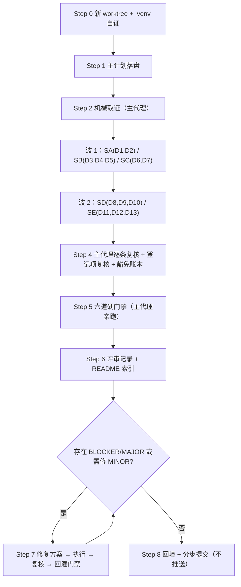

# 2026-11-05 全仓库多维度评审（第二轮）主计划

> 流程定位：`task-orchestration.md` §二闭环的【方案】产物；方案先行，无人值守阶段
> 批准按通过处理（总纲 §一.5，不向用户发起询问）。
> 子代理事实：`plan-architect-designer` 按 `task-orchestration.md` §一.3 连续两次 spawn
> 均因定义文件 frontmatter `qwen-3.7-plus` 未注册而失败（第二次已在任务书显式指定
> `Hy4 preview`，运行时仍强制读 frontmatter）。按 §一.3.5 与 §三兜底：主代理亲自按
> [plan-architect-designer](../agents/plan-architect-designer.md) 剧本产出本方案，
> **如实标注该环节子代理零产出**，不修改定义文件。

规范来源（唯一）：[multi-dim-review SKILL](../skills/multi-dim-review/SKILL.md)、
[task-orchestration](../rules/task-orchestration.md)、
[plan-before-execute](../rules/plan-before-execute.md)、
[subagent-workflow](../rules/subagent-workflow.md)、
[architecture-boundaries](../rules/architecture-boundaries.md)、
[python-coding-style](../rules/python-coding-style.md)、
[doc-conventions](../rules/doc-conventions.md)、
[misc-rules](../rules/misc-rules.md)、
[reviews README](../reviews/README.md)、
[上一轮记录](../reviews/2026-10-31-multi-dim-review.md)。

## 一、目标与非目标

**目标**

1. 对当前 master `75bccfa` 的全仓（`yate/` 162 个 `.py` / 42763 行、`tests/` 147 / 66173 行、
   `tools/` 90 / 16884 行，以及用户可见双语文档、规则与评审索引）按 skill 的 **13 维度**
   做只读审计（audit 路由，Step 2 / Step 6）。
2. 5 名只读审查员两波 fan-out（每波 ≤3、硬上限 6），审查员列出**全部**候选（不预筛），
   主代理逐条回读当前文件复核（Step 4 证据纪律），裁定严重级别。
3. 主代理**亲自**跑 Step 7 六道硬门禁，报告真实退出码；纯文档修复按 `misc-rules.md` §三
   判定是否豁免。
4. 落盘只读事实评审记录 `../reviews/2026-11-05-multi-dim-review-r2.md` 与
   `../reviews/README.md` 一行索引（Step 8）；记录不含修复排期。
5. 确认缺陷按修复方案闭环：blocker / major 迭代至归零；minor 全部修复或显式登记不修
   （`doc-conventions.md` §二.2 修复方案与评审记录互链，但文件各自独立）。
6. 分步单独提交（英文 `type(scope): subject`），**只提交、不推送**。

**非目标**

- 不做另案立项项：LSP 增量同步协议、tree-sitter `Tree.edit`、`filemgr` 后续重构等；
- 不批量清扫 `.trae/` 文档历史本机路径（按 `doc-conventions.md` §五「随下次修改迁移」）；
- 不为「找茬」重构未发现缺陷的模块；审查是只读框架，**审查员不得改产品源码**；
- 不合并、不推送、不改动 `.trae/skills/` 与 `.trae/rules/`（除非复核确认规则文本漂移，
  此时须在评审记录显式登记并单独提交）。

## 二、备选方案与否决理由

| 备选 | 否决理由 |
|---|---|
| A. 只审 `0ae1a64..75bccfa` 增量 diff（174 提交 / 366 文件 +32492−4469） | 用户指令为「使用 multi-dim-review」全维度审计路由，未给 `$ARGUMENTS` 限定范围；且 Step 6.4 要求对既往登记项复核当前有效性，增量 diff 无法覆盖存量契约回归面。 |
| B. 单代理串行逐维度读完全仓 | 覆盖面约 125k 行 Python，单轮必然漏维；skill Step 6 与 `subagent-workflow.md` §一.1 明确要求按维度切分并行下发。 |
| C. 审查员直接修复发现的问题 | skill 明文「read-only review framework … never edits product code；fixes go through the plan workflow」；修复须另立方案并走闭环【执行】。 |
| D. 在主工作区直接评审与写记录 | 项目反馈：重跑全仓审计须新建 worktree + 新分支，不复用旧审计 worktree；且主工作区与 worktree 的 `.venv` 不共享，写记录到独立分支便于干净追溯。 |

## 三、分步实施（输入 / 独占文件 / 输出 / 验收命令）

### Step 0 【领会】环境准备（已完成，实测数据）

- 输入：主仓 master `75bccfa`（clean、与 origin/master 同步）；`git worktree list`。
- 命令：从 master 新建独立 worktree 与分支（本轮为 `enh/multi-dim-review-r2`），
  随后 `python -m venv .venv`；`.venv\Scripts\python.exe -m pip install -e ".[dev]" --quiet`。
- 输出：独立 worktree + 分支 + 沙箱；自证
  `.venv\Scripts\python.exe -c "import yate; print(yate.__file__)"` 指向该 worktree
  内的 `yate/__init__.py`（实测 Python 3.13.2）。
- 验收：`.venv\Scripts\python.exe -c "import pytest, pyright, textual; print('deps ok')"` → exit 0。

### Step 1 【方案】本文件（已完成）

- 独占文件：`.trae/documents/multi-dim-review-r2-plan.md`。
- 验收：文件非空、含本节全部要素、路径引用均为相对路径（人工检查 + 全文 grep 绝对路径）。

### Step 2 机械取证（主代理，先于 fan-out）

- 输入：worktree 全量 `.py`；`tests/test_architecture.py` 的 6 个豁免集
  （`SIZE_EXEMPT_FILES` / `UI_FROZEN_FILES` / `NON_ASCII_COMMENT_EXEMPT` /
  `PRINT_EXEMPT_SITES` / `SCROLLBAR_EXEMPT` / R2 白名单）。
- 探针（一次性 Python 脚本，验证后删除）：统计 `TYPE_CHECKING`、相对导入、
  `Protocol` 定义、`Any` / `# type: ignore` / `# pyright: ignore`、`print()`、
  裸 `except:`、f-string 日志、非 ASCII 注释、家目录路径、`Optional[` / `Union[`、
  `self.log` / `self.app.log`、文件 `splitlines()` 行数 >800、双语手册配对、
  最近 20 条提交信息格式。
- 输出：机械面证据清单（每条 `文件:行号`），作为审查员任务书附件与主代理复核基线。
- 验收：`.venv\Scripts\python.exe -m pytest tests/test_architecture.py -q` → exit 0
  （37 守卫用例基线）。

### Step 3 【执行·审查】5 名只读审查员两波 fan-out

- 分组（每人 ≤3 维度）：
  - SA：D1 正确性 + D2 健壮性/错误处理；
  - SB：D3 安全 + D4 算法与复杂度 + D5 性能；
  - SC：D6 架构边界 + D7 结构与职责；
  - SD：D8 类型静态纪律 + D9 风格惯用 + D10 并发/运行时/可观测；
  - SE：D11 测试验证 + D12 文档双语与提交卫生 + D13 硬门禁（只核对门禁项，不跑命令）。
- 波次：第一波 SA / SB / SC（3 并发），回收后第二波 SD / SE（2 并发）；
  使用内置 `code-explorer`（只读探索，`mode=default`），thoroughness = very thorough。
- 任务书必须含：唯一规范来源（本计划 + skill + 规则）、维度清单、独占边界
  （**零写盘、零产品源码改动、零门禁运行**）、Step 9 豁免集、既往登记项清单、
  输出格式（`file:line -> evidence -> candidate -> own triage verdict`，
  含被自己杀掉的候选与至少一条代表性「已核查并排除」）。
- 输出：两份汇总（主代理落盘到本计划文档 §九「执行记录」或独立进度笔记），
  不新建文档（避免膨胀）。
- 验收：每名审查员对每个负责维度给出结论（含 clean 的依据与排除项），
  全部候选带 `file:line`；零输出的审查员如实标注，主代理亲自补审该组维度。

### Step 4 主代理逐条复核 + 登记项复核（Skill Step 4 / Step 6.4）

- 逐条回读当前文件验证 `file:line`；三分类（保留 / 降级为 Suspect 或 Suggestion /
  有反证才删除并引原文）；严重级别按 skill Step 8 表格；被豁免集吸收的候选列入
  exemption ledger（每个 `file:line` + 集合名）。
- 登记项复核清单（一行一项：id / 当前状态 / 未变或有新证据）：README 索引中
  ⏸ / 👀 / 📌 项与上一轮 #50 的登记项（F4–F7、uninstall OSError、
  yxp 既有缺口、cli.py 排版、空目录噪声、logs mkdir mode、`.trae/` 文档路径存量、
  lua linter CRLF 环境事故与 CI lupa skip）。
- 验收：候选 100% 有复核结论；无「静默丢弃」。

### Step 5 硬门禁（主代理亲跑，Skill Step 7）

```powershell
$env:PATH = "$env:LOCALAPPDATA\pyright-python\nodeenv\Scripts;$env:PATH"
.venv\Scripts\python.exe -m pyright yate/ tests/ tools/ pack/
.venv\Scripts\python.exe -m pytest tests/ -q -n auto
.venv\Scripts\python.exe -m pytest tests/test_architecture.py -q
.venv\Scripts\python.exe -m pytest tests/ --cov=yate --cov-branch -n auto
.venv\Scripts\python.exe -m tools.smoke_test run --jobs 4
.venv\Scripts\python.exe -m tools.changelog check
```

- `-q` 可能无汇总行：以 exit code 为权威信号；并行失败用 `-n 1` / `--jobs 1` 复核，
  真实缺陷与时序假设都要修，不记「偶发」；覆盖率阈值 75 单源于 `pyproject.toml`，
  局部运行加 `--cov-fail-under=0`；编辑后用新状态复跑（避免 `__pycache__` 时序伪影）。
- 验收：六道命令真实退出码写入评审记录；红灯 = `[BLOCKER]`。

### Step 6 评审记录与索引（Skill Step 8）

- 独占文件：`../reviews/2026-11-05-multi-dim-review-r2.md`（只读事实文档）、
  `../reviews/README.md`（仅追加 1 行索引 + 必要增量说明）。
- 内容：一行总裁定、13 维度逐维表（clean 也写依据与排除项）、按级别分组的 findings、
  Suspects / Suggestions / Deferred / Strengths、豁免账本、登记项复核清单、门禁实测表。
- 验收：文件非空、命名 `YYYY-MM-DD-<topic>.md`、无绝对路径引用、无修复排期。

### Step 7 【迭代】确认缺陷修复闭环（条件触发）

- 触发：存在 `[BLOCKER]` / `[MAJOR]`（必迭代至归零），或 `[MINOR]` 中决定修复的项。
- 新增修复方案 `.trae/documents/multi-dim-review-r2-fixes-plan.md`（与评审记录互链，
  `review` 词根命名合规），含逐条改法、新增用例、验收命令、回滚；按
  [plan-executor](../agents/plan-executor.md) 剧本执行（独占文件清单 + 波次）；
  派 `code-review-expert` 复核（按反馈给足 ≥30 分钟窗口，判死前查落盘产物），
  零产出则主代理兜底自审并如实标注。
- 验收：修复后重跑 Step 5 六道门禁；blocker / major 归零；minor 全部销账或登记不修。

### Step 8 【收尾】回填、提交（不推送）

- 回填本计划文档 §九执行记录（真实前后数字、偏离与实测依据）；按
  `git-commit-message.md` 分步单独提交（Step 1 方案 / Step 6 记录+索引 / Step 7 修复 / 回填），
  英文 `type(scope): subject`，PowerShell here-string（`@'...'@` 顶行结束标记）。
- 验收：`git status --short` 干净（仅 `.venv` 等忽略项）、`git log --oneline` 逐步可见、
  **无 `git push`**。

## 四、审查波次与闭环（Mermaid）



## 五、证据纪律与裁定口径

1. 每条 finding 的 `file:line` 必须由主代理重新读当前文件确认，不用记忆、不引子代理自述数字。
2. 候选一律三分类，禁止静默删除；上下文使候选不成立的，降级为 Suggestion / Suspect 并
   写一行理由；只有同行反证（引原文）才删除。
3. 复杂度类问题（D4）按「构建期即选最低时空复杂度」判 MAJOR/MINOR，不需要 profiler；
   常数因子调优（D5）无 profiler 实测只进 Suspects，不得丢弃。
4. 严重级别：`[BLOCKER]` 安全/架构违规/红灯门禁/正常使用崩溃；`[MAJOR]` 边界缺陷、
   显著性能、吞异常、双语失配；`[MINOR]` 风格/可读性/死代码/文档漂移。
5. 每个 clean 维度必须列出检查面与至少一条代表性「已核查并排除」；裸 clean 视为评审缺陷。
6. 审查员回报的数据一律独立复核；子代理零产出由主代理补审并如实标注。

## 六、风险清单与回滚路径

| 风险 | 触发信号 | 处置 / 回滚 |
|---|---|---|
| plan-architect-designer 子代理模型未注册（已发生） | `Model "qwen-3.7-plus" not found` | 按 `task-orchestration.md` §三主代理兜底，已如实标注；不改定义文件 |
| 只读审查员中止 / 零产出 | `code-explorer aborted` 或无候选无结论 | 不原样重试同批；主代理亲自补审该组维度，标注「子代理零产出」 |
| 评审子代理长时间无回信 | 探活无回信 | 按项目反馈给足 ≥30 分钟、先查落盘产物再判死；判死后主代理兜底自审 |
| worktree 陈旧 CRLF 触发 lua lint | `test_bundled_lua_files_pass_the_linter` 红 | 复现上一轮环境事故定性（字节级规范 + `-n 1` 复核），记录为环境事故而非代码缺陷 |
| pyright 找不到 node | pyright 启动报错 | `$env:PATH = "$env:LOCALAPPDATA\pyright-python\nodeenv\Scripts;$env:PATH"` |
| `pytest -q` 无汇总行 | 输出只有点线 | 以 exit code 为准，数字用 collect-only / 覆盖率输出正则取 |
| 并行时序 flake | 全量偶发失败 | `-n 1` / `--jobs 1` 复核；真实缺陷与时序假设都修，不记为「偶发」 |
| 修复引入回归 | 复审出现新 major | 回到 Step 7 修复方案重新设计，迭代不封顶 |
| 误提交 / 范围漂移 | `git status` 出现计划外改动 | 逐笔 `git revert` 回滚；分支独立、不推送，主仓不受影响 |

## 七、门禁与提交纪律

- 六道门禁命令见 Step 5；收尾门禁（pyright + pytest + 架构测试，覆盖率阈值
  75 单源于 `pyproject.toml` 的 `[tool.coverage.report] fail_under`）由主代理亲自跑，
  不得由子代理数字代跑。
- 每一步产物单独提交一次，禁止多步攒成一笔；闭环内禁止 `git push`。
- 纯文档变更按 `misc-rules.md` §三可豁免测试，但本轮含机械取证与硬门禁实测，
  **不援引豁免**（混合变更按最高风险判定）。

## 八、交付物清单

1. `.trae/documents/multi-dim-review-r2-plan.md`（本文件，含 §九回填）；
2. `.trae/reviews/2026-11-05-multi-dim-review-r2.md`（只读事实记录）；
3. `.trae/reviews/README.md`（一行索引 + 增量说明）；
4. 条件交付：`.trae/documents/multi-dim-review-r2-fixes-plan.md` 与相应代码/测试/规则改动；
5. 分支 `enh/multi-dim-review-r2` 上的分步提交（不推送）。

## 九、执行记录（回填区，禁写预期数字）

> 本区只回填已实测的真实命令结果、退出码与偏离记录。

| 步骤 | 实测结果 | 退出码 | 偏离与依据 |
|---|---|---|---|
| Step 0 | 新 worktree + 分支 `enh/multi-dim-review-r2`；`.venv` 重建（Python 3.13.2）；`import yate` 指向该 worktree | 0 | 无偏离；沙箱自证按 Step 0 命令执行 |
| Step 1 | 主计划落盘并单独提交（首笔 `docs(plan)`） | 0 | `plan-architect-designer` 两次 spawn 因 frontmatter 模型未注册失败，主代理按 §三兜底并如实标注 |
| Step 2 | 机械取证探针 2 支 + UTF-8 探针 1 支；覆盖 13 维度静态面、豁免集、双语配对、提交 subject | 0 | 探针为一次性脚本，验证后删除；证据清单随审查员任务书下发 |
| Step 3 | 5 名只读审查员两波 fan-out 全部交付（SA/SB/SC，SD/SE），零写盘、零门禁 | 0 | 批大小 3 + 2，符合上限；无审查员零产出 |
| Step 4 | 主代理逐条回读复核全部候选；2 MAJOR / 13 MINOR；Suspects 全保留；SA D1-13 以 `caplog` 检索反证删除 | — | 无静默丢弃；登记项复核清单见评审记录第八节 |
| Step 5 | 基线六道门禁：pyright 0 / pytest 0 / 架构 0 / 覆盖率 1（safe-delete 钩子）/ 冒烟 0 / changelog 0；覆盖率单独复跑 0（92.85%，3391 passed / 10 skipped） | 见左 | 环境事故，非测试失败；按项目记忆分轮次执行并清理 43 个 `garbage-*` 目录 |
| Step 6 | 评审记录 + README #57 索引行与增量段落盘 | — | 记录为只读事实文档，不含修复排期 |
| Step 7 | 修复方案 + F1–F10 全部落盘；2 MAJOR 归零；13 MINOR 全修或登记不修 | 0 | 新增回归用例首次因数据落在 2048 窗口外转红，修正数据后转绿（先红后绿演练） |
| Step 8 | `code-review-expert` 只读复核（92 次工具调用 / 250.09s）：0 BLOCKER / 0 MAJOR / 4 MINOR，四项全闭环；最终六道门禁全 0 | 0 | 复核者未复跑门禁、未逐条回读七维证据，范围限制已登记；新增边界用例改用公开 `next()` 避开 pyright `reportPrivateUsage` |
| 最终门禁 | pyright `0 errors, 0 warnings, 0 informations`；pytest 0；架构 37/37；覆盖率 92.90%（3394 passed / 10 skipped）；冒烟 121/121 · 1463/1463；changelog `released changelog sections are up to date` | 全 0 | 六道均拆到独立轮次执行，规避 safe-delete 累计计数 |
| 临时产物清理 | 一次性探针脚本 6 支（`_probe_*.py` / `_gate_*.py` / `_clean_garbage.py`）+ 复核者探针残留的两个未跟踪文件 `p)` / `pos)` 全部删除 | — | 均非交付物；删除前先在本行落盘登记，收尾 `git status` 复核；未触碰任何已跟踪文件 |
| 提交 | 分步单独提交，**不推送** | — | 逐步 `git status` 核对，临时脚本删除后工作区干净 |
| 提交顺序偏离（2026-11-06 pr-review 补登） | 实际为「修复方案 → 评审记录」，与计划 Step 6/Step 7 预期顺序相反；`084c74a` 的修复方案链接指向当时尚未落盘的评审记录（中间态文档互链断链，最终态闭合） | — | 分支未推送但不做交互式 rebase；按 `task-orchestration.md` §三显式登记，逐笔 tree 已用 `git diff-tree` 复核无夹带 |
| pyright 口径订正（2026-11-06 pr-review 补登） | 原 Step 5 命令漏 `pack/`，与 `task-orchestration.md` §二.7 及 `pyproject.toml` 的 `include` 不一致 | 见本轮 pr-review 记录 | 按 §二.7 四路径补跑并订正 Step 5 命令；CI bare `pyright` 受 include 管辖未漏扫，本 PR 未改 `pack/` |
