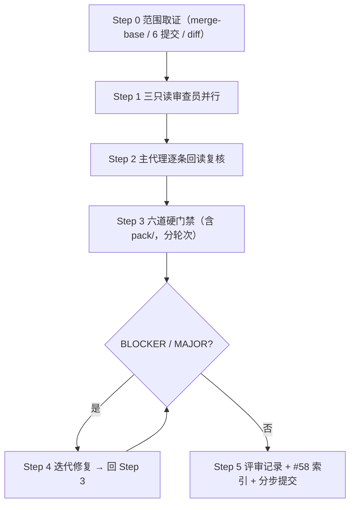

# 2026-11-06 合并前 pr-review 主计划（`enh/multi-dim-review-r2`）

> 依据：`pr-review` skill（AI 预评审，人工决策）、`task-orchestration.md` 闭环流程、
> `plan-before-execute.md` 方案先行。本文件是本轮唯一规范来源，偏离须显式登记。

## 一、目标与非目标

**目标**：对分支 `enh/multi-dim-review-r2` 相对 `master 75bccfa` 的 6 笔提交做合并前
PR 级预评审；按 pr-review skill 六维度（功能/安全/性能/可维护性/架构边界/硬门禁）
输出分级 findings 与 verdict；主代理逐条回读复核后闭环 blocker/major，落盘只读事实
记录与索引，分步提交（不推送）。

**非目标**：不合并、不推送、不重排既有 6 笔提交、不修改本 PR diff 之外的
skill / 规则源 / CI 配置、不对 master 全仓重做 13 维度审计。

## 二、范围事实（【领会】只读取证）

| 项 | 实测 |
|---|---|
| worktree / 分支 | 独立 worktree / `enh/multi-dim-review-r2` @ `b80505a` |
| 基线 | `master` = `origin/master` = `75bccfa`；`git merge-base HEAD master` 同值，无分叉、无冲突面 |
| 范围 | `master...HEAD`：6 提交 / 20 文件 / +735−56；工作区 clean；未推送 |
| 提交链 | `f2b5440` 主计划 → `084c74a` 修复方案 → `2c6825f` 代码修复（16 文件）→ `6e43739` 评审记录+索引 → `57796d3` 回填 → `b80505a` 路径字面量清理；6 笔 subject/body 全英文、`type(scope): subject` |
| 噪声过滤 | diff 内无 `.pyc` / lock / 二进制 / `.venv`；无纯重排 hunk（按 skill Step 1 一次性声明跳过） |
| 环境 | 本机 safe-delete 钩子按 turn 累计删除量 >9999 杀 pytest（见项目记忆），门禁须拆到独立轮次 |

## 三、备选方案与否决理由

| 备选 | 否决理由 |
|---|---|
| 只按 skill 输出报告、不落盘评审记录与索引 | 违反 `task-orchestration.md` §二 提交纪律与 `.trae/reviews/README.md` 索引惯例（#1–#57 全部有落盘记录） |
| 重排 6 笔提交以消除中间态互链断链 | 分支未推送但交互式 rebase 属破坏性历史改写；`084c74a` 的断链仅为文档互链，最终态闭合且无构建影响，按 git 安全协议优先落盘登记偏离 |
| 直接改 `.trae/skills/*/SKILL.md` 的 pyright 命令 | skill 是存量规则源且不在本 PR diff，违反 pr-review "review only the diff"；按规则总纲以 `task-orchestration.md` §二.7 为准，skill 口径差异另案登记 |
| 批量替换新增文档内的 `.trae/...` 行内路径 | `doc-conventions.md` §五 末条「存量随下次修改逐步迁移，不做专项清扫」；新增文档该写法与历史 42 处/21 文件同型，Markdown 链接已全部相对，专项替换会显著扩大 diff 且无行为收益 |

## 四、分步实施

### Step 1 【执行】只读审查员波次（已完成，实测）

- 输入：`master...HEAD` 全量 diff 拆为代码/文档两份落盘 `%TEMP%`。
- 波次：3 名 `code-explorer` 并行（P1 功能+安全+跨提交 / P2 性能+可维护性+架构 /
  P3 合并正确性+文档一致性+仓库卫生+门禁配置），`bypassPermissions`，只读、不跑门禁。
- 输出：三份分级报告，全部交付（61 / 58 / 78 次工具调用）。
- **偏离登记**：本方案文档落盘晚于审查员波次启动。审查员零写盘产物、不触碰产品代码，
  方案先行约束的实质风险为零；此处如实标注，不事后伪装为"先方案后执行"。

### Step 2 【审核】主代理逐条回读复核

- 输入：三份报告 + 当前 worktree 文件 + 规则源。
- 动作：每条候选重读 `file:line`；只有同行反证才删除/降级（如 P1 MINOR-5 建议"测试文件
  已有 `reportPrivateUsage` 豁免"经实测该文件无此豁免，且上轮 pyright 实报该诊断，故否决
  该改法，只修正措辞）。
- 输出：复核后的 findings 清单与裁决。

### Step 3 【审核】硬门禁实测（主代理亲跑）

- 统一按 `task-orchestration.md` §二.7 口径，pyright **含 `pack/`**（`pyproject.toml`
  `include` 已含 `pack`，且 `pack/_common.py` 实存）；六道拆到独立轮次执行。
- 验收命令：
  ```powershell
  .venv\Scripts\python.exe -m pyright yate/ tests/ tools/ pack/
  .venv\Scripts\python.exe -m pytest tests/ -q -n auto
  .venv\Scripts\python.exe -m pytest tests/test_architecture.py -q
  .venv\Scripts\python.exe -m pytest tests/ --cov=yate --cov-branch -n auto
  .venv\Scripts\python.exe -m tools.smoke_test run --jobs 4
  .venv\Scripts\python.exe -m tools.changelog check
  ```
- 输出：真实退出码与输出要点，写入评审记录，不得写预期值。

### Step 4 【迭代】按 blocker/major 修复

- 独占文件（主代理亲自改）：原 PR 内的产品代码 / 测试 / 文档（不新增 diff 外文件）。
- MAJOR-1（pyright 口径）→ 按 §二.7 补跑 + 主计划/评审记录命令订正 + 本轮记录登记。
- 确认的 MINOR → 注释/文档一致性类当轮销账；技术性项按理由修或登记 Deferred。
- 验收：Step 3 六道门禁全 exit 0；`git diff --check master...HEAD` exit 0。

### Step 5 【收尾】记录、索引、提交

- 独占文件：`../reviews/2026-11-06-pr-review-enh-multi-dim-review-r2.md`（新建）、
  `../reviews/README.md`（#58 索引行 + 增量段）。
- 分步提交：修复波一笔、评审记录+索引一笔、本方案一笔；只提交不推送。
- 验收：`git status --short --branch` clean；`git log --oneline` 可追溯。

## 五、风险与回滚

| 风险 | 触发信号 | 处置 / 回滚 |
|---|---|---|
| safe-delete 钩子按 turn 累计杀 pytest | `[SAFE_DELETE_BULK_CONFIRM_REQUIRED]` | 每道门禁拆到独立工具调用轮次；必要时原生 `rmdir /s /q` 清 `%TEMP%\pytest-of-*` 下的 `garbage-*`；不用仓库内 `--basetemp` |
| 修复波引入回归 | pyright / pytest 变红 | 逐笔 `git revert` 回滚；分支独立，主仓不受影响 |
| 审查员报告含臆测 | 无法在当前文件复现 `file:line` | 主代理回读否决，记录反证，不写入 findings |
| 门禁数字与记录不一致 | 记录写预期值 | 只回填实测退出码与输出原句 |
| 范围漂移 | `git status` 出现计划外文件 | 逐笔 revert；一次性探针/脚本验证后删除并登记 |

## 六、波次图



## 七、执行记录（回填区）

> 只回填已实测的真实结果。

| 步骤 | 实测 | 退出码 |
|---|---|---|
| Step 0 | `master` = `origin/master` = `75bccfa`；`merge-base HEAD master` 同值、无分叉；6 提交 / 20 文件 +735−56；工作区 clean、未推送；6 笔 subject/body 全英文 | 0 |
| Step 1 | 3 名 `code-explorer` 只读审查员一波并行（P1/P2/P3）全部交付，零写盘、零门禁；diff 拆代码/文档两份落盘 `%TEMP%` 供取证 | 0 |
| Step 1 偏离 | 本方案落盘晚于审查员波次启动（审查员零写盘、不触碰产品代码，方案先行约束实质风险为零），已在 §四 Step 1 如实标注 | — |
| Step 2 | 主代理逐条回读复核：1 MAJOR / 12 MINOR；删除 1 条改法建议（无 `reportPrivateUsage` 豁免反证）、降级 3 条（日志级别 / 4 层嵌套 / 行内路径） | — |
| Step 3 | pyright 四路径 `0 errors, 0 warnings, 0 informations`；pytest `[100%]`；架构 37/37；覆盖率 `3395 passed, 10 skipped in 169.59s` / `Total coverage: 92.82%`；冒烟 `121/121 scenarios`、`1463/1463 checks`、84.16s；changelog released 段 up to date | 全 0 |
| Step 3 环境 | `%TEMP%` 探测到 8 个 `garbage-*` / 121158 条目，原生 `rmdir /s /q` 清理；六道拆独立轮次，长门禁用后台执行器 + JSON 结果落盘；本轮无 safe-delete 拦截 | — |
| Step 4 | MAJOR-1 按 §二.7 四路径补跑并订正主计划/上一轮记录；9 条 MINOR 当轮销账（代码 5 文件 + 测试 2 文件 + 文档 3 文件），3 条按理由登记 Deferred | 0 |
| Step 5 | 评审记录 + README #58 索引行与增量段落盘；一次性脚本 `_pr_fix_docs.py` / `_pr_gate.py` / `_pr_gate_launch.py` 验证后删除并登记；分步提交、不推送 | — |
