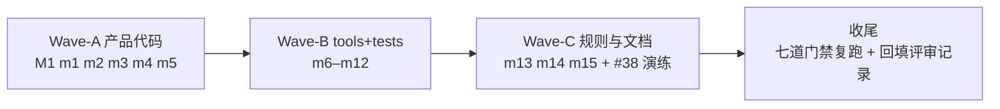

# multi-dim-review-r3 修复计划

- 来源评审记录：[`../reviews/2026-11-12-multi-dim-review-r3.md`](../reviews/2026-11-12-multi-dim-review-r3.md)（#76）
- 基线：`master` `7665814a`；执行沙箱为本任务 worktree（分支 `feature/fix-repo-audit`，
  路径按 `doc-conventions.md` §五 脱敏）
- **无人值守批准登记**：用户指令原文「全仓库扫描，发现潜在问题给出建议并修复，
  全程无人值守，无须过问，请严格按照纪律执行」——【批准】步骤由用户预先授权，
  本计划即按 `plan-before-execute.md` §二.3 以该授权替代交互式确认，
  替代理由与指令原文在此显式登记，不视为静默跳过。

## 一、目标与非目标

**目标**：闭环 #76 确证的 1 MAJOR + 15 MINOR（M1、m1–m15），补守卫 #38 负向演练登记；
修复后七道硬门禁全绿并回填评审记录。

**非目标**：
- 不处置 §五 8 条 Suspects（依赖未验证假设 / 需 profiler）；
- 不处置 §六 Suggestions（仅建议，不影响判定）；
- 不清扫存量文档多行盘符路径簇（doc-conventions §五 禁止专项清扫，登记不修）；
- 不新增守卫用例（#38 演练仅登记事实，不扩拦截面）。

## 二、备选方案与否决理由

| 项 | 放弃的路线 | 否决理由 | 采纳路线 |
|---|---|---|---|
| M1 | 把 `search_lines` 改为生成器、调用方惰性消费 | 破坏公共契约（`tests/test_project_search.py` 与 `replace_lines` 均按 list 消费），改动面大于收益 | `search_lines` 增加可选 `limit: int \| None = None`，达 limit 即 break；默认 None 保持现契约，`_search_one_file` 传 `budget` |
| m2 | 校验 `ZipInfo.file_size` 头部后再 `zf.read` | 头部正是可伪造项（m3 根因），预检不构成上界 | 改走既有有界流式原语 `_read_member`（真实字节封顶 `MAX_MEMBER_BYTES`） |
| m3 | 按成员数设硬上限拒绝包 | 成员数无界是合法业务形态，磁盘放大由真实字节决定 | `_verify_digests` 与 `install._extract_payload` 各按真实字节累计封顶 `MAX_PAYLOAD_BYTES`；头部预检保留为快速拒绝路径 |
| m12 | 把 `caplog.at_level` 降为 DEBUG | caplog handler 传播语义跨 pytest 版本不可控，断言仍可能恒真/恒假摇摆 | 直接断言 `logging.getLogger("yate").level is logging.NOTSET`（logs.py install 保存 / uninstall 恢复 `_previous_level` 的事实为锚点） |
| m15 | 全量清扫 `.trae` 265 处存量盘符命中 | doc-conventions §五 明文「不做专项清扫」 | 仅处置近 14 天已触发迁移义务的 10 处单行提及，改 `<worktree>` 可移植表述 |
| #38 | 新增守卫拦截演练缺失 | 守卫本体已存在且双向断言充分，缺的只是仓库惯例的演练登记 | 单侧改键漂移演练一次，结果登记规则 §六 |

## 三、波次划分



波间无文件重叠，波内逐条独立提交（英文 `type(scope): subject`，只提交不推送）。

### Wave-A：产品代码（yate/）

| # | 文件 | 改动 |
|---|---|---|
| M1 | `yate/editor_core/project_search.py` | `search_lines` 增可选 `limit` 参数，命中数达 limit 即 break；`_search_one_file:161` 传 `budget`，删除 `[:budget]` 切片截断语义（limit 已保证上界） |
| M1 | `tests/test_project_search.py` | 回归用例：`search_lines(lines, pattern, limit=2)` 在 >2 匹配文件上恰返回 2 条；默认 `limit=None` 行为不变（全量返回） |
| m1 | `yate/editor_core/search.py` | `replace_current` 顶部编译一次 pattern 并复用（消除 :123/:130 双编译） |
| m2 | `yate/services/yxp/manifest.py` | `_load_json_member` 改走 `_read_member` 有界读取 |
| m3 | `yate/services/yxp/manifest.py`、`yate/services/yxp/install.py` | `_verify_digests` 与 `_extract_payload` 按真实字节累计封顶 `MAX_PAYLOAD_BYTES`，超限抛既有校验失败路径；`tests/test_yxp*.py` 补恶意累计包用例（多成员各自 <32MB、累计 >128MB → 拒绝） |
| m4 | `yate/editor_core/buffer.py` | `commit()` 对 `len(d.old) != len(d.new)` 补与 `_apply_deltas:612-615` 同型的 `_note_dirty(d.top, len(self.lines) - 1)` 扩排 |
| m5 | `yate/editor_lsp/manager.py` | didOpen 失败分支补 `log.debug("didOpen failed for %s: %s", uri, exc)`（与 didClose/didSave 兄弟样式对齐） |

验收（worktree 内）：

```
.venv\Scripts\python.exe -m pyright yate/ tests/
.venv\Scripts\python.exe -m pytest tests/test_project_search.py tests/test_search.py tests/test_buffer.py tests/test_yxp_manifest.py tests/test_yxp_install.py tests/test_lsp.py -q
.venv\Scripts\python.exe -m pytest tests/test_architecture.py -q
```

### Wave-B：tools 与 tests

| # | 文件 | 改动 |
|---|---|---|
| m6 | `tools/lint_lua.py` | :178 `issues.append(...)` 参数分行悬挂，行宽 ≤100 |
| m7 | `tools/smoke_test/scenarios/regression.py` | :268 抑制补一行理由注释（Textual bare `Worker` generic，指向 :301-304 同调用先例措辞） |
| m8 | `tests/test_lsp.py` | :797 固定 `sleep(0.1)` 改轮询 `client.sent` 出现 didChange（范本 :1299） |
| m9 | `tests/test_lsp.py` | :1122 固定 `sleep(0.1)` 改轮询 `fake.state is ServerState.STARTING` |
| m10 | `tests/test_pty_proc.py` | `_scenario`：start 回调收集数据入列表，`sleep(0.2)` 改 `_wait_for` 等 `b"pty-ready"`（范本 :599/:787） |
| m11 | `tests/test_hover_integration.py` | 删除死旋钮 `self.delay`（:56 初始化与 :88-89 分支，全文件无赋值点） |
| m12 | `tests/test_tracing.py` | :346-356 恒真断言改为直接断言 `logging.getLogger("yate").level is logging.NOTSET`，保留 uninstall 后语义 |

验收：

```
.venv\Scripts\python.exe -m pyright tools/ tests/
.venv\Scripts\python.exe -m pytest tests/test_lsp.py tests/test_pty_proc.py tests/test_hover_integration.py tests/test_tracing.py -q
```

### Wave-C：规则文本与文档

| # | 文件 | 改动 |
|---|---|---|
| m13 | `.trae/rules/architecture-boundaries.md` §三.7 | 四处登记行数修订为 2026-11-12 splitlines 实测：`keymaps/vim.py` 1534、`editor_core/buffer.py` 1559、`editor_lsp/manager.py` 879、`file_manager/screen.py` 1017，并注记复测日期（buffer.py 若 Wave-A m4 改动行数，以修复后复测为准） |
| m14 | `.trae/rules/architecture-boundaries.md` §三.5② | 「唯一例外」清单补登 `services/yxp/__init__.py` 门面（docstring 已自述，big-module-split-2 漏回写） |
| #38 | `.trae/rules/architecture-boundaries.md` §六 + 演练 | 单侧改 hover 键字面量 → 跑 `test_hover_key_is_shared_and_identical` 确认失败 → 还原；演练通过事实登记入 §六 #38 行 |
| m15 | 10 处单行盘符路径 | `pr-review-fixes-plans/{prfix-ws,fix-cli,fix-fm}.md:3`、`pr-review-deferred-fixes-plans/{fix-preview,fix-editor,fix-navtest}.md:3`、`file-manager-plans/overview.md:165`、`ci-pilot-startup-stall-plan.md:134`、`arch-sec-audit-plans/overview.md:3`、`reviews/2026-11-10-pr-review-feature-feat-lsp-hover-docs.md:69` —— 改 `<worktree>` 占位或「本任务 worktree」可移植表述 |

验收：

```
.venv\Scripts\python.exe -m pytest tests/test_architecture.py -q
```

加 grep 取证：上述 10 个文件盘符命中为 0；演练期间守卫失败/还原后通过的记录进提交信息。

### 收尾

全量七道门禁复跑（pyright yate/ tests/ tools/、pyright pack/、架构 38、全量 pytest -n auto
计数、覆盖率、冒烟、changelog），评审记录 §一 回填修复后数字并追加「本轮修复事实」段
（先例：#57 基线→当轮修复→收尾全绿），单独提交。

## 四、风险清单与回滚路径

| 风险 | 缓解 | 回滚 |
|---|---|---|
| M1 `limit` 参数误改默认语义导致既有调用行为变化 | 默认 `None` 分支零改动；回归用例双断言（limit 生效 + 默认不变） | revert 对应提交（单文件 + 单测试文件） |
| m3 累计封顶误拒合法大包 | 上限即既有 `MAX_PAYLOAD_BYTES` 常量，不新增数值约束；合法包本应受同值头部预检约束 | revert 对应提交 |
| m4 扩排使脏区间变大 | 现行唯一调用方行数不变，扩排分支不触发；超标脏仅性能损失不影响正确性 | revert 对应提交 |
| m8/m9/m10 时序测试改写引入新 flake | 改写后对目标文件重复跑 3 次；轮询超时上限沿用 `wait_until`/`_wait_for` 既有默认 | revert 对应提交 |
| #38 演练未还原即提交 | 演练与还原在同一命令串内完成，提交前 `git diff` 必须为空（除规则文档登记行） | 演练失败则不登记、不改规则 |

## 五、纪律对照

- 每步产物单独提交，英文 `type(scope): subject`（`git-commit-message.md`）；
- 只提交不推送（`task-orchestration.md`）；
- 门禁全部主代理亲跑取真实退出码，不引用子代理自述；
- 偏离本计划（阈值、范围、选型）须显式列出实测依据，不得静默改设计。
