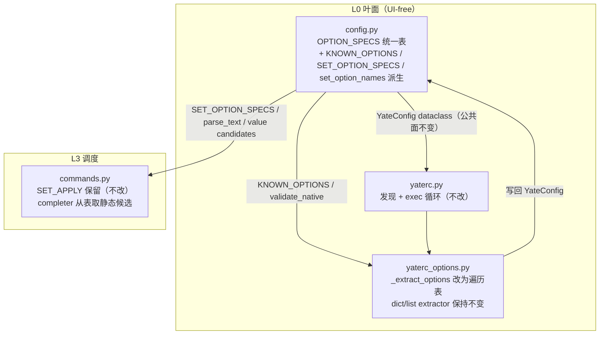

# 选项定义统一（option-spec-unify）方案总纲

> 来源：[issue 文本](../option-spec-unify-issue.md)（待建 Gitee 单，无编号）。
> 分支 `feature/ref-option-spec-unify`，parent `master`，worktree `yate-option-spec-unify`。
> 本文件是子计划的唯一规范来源；执行者按各子计划的独占文件清单与验收命令推进。

## 一、目标与非目标

### 目标

1. 在 `yate/config.py` 建立**一张统一选项表** `OPTION_SPECS`，每个选项一行，声明：规范名、`:set` 别名、是否对 yaterc 可见、原生值校验、字符串值解析、报错文案、`:set` 摘要。
2. `KNOWN_OPTIONS`、`VALID_KEYMAPS`、`VALID_KEY_PROTOCOLS`、`VALID_TRACE_LEVELS`、`SET_OPTION_SPECS`、`set_option_names()` 全部保留公共名，改为从 `OPTION_SPECS` 派生。
3. `yaterc_options.py::_extract_options` 改为遍历 `OPTION_SPECS` 的 yaterc 可见标量项做校验与写回，删除内联逐选项判断；合法值/范围（如 `terminal_height` 的 `3..40`）只声明一次。
4. `commands.py` 的 `:set` 分派与 value 补全候选从同一张表派生，移除硬编码候选。
5. 新增防漂移守卫并做负向演练，钉住「表 ↔ 派生视图一致」与「范围单一来源」。

### 非目标

- 不合并三个文件、不改三者的职责分工与依赖方向。
- 不改 `YateConfig` 等 dataclass 的字段、默认值与类型。
- 不改 yaterc 加载顺序、信任门控、主题回调注入。
- 不改 dict / list 类选项（`screen_saver` / `file_preview` / `large_file` / `language_servers` / `extensions` / `theme_dirs` / `disabled_extensions`）的 extractor 实现。
- 不改 `SET_APPLY`（L3 命令层副作用映射）的归属与内容。
- 不改任何用户可见行为：合法值、默认值、报错文案、补全候选集合、加载顺序。
- 不改双语手册语义；不新增配置项与 `:set` 别名。

## 二、关键设计决策

### D1：统一表落在 `config.py`，不新建模块

| 方案 | 结论 | 理由 |
|---|---|---|
| 放 `config.py`（采纳） | ✅ | `config.py` 已持有 `KNOWN_OPTIONS` 与 `SET_OPTION_SPECS`，是「选项知识」的天然归属；依赖方向 `yaterc.py → yaterc_options.py → config.py` 天然成立，无环；不新增 L0 模块，故不触碰 R4 / `UI_FREE_FILES` / `_LAYER_RANKS` / 规则文档多处同步；`config.py` 现 378 行，加表后预估约 500-560 行，仍低于 800 行阈值。 |
| 新建 `yate/option_specs.py` | ❌ | 单一职责更纯，但须同步 `architecture-boundaries.md` §一 L0 清单、R4 条款、§六 R4 条目，以及 `tests/test_architecture.py` 的 `UI_FREE_FILES`；四处改动换「文件更短」，违背 §三.1「不建公共类型层」与 PEP 20「Simple is better than complex」。 |

### D2：表形态——一个 spec 携带两种输入形式的解析

选项在两侧的**输入形态不同**，这是有意的、必须保留的语义，不是要消除的重复：

- yaterc 侧：`exec` 后的 Python 原生值（bool 是 `True` / `False`，int 是 `12`，str 是 `"vim"`）。
- `:set` 侧：命令行字符串（`on` / `off` / `12` / `vim`）。

因此每个 spec 需要两个解析入口，但**共享同一份合法值/范围定义**：

```
OptionSpec
├── name / aliases / rc_visible / summary / invalid_message
├── domain: 合法值定义（枚举集合 / 整数区间 / 布尔 / 非空字符串）—— 唯一声明处
├── parse_native(value: object) -> object | None   # yaterc 用，从 domain 派生
└── parse_text(text: str) -> object | None         # :set 用，从 domain 派生
```

`domain` 是唯一的事实来源：、`parse_native` 与 `parse_text` 都从它读取合法值/范围，杜绝第二遍 `3..40`。布尔的 spellings（`on/off/true/false/1/0/yes/no`）由 `config.py` 的 `_TRUTHY` / `_FALSY` 提供，只此一处。

### D3：公共名兼容策略

| 公共名 | 结论 | 派生方式 |
|---|---|---|
| `KNOWN_OPTIONS` | 保留 | `tuple(spec.name for spec in OPTION_SPECS if spec.rc_visible)`；保持现有 tuple 顺序（usage 文案与文档表顺序依赖它） |
| `VALID_KEYMAPS` | 保留 | 作为 `keymap` spec 的 domain 枚举值，仍可单独 import |
| `VALID_KEY_PROTOCOLS` | 保留 | 同 `key_protocol` spec 的 domain |
| `VALID_TRACE_LEVELS` | 保留 | 仍指向 `yate.logs.LEVEL_NAMES`，`yate_trace_level` spec 的 domain 引用它 |
| `SET_OPTION_SPECS` | 保留 | `tuple(SetOption(...) for spec in OPTION_SPECS if spec.settable)`；字段值来自 spec，不再各自写 parser |
| `set_option_names()` | 保留 | 从 `SET_OPTION_SPECS` 派生，逻辑不变 |
| `parse_bool()` | 保留 | 仍读 `_TRUTHY` / `_FALSY`；`bool` domain 的字符串解析调用它 |
| `SetOption` / `OptionParser` | 保留 | 结构不变，`commands.py` import 零改动 |

### D4：`:set` 专有选项的表达

`filetype`（别名 `ft` / `language` / `lang`）与 `readonly` 只在 `:set` 存在、不是 yaterc 变量，用 `rc_visible=False` 标记：`KNOWN_OPTIONS` 不含它们，`SET_OPTION_SPECS` 含它们。`filetype` 的合法值交给 `editor.set_filetype` 运行时校验（domain 为「任意字符串」），`readonly` 为 bool domain——与现状一致。

### D5：`commands.py` 的适配范围

- `SET_APPLY` **留在 L3**：把值应用到编辑器是命令层副作用，不属于 L0 选项定义（`config.py` 不得 import `Editor`）。
- `_make_set_completer`（`commands.py:216-237`）的 value 候选硬编码纳入统一表：新增一个只读查询函数（如 `set_option_value_candidates(name) -> tuple[str, ...]`）从 spec domain 取枚举值候选；completer 改调用它。对 `theme` / `filetype` 这类动态候选仍走 editor，表中无静态候选时返回空 tuple，由 completer 保留既有分支。
- `_set` 的 usage 文案仍由 `SET_OPTION_SPECS[*].summary` 拼接，不变。

### D6：架构边界影响登记

| 项 | 结论 |
|---|---|
| R4（`config.py` / `yaterc.py` / `yaterc_options.py` 不 import `editor_components`） | 不触碰：表只依赖 stdlib 与 `yate.logs` 常量 |
| R12（UI-free 面不 import `textual.app`） | 不触碰 |
| `UI_FREE_FILES` / `_LAYER_RANKS` | 不新增模块，故零改动 |
| 800 行阈值 | `config.py` 378 → 预估约 500-560；`yaterc_options.py` 742 → 预估约 640-690（删去内联校验）；均不越线，无需 `SIZE_EXEMPT_FILES` 变更 |
| PEP 695 回调别名 | 新增的解析函数类型别名一律用 `type X = ...`；不引入 `X = Callable[...]` |
| ASCII 注释纪律 | 新增注释/docstring 全英文 ASCII |

### D7：行为等价性口径

「不改用户可见行为」逐项核对（执行者须逐条验证）：

| 行为 | 现状 | 统一后 |
|---|---|---|
| yaterc bool 值 | 只接原生 bool，非 bool 报错保默认 | 同 |
| `:set` bool 值 | 接 `on/off/true/false/1/0/yes/no` | 同 |
| `terminal_height` | yaterc `3..40` int、`:set` `3..40` 字符串解析 | 同范围、同报错文案 |
| `shell` | yaterc 拒绝空串；`:set` `_parse_shell` 接受任意字符串（含空串？实测 `return value` 不过滤） | **保持差异**：domain 对两条路径分别给出与现状一致的判定，不强行归一（见 plan-a 的 `shell` spec 设计） |
| `theme` | yaterc 非空字符串、`:set` 非空字符串（未知名在 apply 时失败） | 同 |
| 报错文案 | 各选项现有文案 | 逐字保留，作为 spec 的 `invalid_message` / yaterc 报错模板 |
| 补全候选 | keymap/readonly/show_hidden 等静态候选 + theme/filetype 动态候选 | 静态候选从 domain 派生，集合相同；动态分支不变 |

> 注：`shell` 的空串差异是存量历史形态，本轮**显式保留**，不借统一之名改行为；如后续决定归一，另案处理。

## 三、子计划索引与执行波次

| 子计划 | 文件 | 波次 | 独占文件 |
|---|---|---|---|
| [plan-a：统一表与 config 派生](option-spec-unify-spec-table-plan-a.md) | `*-spec-table-plan-a.md` | wave-1 | `yate/config.py`、`tests/test_option_specs.py`（新增） |
| [plan-b：yaterc 消费统一表](option-spec-unify-rc-consumer-plan-b.md) | `*-rc-consumer-plan-b.md` | wave-2（依赖 a） | `yate/yaterc_options.py`、`tests/test_yaterc_options.py` |
| [plan-c：命令层与守卫适配](option-spec-unify-command-guards-plan-c.md) | `*-command-guards-plan-c.md` | wave-3（依赖 a、b） | `yate/commands.py`、`tests/test_set_options.py`、`tests/test_architecture.py` |

**波次纪律**：波次内文件互不重叠；波次间串行，上一波验收命令退出码 0 才进入下一波。a → b → c 全串行，因为 c 的守卫依赖 b 消费后的最终形态，b 的消费依赖 a 的表。

## 四、依赖关系图



数据与校验流向：

```mermaid
sequenceDiagram
    participant YC as yaterc 文件
    participant RC as yaterc.py
    participant OPT as yaterc_options.py
    participant CFG as config.py::OPTION_SPECS
    participant SET as commands.py::_set

    YC->>RC: exec 出 namespace
    RC->>OPT: _extract_options(namespace, config)
    loop 每个 rc_visible 标量 spec
        OPT->>CFG: spec.validate_native(raw)
        CFG-->>OPT: 值 or None（含报错模板）
        OPT->>OPT: 写回 config 字段 / 追加 error
    end
    SET->>CFG: SET_OPTION_SPECS (parse_text)
    CFG-->>SET: 解析值 or None
    SET->>SET: SET_APPLY[name](editor, value)
```

## 五、验收命令清单（每波执行者按本波子集跑，收尾主代理跑全量）

```powershell
# 单波局部（pyright 全量口径，pytest 定位到本波用例）
.venv\Scripts\python.exe -m pyright yate/ tests/ tools/ pack/
.venv\Scripts\python.exe -m pytest tests/test_option_specs.py tests/test_yaterc_options.py tests/test_set_options.py -q -n 1
.venv\Scripts\python.exe -m pytest tests/test_architecture.py -q

# 收尾全量（主代理，并行口径）
.venv\Scripts\python.exe -m pyright yate/ tests/ tools/ pack/
.venv\Scripts\python.exe -m pytest tests/ -q -n auto
.venv\Scripts\python.exe -m pytest tests/test_architecture.py -q
.venv\Scripts\python.exe -m pytest tests/ --cov=yate --cov-branch -n auto
.venv\Scripts\python.exe -m tools.smoke_test run --jobs 4
```

> 局部覆盖率运行须加 `--cov-fail-under=0`；本方案局部命令不跑覆盖率，故不需要。
> 并行下出现时序 flake 时用 `-n 1` 复核并修用例，不得记成「偶发、重跑即过」。

## 六、风险与回滚

| 风险 | 缓解 |
|---|---|
| 派生后选项顺序变化，导致 `:set` usage 文案与文档表顺序漂移 | `KNOWN_OPTIONS` / `SET_OPTION_SPECS` 的派生顺序严格沿用现有字面顺序，守卫 pin 住 tuple 内容 |
| 报错文案逐字变化（测试 pin 的是子串） | 每个 spec 的 `invalid_message` 从现有代码逐字搬运；新增用例 pin 完整文案 |
| `shell` 空串差异被误归一 | D7 显式登记差异，plan-a 的 `shell` spec 分别定义两条路径判定，守卫 pin 住差异 |
| `config.py` 越过 800 行 | plan-a 验收命令含 `splitlines()` 实测行数，超 750 行即触发拆分评审（不得直接登记豁免） |
| `yaterc_options.py` 删除校验后仍越过 800 行 | 现状 742 行，删除内联校验后预计下降；plan-b 实测复核 |
| 新增回调别名触发 `test_callable_aliases_use_type_statements` | 一律用 PEP 695 `type` 语句，不用 `X = Callable[...]` |
| 负向演练误留硬编码 | 演练后 `git diff` 自查，确认还原；守卫用例只检查生产源码，不检查测试夹具 |

回滚：每波单独提交，回滚单位为波。wave-1 回滚后 wave-2/3 必须一并回滚（依赖关系），按 `git revert` 逆序执行。
