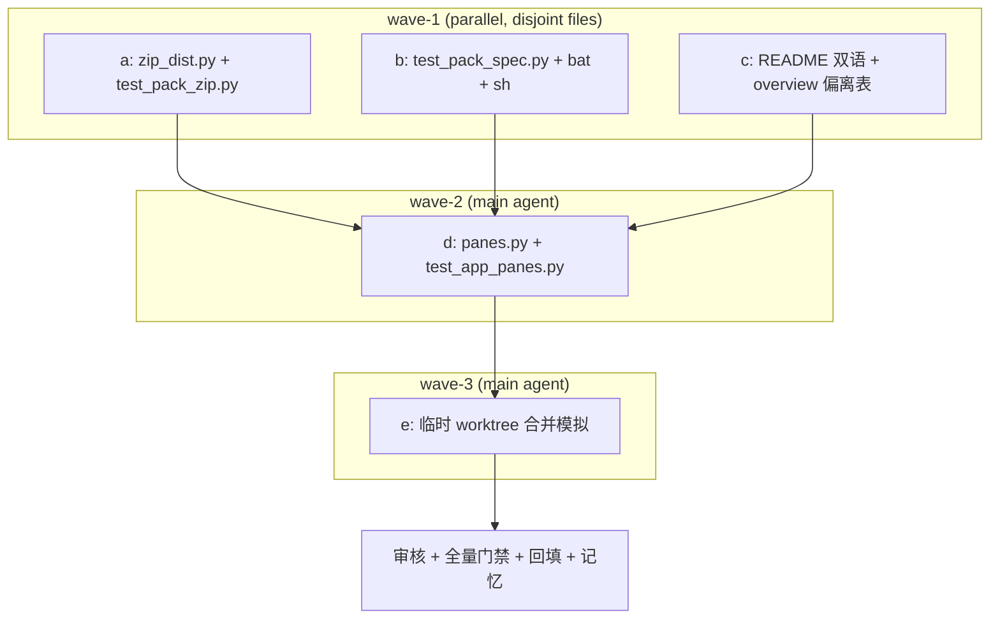

# 全量 minor 修复轮 子计划总纲（波次唯一依据）

主计划：`../pack-dist-zip-minor-fixes-plan.md`；issue 素材：
`../pack-dist-zip-minor-fixes-issue.md`（16 条）。
本总纲只管索引、波次与互斥；每个子计划自包含且只认自己独占文件清单。
路径基准：本目录 `.trae/documents/pack-dist-zip-minor-fixes-plans/` 下
`../../../tools/pack/zip_dist.py` 即仓库根 `tools/pack/zip_dist.py`；
代码块内命令相对基准是仓库根。

## 一、子计划索引

| 子计划 | wave | 独占文件（其它子计划一律不得触碰） | 交付 |
| --- | --- | --- | --- |
| `pack-dist-zip-helper-plan-a.md` | 1 | `tools/pack/zip_dist.py`、`tests/test_pack_zip.py` | F1/F3/F4/F5/F6/F7/F8/F9 实质修复 + 回归用例 |
| `pack-dist-zip-guards-scripts-plan-b.md` | 1 | `tests/test_pack_spec.py`、`pack/pack.bat`、`pack/pack.sh` | F2/F12/F13 |
| `pack-dist-zip-docs-plan-c.md` | 1 | `README.md`、`README.zh.md`、`.trae/documents/pack-dist-zip-plans/overview.md` | F10/F11 |
| `pack-dist-zip-panes-plan-d.md` | 2 | `yate/editor_components/panes.py`、`tests/test_app_panes.py` | F16（产品源码，主代理亲改） |
| `pack-dist-zip-merge-check-plan-e.md` | 3 | 无源码写入（临时 worktree + 回填文档） | F14/F15 合并模拟实测 |

## 二、波次表（波内文件互不重叠，波间串行）

| wave | 子计划 | 前置 | 验收命令（退出码 0 才进下一波） |
| --- | --- | --- | --- |
| 1 | a ∥ b ∥ c | 无 | 各子计划 §验收命令；主代理逐条复核 |
| 2 | d（主代理） | wave-1 三条全绿 | `.venv\Scripts\python.exe -m pytest tests/test_app_panes.py -q -n 1`（连续 4 次）；`pyright yate/ tests/ tools/ pack/`；`pytest tests/test_architecture.py -q` |
| 3 | e（主代理） | wave-2 全绿 | 合并树 `pytest tests/test_architecture.py -q`（38）、合并树全量 pytest、合并树 changelog 0、合并树 diffcheck 0 |
| 4 | 【审核】+【收尾】 | wave-3 结论回填 | `code-review-expert` 评审 → 迭代至 0 blocker/0 major → 主代理七项全量门禁 + 回填 + 提交 + 记忆更新 |

波内并行按 `subagent-workflow.md` 以 2~3 个一批下发；任务书指向对应子计划为
唯一规范来源，显式给独占文件清单、验收命令、报告格式、`bypassPermissions`；
成员回报数据一律由主代理重跑复核，只认落盘结果。

## 三、依赖图

## 四、wave-1 文件互斥矩阵

| 文件 \ 子计划 | a | b | c |
| --- | :---: | :---: | :---: |
| `tools/pack/zip_dist.py` | W | R | . |
| `tests/test_pack_zip.py` | W | . | . |
| `tests/test_pack_spec.py` | . | W | . |
| `pack/pack.bat` / `pack/pack.sh` | . | W | . |
| `README.md` / `README.zh.md` | . | . | W |
| `.trae/documents/pack-dist-zip-plans/overview.md` | . | . | W |

W = 独占写；R = 只读（静态守卫读取助手源码）；`.` = 不触碰。
wave-2 / wave-3 与 wave-1 文件不重叠；wave-3 不写源码。

## 五、偏离登记规则

- 任何波次的阈值 / 范围 / 选型偏离，须当轮回填本总纲「六、偏离记录」并给
  出实测命令与退出码，不得静默调整；波次表一经批准不得执行中临时重排。
- 子代理 spawn 失败 / 零产出：按 `task-orchestration.md` §一.3.5 / §三 最多
  重试一次后由主代理按对应角色剧本兜底，并在
  `../pack-dist-zip-progress.md` 标注「子代理零产出」及兜底产物。
- 合并模拟创建的临时 worktree / 合并提交属删除未跟踪产物动作：先落盘记录，
  收尾汇报显式列出（git 安全协议）。

## 六、偏离记录

| 轮次 | 偏离 | 实测依据 | 退出码 | 裁定 |
| --- | --- | --- | --- | --- |
| 【方案】 | `plan-architect-designer` 未派发（模型 `qwen-3.7-plus` 在本运行时未注册，前轮已两次 spawn 失败） | 前轮 task 工具两次返回同一错误、零落盘产物 | N/A（模型错误） | 按 §三 主代理亲自按剧本产出主计划 + 本总纲 + 全部子计划，如实标注「子代理零产出」 |
| 【方案】 | F16 纳入本轮（评审原判「另案、不阻塞」） | 用户 2026-11-11 明确「fix 所有的isuee」 | N/A（范围裁定） | 纳入 wave-2；产品源码由主代理亲改（子代理不得改 `yate/`） |
| 【方案】 | F13 不新增行为改动，仅注释 + 销账 | 评审原文「无需改动（当前处置已达最优），仅记录为已知脆弱点」 | N/A | 采纳评审裁定，待办表状态改为已闭环 |
| 【执行】wave-1 | F6 由「旧 zip 移到备份」改为「复制式备份 + 整个 swap 块异常回滚」 | 主代理复核发现：若 `os.replace(zip_tmp, archive)` 自身失败，旧 zip 已被移走且 finally 删除备份 → 旧 zip 丢失；改用 `shutil.copyfile` 后旧 zip 始终在场，任一 swap 失败都从副本恢复；补 `test_archive_stage_when_zip_replace_fails_restores_previous_zip` 回归用例 | 0（重跑 wave-1 验收） | 采纳，实质增强 F6 闭环，登记偏离 |
| 【执行】wave-1 | 去掉子代理引入的 `# type: ignore[arg-type]` | `tests/test_pack_zip.py` monkeypatch 桩改为 `src: Path, dst: Path` 正确签名；pyright strict 实测 0 诊断 | 0 | 采纳，符合 python-coding-style「不得用 type ignore 掩盖问题」 |
| 【执行】wave-1 | 一次性验证脚本打印 bat 中文帮助时触发 GBK `UnicodeEncodeError` | 属脚本自身问题、非产品失败（前 5 条命令已 RC=0）；打印改 `ascii+replace` 编码后重跑全部七条 | 0（重跑后） | 采纳，如实登记失败与修正 |
| 【执行】wave-1 | 静态守卫 stdlib 白名单补 `shutil`（F6 复制式备份所需） | 重跑 `WAVE1_RCS` 首项为 1，失败点 `test_pack_spec.py:948` 报 `offenders ['shutil']`；`shutil` 为 stdlib、无第三方依赖，补入白名单而非删断言 | 0（补后重跑） | 采纳，登记偏离 |
| 【审核】R1 | 第一轮评审 major 1（M1 锁残留回归）触发迭代 | `.trae/reviews/2026-11-11-fix-all-minor-review.md` 实测三条失败路径残留 `.lock`；按 §二.6 回到步骤 2 产出 `pack-dist-zip-minor-fixes-review-iteration-plan.md` | 0（迭代方案落盘） | 裁定 A 大 `try` 覆盖，m2/m4 同批，m1/m3/m5/m6 登记待办 |
| 【收尾】 | 三轮评审迭代至 0 blocker / 0 major / 3 minor；全量门禁第 8 项被本机 `[safe-delete]` 钩子拦截（count=10024 > 9999） | 主代理八项门禁前七项全 0，单独重跑 `test_app_panes.py -n 1` RC=0；覆盖率 92.93%·3514 passed、冒烟 121/121·1464 | 0（重跑后） | 采纳，如实登记环境钩子，非产品缺陷、不记「偶发」 |
