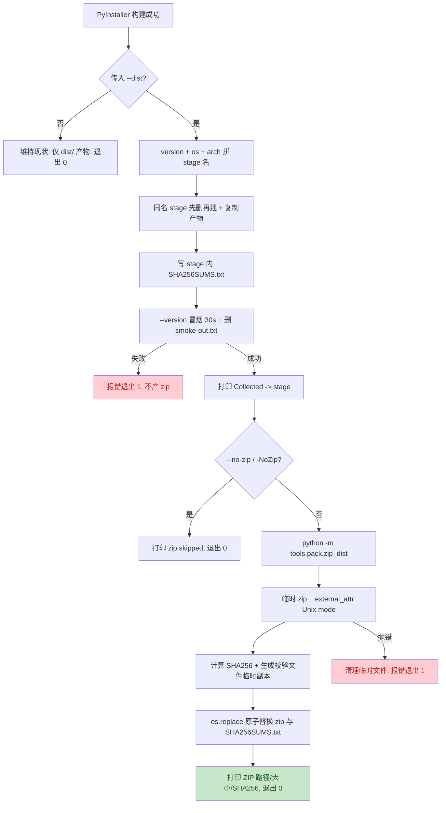

# IKTRDV `pack --dist` 自动产出 zip 归档 —— 主计划

> 状态：方案已落盘。无人值守下【批准】按通过处理（用户明确「所有问题无须过问」），
> 不自称经过用户确认；登记见 `pack-dist-zip-progress.md`。
> 需求唯一来源：`pack-dist-zip-issue.md`；子计划与波次见
> `pack-dist-zip-plans/overview.md`。本文引用仓库文件的相对路径以
> `.trae/documents/` 为基准（`../../pack/pack.ps1` 即仓库根 `pack/pack.ps1`）；
> 代码块内命令的相对基准是仓库根。

## 1. 目标与非目标

**目标**（issue §二）：`--dist <dir>` 收集 + `SHA256SUMS.txt` + `--version` 冒烟
全部成功后，默认额外产出 `<dist>/<stage-name>.zip`（zip 内顶层保留
`<stage-name>/`，内容与 stage 逐项一致、不含 `smoke-out.txt`）；终端打印 zip
路径 / 大小 / SHA256；`<dist>/SHA256SUMS.txt` 追加（同名条目幂等替换）
`<hash> <stage-name>.zip`；单一负向开关 `--no-zip`（ps1 为 `-NoZip`）可关闭，
关闭时其余流程逐项不变且提示已跳过；压缩失败非 0 退出、不留半截 zip、
无残留临时文件；Windows / Linux 命名、顶层目录、压缩方式、退出码、输出语义
对齐；三处帮助可见新开关。

**非目标**（issue §五，逐条遵守）：不动 `python -m tools.release`；不给
`python -m tools.pack` 的 `icon/rosters/wiki` 子命令表新增 `release` / `zip`
子命令；不做 `--zip` 正向开关 / 带值参数 / 配置文件 / 环境变量默认值；不改
`.yxp` 格式与 `tools/yxp/cli.py`；不改 CI；不改 PyInstaller spec 与产物结构、
不删 stage、不引入第三方依赖；不做签名 / 分卷 / 多平台合并归档。

**本轮范围裁定**：
- 抽取共享 Python 助手 `tools/pack/zip_dist.py`（issue §三允许落在
  `tools/` 或 `pack/`），由三脚本共同调用——跨平台一致性由「一份实现」保证，
  不靠两份脚本各自对齐。
- 同步公开用法到 `README.md` / `README.zh.md`（issue §六标为可选，本轮纳入：
  新增开关是面向用户的构建行为，README 是构建入口文档），并同步应用内双语
  手册 `yate/resources/manual.en.md` / `manual.zh.md` 的「Build & Release」章节
  （取证见 §2：手册已明文描述 `--dist` 现状，不同步即产生文档谎言）。
- 不修改 PyInstaller spec、不新增 `tools.pack` 子命令、不改 CI。

## 2. 现状取证（只读实测，文件:行号）

| 事实 | 证据 |
| --- | --- |
| `--dist` 收集块末尾仅打印 `Collected -> ...` 与 `SHA256 yate.exe`，无压缩 | `../../pack/pack.ps1:262-266`；`../../pack/pack.sh:204-209` |
| stage 命名 `yate-<version>-windows-$arch` / `yate-<version>-linux-$arch`，同名先删再建 | `../../pack/pack.ps1:185-201`；`../../pack/pack.sh:169-184` |
| stage 内 `SHA256SUMS.txt`：ps1 用 .NET SHA256 + `Set-Content -Encoding ascii`；sh 用 `sha256sum yate >` | `../../pack/pack.ps1:214-229`；`../../pack/pack.sh:195` |
| 30s 冒烟：ps1 `WaitForExit(30000)` + `smoke-out.txt` 成功路径 `Remove-Item`；sh `timeout 30 ... \| grep -q` | `../../pack/pack.ps1:241-260`；`../../pack/pack.sh:197-202` |
| Linux onefile 产物显式 `chmod 0755 "$stage/yate"` | `../../pack/pack.sh:189` |
| ps1 现有 `param()` 四参数（OneFile / SkipChangelog / Dist / Help），`-Help` 走 `Get-Help -Detailed`；头注释无 `.PARAMETER` | `../../pack/pack.ps1:2-50` |
| sh `show_help()` 用 `sed -n '2,19p'` 截头注释；usage 行位于 5-11 行；未知参数 `*) ... exit 2` | `../../pack/pack.sh:5-11,26-29,56-59` |
| bat `:parse` 逐参数重引号 + 显式映射 `--onefile`→`-OneFile` / `--dist`→`-Dist` / `--help`→`-Help`，未知透传 | `../../pack/pack.bat:21-41` |
| `tests/test_pack_spec.py` 685 行，静态守卫风格为 `ast.parse` + `Path.read_text`，已有 `_REPO_ROOT` 与 `_parse` 辅助；无任何 zip / `--dist` 断言 | `../../tests/test_pack_spec.py:30-58,131-138,428-443` |
| `tools/pack/__init__.py` / `tools/__init__.py` 均为惰性包根（`__all__` 只含 `__version__`），`-m tools.pack.<module>` 不会连带加载 wiki / icon | `../../tools/pack/__init__.py:1-14`；`../../tools/__init__.py:1-10` |
| `python -m tools.pack` 子命令仅 `icon/rosters/wiki`；非目标要求保持不变 | `../../tools/pack/cli.py:41-47` |
| pyright strict 的 `include` 含 `tools` / `tests` / `pack`；覆盖率 `fail_under=75`；`[build]` extra = pyinstaller + pillow（dev 不含 PyInstaller） | `../../pyproject.toml:110,115-125,153-166` |
| 全仓唯一 zip 写法 `.yxp` 用 `zf.writestr(rel, ...)`，无 `external_attr`、无原子替换、失败仅 `unlink` | `../../tools/yxp/cli.py:223-238` |
| 架构守卫：绝对导入 (`test_no_relative_imports`)、ASCII 注释 (`test_comments_and_docstrings_stay_ascii` 扫 `yate/`+`tools/`+`tests/`)、库模块禁 `print()`（只扫 `yate/`）、800 行阈值 | `../../tests/test_architecture.py:610,899,1417,1496` |
| `*.spec` 被 .gitignore 排除但 `pack/*.spec` 例外；`release/` `dist/` `build/` 已忽略 | `../../.gitignore:12-15,41-43` |
| README 构建段落只列 `--onefile`，无 `--dist`；应用内双语手册已详述 `--dist` 且写明「不传 --dist 行为不变」 | `../../README.md:305-314`；`../../README.zh.md:321-330`；`../../yate/resources/manual.en.md:1650-1671`；`../../yate/resources/manual.zh.md:1474-1493` |

## 3. 备选方案与否决理由

| 方案 | 内容 | 裁决 |
| --- | --- | --- |
| A（选中） | 共享 Python 助手 `tools/pack/zip_dist.py`（stdlib `zipfile` + `hashlib` + `tempfile` + `os.replace`），ps1 / sh 均在冒烟成功后以 `-m tools.pack.zip_dist` 调用 | 选中：一份实现同时保证两平台的 zip 命名、顶层目录、`ZIP_DEFLATED`、Unix mode 位、校验条目 upsert、临时文件与退出码语义完全一致；落在 `tools/` 且被 pyright strict 覆盖，测试可静态 `from tools.pack import zip_dist` 导入，无需动态加载；`-m` 入口不触碰 `python -m tools.pack` 的 `icon/rosters/wiki` 子命令表（非目标） |
| B | Windows 用 `Compress-Archive`，Linux 用 `python -c` 内联 zip | **否决**：`Compress-Archive` 有 2 GB 上限（issue §三明确要求评估），且不写 `external_attr`、顶层目录形态与 `zipfile` 分叉；两平台两份实现要靠测试「对齐」而不是共享契约，重复执行 / 失败清理 / 校验条目语义各写一遍，维护成本翻倍 |
| C | Windows `Compress-Archive` + Linux 系统 `zip` 命令 | **否决**：违反「不要求预装 zip / 7-Zip 等系统工具」；`zip -r` 的顶层目录与 mode 处理依赖 umask，解压后 Linux 可执行位不可控 |
| D | 给 `python -m tools.pack` 新增 `zip` 子命令，脚本调用它 | **否决**：issue 非目标明文「不给 `python -m tools.pack` 新增 release / zip 子命令」；`tools/pack/cli.py` 的子命令表是冻结面 |
| E | `--zip` / `--no-zip` 双向开关或 `--zip=<true\|false>` | **否决**：issue 术语约定「一个参数且默认值唯一」，双向开关会产生两个真值来源与无效相反组合；默认值扩散到环境变量 / rc 同样被非目标排除 |

**关键子决策**：`zipfile` 默认不写 Unix mode（issue §三），故助手显式构造
`ZipInfo` 并写 `create_system = 3` 与
`external_attr = ((mode | stat.S_IFREG) << 16)`；POSIX 侧取
`stat.S_IMODE(path.stat().st_mode)`（保留 `chmod 0755`），Windows 侧对
`yate` / `yate.exe` 给 `0o755`、其余 `0o644`，使任一平台产出的包解压后
顶层可执行文件都带可执行位。

## 4. 数据契约与调用顺序

**助手 CLI**：`python -m tools.pack.zip_dist --stage <abs stage> --dist-root <abs dist>`。
- 成功（退出码 0）向 stdout 打印两行，语义两平台一致：
  `ZIP -> <path>  (<X.X MB>)` 与 `  SHA256 <stage-name>.zip: <hash>`；
- 失败（退出码 1）：`error: zip archive failed: <reason>` 写 stderr；
  参数错误由 argparse 退出 2；
- 产物：`<dist>/<stage-name>.zip`（与 stage 同名同级，重复执行 `os.replace`
  覆盖）、`<dist>/SHA256SUMS.txt`（追加 `<hash>  <stage-name>.zip`）。

**校验文件 upsert**：逐行读现有文件（不存在视为空），仅剔除「第二列恰为
`<stage-name>.zip`」的行，保留其它平台 / 版本 / 注释行，再追加新行，写到
同目录临时文件后 `os.replace`。故多次构建不重复追加同名条目，多平台条目
共存不互相覆盖；stage 内 `SHA256SUMS.txt` 全程不读不写。

**原子性与清理**：zip 先写同目录临时文件（`tempfile.mkstemp` 前缀
`.<stage-name>.`、后缀 `.zip.tmp`），校验文件同样写临时文件；两者都准备好后
先 `os.replace` zip、再 `os.replace` 校验文件；`finally` 无条件清理两个临时
文件。压缩过程抛错 → 最终 zip 不被触碰（旧 zip 保持）、无半截产物、非 0
退出。校验文件替换失败时错误可读且退出非 0，已落盘的是**完整** zip（重跑即
补齐条目）——此边界在 §7 风险表登记。

**zip 内容**：`sorted(stage.rglob("*"))` 只取文件，arcname 为
`<stage-name>/<相对路径 as_posix>`；显式排除 `smoke-out.txt`（成功路径本就
已删除，这里做双保险）；不写空 zip（stage 无文件时报错退出）。

**触发顺序**（三脚本一致）：`--dist` 块内 stage 复制 → stage 内
`SHA256SUMS.txt` → 30s 冒烟 → 删除 `smoke-out.txt` → `Collected ->` 输出 →
`if NoZip` 打印跳过提示 / `else` 调助手。因此前置步骤失败时根本到达不了
归档分支；未传 `--dist` 时无论开关取值都不产出 zip；stage 始终保留。

## 5. 子计划与执行波次

总纲与波次表见 `pack-dist-zip-plans/overview.md`；波内文件互不重叠，
波次间串行（上一波全部验收命令退出码 0 才进入下一波）。

| wave | 子计划 | 独占文件 |
| --- | --- | --- |
| 1 | `pack-dist-zip-helper-plan-a.md` | `tools/pack/zip_dist.py`、`tools/pack/__init__.py`、`tests/test_pack_zip.py` |
| 2 | `pack-dist-zip-ps1-plan-c.md` / `pack-dist-zip-sh-plan-d.md` / `pack-dist-zip-bat-plan-e.md` | 各脚本单独独占 |
| 3 | `pack-dist-zip-guards-plan-b.md` / `pack-dist-zip-docs-plan-f.md` | `tests/test_pack_spec.py` / 四个双语文档 |
| 4 | `pack-dist-zip-e2e-plan-g.md`（主代理执行，不派子代理） | 无源码写入；只读产物校验 |

## 6. 验收标准映射（issue §四）

| issue 验收 | 本方案覆盖手段 |
| --- | --- |
| 1 Windows 参数矩阵 | wave-2 三脚本改动 + wave-4 真实构建 E2E（含 `-Help` / `--help` 输出、`-NoZip`、无 `--dist`） |
| 2 Linux 参数矩阵 | wave-2 sh 改动 + wave-3 静态守卫（`-h` sed 区间、`--zip` 未知参数仍 exit 2）+ 助手单测；Linux 无真实构建环境，偏离见 §7 |
| 3 Windows 真实构建产物校验 | wave-4：`Expand-Archive` 目录树、`Get-FileHash` 对校验条目、`yate.exe --version`、stage 保留、stage 内校验文件不变 |
| 4 Linux 同构验证 | 助手单测断言 `ZipFile.testzip()` 与 `external_attr` 的 `0o755`；用 `python -m zipfile -t` 对 wave-4 生成的 zip 做完整性检查；**Linux 真实 PyInstaller 构建不纳入本轮**，偏离理由见 §7 |
| 5 失败与边界 | 助手单测 monkeypatch 注入 `zipfile.ZipFile.writestr` 抛错 → 非 0、临时文件清空、旧 zip 不变；重复执行覆盖 + 校验条目幂等；`--no-zip` 不删旧 zip；冒烟失败路径由调用顺序静态守卫保证 |
| 6 回归用例 | wave-3 `tests/test_pack_spec.py` 新增守卫 + `python -m pytest tests/test_pack_spec.py -q` |
| 7 全量门禁 | 主代理收尾五项：pyright `yate/ tests/ tools/ pack/`、pytest `-n auto`、架构 37 用例、覆盖率 `--cov-fail-under=75`、冒烟 `--jobs 4`；改 README 追加 `python -m tools.changelog check` |

## 7. 风险清单、偏离记录与回滚路径

| 风险 | 缓解 / 证据 | 回滚 |
| --- | --- | --- |
| `pack.sh` 的 `sed -n '2,19p'` 硬编码区间漏掉新 usage | wave-2 同步终点为新增行数后的值；wave-3 守卫解析 `show_help()` 的区间终点并断言 ≥ 所有 usage 行最大行号（含 `--no-zip`） | 还原 sh 头注释与 `show_help` 两行 |
| `zipfile` 不写 Unix mode 导致 Linux 包不可执行 | 显式 `create_system=3` + `external_attr`；助手单测断言 `0o755` 位 | 删助手 `external_attr` 逻辑（会导致验收 4 失败，故不作为回滚选项，只作修复方向） |
| PowerShell 5.1 在 `$ErrorActionPreference=Stop` 下把 native stderr 当终止错误 | ps1 沿用现有「不重定向 native stderr」约定（`../../pack/pack.ps1:83-93` 注释实证），助手错误信息写 stderr、调用处检查 `$LASTEXITCODE` | 助手错误改为 stdout + 非零退出码 |
| 校验文件被覆盖 / 重复追加 | upsert 按「第二列 == `<stage>.zip`」精确剔除，其它行原样保留；单测覆盖多平台条目 | 还原为纯追加（会违反验收 5，故只作对比说明） |
| 校验文件替换失败时 zip 已落盘但条目未更新 | 顺序固定为「先 zip 后校验」，失败非 0 退出、错误可读、重跑幂等补齐；登记为已知边界（minor） | 无需回滚：重跑即可 |
| `--no-zip` 误删历史 zip 或改校验文件 | 跳过分支只打印提示，不调用助手、不含任何删除 / 写校验语句；静态守卫断言 | 删除跳过分支 |
| 新增 Python 模块触发架构守卫 | `from __future__ import annotations`、绝对导入、注释与 docstring 全英文、无 `Any` / `TYPE_CHECKING` / 相对导入；`print()` 仅在 CLI `main()`（守卫只扫 `yate/`）；文件远低于 800 行 | 删除助手并回退三脚本调用 |
| 真实构建污染工作树 | wave-4 用 `-SkipChangelog` 避免刷新 `changelog.*.md`；`release/` `dist/` `build/` 已被 `.gitignore` 忽略，验证后清理 | 删除未跟踪产物目录（不删 `.codebuddy/`） |
| **偏离：Linux 真实构建** | 本机为 Windows（OS win32），无 Linux PyInstaller 环境；CI 不跑 pack（issue 背景表取证）。按 issue 验收 4 的允许口径，Windows 做真实构建，Linux 侧由「同一份 Python 助手的运行时单测 + 三脚本静态守卫 + `python -m zipfile -t`」覆盖，并在收尾回填中显式记录此偏离与等价验证命令；**不得声称跑过 Linux 构建** | 不适用 |
| **偏离：Windows 真实构建若失败** | wave-4 若因网络 / `[build,ts,lua]` extras 安装 / PyInstaller 失败而无法完成，必须记录实测错误与退出码，改以「伪 stage + 助手 CLI + 脚本静态守卫」端到端 dry-run 覆盖，并在收尾文档标注未达标项，不得粉饰 | 不适用 |
| 子代理零产出（已发生） | `plan-architect-designer` 两次 spawn 均 `Model "qwen-3.7-plus" not found`（§一.3.5 已按表格改模型重试一次），按 §三 由主代理亲自按剧本调研 + 落盘本方案；后续执行 / 评审角色仍按纪律尝试 spawn，失败同样兜底并如实标注 | 主代理兜底，不阻塞任务 |

**回滚总路径**：本功能全部集中在新增助手 + 三脚本 `--dist` 块末尾追加分支 +
静态守卫 + 文档；撤销时 `git revert` 本分支各步提交即可，`--dist` 现有语义
（stage 结构、命名、校验、冒烟）在改动中零重写。

## 8. 门禁与提交纪律

- 每步（领会 / 方案 / 批准 / 执行各波 / 审核 / 收尾）完成后按
  `git-commit-message.md` **单独提交一次**，只提交不推送，闭环内不自动合流。
- 收尾由主代理亲自跑（并行口径，与 CI 一致）：
  `python -m pyright yate/ tests/ tools/ pack/`、
  `python -m pytest tests/ -q -n auto`、
  `python -m pytest tests/test_architecture.py -q`、
  `python -m pytest tests/ --cov=yate --cov-branch -n auto`、
  `python -m tools.smoke_test run --jobs 4`，
  再加 `python -m tools.changelog check`（本轮改 README）。
- 并行下出现时序 flake 用 `-n 1` 复核并修用例，不记成「偶发」；
  局部覆盖率运行加 `--cov-fail-under=0`。
- 计划文档回填真实前后数字与偏离记录；`pack-dist-zip-progress.md` 同步状态。

## 9. 收尾实测与偏离回填（2026-11-10）

- 闭环结果：两轮 `code-review-expert` 评审。第一轮 blocker 0 / major 3 /
  minor 7（记录 `../reviews/2026-11-10-pack-dist-zip.md` §一-§六）；按 §二.6
  回到步骤 2 产出 `pack-dist-zip-review-fixes-plan.md`，修复提交 `4f11dd1d`；
  第二轮迭代复核（同记录 §七）**blocker 0 / major 0 / minor 5**，达到迭代终点。
- 三条 major 闭环：M1 / M2 文档与帮助示例统一为可执行 `-Dist` 形态（否决改
  ps1 参数面；实测 `--dist` 在 PowerShell 命令模式是双连字符终止符形态，属
  既有行为，bat 显式映射与 `-Dist` 路径已真实构建验证）；M3
  `_checksum_bytes` 字节级 upsert，非 ASCII 校验行不再硬失败且有回归用例。
- 主代理收尾全量门禁（并行口径，逐条退出码）：pyright
  `yate/ tests/ tools/ pack/` = 0（0 errors）；`pytest tests/ -q -n auto` = 0；
  `pytest tests/test_architecture.py -q` = 0（37 用例）；
  `pytest tests/ --cov=yate --cov-branch -n auto` = 0（3495 passed /
  10 skipped，TOTAL 92.96%，阈值 75）；
  `tools.smoke_test run --jobs 4` = 0（121/121 scenarios、1464/1464 checks）；
  `tools.changelog check` = 0。`GATE_RCS [0, 0, 0, 0, 0, 0]`。
- wave-4 三次真实构建产物校验（详见 `pack-dist-zip-progress.md`
  「波次执行实测」）全部通过；Linux 真实构建不纳入，等价覆盖与偏离理由见
  §7 与 `pack-dist-zip-plans/overview.md` §六。
- 遗留 minor（登记待办，不阻塞合入）：m1（bat 启动期失败无可辨识提示）、
  m7（sh 帮助 `sed` 区间硬编码，守卫已充分）、第二轮 N1（存量
  `test_app_panes.py::test_close_command_closes_active_pane` 确定性竞态，
  不在本分支 diff，另案；不记「偶发」）、N2（epoch 用例未断言文件 mtime
  未被固定）、N3（末列含全角空格的畸形同名行不替换）、N4（偏离表退出码
  列混填一格）、N5（README 代码块注释列对齐）。
- 提交纪律：每步单独提交、只提交不推送、不自动合流；分支
  `feature/feat-pack-dist-zip`（parent `master`），工作树干净。E2E 产物
  `release/` / `dist/` / `build/` 均为 `.gitignore` 忽略项，按 git 安全协议
  保留未删，收尾汇报显式列出。
