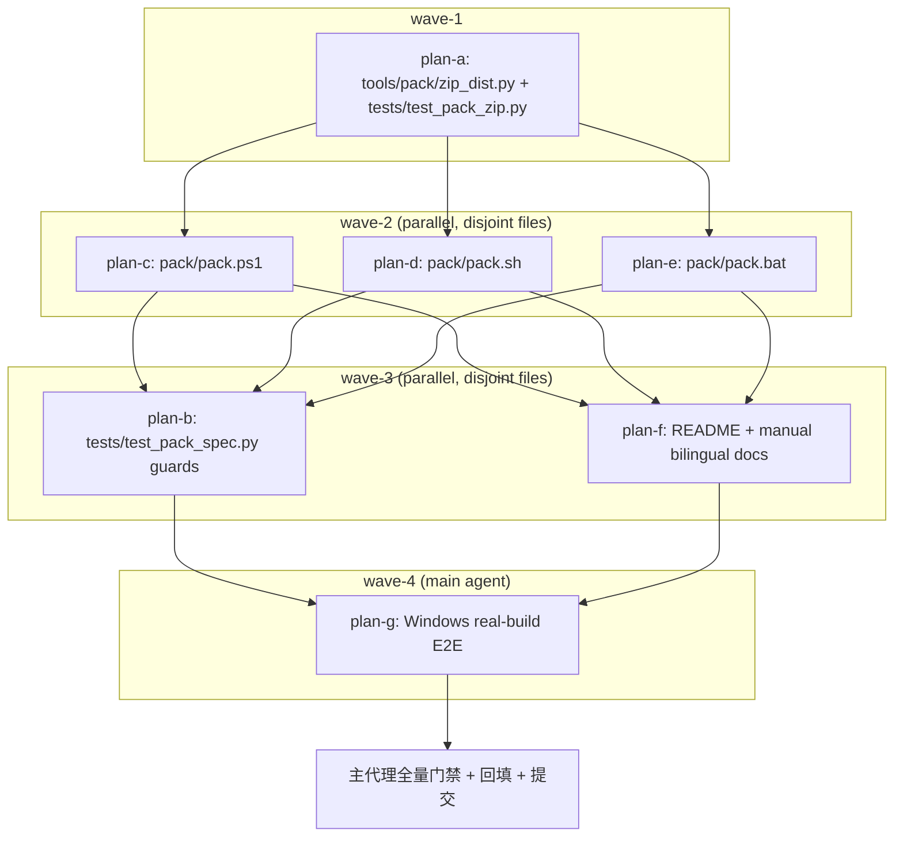

# IKTRDV / pack-dist-zip 子计划总纲（执行波次唯一依据）

主计划：`../pack-dist-zip-plan.md`（目标 / 非目标 / 备选与否决理由 / 数据契约 /
Mermaid 流程图 / 风险与回滚 / 验收映射）。需求素材：`../pack-dist-zip-issue.md`。
本总纲只管索引、波次与依赖关系；每个子计划自包含且只认自己的独占文件清单。
文档内仓库文件引用以本文件所在目录为基准（`../../../tools/pack/zip_dist.py`
即仓库根 `tools/pack/zip_dist.py`）；代码块内命令相对基准为仓库根。

## 一、子计划索引

| 子计划 | wave | 独占文件（其它子计划一律不得触碰） | 交付 |
| --- | --- | --- | --- |
| `pack-dist-zip-helper-plan-a.md` | 1 | `tools/pack/zip_dist.py`（新）、`tools/pack/__init__.py`、`tests/test_pack_zip.py`（新） | 共享归档助手 + 运行时单测 |
| `pack-dist-zip-ps1-plan-c.md` | 2 | `pack/pack.ps1` | `[switch]$NoZip`、帮助、收集块末尾归档分支 |
| `pack-dist-zip-sh-plan-d.md` | 2 | `pack/pack.sh` | `--no-zip` case、帮助行区间、归档分支 |
| `pack-dist-zip-bat-plan-e.md` | 2 | `pack/pack.bat` | `--no-zip` → `-NoZip` 映射 + 头注释 |
| `pack-dist-zip-guards-plan-b.md` | 3 | `tests/test_pack_spec.py` | 三脚本开关 / 默认值 / 跳过语义 / help 区间 / `--dist` 与冒烟不回归的静态守卫 |
| `pack-dist-zip-docs-plan-f.md` | 3 | `README.md`、`README.zh.md`、`yate/resources/manual.en.md`、`yate/resources/manual.zh.md` | 双语公开 `--dist` / `--no-zip` 用法 |
| `pack-dist-zip-e2e-plan-g.md` | 4 | 无源码写入（只读产物校验 + 临时构建产物） | Windows 真实构建参数矩阵与 zip 内容 / hash / 可执行校验 |

## 二、执行波次表（波内文件互不重叠，波间严格串行）

| wave | 子计划 | 前置条件 | 每波验收命令（退出码 0 才进入下一波） |
| --- | --- | --- | --- |
| 1 | `plan-a` | 无 | `.venv\Scripts\python.exe -m pytest tests/test_pack_zip.py -q`；`.venv\Scripts\python.exe -m pyright tools/pack/zip_dist.py tests/test_pack_zip.py`；`.venv\Scripts\python.exe -m pytest tests/test_architecture.py -q` |
| 2 | `plan-c` ∥ `plan-d` ∥ `plan-e` | wave-1 全绿（助手以 `-m tools.pack.zip_dist` 可调用） | `.venv\Scripts\python.exe -m pytest tests/test_pack_spec.py -q`（既有守卫回归）；`powershell -NoProfile -ExecutionPolicy Bypass -File pack/pack.ps1 -Help`；`powershell -NoProfile -ExecutionPolicy Bypass -File pack/pack.ps1 -NoZip -Help`（参数绑定探针）；`cmd /c pack\pack.bat --help`；`bash pack/pack.sh -h`（bash 不可用时由 wave-3 静态守卫覆盖并登记） |
| 3 | `plan-b` ∥ `plan-f` | wave-2 三脚本已落盘 | `.venv\Scripts\python.exe -m pytest tests/test_pack_spec.py tests/test_pack_zip.py -q`；`.venv\Scripts\python.exe -m pyright yate/ tests/ tools/ pack/`；`.venv\Scripts\python.exe -m tools.changelog check` |
| 4 | `plan-g` | wave-3 全绿 | 见 `pack-dist-zip-e2e-plan-g.md`（真实构建 + zip 校验 + `--no-zip` 矩阵）；失败按主计划 §7 记录偏离 |
| 收尾 | 主代理 | wave-4 结论回填 | 五项全量门禁 + `python -m tools.changelog check`；文档回填 + 逐步提交 |

波内并行按 `subagent-workflow.md` 以 2~3 个一批下发；每批任务书指向对应子计划为
唯一规范来源，显式给独占文件清单、验收命令、报告格式、`bypassPermissions`；
成员回报数据一律由主代理重跑复核，只认落盘结果。

## 三、依赖关系图

## 四、波内文件互斥矩阵

| 文件 \ 子计划 | a | c | d | e | b | f | g |
| --- | :---: | :---: | :---: | :---: | :---: | :---: | :---: |
| `tools/pack/zip_dist.py` | W | . | . | . | R | . | R |
| `tools/pack/__init__.py` | W | . | . | . | . | . | . |
| `tests/test_pack_zip.py` | W | . | . | . | R | . | R |
| `pack/pack.ps1` | . | W | . | . | R | . | R |
| `pack/pack.sh` | . | . | W | . | R | . | R |
| `pack/pack.bat` | . | . | . | W | R | . | R |
| `tests/test_pack_spec.py` | . | . | . | . | W | . | R |
| `README.md` / `README.zh.md` | . | . | . | . | R | W | . |
| `yate/resources/manual.{en,zh}.md` | . | . | . | . | . | W | . |

W = 独占写；R = 只读引用（静态断言读取）；`.` = 不触碰。
wave-1 与 wave-2 / wave-3 无写冲突；wave-2 三个子计划各自独占一个脚本；
wave-3 的 b 与 f 互不重叠；wave-4 不写源码。

## 五、偏离登记规则

- 任何波次的阈值 / 范围 / 选型偏离，必须在当轮回填本总纲「六、偏离记录」并给
  出实测命令与退出码，不得静默调整；波次表一经批准不得在执行中临时重排。
- 子代理 spawn 失败 / 零产出：按 `task-orchestration.md` §一.3.5 / §三 最多重试
  一次后由主代理按对应角色剧本兜底，并在进度记录
  `../pack-dist-zip-progress.md` 标注「子代理零产出」及兜底产物。
- Linux 真实构建不纳入（本机 Windows），偏离理由与等价验证见主计划 §7 与
  `pack-dist-zip-e2e-plan-g.md`。

## 六、偏离记录

| 轮次 | 偏离 | 实测依据 | 退出码 | 裁定 |
| --- | --- | --- | --- | --- |
| 【方案】 | `plan-architect-designer` 两次 spawn 均报 `Model "qwen-3.7-plus" not found`（首次 + §一.3.5 按表格改模型重试一次） | task 工具两次返回同一错误，零落盘产物 | N/A（spawn 错误） | 按 §三 主代理亲自按剧本调研并落盘主计划 + 本总纲 + 全部子计划，如实标注「子代理零产出」 |
| 【方案】 | 本轮把应用内双语手册 `yate/resources/manual.{en,zh}.md` 纳入范围（issue §六未列） | `yate/resources/manual.en.md:1650-1671` / `manual.zh.md:1474-1493` 已明文描述 `--dist` 现状，不改即过时 | N/A（只读调研） | 纳入 wave-3 子计划 f，与 README 一起双语同步 |
| 【执行】wave-4 | E2E dist 目录用 `release` 替代计划中的 `release-e2e` | `../../.gitignore:15` 只忽略 `release/`，`release-e2e/` 会成为未跟踪产物；三次真实构建后 `git status --short` 实测无未跟踪产物 | 0（三次构建） | 采纳，语义等价，登记偏离 |
| 【执行】wave-4 | ps1 直接调用 `--dist release` 未作为 E2E 构建入口，改由 bat `--dist` 与 ps1 `-Dist` 覆盖 | 实测 `& .\pack\pack.ps1 --dist release -Help` 报 `A positional parameter cannot be found that accepts argument 'release'`；`-dist release -Help` / `-Dist release -Help` exit 0；`pack.bat --skip-changelog --dist release` 真实构建 exit 0。`--dist` 在 PowerShell 命令模式是双连字符终止符形态，属既有参数解析行为（`../../pack/pack.bat:21-26` 注释已说明需显式映射），非本任务引入 | 1（--dist 绑定）/ 0（-Dist 与 bat） | 不改 ps1 参数面；第一轮评审 M1/M2 指出文档示例误导，已在迭代轮改为 `-Dist` 形态并补显式说明，见下行 |
| 【执行】wave-4 | Linux 真实 PyInstaller 构建不纳入 | 本机 win32、CI 不跑 pack；按 issue 验收 4 的允许口径，Windows 做三次真实构建，Linux 侧由助手 `posix=True` mode 单测、sh 静态守卫、`python -m zipfile -t`（实测 `Done testing`）覆盖 | 0（`zipfile -t`） | 主计划 §7 已登记；第一轮评审 §五 判「可接受」，收尾不声称跑过 Linux 构建 |
| 【迭代】R1 | 第一轮评审 major 3（M1/M2 不可执行示例、M3 非 ASCII 校验行硬失败）触发修复 | `pack-dist-zip-review-fixes-plan.md` §8：46 passed、pyright 0、架构 37、非 ASCII 探针保留字节、`-NoZip -Dist release -Help` exit 0、changelog check 0 | 0（三条验收命令 + 探针） | 按 §二.6 回到步骤 2 重新设计并修复；文档纠偏为 `-Dist`（否决改 ps1 参数面）、M3 改字节级 upsert；提交 `4f11dd1d` |
