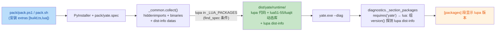

# pack-lupa-plan.md — pack 打包自动携带 lupa（issue IKL2G6）

> 状态：执行中（无人值守时段推进，方案批准按总纲 §二.5 视为通过）
> 来源 issue：https://gitee.com/jermaine/yate/issues/IKL2G6
> 分支 / worktree：`enh/pack-lupa` / `../yate-pack-lupa`

## 一、目标与非目标

### 目标

1. 调用 pack 打包脚本（`pack/pack.ps1` / `pack/pack.bat` / `pack/pack.sh`）后，
   打包产物自动包含第三方包 **lupa**（`[lua]` extra 的 Python-Lua 桥）。
2. 打包完成后运行 `yate --diag`，`[packages]` 段的包清单里有 lupa
   （`lua:` 标签下显示版本号，而非 `not installed`）。

### 非目标

- 不改 `yate/diagnostics.py` / `yate/dist_meta.py`（issue IKJJFI 定案的
  dist 元数据单一事实来源无需动）；
- 不改变 lupa 的可选依赖语义（不从 `[lua]` extra 提升为 core 依赖）；
- 不改 one-folder / onefile 两种构建模式的产物布局（`runtime/` 契约不动）；
- 不处理 tree-sitter / 其余 extra 的既有行为。

## 二、现状事实（调研结论，全部带证据）

1. pack 走 PyInstaller：入口 `pack/pack.ps1:128`（`python -m PyInstaller ...
   $spec`），共享构建逻辑在 `pack/_common.py::collect`（:116-192）。
2. lupa 是动态 import（`yate/services/lua_extensions.py:114`
   `importlib.import_module("lupa")`），PyInstaller 静态分析扫不到；
   `tests/test_pack_spec.py:74-76` 明文记录该事实。
3. lupa 目前**不在任何收集清单**：不在 `pack/_common.py:36-62` 的
   `_TS_PACKAGES`，不在 core 依赖组（`pyproject.toml:12-15`），
   因此产物里既无 lupa 代码也无 lupa dist-info。
4. `yate --diag` 的 `[packages]` 段（`yate/diagnostics.py:428-455`）由
   `requirement_groups()`（`yate/dist_meta.py:26-53`）解析
   `importlib.metadata.requires("yate")` 得到分组（lupa 在 `lua:` 组，
   `_SKIPPED_EXTRAS = {"dev", "build"}` 不含 lua），版本探测走
   `importlib.metadata.version()`（:458-463）——**只读 dist-info**。
5. yate 自身 dist-info 已随包发布（`pack/_common.py:154`
   `copy_metadata("yate")`），core 依赖 dist-info 由
   :156-157 自动派生；extra 依赖（含 lupa）没有对应收集。
6. pack 脚本在构建环境缺 PyInstaller 时自动安装
   `pip install -e ".[build,ts]"`（`pack/pack.ps1:94`、`pack/pack.sh:91`），
   不含 `[lua]`，全新环境构建出的产物必然缺 lupa。

## 三、备选方案与否决理由

| 方案 | 结论 | 理由 |
|---|---|---|
| A. 仿 `_TS_PACKAGES` 模式显式收集 lupa（collect_submodules + collect_dynamic_libs + copy_metadata，find_spec 条件跳过） | **采纳** | 与既有 tree-sitter 收集机制同构、有先例（diag-package-sync plan-b）、对无 lupa 的构建环境优雅降级 |
| B. 依赖 PyInstaller hooks-contrib 的 hook-lupa 自动收集 | 否决 | 收集面依赖 hooks 版本不可控；dist-info metadata 不会被 hook 收集，`--diag` 版本探测仍显示 not installed |
| C. 把 lupa 移入 core dependencies | 否决 | 改变可选依赖语义（无 lupa 时 yate 照常运行），违背 pyproject 的 extra 设计与 `lua_extensions.py` 的懒加载前提 |
| D. 在 diagnostics 里为 lupa 加硬编码显示 | 否决 | 违反 IKJJFI 定案的"dist 元数据单一事实来源"；且不解决产物缺代码的实质问题 |

## 四、分步实施计划

### 步骤 1：`pack/_common.py` 显式收集 lupa

- 输入：现状 `collect()`（:116-192）。
- 改动：
  1. 新增模块级常量 `_LUA_PACKAGES: tuple[str, ...] = ("lupa",)`（注释说明
     `[lua]` extra、动态 import 同 `_TS_PACKAGES` 的前提）；
  2. 收集循环从 `for ts_pkg in _TS_PACKAGES` 改为遍历
     `(*_TS_PACKAGES, *_LUA_PACKAGES)`（同一套 find_spec 跳过 +
     collect_submodules + collect_dynamic_libs + copy_metadata）；
  3. `SpecInputs` 字段 `ts_binaries` / `ts_datas` 更名为
     `optional_binaries` / `optional_datas`（不再只承载 tree-sitter，
     名称如实反映内容），docstring 同步。
- 输出：构建环境装有 lupa 时，hiddenimports / binaries / datas 含 lupa
  及其 dist-info；未装时跳过（维持现状，不劣化）。
- 验收命令：`.venv\Scripts\python.exe -m pytest tests/test_pack_spec.py -q`

### 步骤 2：两个 spec 与 pack 脚本同步

- 改动文件：`pack/yate.spec`、`pack/yate-onefile.spec`（`Analysis` 的
  `binaries=` / `datas=` 引用新字段名 + docstring 措辞
  "tree-sitter binaries" → 覆盖 lupa）；`pack/pack.ps1`、`pack/pack.sh`
  （自动安装 extras `.[build,ts]` → `.[build,ts,lua]` + 注释同步；
  帮助文本中的安装提示同步）。
- 输出：两种构建模式一致携带 lupa；全新环境一键构建不再缺 lupa。
- 验收命令：`.venv\Scripts\python.exe -m pytest tests/test_pack_spec.py -q`
  （其中 `test_collect_..._fills_every_spec_input_field` /
  `test_spec_..._reads_every_spec_input_field` 自动守卫字段改名不脱节）

### 步骤 3：静态守卫测试补强（`tests/test_pack_spec.py`）

- 改动：新增用例断言 `_LUA_PACKAGES` 恰为 `("lupa",)`（lupa 必须保留在
  显式收集清单；删除即构建回归）；同步 `:67` 附近提到 `_TS_PACKAGES`
  的注释，把 lupa 动态 import 的收集归属写清。
- 验收命令：`.venv\Scripts\python.exe -m pytest tests/test_pack_spec.py -q`

### 步骤 4：真实构建 + `--diag` 验收（issue 的验收标准）

- 输入：worktree 沙箱（dev extra 已含 lupa）；补装 PyInstaller：
  `.venv\Scripts\python.exe -m pip install pyinstaller`。
- 命令：`powershell -NoProfile -ExecutionPolicy Bypass -File pack\pack.ps1 -SkipChangelog`
  （one-folder 模式），随后
  `dist\yate\yate.exe --diag`。
- 输出/通过标准：`--diag` 输出的 `[packages]` 段在 `lua:` 标签下出现
  `lupa` 且显示版本号（非 `not installed`）；构建退出码 0。
- 说明：真实构建耗时数分钟，产物目录（dist/ build/）不入库。

## 五、构建/诊断链路（改动后）



## 六、风险清单与回滚

| 风险 | 缓解 |
|---|---|
| lupa 的 C 扩展 / 捆绑 Lua DLL 收集不全，冻结后 import 失败 | 步骤 4 真实构建 + `--diag` + 手工 lua 扩展冒烟兜底；collect_submodules + collect_dynamic_libs 双通道 |
| 构建环境未装 lupa（只有 build/ts extras）→ 产物静默缺 lupa | pack 脚本自动安装 extras 加 `[lua]`；find_spec 跳过只作为降级路径 |
| PyInstaller 对 lupa 重复收集（hook 与显式收集并存） | PyInstaller 对重复 datas/binaries 去重（`_common.py:153` 注释既有先例），构建告警可接受 |
| 产物体积增长（lupa + Lua DLL ≈ 1-2 MB） | 预期内，issue 明确要求携带 |

回滚路径：全部改动单分支单系列提交，`git revert` 即可整体回退；
不改运行时 `yate/` 代码，无行为回归面。

## 七、门禁（收尾必跑）

- `.venv\Scripts\python.exe -m pyright yate/ tests/ tools/ pack/` 零诊断；
- `.venv\Scripts\python.exe -m pytest tests/ -q` 全绿；
- `.venv\Scripts\python.exe -m pytest tests/test_architecture.py -q` 全绿；
- 覆盖率：`.venv\Scripts\python.exe -m pytest tests --cov=yate --cov-branch
  --cov-fail-under=75 -q`（改动面在 pack/ 与 tests/，yate/ 无产品代码变更，
  覆盖率不应回落）。

## 八、执行记录（回填）

- 步骤 1-3（代码 + 测试）：已完成，提交 `7767f7b`
  （`feat(pack): bundle the lupa Lua bridge in frozen builds (issue IKL2G6)`，
  6 文件 +80/-35）。实现与计划一致：`_LUA_PACKAGES = ("lupa",)` 并入
  find_spec 门控收集循环；`SpecInputs.ts_binaries/ts_datas` →
  `optional_binaries/optional_datas`；两个 spec、`pack.ps1` / `pack.sh`
  extras 同步为 `[build,ts,lua]`；`tests/test_pack_spec.py` 新增
  `test_lua_packages_when_common_loaded_pin_the_lupa_bridge_inventory`。
- 步骤 4（真实构建验收）：已完成。`.venv\Scripts\python.exe -m pip install
  pyinstaller` 后 `powershell -File pack\pack.ps1 -SkipChangelog` 退出码 0
  （PyInstaller 6.22.3 / Python 3.13.2，one-folder）；构建日志确认
  `Analyzing hidden import 'lupa.lua51'…'lupa.luajit21'`。
  `dist\yate\yate.exe --diag` 退出码 0，`[packages]` 段实测：

  ```
  [packages]
    core:
      pyperclip             : 1.11.0
      textual               : 8.2.8
    lua:
      lupa                  : 2.8
    ts:
      tree-sitter           : 0.25.2
      ...
  ```

  产物取证：`dist/yate/runtime/` 下含
  `lua51/52/53/54/55/luajit20/luajit21.cp313-win_amd64.pyd` 七个 lupa C 扩展
  与 `lupa-2.8.dist-info`。**issue 验收标准达成**。
- 门禁结果（主代理亲跑，均为退出码 0）：
  - pyright：`python -m pyright yate/ tests/ tools/ pack/` →
    0 errors, 0 warnings, 0 informations；
  - pytest 全量：`python -m pytest tests/ -q` → 全绿（10 skipped 均为平台
    条件跳过，与改动无关）；
  - 架构测试：`python -m pytest tests/test_architecture.py -q` → 全绿；
  - 覆盖率：`pytest tests --cov=yate --cov-branch --cov-fail-under=75 -q` →
    `Total coverage: 91.86%`（gate 75 通过）。
- 评审轮次（`.trae/skills/pr-review`，`review` 模式，diff 范围
  `master...enh/pack-lupa`）：**Overall: APPROVE**（0 BLOCKER / 0 MAJOR /
  2 MINOR）。MINOR 已当场修复并提交 `be2f199`
  （`_LUA_PACKAGES` 单元素元组收为一行；方案文档 Mermaid 标签 Lua DLL
  版本表述修正为 lua51-55/luajit）。修复后复跑：
  `pytest tests/test_pack_spec.py -q` 全绿（exit 0）、
  `pyright pack/ tests/` 零诊断；收尾终验 pyright 全仓 0 诊断（exit 0）、
  pytest 全量全绿（exit 0）。六维结论：功能正确性由真实构建 +
  `--diag` 实测背书；安全/性能无发现；架构边界与硬门禁全过（`pack/`
  不在 yate 运行时分层内，无 R1-R13 触碰面）。
- 偏离记录：
  1. 计划步骤 1 提到"循环改为遍历 `(*_TS_PACKAGES, *_LUA_PACKAGES)`"——按计划执行，
     无偏离；
  2. `pack/pack.ps1` / `pack.sh` 的帮助文本与错误提示里的 extras 清单一并
     同步为 `[build,ts,lua]`（计划步骤 2 已列，实际还覆盖了 `pack.ps1:72`
     的 .venv 缺失错误提示与 `pack.sh:75` 同类提示，属同一改动面）；
  3. lua 桥的端到端运行冒烟（真实 `.lua` 扩展加载）未执行：issue 验收标准
     仅要求 `--diag` packages 清单，产物内 7 个 lupa C 扩展 + dist-info 已
     取证齐全；端到端冒烟属既有 `tests/test_lua_extensions.py` 运行时用例
     覆盖范围（源模式），未劣化。
