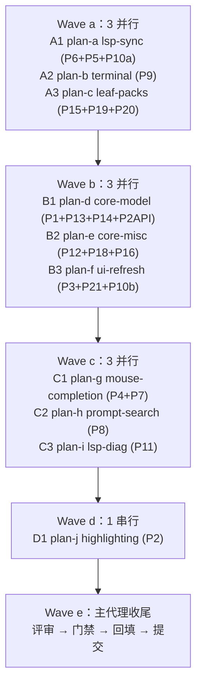

# perf-audit-fixes 总纲（overview）

来源：[评审记录](../../reviews/2026-10-26-perf-audit.md)（唯一事实来源，21 条发现均经
主代理亲自复核，含 文件:行号 证据）。本目录（总纲 + 子计划 a-j）是全部子代理任务书的
唯一规范来源——成员不得凭常识猜，只按名下子计划执行。

## 一、目标与非目标

**目标**：修复评审记录 P1-P21 全部 21 条性能发现，达成 pyright strict 零诊断、
pytest 全绿（`-n auto`）、架构测试 37 用例全过、覆盖率 `--cov-fail-under=75`。

**非目标**（显式排除，另行立项）：
1. LSP 增量同步协议（range/rangeLength）——P5 只做版本比较 + 延迟物化；
2. tree-sitter `Tree.edit()` 增量解析——P15 只做双重编码 / Parser 缓存 / 端点增量解码
   三个局部修复，整文档重解析保持既有 v1 取舍；
3. `_refresh_views` 按需视图脏标记架构重构——P3 保守保留全量 `content_changed()`
   （多窗格成本暂不消除），只做"未消费键不刷 + chrome 文本短路 + which-key 早退"；
4. rope/分段缓冲等数据结构级重写。

## 二、备选方案与否决理由

- **单成员串行修完全部**：否决——条目相互独立、文件可独占切分（用户明确要求并行）。
- **每条 finding 一个子代理**：否决——同文件条目必须同成员（文件独占纪律），按文件分组成波。
- **P1 直接落增量撤销 delta**：采纳为目标方案；若实现中发现撤销语义回归风险不可控
  （undo 粒度 / redo / 多光标恢复 / content_version 推进），退回"快照去冗余"
  （复用 before 元组 + 变更区间比较 + 早退前移），内存驻留问题登记待办，并在 §六
  执行记录中显式登记偏离。
- **P2 与 P1 同波执行**：否决——P2 消费的变更行区间 API 必须先由 P1 落地
  （同文件依赖），故 P2 单列 Wave d。
- **P7 改 to_thread**：否决——Textual worker 退出语义与线程模型改动风险大；
  改按行增量维护词集（行级缓存复用），保持现有 worker。
- **P20 全量 mtime 目录签名**：否决——大仓库签名计算本身就是 O(entries)；
  改短 TTL 缓存（默认 5s）+ 显式失效，palette 与全项目查找共享。

## 三、执行环境与波次

worktree `d:\Programming\yate-perf-audit`，分支 `enh/perf-audit`；解释器一律
`.venv\Scripts\python.exe`（沙箱已自证 `import yate` 指向本 worktree）。
成员所有命令先 `Set-Location d:\Programming\yate-perf-audit`。

| 成员 | 子计划 | 条目 | 独占产品文件 | 关联测试（可改） |
|---|---|---|---|---|
| A1 | [plan-a](perf-audit-fixes-lsp-sync-plan-a.md) | P6、P5、P10a | `yate/editor_lsp/manager.py`、`yate/editor_lsp/client.py` | test_lsp.py、test_lsp_parsing.py、test_app_lsp.py、test_python_lsp_ext.py、test_completion_popup.py |
| A2 | [plan-b](perf-audit-fixes-terminal-plan-b.md) | P9 | `yate/editor_term/emulator.py`、`yate/editor_view/terminal.py` | test_terminal_emulator.py、test_terminal.py、test_pty_proc.py、test_app_terminal.py |
| A3 | [plan-c](perf-audit-fixes-leaf-packs-plan-c.md) | P15、P19、P20 | `yate/editor_syntax/ts_backend/backend.py`、`yate/services/extensions/lua/library.py`、`yate/services/extensions/loader.py`、`yate/services/workspace.py` | test_ts_backend.py、test_syntax_engine.py、test_extensions.py、test_lua_extensions.py、test_workspace_filter.py、test_app_palette.py |
| B1 | [plan-d](perf-audit-fixes-core-model-plan-d.md) | P1、P13、P14、P2-API | `yate/editor_core/buffer.py`、`yate/editor_core/document.py` | test_editor_core.py、test_document_chunked.py、test_session.py、test_clipboard.py、test_textobjects.py、test_vim_keymap.py |
| B2 | [plan-e](perf-audit-fixes-core-misc-plan-e.md) | P12、P18、P16 | `yate/editor_core/search.py`、`yate/editor_core/words.py`、`yate/editor_core/chunked.py` | test_project_search.py、test_chunked.py、test_hex_view.py、test_app_find.py、test_app_find_replace.py |
| B3 | [plan-f](perf-audit-fixes-ui-refresh-plan-f.md) | P3、P21、P10b | `yate/editor.py`、`yate/editor_view/chrome.py`、`yate/editor_view/statusbar.py`、`yate/editor_view/tabbar.py`、`yate/editor_view/whichkey.py` | test_chrome.py、test_whichkey_panel.py、test_whichkey_flows.py、test_mode_chip.py、test_app_render.py、test_app_panes.py |
| C1 | [plan-g](perf-audit-fixes-mouse-completion-plan-g.md) | P4、P7 | `yate/flows/mouse_flows.py`、`yate/editor.py`、`yate/editor_view/completion.py`、`yate/flows/completion_flows.py` | test_app_mouse.py、test_completion_popup.py、test_prompt_completion.py、test_app_render.py、test_app_panes.py |
| C2 | [plan-h](perf-audit-fixes-prompt-search-plan-h.md) | P8 | `yate/flows/prompt_flows.py` | test_app_find.py、test_modals.py、test_app_render.py |
| C3 | [plan-i](perf-audit-fixes-lsp-diag-plan-i.md) | P11 | `yate/editor_lsp/manager.py`、`yate/editor_view/editor.py` | test_lsp.py、test_app_lsp.py、test_highlight.py、test_app_render.py |
| D1 | [plan-j](perf-audit-fixes-highlighting-plan-j.md) | P2 | `yate/editor_view/highlighting.py` | test_highlighting.py、test_highlight.py、test_syntax_engine.py、test_app_render.py |

## 四、纪律条款（对全部成员生效）

1. spawn 显式 `bypassPermissions`（无人值守）；spawn 与探活同回合闭合；
2. 文件独占：只改名下"独占产品文件 + 关联测试"；清单外文件一律停下上报主代理；
3. 成员不跑 `-n auto` 全量（避免并发干扰），只跑名下测试子集；主代理回收后统一全量；
4. 只认落盘结果：成员声称完成不等于完成，主代理重跑其 pyright 与名下测试后才算数；
5. 判死：探活 `Recipient not found` / 成员表空 / read:true 数分钟无回信且零文件变化；
   判死后不原样重试，改配置重试最多一次，否则主代理亲自执行；
6. 偏离计划（接口签名、窗口常量、实现路线）必须登记本总纲 §六 执行记录；
7. 成员改完自行跑验收命令，报告附真实输出摘要（通过/失败数），不得只说"完成"；
8. 代码注释与 docstring 一律英文（misc-rules §四）；pyright strict 零诊断是硬门槛；
   日志一律 `tracing.get_logger` + 惰性 `%` 占位符。

## 五、风险清单与回滚

| 风险 | 等级 | 缓解 |
|---|---|---|
| P1 撤销语义回归（undo 粒度/redo/多光标/只读） | 高 | 行为测试护栏（plan-d 名下 6 个测试文件）；备选"快照去冗余"路线；偏离显式登记 |
| P3 条件化刷新导致视图不同步 | 中 | 保守方案（只动 handle_raw_key + chrome 短路）；test_app_render/test_app_panes 护栏 |
| P2 区间 diff 与防抖 worker 缓存交互 | 中 | take_dirty_range 仅在同步路径消费；test_highlighting/test_highlight 护栏 |
| P9 解析合帧引入终端输出延迟感 | 低 | 有界缓冲上限兜底；test_terminal_emulator 护栏 |
| P20 TTL 缓存 5s 窗口错过新建文件 | 低 | TTL 短 + `invalidate()`；test_workspace_filter 护栏 |

回滚路径：全部工作在 `enh/perf-audit` 分支逐成员提交；任一成员失败回滚其名下
提交（`git revert` 或重置到该成员提交前），不影响其他成员产物；最终门禁不过则
整分支不合并。

## 六、执行记录（收尾时回填真实数字与偏离）

| 项 | 计划 | 实际 |
|---|---|---|
| Wave a 三成员 | 并行 3 | 待回填 |
| Wave b 三成员 | 并行 3 | 待回填 |
| Wave c 三成员 | 并行 3 | 待回填 |
| Wave d 一成员 | 串行 1 | 待回填 |
| 门禁 | pyright/pytest/arch/cov=75/smoke | 待回填 |
| 偏离登记 | — | 待回填 |

批准状态：无人值守模式，方案按 bypassPermissions 视为已批准（2026-10-26）。
