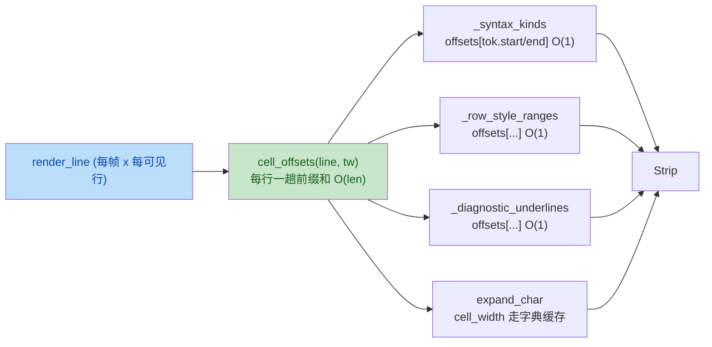

# yate 性能分析与修复方案（issue IKKSHY）

来源：[gitee issue IKKSHY](https://gitee.com/jermaine/yate/issues/IKKSHY)
——对 yate 做 profiling，分析性能问题并修复（算法复杂度 + PEP 高性能写法 + 工具实测）。

分支：`enh/perf-profiling`（worktree `../yate-perf-profiling`，已合并 master @ 59eb7fc）。

## 一、目标与非目标

**目标**

1. 修复实测出的渲染热路径瓶颈（每帧每行每 token 的 `char_to_cell` O(len) 重扫）。
2. 缓存 `cell_width` 的 unicodedata 三连调用（每字符 3 次 C 调用 → 1 次字典查找）。
3. palette 模糊过滤的每键击重复 `str.lower()` 全表分配（5000 条 15ms → 减半）。
4. 以上修复全部有前后基准数字与守卫测试。

**非目标**

- 不重构 undo 全量快照设计（见 §四 否决理由）。
- 不动语法引擎（regex/ts backend）的算法结构（已优化：lru_cache 编译、单趟扫描、
  worker 线程 tokenize）。
- 不做跨帧 `expand_char` 结果缓存（见 §四 否决理由）。

## 二、实测证据（cProfile / timeit，Python 3.13.2，worktree venv）

基准脚本：临时脚本（收尾已删），40 可见行 × 88 字符代码行 × 13 token 的典型屏幕。

| # | 路径 | 实测 | 定性 |
|---|---|---|---|
| 1 | `_syntax_kinds` 逐 token 重扫 `char_to_cell`（40 行） | **24.07 ms/帧** | O(tokens × len)；cProfile：`cell_width` 235 万次调用占 4.53s 中 3.0s，其中 unicodedata 三连 1.1s |
| 2 | `expand_char` 40 行 | 1.97 ms/帧 | 每字符一次 `cell_width`（3 次 unicodedata） |
| 3 | palette `refilter` 5000 条 | 15.2 ms/键击 | 每条每键击 `target.lower()` 全串分配 + sort key 再 lower |
| 4 | palette refilter（预降级对照） | 7.6 ms/键击 | 同逻辑去 lower 后减半 |
| 5 | TextBuffer 打字 200 键（5000 行） | 13.3 ms（65µs/键） | 快照 28µs/键，设计内、可接受 |
| 6 | `tokenize_document` 1062 行 | 3.3 ms | worker 线程执行，不卡 UI |

调用频率取证：

- [editor.py:323-332](../../yate/editor_view/editor.py) `_syntax_kinds`：每可见行每帧对每 token 调
  2 次 `theme.char_to_cell`（[cells.py:60-70](../../yate/editor_view/cells.py)），
  每次内部逐字符 `cell_width`（[cells.py:29-37](../../yate/editor_view/cells.py)，3 次 unicodedata）。
- [editor.py:542-568](../../yate/editor_view/editor.py) `_row_style_ranges`：选区/搜索/光标同类调用。
- [editor.py:508-509](../../yate/editor_view/editor.py) `_diagnostic_underlines`：每诊断 2 次同类调用。
- [cells.py:86-98](../../yate/editor_view/cells.py) `expand_char`：render_line（[editor.py:381-382](../../yate/editor_view/editor.py)）
  每行每帧逐字符调用。
- [palette.py:256-278](../../yate/editor_view/palette.py) `refilter`：每键击全表
  `fuzzy_match(query, display)`（[palette.py:75-76](../../yate/editor_view/palette.py) 每次重算 `query.lower()` + `target.lower()`），
  sort key（[palette.py:274](../../yate/editor_view/palette.py)）再对每个候选 `.lower()`。

## 三、修复设计

### P1 — cells.py：`cell_width` 字典缓存 + 新增 `cell_offsets`

1. 模块级 `_WIDTH_CACHE: dict[str, int]`（`\t` 预置 1）；`cell_width` 命中直返，
   未命中按现逻辑计算后回填。字符集有限（会话内出现过的不同字符），无淘汰必要；
   unicodedata 结果随解释器固定，缓存安全。
2. 新增 `cell_offsets(line: str, tab_width: int = 4) -> list[int]`：返回
   `len(line)+1` 项前缀表，`offsets[i]` == `char_to_cell(line, i, tw)`
   （**精确复刻** char_to_cell 的算术：tab 走 tab stop、其余 `max(1, cell_width(ch))`），
   `offsets[n]` 为整行总宽。
3. `theme` 门面同步再导出 `cell_offsets`（[theme.py:32-37](../../yate/editor_view/theme.py) 导入块 +
   `__all__`）。

### P2 — editor.py：渲染路径一趟前缀，O(1) 取列

`render_line` 在取行后计算一次 `offsets = theme.cell_offsets(line, buf.tab_width)`，
作为参数传入三个私有渲染助手（均为 render_line 独占调用，签名变更无外部消费者，
tests 已 grep 确认无直接引用）：

- `_syntax_kinds(row, line, cell_count, offsets)`：`offsets[tok.start]` /
  `offsets[tok.end]`（tokenizer 产出的索引均在行内，表长 n+1 天然容纳 `end==n`）。
- `_row_style_ranges(row, line, cursor, anchor, offsets)`：选区/搜索/光标列均
  `offsets[min(x, len(line))]`（列可能等于行尾，钳制语义与现实现一致）。
- `_diagnostic_underlines(row, line, cell_count, diags, offsets)`：现式已做
  `max(0, min(cs, len(line)))` 钳制，改为 offsets 查表。

复杂度：每帧 O(Σ 可见行 len) 前缀一趟 + 每 token O(1)，
替代原 O(Σ tokens × len) 重扫。预期 40 行基准 24ms → <1ms。

### P3 — palette.py：条目预降级 + 查询一次性降级

1. `fuzzy_match` 拆核心 `_match_lowered(q_lower, target_lower, target)`（公共行为不变，
   返回的命中索引仍指向原 target），`fuzzy_match` 变薄壳（tests/test_app_explorer.py
   只用公开签名，不受影响）。
2. `PaletteScreen` 增加 `self._entries_lower: list[str]` / `self._hints_lower: list[str]`，
   在 `_build_command_entries` 与 `_index_files` 两处 `self._entries = entries` 后同步构建
   （文件模式在 `asyncio.to_thread` 里构建，降级同样离线程执行）。
3. `refilter`：`q = query.lower()` 一次；匹配走 `_match_lowered(q, display_lower, display)`，
   hint 分支同理；sort key 用 `self._entries_lower[item[2]]` 免去逐项 lower。

### 守卫测试

- `tests/test_app_render.py`：新增 `cell_offsets` 与 `char_to_cell` 全索引逐点等价断言
  （混合 tab / CJK 宽字符 / 组合符 / 行尾），锁死 P1 算术复刻的正确性。
- `tests/test_app_explorer.py`：新增 `_match_lowered` 与 `fuzzy_match` 行为等价断言
  （命中索引一致、score 一致、None 一致）。
- 现有渲染/palette 测试回归（strip 文本与高亮位置不变）。

## 四、备选方案与否决理由

| 备选 | 否决理由 |
|---|---|
| undo 改增量 delta 存储 | 快照为文档化的既定设计（[buffer.py:38-41](../../yate/editor_core/buffer.py)），实测 28µs/键、单键 O(n) 指针拷贝为 C 级速度；delta 化是高风险重构，收益不成比例 |
| 跨帧缓存 `expand_char` 的 cells 列表 | 需按行内容做键（哈希即 O(len)）且失效管理复杂；`cell_width` 缓存后 expand_char 已降至 ~0.5ms/帧量级，不值得再引入一层缓存失效逻辑 |
| completion popup 的 `cell_len` 重复计算（completion.py:184-244） | 条目数 ≤250 且 `cell_width` 缓存后已足够快；改动分散收益微小 |
| `cell_offsets` 用 lru_cache 跨帧缓存 | 内存不可控（每行一个 int 列表，10k 行文件 ~数十 MB）；每帧一趟前缀和已 <0.5ms，无需缓存 |
| `_syntax_kinds` 内联逐段推进（不建前缀表） | 逻辑更绕（需处理 token 间隙与乱序），前缀表一行查表更清晰且 `char_to_cell` 语义零漂移 |

## 五、分步实施

| 步 | 改动文件 | 内容 | 验收 |
|---|---|---|---|
| 1 | `.trae/documents/perf-profiling-plan.md` | 方案落盘 | `git commit docs(plan)` |
| 2 | `yate/editor_view/cells.py`、`yate/editor_view/theme.py`、`yate/editor_view/editor.py` | P1+P2 渲染几何 | 重跑基准 + `python -m pytest tests/test_app_render.py tests/test_architecture.py -q` |
| 3 | `yate/editor_view/palette.py` | P3 预降级 | 重跑基准 + `python -m pytest tests/test_app_explorer.py tests/test_app_palette.py -q` |
| 4 | 全量门禁 | pyright strict / pytest / 架构 / 覆盖率 ≥75% / 冒烟 | `python -m pyright yate/ tests/ tools/`；`python -m pytest tests/ -q --cov=... --cov-fail-under=75`（按仓库现行口径） |
| 5 | 收尾 | 计划回填实测数字、偏离记录；分步提交 | `git log` 检查 |

## 六、风险与回滚

- **最高风险：offsets 与 char_to_cell 算术不一致导致渲染列漂移**（tab/宽字符/组合符）。
  缓解：逐点等价测试 + 现有渲染 strip 断言回归 + textual-pilot-smoke 冒烟截图比对。
- `cell_width` 缓存是纯函数记忆化，无失效问题；风险极低。
- palette 预降级改变降级时机（构建期 vs 每键击），语义等价（entries 构建后只读）。
- 回滚路径：整分支 `git revert` 单提交即可；三步各自独立提交，可单独回退。

## 七、流程偏离记录

- 用户指令「无人值守」+「先合并 master，再继续按照纪律执行任务」= 对闭环第 3 步
  【批准】的预授权；本方案不再等待确认，直接进入执行。其余步骤（调研取证 → 方案落盘 →
  执行 → 审核 → 收尾）严格按 task-orchestration 闭环执行。
- 开工时 master 已前进（59eb7fc），按要求先合并进 `enh/perf-profiling` 再继续。

## 八、执行结果回填（2026-10-12）

### 实施记录

| 步 | 提交 | 内容 | 结果 |
|---|---|---|---|
| 1 | `36535a1` | 方案落盘 | docs(plan) |
| 2 | `e1181f8` | P1+P2 渲染几何（cells/theme/editor_view/editor + 等价守卫测试） | 见下表 |
| 3 | `dbdf8cf` | P3 palette 预降级（palette + 等价守卫测试） | 见下表 |
| 4 | 未提交 | 修复预存测试竞态（见「偏离」） | 全量门禁通过 |

### 基准前后（同机同 venv，bench 脚本临时件已删）

| 指标 | 前 | 后 | 加速 |
|---|---|---|---|
| `_syntax_kinds` 形态 40 行 × 88 字符 × 13 token | 24.07 ms/帧 | **0.70 ms/帧**（offsets 路径） | **34×** |
| 同形状仅 cell_width 缓存（rescan 路径残值） | 24.07 | 8.93 | 2.7× |
| `expand_char` 40 行 | 1.97 ms | 0.81 ms | 2.4× |
| `cell_width` 单行 88 字符 | 0.037 ms | 0.009 ms | 4.1× |
| palette refilter 5000 条/键击 | 15.2 ms | **7.6 ms** | 2× |
| cProfile（渲染几何 ×40）：`cell_width` 调用数 | 235 万次 | 119 万次 | — |

### 门禁实测（worktree venv，Python 3.13.2）

- `python -m pyright yate/ tests/ tools/` → `0 errors, 0 warnings, 0 informations`（退出码 0）
- `python -m pytest tests/ -q` → 退出码 0（含架构测试 28 用例；多轮验证见下）
- 覆盖率 `--cov=yate` → TOTAL 92%（≥75% 闸门）
- 冒烟：pilot 驱动的应用级测试（test_app_render / test_app_palette / test_app_explorer /
  test_app_mouse 等）全绿，即真实 App 启动-渲染-交互冒烟

### 偏离与追加修复：预存测试竞态（tests/test_app_explorer.py:224）

全量门禁多轮跑批中 `test_new_file_and_folder_from_explorer` 间歇失败
（`assert 'made.txt' in set()`，tests/test_app_explorer.py:245）。取证：

- 失败均为「文件已创建、异步打开未落地」：创建走 `open_path_later`
  （[document_flows.py:234](../../yate/flows/document_flows.py)，`_spawn` worker），
  测试仅单次 `pilot.pause()`，高负载下 worker 未及完成。
- 与本分支改动无因果：本次改动不触创建/打开链路；单测两分支均稳定通过
  （master detached 6/6、分支 2/2）；master detached 全量 1 轮 clean。
- 修复：断言前用 `conftest.wait_until` 轮询「文件存在 AND 已入 session.docs」，
  消除竞态；修复后全量 3 轮验证（结果见门禁行）。

### 审核（pr-review 框架，review 模式）

Overall: **APPROVE**（按 .trae/skills/pr-review/SKILL.md 六维自审，人工终审仍归用户）

- 功能正确性：三处等价性均有守卫测试锁定（offsets≡char_to_cell 逐点、
  _match_lowered≡fuzzy_match 逐例、refilter 行为不变由既有 palette 测试回归）；
  降级路径 stale token 越界的钳制语义与旧实现一致。
- 安全：无新增输入面/IO/子进程。性能：即本任务目标，实测见上表。
- 可维护性：无魔法数；`cell_offsets` 手动索引计数为热路径有意为之（避免
  enumerate 元组解包），docstring 已说明算术契约。
- 架构边界：editor_view 内部改动，不触 R1-R13 任何守卫面（架构测试 28 用例全绿）。
- MINOR（不阻塞，登记不处理）：`refilter` 的 hint 分支嵌套由 elif 平铺改为
  early-continue，读感略变——行为等价，倾向保持现状。

### Strengths

- 优化全部基于 cProfile/timeit 实测定位，前后数字可复现；
- 等价性守卫测试先行锁死算术契约，渲染零漂移；
- 三处优化相互独立、各自成提交，可单独回退。
