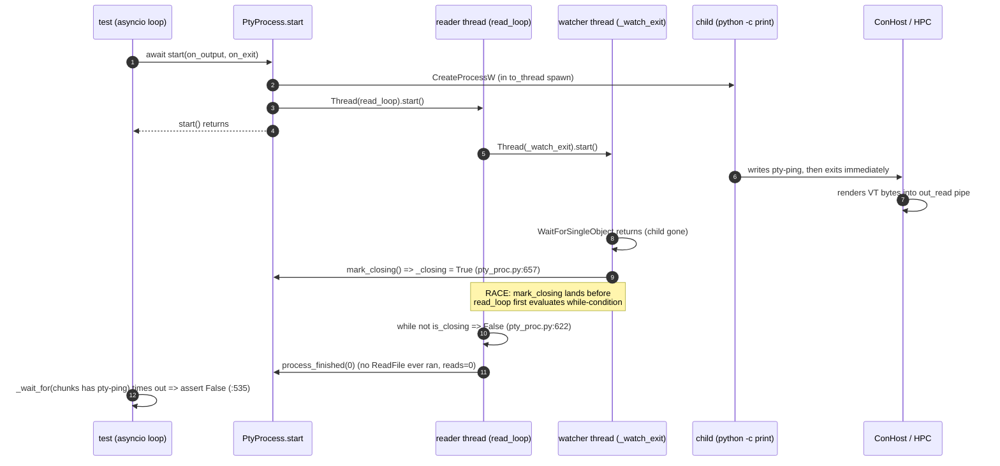

# pty-win312-stream-plan

> 状态：**待批准**（按 `../rules/plan-before-execute.md` §二.3，未经批准不得进入实施）
> 撰写角色：`plan-architect-designer`（`../agents/plan-architect-designer.md` 剧本）
> 适用分支：`feature/fix-pty-win312-stream`，parent `master` `015deee5`，独立 worktree 与独立 venv
> 本方案唯一交付物即本文档；本任务不修改 `yate/`、测试文件、规则文件，不执行 `git commit` / `git push`
> 规范来源：`../rules/task-orchestration.md`、`../rules/plan-before-execute.md`、
> `../rules/architecture-boundaries.md`、`../rules/python-coding-style.md`、
> `../rules/doc-conventions.md`、`../rules/subagent-workflow.md`、`../rules/misc-rules.md`

---

## 0. 任务分析与范围界定

### 0.1 需求拆解

CI（Windows runner、Python 3.12.10）以
`python -m pytest tests --cov=yate --cov-branch --cov-report=term-missing -n auto`
得到 `1 failed / 3876 passed / 10 skipped`（259.72s），失败节点
`[gw3] win32 -- Python 3.12.10`：

```
FAILED tests/test_pty_proc.py::test_real_pty_streams_child_output_and_reports_its_exit_code
assert await _wait_for(lambda: b"pty-ping" in b"".join(chunks))  # tests/test_pty_proc.py:535
assert False
```

即真实 ConPTY 子进程**零字节**到达 `chunks`，后续 `wait_closed()` 与 `exits == [0]`
断言未执行。拆解后的待答问题：

1. 根因在 `yate/editor_term/pty_proc.py` 产品代码，还是在测试自身的时序 / 环境假设？
2. 是否为 Windows / Python 3.12 特有？本机 3.13 能否复现？
3. 修复范围、代码形态、回归用例、验收命令、风险与回滚分别是什么？

### 0.2 大任务判定（逐条核对 `plan-architect-designer` 剧本「子计划拆分」判据）

| 判据 | 本任务实况 | 命中 |
|---|---|---|
| 预计改动 ≥ 3 个文件（测试不计入判据） | 产品代码仅 `yate/editor_term/pty_proc.py` 1 个文件 | 否 |
| 跨层（L0-L4 多层联动） | 改动只在 L0 叶子 `editor_term` 内部，不新增任何 import 连线 | 否 |
| L0 叶子 / 共享模型**多处**修改 | 单文件内 3 处相邻、同一内聚修复（watcher / read_loop / docstring），非多点分波验证型 | 否 |

**结论：非大任务**，按 `../rules/doc-conventions.md` §一写单个主计划
`pty-win312-stream-plan.md`，不拆 `<task>-plans/` 子计划、不定制执行波次；
这与任务书指定的落盘路径一致。3 处改动同属一个可独立验收的原子修复，
Step 1 一次性完成、Step 2 一次性补用例，无需跨波次串行。

### 0.3 可行性

修复不新增模块 / 协议 / 依赖，仅调整既有 3 个方法的行为与 docstring，
静态可证与全部既有 stub / 真实 PTY 用例兼容（见 §1.3、§8），可行。

---

## 1. 只读调研取证

### 1.1 关键事实清单（`文件:行号`）

| # | 位置 | 事实 |
|---|---|---|
| F1 | `tests/test_pty_proc.py:526-539` | 失败用例：子进程为 `_child("print('pty-ping')")`（`:532`），`print` 后**立即退出**，无 `flush=True`、无 `sleep`；`:535` 断言 chunks 含 `b"pty-ping"` |
| F2 | `tests/test_pty_proc.py:49-51` | `_child` = `[sys.executable, "-c", code]`，用当前解释器 |
| F3 | `tests/test_pty_proc.py:59-74` | `_wait_for` 是轮询谓词（默认 `REAL_PTY_TIMEOUT=20.0`，见 `:46`），不是固定 sleep；测试等待方式本身合规 |
| F4 | `tests/test_pty_proc.py:77-104` | `_no_inherited_std_handles()` 用 `SetStdHandle(slot, None)` 临时清空 3 个进程级标准句柄（Windows 分支），spawn 后 `finally` 恢复 |
| F5 | `tests/test_pty_proc.py:16-22` | 模块 docstring 说明该上下文的目的：模拟 console parent，令 ConPTY 把 pseudoconsole 句柄分发给子进程 |
| F6 | `tests/test_pty_proc.py:542-566` / `:569-590` / `:593-616` | 相邻 3 个真实 PTY 用例的子进程均 `print('pty-ready', flush=True)` 后 `sleep(30)` 或读 `sys.stdin`，**长驻**；CI 汇总中这 3 例均通过（推断见 F11） |
| F7 | `tests/test_pty_proc.py:633-643` | `test_real_pty_write_after_exit_is_a_noop` 也是立即退出的 `print('pty-bye')`，但**不检查 chunks**（只验证 `write`/`resize` 不抛），故即使零输出也不红 |
| F8 | `yate/editor_term/pty_proc.py:622` | `read_loop` 的循环守卫是 `while not self._owner.is_closing:` |
| F9 | `yate/editor_term/pty_proc.py:657` | `_watch_exit` 在 `WaitForSingleObject(hProcess, INFINITE)` 返回（子进程退出）后**立即**调 `self._owner.mark_closing()`；`:659` 才 `wait(0.2)`，`:660` 才 `_close_pty()` 关 HPC 打断阻塞的 `ReadFile` |
| F10 | `yate/editor_term/pty_proc.py:606-647` | `read_loop` 启动 watcher（`:617-618`）后进入 `while`；退出依赖 `out_read is None`（`:629-630`）或 `if not ok or count == 0: break`（`:641-642`）；`finally` 取退出码，末尾 `process_finished(code)`（`:647`） |
| F11 | CI 汇总 | `1 failed / 3876 passed / 10 skipped`，唯一 failed 是 F1；Windows 上不会 skip 的真实 PTY 用例（F6、F7、`:619`）因此均在 3876 passed 内 —— **基于汇总数据的推断**，非逐例实测 |
| F12 | `yate/editor_term/pty_proc.py:222-224` | `mark_closing()` 仅置 `self._closing = True`；docstring 自述为 "watcher-thread bridge" |
| F13 | `yate/editor_term/pty_proc.py:94` / `:135` | `start()` spawn 失败分支、`terminate()` 各自置 `_closing = True`（不经过 watcher），`is_closing` 的这两条来源不受影响 |
| F14 | `yate/editor_term/pty_proc.py:295-322` | POSIX `_UnixPty.read_loop` 靠 master fd 的 `os.read` EOF + `proc.wait()` 收尾，**无此竞态** |
| F15 | `yate/editor_components/terminal.py:125-187` | 生产消费方：`TerminalView.start` / `shutdown` 经 `proc.start(self._on_output, self._on_exit)` 接线，`started` 用 `self.dead`（由 `_on_exit` 置位，**不依赖 `is_closing`**）；生产 shell 由 `resolve_shell()` 给出，长驻 |
| F16 | `yate/flows/shell_flows.py:56-107` | 与 `PtyProcess` 无关，走 `services/shell.py::run_shell`；不是本次改动的调用方 |
| F17 | `yate/editor_term/pty_proc.py:733-748` | `close()` 关闭 HPC / 进程线程句柄 / `_in_write` / `_out_read`；`_finished()`（`:163-185`）先 `close()` 再回调 |
| F18 | `tests/test_architecture.py:177` / `:377` / `:1367` | `UI_FREE_PACKAGES` / `SIZE_EXEMPT_FILES` / `leaf_packages` 的登记面；本改动不触碰三者，也不改包 `__init__.py` |

### 1.2 探针与结果（全部在本 worktree 的 venv 内执行，解释器 `.venv\Scripts\python.exe`）

| 探针 | 命令 | 结果 / exit code |
|---|---|---|
| P0 环境自证 | `.venv\Scripts\python.exe -c "import sys,yate,os; print(sys.version); print(yate.__file__); print(os.name)"` | `3.13.2 (...)` / `__init__.py` 指向**本 worktree** / `nt`；exit **0**（沙箱生效，符合 `../rules/task-orchestration.md` §二.1） |
| P1 本机单跑失败用例 | `.venv\Scripts\python.exe -m pytest "tests/test_pty_proc.py::test_real_pty_streams_child_output_and_reports_its_exit_code" -q` | `. [100%]`；`EXIT_CODE=0` —— **本机 3.13 不复现** |
| P2 一次性诊断脚本（用完已删） | `.venv\Scripts\python.exe _probe_pty.py` | exit **0**；原始输出见附录 A |
| P2-a 串行 30 次 | 同上（脚本内） | `serial zero-output: 0 / 30` |
| P2-b 确定性负向演练 ×5 | 同上（脚本内 `force_race`） | **5/5 全部** `got=False, chunks=0, reads=0, code=0, exits=[0]` |
| P2-c 8 路并发 | 同上（脚本内） | `concurrent zero-output: 0 / 8` |
| P3 安装 3.12.10 | `install_binary(type=python, version=3.12.10)`（ToolSearch + DeferExecuteTool） | **失败**：`Failed to install python 3.12.10: Command failed: tar -xzf "cpython-3.14.3+...tar.gz" ... 'tar' 不是内部或外部命令` —— 缓存误取 3.14.3 包且本机无 `tar` |
| P4 本机 3.12 探测 | `py -0p`、`where.exe python`、检查常见 3.12 安装路径 | `py` 命令不存在；`where python` 仅 `...\Python313\python.exe` 与 WindowsApps 别名；3 个常见 3.12 路径全 `absent`；exit **0** |

P2 脚本是本 worktree 根的一次性诊断脚本，取证后已用
`Remove-Item _probe_pty.py` 删除（`REMAINS=False`），非交付物。

### 1.3 根因判定

**判定：产品代码竞态缺陷（`yate/editor_term/pty_proc.py`），非测试自身时序 / 环境假设缺陷，非「偶发重跑即过」。**

推导链：

1. `start()`（`pty_proc.py:98-101`）启动 reader 线程后立即返回；reader 线程在
   `read_loop` 内启动 watcher 线程（F10）。
2. 失败用例的子进程 `print('pty-ping')` 毫秒级退出（F1）。watcher 的
   `WaitForSingleObject` 几乎立即返回，随即 `mark_closing()` 置
   `_closing = True`（F9）。
3. 若该置位**先于** reader 第一次求值 `while not self._owner.is_closing`
   （F8）：循环体一次都不执行，`ReadFile` 从未调用，ConPTY 已渲染进
   `out_read` 管道的输出字节全部丢弃 → `chunks` 为空。
4. 之后 `finally` 取 `_exit_code()`（`GetExitCodeProcess` 得 0），
   `process_finished(0)` → `wait_closed() == 0`、`exits == [0]`。
   即「输出丢了，但退出码照常上报」。

P2-b 的负向演练精确复现了这一形态：`reads=0`（`ReadFile` 一次未调用）、
`chunks=0`、`code=0`、`exits=[0]` —— 与 CI 在
`tests/test_pty_proc.py:535` 处 `assert False`、后续两条断言未执行**完全一致**。
这是**确定性**的充分条件，不是随机 flake；本机串行 30 次与 8 路并发
（0/30、0/8）只是因为负载低、竞态窗口窄而没命中，CI 的 `-n auto` +
3876 用例 / 259.72s 高负载把窗口命中率拉高。按
`../rules/task-orchestration.md` §二.7 与 `../rules/python-coding-style.md`
§4.7，不得把该失败记成「偶发、重跑即过」。

**排除「测试环境假设缺陷」**：F11 显示 CI 上其余 3 个会检查 chunks 的真实
ConPTY 用例（F6）全部通过，说明 3.12 下 CreateProcessW / ConPTY 句柄分发 /
`_no_inherited_std_handles`（F4）/ 输出链路均正常；唯一变量是「子进程立即
退出」。`print` 无 `flush=True` 不是根因（长驻用例同样先 `print` 再阻塞，
靠的是进程存活而非 flush；且 watcher 是等自然退出而非杀进程，退出时缓冲
会 flush）。加 `sleep` / 放宽断言只会掩盖产品缺陷。

**产品影响面**：不只是测试。`TerminalView`（F15）对「启动即退出的命令」
（短命令、立即退出的 shell）同样会丢输出，因为 `is_closing` 把
「用户主动 `terminate()`」与「子进程自然退出」两种语义混为一谈：前者应停止
读取，后者恰恰**必须**把已渲染输出 drain 完。

### 1.4 3.12 特有性判定与未解决项

- **不是 3.12 特有的产品代码缺陷**：P2-b 在本机 **3.13.2** 上确定性复现
  零输出，证明该竞态与 Python 版本无关，是 `read_loop` / `_watch_exit` 的
  纯线程时序逻辑。CI 的 3.12.10 只是高负载并行下命中了竞态窗口。
- **未能本机实测排除「3.12 加剧因素」**：P3 安装失败（缓存误取 3.14.3 +
  环境缺 `tar`），P4 证实本机无任何 3.12 解释器。3.12 的 venv launcher /
  子进程启动更快或更慢、`subprocess.list2cmdline` 时序等微差异**可能**改变
  watcher 与 reader 的相对时序，但不改变「竞态存在」这一结论。
- 因此把「3.12 环境实测确认」列为**未解决项**，并给出 §7 的完整面向 3.12
  验证方案（CI runner 命令 + 本地 3.12 venv 命令 + 兜底探针），由执行者在
  3.12 环境实测回填。

---

## 2. 目标与非目标

### 目标

- G1 修复 `read_loop` / `_watch_exit` 协作，使「启动即退出的子进程」已渲染
  输出**必达** `on_output`，同时 `wait_closed()` / `on_exit` 仍上报正确退出码。
- G2 保持 `is_closing` 对外语义：用户 `terminate()`、spawn 失败、子进程已死
  三种情况下均为 `True`。
- G3 补 3 条确定性回归用例（含负向演练先红后绿），使该竞态以后无法回归。
- G4 全量门禁（pyright / pytest / 架构 / 覆盖率）与 CI 3.12 原命令全绿。

### 非目标

- 不重构 ConPTY 句柄管理（`pty_proc.py:436-439` 注释里的 RAII handle class
  long-term item 另案）。
- 不改 `_no_inherited_std_handles`（F4，已证 3.12 生效）、不改 POSIX
  `_UnixPty`（F14 无此竞态）、不改 `terminal.py` / `shell_flows.py` 调用方。
- 不放宽断言、不加固定 sleep、不 skip Windows/3.12、不把失败记为 flake。
- 不新增模块 / 协议 / 回调别名 / EventBus / 字符串事件名（架构边界 §四）。
- 不改 `tests/test_architecture.py` 的任何登记集合。
- 本任务不执行 `git commit` / `git push`。

---

## 3. 备选方案与否决理由

| 方案 | 描述 | 结论 |
|---|---|---|
| **A1'（推荐）** | ① `_watch_exit` 删除 `mark_closing()`，只保留 `wait(0.2)` + `_close_pty()`；② `read_loop` 的 `while not is_closing` 改为 `while True`，退出完全靠 `out_read is None` 与 `ReadFile` 失败/0；③ `read_loop` 末尾（`process_finished` 前）由 reader 自己 `mark_closing()`；④ 更新 3 处 docstring | **采纳**：单文件、3 处内聚小改、零新增 import/模块、不跨层；同时修复「过早置位」与「循环被短路」两层；`is_closing` 语义保持；N1/N2/N3 均可「修复前红、修复后绿」 |
| A1（只删 watcher 的 `mark_closing`） | 仅做 ①，`read_loop` 仍用 `while not is_closing` | 否决：只移除触发源，未消除「任何提前置位都会短路读取」的脆弱性；N2（预置 `is_closing` 的负向演练）修复后仍红，回归守卫失效 |
| A2（do-while：先读一次再查 `is_closing`） | 保留 watcher 置位，把循环守卫移到循环体末尾 | 否决：守卫语义混乱、大输出可能在 drain 完前被截断；可读性差，不如 A1' 干净 |
| A3（watcher 先 `_close_pty()` 再 `mark_closing()`） | 调换 `:657` 与 `:660` 顺序 | 否决：`mark_closing` 仍在 watcher 线程、reader 的 `finally` 在 reader 线程，两线程竞态未消除 |
| B（只改测试） | 给子进程加 `sleep` / `flush=True`、放宽 `_wait_for`、skip 3.12 | **硬性否决**：违反 `../rules/python-coding-style.md` §4.7 与 `../rules/task-orchestration.md` §二.7；F1/F3 证明测试等待方式本身合规，问题在产品代码；会放过生产环境（F15）的真实丢输出缺陷 |
| C（引入 `threading.Event` / 新 `_reader_stop` 标志重构） | 新增独立停止信号 | 否决：过度设计，违反 `../rules/architecture-boundaries.md` §三.6 与 PEP 20「Simple is better than complex」；关 HPC 打断 `ReadFile` 的既有机制已足够，新增并发状态反而扩大守卫面 |
| D（read_loop 轮询 `GetExitCodeProcess` / 超时读） | 用进程存活判定替代阻塞读 | 否决：`ReadFile` 阻塞 + ConPTY 管道 never EOF 是既有设计前提，D 与 watcher 关 HPC 机制重复且复杂 |
| E（在 `_finished()` / `process_finished()` 里统一置位） | 把 `mark_closing` 挪到 facade 的 exit bridge | 否决：扩大改动面到 `PtyProcess` 层，且 stub 测试直接调 `process_finished`（`tests/test_pty_proc.py:221`、`:381`、`:401`）会连带置位，语义噪声更大；A1' 把置位留在 reader 末尾更内聚 |

---

## 4. 根因机理（Mermaid）

### 4.1 现状：`tests/test_pty_proc.py:535` 为何 `assert False`



### 4.2 A1' 修复后

```mermaid
sequenceDiagram
    autonumber
    participant T as test (asyncio loop)
    participant P as PtyProcess.start
    participant R as reader thread (read_loop)
    participant W as watcher thread (_watch_exit)
    participant C as child (python -c print)
    participant K as ConHost / HPC

    T->>P: await start(on_output, on_exit)
    P->>C: CreateProcessW
    P->>R: Thread(read_loop).start()
    R->>W: Thread(_watch_exit).start()
    C->>K: writes pty-ping, then exits immediately
    K->>K: renders VT bytes into out_read pipe
    R->>R: while True: ReadFile(out_read) -> bytes
    R->>T: emit_output(bytes) via call_soon_threadsafe
    W->>W: WaitForSingleObject returns; wait(0.2) to let reader drain
    W->>K: _close_pty() -> ClosePseudoConsole
    K-->>R: ReadFile fails / returns 0  =>  break
    R->>P: mark_closing() then process_finished(0)
    T->>T: chunks has pty-ping; wait_closed()==0; exits==[0]
```

---

## 5. 分步实施计划

> 计划制定者不运行验收测试；以下验收命令由 `plan-executor` / 主代理按步执行并回填实测结果。
> 所有命令在**本 worktree 根**执行，解释器统一 `.venv\Scripts\python.exe`。

### Step 1 —— 产品代码根因修复

- **输入**：§1 事实清单（F8/F9/F10/F12/F13）、§3 方案 A1'、§4 时序图。
- **独占改动文件清单**：`yate/editor_term/pty_proc.py`（**仅此 1 个产品文件**）。
- **具体修改**（定位到行号，代码形态见下）：
  1. `_watch_exit`（`:649-660`）：删除 `:657` 的 `self._owner.mark_closing()`；
     保留 `WaitForSingleObject` → `threading.Event().wait(0.2)` →
     `self._close_pty()`；更新方法 docstring，把 `:658` 注释改为
     "Give the reader a moment to drain the final repaint."。
  2. `read_loop`（`:606-647`）：`:622` 的 `while not self._owner.is_closing:`
     改为 `while True:`；`:623-626` 注释补充「退出靠 `out_read is None`
     与 `ReadFile` 失败/0，绝不靠 `is_closing`」；在 `:646`
     `watcher.join(timeout=3)` 之后、`:647` `process_finished(code)` 之前
     插入 `self._owner.mark_closing()`；更新方法 docstring。
  3. `mark_closing`（`:222-224`）：仅更新 docstring，说明置位者是
     reader 线程（drain 完成后）/`terminate()`/`start()` 失败分支，
     watcher 不得调用；方法体 `self._closing = True` 不变。
- **依赖边变化**：无新增 `import`、无新增模块 / 类 / 协议、无跨层调用；
  `PtyProcess.mark_closing` 的调用者由 `_ConPty._watch_exit`（watcher 线程）
  迁到 `_ConPty.read_loop`（reader 线程），二者皆为 owner 的具体对象方法调用，
  符合 `../rules/architecture-boundaries.md` §四「1:1 操作直接调用具体协作者」与 R8。
- **代码形态**（散文式 docstring、英文注释、行宽 ≤100、无新增 `Any` / `# type: ignore`）：

```python
    def _watch_exit(self) -> None:
        """Break the pending ReadFile once the child is gone.

        ConPTY output pipes do not EOF when the child exits.  Closing the
        pseudo console releases ConHost's end of the output pipe, which makes
        the reader's blocking ``ReadFile`` return so it can drain the final
        repaint.  The closing flag is owned by :meth:`read_loop` now: setting
        it here lets a fast-exiting child short-circuit the reader before it
        has read anything.
        """
        k = self._kernel32
        info = self._proc_info
        if info is None:
            return
        k["WaitForSingleObject"](info.hProcess, 0xFFFFFFFF)
        # Give the reader a moment to drain the final repaint.
        threading.Event().wait(0.2)
        self._close_pty()
```

```python
        try:
            while True:
                # Snapshot the read handle under the lock: ReadFile blocks,
                # so it must not run holding the lock -- a concurrent close
                # can still retire the snapshotted handle (residual window,
                # see the _handle_lock comment in __init__).  The loop exits
                # on a missing handle or a failed/empty ReadFile, never on
                # is_closing: the child may be gone while its rendered output
                # is still queued in the pipe.
                with self._handle_lock:
                    out_read = self._out_read
                if out_read is None:
                    break
                ok = k["ReadFile"](
                    out_read, buffer, ctypes.sizeof(buffer),
                    ctypes.byref(read_bytes), None,
                )
                count = read_bytes.value
                # Gate on ok as well: a failed ReadFile leaves the count
                # untouched, and emitting it would repeat the previous
                # chunk verbatim.
                if ok and count:
                    self._owner.emit_output(buffer.raw[:count])
                if not ok or count == 0:
                    break
        finally:
            code = self._exit_code()
        if watcher is not None:
            watcher.join(timeout=3)
        self._owner.mark_closing()
        self._owner.process_finished(code)
```

```python
    def mark_closing(self) -> None:
        """Mark the process closing after the reader has drained its output.

        Called by the reader thread once :meth:`_ConPty.read_loop` finishes,
        and by :meth:`terminate` / the failed-spawn path in :meth:`start`.
        The watcher thread must not call it: a fast-exiting child would then
        short-circuit the reader before the rendered bytes are delivered.
        """
        self._closing = True
```

- **输出**：修复后的 `yate/editor_term/pty_proc.py`（761 行 → 约 763 行，仍 < 800）。
- **可直接执行的验收命令**：

```powershell
.venv\Scripts\python.exe -m pyright yate/ tests/ tools/ pack/
.venv\Scripts\python.exe -m pytest tests/test_pty_proc.py -q -n 1
```

- **通过判定**：pyright 零诊断；`tests/test_pty_proc.py` 全绿（含 6 个真实 PTY
  用例、全部 ConPTY internals 用例、POSIX skip 用例）；退出码 0。

### Step 2 —— 新增确定性回归用例

- **输入**：Step 1 修复、§6 的 3 条用例定义、P2-b 负向演练结论。
- **独占改动文件清单**：`tests/test_pty_proc.py`（**仅此 1 个测试文件**）；
  与 Step 1 文件不重叠。
- **具体修改**：在 `tests/test_pty_proc.py` 的
  `# --- Windows backend internals ---`（`:646`）之后 / 真实 PTY 区段之后按
  既有分组追加 3 条用例（N1/N2/N3，见 §6）；复用既有 `_FakeKernel32`
  （`:827-844`）、`SimpleNamespace`（`:37`）、`cast(Any, ...)` 与
  `@pytest.mark.skipif(os.name != "nt", ...)` 惯例，不新建 fixture 模块。
- **输出**：`tests/test_pty_proc.py` 新增 3 条用例；负向演练记录（先红后绿）回填本文档。
- **可直接执行的验收命令**：

```powershell
.venv\Scripts\python.exe -m pytest tests/test_pty_proc.py -q -n 1
.venv\Scripts\python.exe -m pytest tests/test_pty_proc.py -q -n auto
.venv\Scripts\python.exe -m pytest tests/test_architecture.py -q
```

- **通过判定**：退出码 0、`tests/test_architecture.py` 仍 `42 passed`；
  `-n 1` 与 `-n auto` 结果一致（时序敏感用例按 §二.7 用 `-n 1` 复核）。
- **负向演练（执行者必做并回填）**：临时还原 Step 1 的 3 处改动
  （`git diff` 级别的一行级回退，或用一次性脚本 patch）→ 单独跑 N1/N2/N3
  应**红**（`assert False` / 断言 `mark_closing` 被调用）→ 恢复 Step 1 →
  再跑应**绿**。回填「先红后绿」的实测命令与退出码，禁止只记绿。

### Step 3 —— 全量门禁与面向 3.12 的验证

- **输入**：Step 1 + Step 2 全部改动。
- **独占改动文件清单**：**无**（仅执行命令，不落盘代码改动）。
- **输出**：门禁实测数字、3.12 验证结论、本文档回填（真实前后数字与偏离记录）。
- **可直接执行的验收命令**（`../rules/task-orchestration.md` §二.7 并行口径）：

```powershell
.venv\Scripts\python.exe -m pyright yate/ tests/ tools/ pack/
.venv\Scripts\python.exe -m pytest tests/ -q -n auto
.venv\Scripts\python.exe -m pytest tests/test_architecture.py -q
.venv\Scripts\python.exe -m pytest tests/ --cov=yate --cov-branch -n auto
```

- 3.12 验证命令见 §7。通过判定：全部退出码 0；`pytest` 无 failed；
  `tests/test_architecture.py` 42 passed；覆盖率 ≥ 75%；CI 原命令
  `1 failed` → `0 failed`。

---

## 6. 新增测试与详细用例

> 全部落在 `tests/test_pty_proc.py`，命名遵循
> `../rules/python-coding-style.md` §4.7 的 `test_<behavior>_<condition>_<expected>`；
> 断言为具体值 / 可观测状态，不写「应正常」类模糊断言；三要素（前置 + arrange/act +
> 断言）齐全；正反路径与异常流覆盖见下表。

### N1 `test_conpty_watcher_closes_console_without_marking_closing`

- **验证目标**：证明 `_watch_exit` 不再提前 `mark_closing()`（根因守卫，
  `../rules/architecture-boundaries.md` §四「1:1 操作直接调用具体协作者」无关，
  属行为守卫）。
- **前置条件 / fixture**：`@pytest.mark.skipif(os.name != "nt", reason="ConPTY backend")`；
  `proc = PtyProcess(["cmd"], Path.cwd(), 80, 24)`；`impl = cast(Any, proc)._impl`；
  `impl._proc_info = SimpleNamespace(hProcess=0x1234)`；`impl._hpc = 0x1002`；
  `impl._kernel32 = _FakeKernel32(ClosePseudoConsole=True)`（复用 `:827-844`）。
- **arrange / act**：`marked: list[bool] = []`；
  `monkeypatch.setattr(proc, "mark_closing", lambda: marked.append(True))`；
  直接调用 `impl._watch_exit()`（内部 `threading.Event().wait(0.2)` 约 0.2s，可接受）。
- **断言（具体值）**：`marked == []`；`"ClosePseudoConsole" in impl._kernel32.calls`；
  `proc.is_closing is False`。
- **正反路径**：修复前 `marked == [True]` → 红；修复后绿（负向演练）。
  `impl._proc_info = None` 的边界另由既有
  `test_conpty_operations_without_a_spawned_child_are_safe`（`:674`）覆盖。

### N2 `test_real_pty_immediate_exit_delivers_output_when_closing_is_preset`

- **验证目标**：端到端证明「`is_closing` 被提前置位」时 `read_loop` 仍 drain 输出，
  且退出码 / `on_exit` 回调不受影响（正常流 + 旧竞态注入）。
- **前置条件 / fixture**：`proc = PtyProcess(_child("print('pty-ping')"), Path.cwd(), 80, 24)`；
  `impl = cast(Any, proc)._impl`；`chunks: list[bytes] = []`；`exits: list[int | None] = []`。
- **arrange / act**：包装 `impl.read_loop`，在调用原 `read_loop` **之前**执行
  `proc.mark_closing()`（确定性模拟修复前 watcher 抢先置位，等价于 P2-b 的
  `force_race`；此处是注入调度条件，断言仍用 `_wait_for` 轮询谓词，不依赖固定
  睡眠时长，符合 §4.7）；随后
  `with _no_inherited_std_handles(): await proc.start(chunks.append, exits.append)`；
  `got = await _wait_for(lambda: b"pty-ping" in b"".join(chunks))`；
  `code = await asyncio.wait_for(proc.wait_closed(), REAL_PTY_TIMEOUT)`。
- **断言（具体值）**：`got is True`；`b"pty-ping" in b"".join(chunks)`；
  `code == 0`；`exits == [0]`；`proc.is_closing is True`（reader 末尾置位）。
- **正反路径**：修复前 `while not is_closing` 短路 → `got is False`、chunks 空 → 红；
  修复后 `while True` 读到输出 → 绿。异常流：`wait_closed()` 在
  `REAL_PTY_TIMEOUT` 内必须 settle，不得 hang。

### N3 `test_conpty_read_loop_marks_closing_after_draining`

- **验证目标**：证明 `mark_closing()` 的置位者已迁到 reader 末尾，且 `read_loop`
  对「无句柄」边界仍安全（契约守卫 + 边界条件）。
- **前置条件 / fixture**：`@pytest.mark.skipif(os.name != "nt", reason="ConPTY backend")`；
  `proc = PtyProcess(["cmd"], Path.cwd(), 80, 24)`；`impl = cast(Any, proc)._impl`；
  `impl._proc_info = None`；`impl._out_read = None`（无句柄边界，复用
  `test_conpty_operations_without_a_spawned_child_are_safe` 的形态）；
  `events: list[str] = []`；`impl._owner.emit_output = lambda _d: events.append("emit")`（不触发）。
- **arrange / act**：`monkeypatch.setattr(proc, "mark_closing", lambda: events.append("mark"))`；
  `monkeypatch.setattr(proc, "process_finished", lambda _c: events.append("finished"))`；
  调用 `impl.read_loop()`。
- **断言（具体值）**：`events == ["mark", "finished"]`（`mark_closing` 在
  `process_finished` **之前**，且两者都发生在 reader 线程内）；`events` 不含
  `"emit"`（无句柄时零 emit）。
- **正反路径**：修复前 `mark_closing` 由 watcher 调用、本 fake 无 watcher →
  `events == ["finished"]` → 红；修复后绿。异常流：`_proc_info = None` 时
  `_exit_code()` 返回 `"failed"` → `code is None`，`process_finished(None)` 仍被调。

### 验证方案汇总

| 用例 | 证明的行为 / 边界 | 验证命令 | 通过判定 |
|---|---|---|---|
| N1 | watcher 不提前置 `_closing` | `pytest tests/test_pty_proc.py -q -n 1` | 退出码 0，N1 绿；负向演练红 |
| N2 | 立即退出子进程输出必达 + exit=0 + exits=[0] | `pytest tests/test_pty_proc.py -q -n 1` 与 `-n auto` | 退出码 0，两者一致；负向演练红 |
| N3 | `mark_closing` 置位者迁移 + 无句柄边界 | `pytest tests/test_pty_proc.py -q -n 1` | 退出码 0；负向演练红 |
| 全量回归 | 不影响既有 stub / 真实 PTY / POSIX-skip 用例 | `pytest tests/ -q -n auto` | 退出码 0，无 failed |
| 架构回归 | 不触碰 R1-R13 守卫面 | `pytest tests/test_architecture.py -q` | `42 passed` |
| 类型回归 | pyright strict 零诊断 | `pyright yate/ tests/ tools/ pack/` | 零诊断 |

- **需一并回归的既有测试范围**：`tests/test_pty_proc.py` 全量（尤其
  `test_real_pty_delivers_typed_input_to_the_child` `:542`、
  `test_real_pty_resize_keeps_the_child_running` `:569`、
  `test_real_pty_terminate_stops_a_sleeping_child` `:593`、
  `test_real_pty_write_after_exit_is_a_noop` `:633`、
  `test_conpty_operations_without_a_spawned_child_are_safe` `:674`、
  `test_conpty_read_loop_does_not_repeat_a_stale_count` `:973`）、
  `tests/test_architecture.py`、`pyright` 全量。
- **架构守卫用例结论**：改动不新增 import 连线、不跨层、不新增模块 / 协议、
  不改包 `__init__.py`，**无需在 `tests/test_architecture.py` 新增守卫用例**；
  按 `../rules/plan-before-execute.md` §二 与 `plan-architect-designer` 剧本要求，
  仍须全量回归既有 42 条守卫用例。触发的 R 条款：**无**（`editor_term` 属 L0 叶子，
  本改动仅调整其内部方法行为，未产生任何向上 / 跨层依赖）。

### 无法自动化的部分（手工验证）

真实 TUI 里「启动即退出命令」的显示无法由 CI 自动化覆盖，执行者须手工确认：

1. 启动 yate，按 `Ctrl+grave` 打开集成终端（`terminal.py:64-67` 的
   `TOGGLE_KEYS`），确认面板出现且标题为 `[running]`。
2. 令 shell 执行一条立即退出的短命令（例如 `cmd /c echo pty-smoke`，或让
   当前 shell 立刻 `exit`）。
3. **预期现象**：终端网格里能看到该命令的输出 / shell 退出前的回显，且
   标题变为 `[exited ...]`（`:592-618` 的 `refresh_header`）；**不得出现**
   「面板空白但标题已 `[exited]`」—— 那正是本缺陷在生产侧的表现。
4. 记录操作系统版本与 Python 版本，回填本文档「手工验证」栏。

---

## 7. 面向 Python 3.12 的验证方案

### 7.1 本机获取 3.12 失败记录（未解决项依据）

- `install_binary(type=python, version=3.12.10)` 失败（P3）：工具缓存误取
  `cpython-3.14.3+...tar.gz`，且本机 `tar` 不存在，报
  `'tar' 不是内部或外部命令`。按 `../rules/subagent-workflow.md` §五.4
  不原样重试、不改定义文件；改用静态分析 + 负向演练（P2-b 已在 3.13
  确定性复现根因）。
- 本机无任何 3.12 解释器（P4）：`py` 不存在，`where python` 仅 3.13，
  常见 3.12 安装路径全部 `absent`。
- **明确说明**：本机 3.13 **无法复现** CI 的失败（P1 exit 0、P2-a 0/30、
  P2-c 0/8）；但通过确定性负向演练（P2-b 5/5）实证了根因，且该机制与
  Python 版本无关（见 §1.4）。因此**不把失败记为「偶发、重跑即过」**。

### 7.2 CI runner（Windows / Python 3.12.10）验证命令

由执行者在 3.12 runner 上按序执行并回填：

```powershell
python -m pytest tests/test_pty_proc.py -q -n auto
python -m pytest tests --cov=yate --cov-branch --cov-report=term-missing -n auto
```

判定：第一条全绿；第二条由 `1 failed / 3876 passed / 10 skipped` 变为
`0 failed`，`test_real_pty_streams_child_output_and_reports_its_exit_code` 通过。
建议在合入前后各跑一次以形成真实前后数字。

### 7.3 本地 3.12 venv 验证命令（若执行者可取得 3.12 解释器）

```powershell
python3.12 -m venv .venv312
.venv312\Scripts\python.exe -m pip install -e ".[dev]"
.venv312\Scripts\python.exe -m pytest tests/test_pty_proc.py::test_real_pty_streams_child_output_and_reports_its_exit_code -q
.venv312\Scripts\python.exe -m pytest tests/test_pty_proc.py -q -n auto
```

另加重复命中率验证（PowerShell 循环，不依赖 `pytest-repeat`）：

```powershell
1..10 | ForEach-Object { .venv312\Scripts\python.exe -m pytest "tests/test_pty_proc.py::test_real_pty_streams_child_output_and_reports_its_exit_code" -q; if ($LASTEXITCODE -ne 0) { Write-Output "FAILED on run $_" } }
```

判定：10/10 退出码 0（修复后零次零输出）。

### 7.4 兜底：若 3.12 修复后仍出现零输出

说明存在 3.12 特有加剧因素（见 §1.4），此时**不得**改断言 / skip，而应：

1. 在 3.12 环境跑 P2 等价的一次性探针（临时脚本，用完删），采集
   `chunks` / `ReadFile` 调用数 / `mark_closing` 与 `read_loop` 入口的
   monotonic 时间差，判断是「watcher 抢先」还是「ConPTY 句柄分发」；
2. 若仍为 watcher 抢先，说明 A1' 在 3.12 上被其它路径绕过，回到
   `../rules/task-orchestration.md` §二.6 迭代（步骤 2 重新设计）；
3. 回填实测证据后再定新方案。

---

## 8. 架构边界与代码形态合规结论

| 检查项 | 结论 |
|---|---|
| 依赖方向 R1-R13 | 改动仅在 L0 叶子 `editor_term/pty_proc.py` 内部，**零新增 import 连线**；不触发任何 R 条款，`UPWARD_EDGES_FROZEN` 仍为空集 |
| 跨模块交互机制 | `mark_closing()` 调用者从 watcher 迁到 reader，仍是具体对象方法（R8 / §四 1:1 直接调用），无新协议 / EventBus / 字符串事件名 |
| R4 / `UI_FREE_PACKAGES` | 不新增 Textual / `editor_components` 依赖；不改 `tests/test_architecture.py:177` 登记 |
| R6 / `TYPE_CHECKING` / `Any` | 不新增；示例中无 `# type: ignore` |
| §三.5 包 `__init__.py` 惰性 | 不改任何 `__init__.py` |
| §三.7 文件体量 | `pty_proc.py` 当前 761 行，改动约 +3/-1 行，仍 < 800；`tests/` 不设限；**无需 `SIZE_EXEMPT_FILES` 登记**，也不改 `tests/test_architecture.py:377` |
| §三.6 能用函数实现的就不造类 | 不新增类 / 模块；只改 3 个既有方法 |
| §五 命名守卫 | 无新增标识符；不改 `*Flows` / `*Controller` 等命名面 |
| `python-coding-style.md` | `from __future__ import annotations` 已在文件首；散文式英文 docstring；行宽 ≤100；`X \| None` / 原生小写泛型 / PEP 695 现状保持；日志仍走 `tracing`（R12，惰性 `%`） |
| `doc-conventions.md` §五 | 本文档内引用仓库文件一律相对路径，不出现盘符 / 用户目录 / 仓库根绝对路径；命令相对基准为仓库根 |

---

## 9. 风险清单与回滚路径

| # | 风险 | 触发条件 | 缓解 / 验证 | 回滚 |
|---|---|---|---|---|
| R1 | `_close_pty()` 未能打断阻塞的 `ReadFile`，`read_loop` 挂住、`wait_closed()` 超时 | 去掉 `while not is_closing` 守卫后，自然退出路径只靠关 HPC 打断读 | 该机制已被 `_watch_exit`（`:660`）与 `terminate()`（`:731`）依赖，且既有 `:593` / `:569` 用例间接验证；Step 1 验收含 `tests/test_pty_proc.py` 全量；N2 用 `REAL_PTY_TIMEOUT` 兜底 | 还原 Step 1 三处改动 |
| R2 | `is_closing` 置位时机后移，影响 `write()` / `terminate()` 短路语义 | 子进程已死但 reader 尚未结束时 | `write()` 走 `_impl.write` 失败静默，既有 `:633` 用例覆盖；`terminate()` 幂等由 `:343` 覆盖；N3 断言置位契约 | 同上 |
| R3 | `-n auto` 并行时序 flake / 收尾锁超时 | 全量门禁并行 | 按 `../rules/task-orchestration.md` §二.7 用 `-n 1` 复核；不得记成「偶发重跑即过」；Step 2 同时跑 `-n 1` 与 `-n auto` | 定位后修用例，不改断言 |
| R4 | 3.12 特有加剧因素未实测排除 | CI 3.12 仍零输出 | §7.2 / §7.3 命令 + §7.4 兜底探针；回填实测证据 | 回到闭环步骤 2 重新设计 |
| R5 | 负向演练被跳过或只记绿 | 执行者未临时还原 Step 1 | Step 2 验收明确要求「先红后绿」并回填实测退出码 | 补做，不视为完成 |
| R6 | 临时探针脚本 / 中间文件残留 | 疏忽 | 已 `Remove-Item _probe_pty.py`（`REMAINS=False`）；本工作区唯一新增文件应为本文档 | 删除残留，不提交 |

**回滚路径**：本任务不提交、不推送。若需回滚，仅需在**本 worktree** 内还原
`yate/editor_term/pty_proc.py` 与 `tests/test_pty_proc.py` 两个文件
（`git checkout --` 为破坏性操作，须按 git 安全协议由主代理显式执行并先落盘记录）。
方案文档作为事实记录不随回滚删除；偏差须在收尾汇报中显式列出。

---

## 10. 收尾门禁（执行者 / 主代理）

按 `../rules/task-orchestration.md` §二.7，**主代理亲自**跑全量门禁（并行口径）：

```powershell
.venv\Scripts\python.exe -m pyright yate/ tests/ tools/ pack/
.venv\Scripts\python.exe -m pytest tests/ -q -n auto
.venv\Scripts\python.exe -m pytest tests/test_architecture.py -q
.venv\Scripts\python.exe -m pytest tests/ --cov=yate --cov-branch -n auto
```

判定：pyright 零诊断、pytest 无 failed、架构 42 passed、覆盖率 ≥ 75%、
全部退出码 0；回填本文档「真实前后数字 + 偏离记录」。本任务按任务书
**禁止 `git commit` / `git push`**，提交与否由主代理按闭环流程另行决定。

---

## 11. 未解决项汇总

| # | 未解决项 | 原因 |
|---|---|---|
| U1 | 无法在本机用 Python 3.12.10 实测修复前后差异 | `install_binary` 失败（P3：缓存误取 3.14.3 + 本机缺 `tar`）；本机无任何 3.12 解释器（P4）。已用 3.13 确定性负向演练（P2-b）+ 静态分析替代，面向 3.12 的完整验证命令见 §7 |
| U2 | 「3.12 是否存在加剧竞态的微差异」未实测排除 | 同上；但根因与版本无关已实证（§1.4），不影响修复方案正确性 |
| U3 | CI 汇总中「其余真实 PTY 用例全绿」为基于 `3876 passed` 的推断 | 任务书未给逐例结果，无法在本 worktree 复现 3.12 CI 全量；若 §7.2 实测与推断不符，按 §7.4 兜底 |
| U4 | 真实 TUI 手工验证（§6 末） | 需人工在集成终端操作，CI 无法自动化 |

---

## 附录 A：探针原始输出（P2，退出码 0）

```
== serial 30 ==
serial zero-output: 0 / 30
== forced-race (deterministic negative rehearsal) ==
FORCED {'i': 100, 'force': True, 'got': False, 'chunks': 0, 'reads': 0, 'bytes': b'', 'code': 0, 'exits': [0], 'mc_minus_rl_ms': -0.0}
FORCED {'i': 101, 'force': True, 'got': False, 'chunks': 0, 'reads': 0, 'bytes': b'', 'code': 0, 'exits': [0], 'mc_minus_rl_ms': -0.0}
FORCED {'i': 102, 'force': True, 'got': False, 'chunks': 0, 'reads': 0, 'bytes': b'', 'code': 0, 'exits': [0], 'mc_minus_rl_ms': -0.0}
FORCED {'i': 103, 'force': True, 'got': False, 'chunks': 0, 'reads': 0, 'bytes': b'', 'code': 0, 'exits': [0], 'mc_minus_rl_ms': -0.0}
FORCED {'i': 104, 'force': True, 'got': False, 'chunks': 0, 'reads': 0, 'bytes': b'', 'code': 0, 'exits': [0], 'mc_minus_rl_ms': -0.0}
== concurrent batch (8 procs, one no-inherit window) ==
concurrent zero-output: 0 / 8
EXIT_CODE=0
```

关键读法：`reads=0` 证明 `read_loop` 的 `while` 循环体一次未执行（`ReadFile`
从未调用），`code=0` / `exits=[0]` 证明退出链路照常 —— 与 CI
`tests/test_pty_proc.py:535` 的 `assert False` 形态逐项吻合。

---

## 12. 执行回填（实测结果 / 负向演练 / 偏离记录）

> 执行角色 `plan-executor`；worktree `yate-pty-win312-stream`、分支
> `feature/fix-pty-win312-stream`；解释器统一 `.venv\Scripts\python.exe`
> （复核 P0：`3.13.2` / `os.name == "nt"` / `yate.__file__` 指向本 worktree）。
> 本机 `pytest -q` 无汇总行时一律以 `$LASTEXITCODE` 为权威信号。
> 本任务未执行 `git commit` / `git push`。

### 12.1 各步实测命令与退出码

| 步骤 | 命令（仓库根相对） | 实测结果 / exit code |
|---|---|---|
| Step 1 | `.venv\Scripts\python.exe -m pyright yate/ tests/ tools/ pack/` | `0 errors, 0 warnings, 0 informations` / **0** |
| Step 1 | `.venv\Scripts\python.exe -m pytest tests/test_pty_proc.py -q -n 1` | 40 点 + `sss`（新增用例前 43 例）/ **0** |
| Step 2 | `... -m pytest tests/test_pty_proc.py -q -n 1` | 43 点 + `sss`（46 例）全绿 / **0** |
| Step 2 | `... -m pytest tests/test_pty_proc.py -q -n auto` | 全绿，与 `-n 1` 一致 / **0** |
| Step 2 | `... -m pytest tests/test_architecture.py -q` | 43 个进度字符全为 `.` / **0** |
| Step 3 | `.venv\Scripts\python.exe -m pyright yate/ tests/ tools/ pack/` | 首轮 **3 errors**（见 D2）→ 修复后 `0 errors` / **0** |
| Step 3 | `.venv\Scripts\python.exe -m pytest tests/ -q -n auto` | 全绿、无 `F` / `E` / **0** |
| Step 3 | `.venv\Scripts\python.exe -m pytest tests/test_architecture.py -q` | 43 passed（`--collect-only` 复核 `43 tests collected`）/ **0** |
| Step 3 | `.venv\Scripts\python.exe -m pytest tests/ --cov=yate --cov-branch -n auto` | `3880 passed, 10 skipped in 155.39s`；`Total coverage: 93.16%`，`Required test coverage of 75.0% reached` / **0** |

### 12.2 负向演练（先红后绿，必做）

临时以文字级 `replace_in_file` 将 Step 1 三处逐字回退到修复前形态
（`read_loop` 恢复 `while not self._owner.is_closing` 并删除末尾
`mark_closing()`；`_watch_exit` 恢复 `self._owner.mark_closing()` 与
"flush" 注释；`mark_closing` docstring 复原），读回逐字确认落盘后执行：

| 阶段 | 命令 | 实测 / exit code |
|---|---|---|
| 基线（修复版） | 三个 N 用例 `-q -n 1` | `...` 全绿 / **0** |
| 回退后（修复前） | 同上 | `FFF`，3 条 `FAILED` / **1** |
| 恢复后（修复版） | 同上 | `...` 全绿 / **0** |

回退后的三条失败断言（逐项吻合 §6 正反路径）：

- N1 `test_conpty_watcher_closes_console_without_marking_closing`:
  `assert [True] == []`（watcher 仍提前置位）；
- N2 `test_real_pty_immediate_exit_delivers_output_when_closing_is_preset`:
  `assert False is True`（`while not is_closing` 短路致零输出）；
- N3 `test_conpty_read_loop_marks_closing_after_draining`:
  `assert ['finished'] == ['mark', 'finished']`（reader 末尾无 `mark_closing`）。

恢复后另因 §12.3 D2 的形态修复再复跑一次 N1/N2/N3，仍绿 / **0**。
负向演练全程未落盘任何探针脚本（文字级回退 / 恢复）。

### 12.3 偏离记录（显式列出，附实测依据）

- **D1（N2 平台守卫）**：§6 的 N2 未写 `skipif`，实际加了
  `@pytest.mark.skipif(os.name != "nt", reason="ConPTY backend")`。
  依据：模块 docstring 的平台分支纪律；只读取证 `pty_proc.py:295-322`
  的 POSIX `_UnixPty.read_loop` 是 `while True` + master-fd EOF，不读
  `is_closing`（F14 已述），故回退 Step 1 在 POSIX leg 也不会令 N2 变红
  —— 不加守卫时 N2 在 POSIX 是「常绿、负向演练无效」用例，稀释回归
  守卫语义。N1 / N3 按 §6 本就带同一守卫，三条保持一致。
- **D2（N3 lambda 形态）**：§6 的 N3 用 `lambda _d` / `lambda _c` 两处
  带参数 lambda；Step 3 首轮 pyright strict 实测 `3 errors`
  （`tests/test_pty_proc.py:1113` `reportUnknownLambdaType`、
  `:1115` `reportUnknownArgumentType` + `reportUnknownLambdaType`）。
  按 `python-coding-style.md` §4.2 零诊断硬门槛，改为带完整参数注解的
  嵌套 `def`（`_record_emit(_d: bytes)` / `_record_finished(_c: int | None)`），
  与既有测试 `_fake_writefile` 风格一致；**断言与行为不变**（未改断言凑绿）。
  复跑 pyright `0 errors` / **0**，N1 / N2 / N3 仍绿。
- **D3（架构用例数）**：§5 / §6 / §10 判定写 `42 passed`；本 worktree
  （parent `master 015deee5`）实测 `pytest tests/test_architecture.py -q`
  为 **43 个进度字符全 `.`**、`--collect-only` 汇总 `43 tests collected`，
  exit 0。未改动 `tests/test_architecture.py`（不在独占清单），属基线
  用例数差异，如实上报；守卫全绿，不影响本修复。
- **D4（pty_proc.py 行数）**：§5 Step 1 写「761 行 → 约 763 行」；实测
  `HEAD` 基线 **760 行**、`git diff --numstat` 为 `+29/-8`（净 +21），
  改后 **781 行**。增量来自 §5「代码形态」块本身就要求的散文式
  docstring 与扩充注释（§5 文字「更新方法 docstring」「注释补充」），
  非计划外设计改动。结论：**781 < 800**，`SIZE_EXEMPT_FILES` 无需登记，
  架构守卫 #28 仍绿。`tests/test_pty_proc.py` 基线 1100 行 → 1187 行
  （+87，三条用例含守卫 / docstring / 嵌套 def），`tests/` 不设行数限。

### 12.4 工作区与未解决项

- `git status --short`：`M yate/editor_term/pty_proc.py`、
  `M tests/test_pty_proc.py`、`?? .trae/documents/pty-win312-stream-plan.md`
  —— 仅上述 3 个独占文件；未执行 `git commit` / `git push`。
- 收尾扫描另发现规划阶段遗留的一次性探针 `_probe_pty_load.py`
  （docstring 自述 `Temporary probe`、被 gitignore 忽略故 `git status`
  不可见、非本执行者创建），已按任务书清理要求删除；删除后
  `Path('.').glob('*.py')` 与 `glob('_probe*.py')` 均为空，`git status`
  仍为上列 3 项。
- **U1 / U2 / §7（3.12 实测）未解决**：本机仅 `3.13.2`、`py` 不存在、
  无任何 3.12 解释器（与 P3 / P4 一致），§7.2 / §7.3 命令需 3.12 runner
  或 3.12 venv，执行者未执行；CI `1 failed → 0 failed` 未能在本机实测，
  留待主代理 / CI 复核。
- **U4（真实 TUI 手工验证）未解决**：需人工在集成终端操作，CI 无法
  自动化，执行者未执行（§6 末）。
- **U3** 仍为基于 CI 汇总的推断，plan-executor 未改其结论。
- 主代理收尾门禁（§10）可在本回填数字之上再统一复核一次。

---

## 13. 主代理收尾复核与评审回填

### 13.1 合并前评审

- 评审记录：`../reviews/2026-11-19-pty-win312-stream.md`。
- 结论：**APPROVE（0 BLOCKER / 0 MAJOR / 1 MINOR）**；评审者独立重跑门禁
  （pyright / 全量 pytest / 架构 43 / 覆盖率 93.11% / `test_pty_proc.py -n 1`
  / 三条 N 用例两口径）全部 exit 0。
- MINOR-1 已修：`yate/editor_term/pty_proc.py:219` 的 `is_closing` docstring
  改为 `True once termination started or the reader drained the child's
  output.`，与 reader 末尾置位的新契约一致；仅文档措辞，逻辑与断言不变。

### 13.2 主代理亲自复核的门禁（并行口径）

| 命令（仓库根相对） | 实测 | exit |
|---|---|---|
| `.venv\Scripts\python.exe -m pyright yate/ tests/ tools/ pack/` | `0 errors, 0 warnings, 0 informations` | 0 |
| `.venv\Scripts\python.exe -m pytest tests/ -q -n auto` | 点阵至 100%，无 `F` / `E` | 0 |
| `.venv\Scripts\python.exe -m pytest tests/test_architecture.py -q` | 43 个进度点全绿 | 0 |
| `.venv\Scripts\python.exe -m pytest tests/ --cov=yate --cov-branch -n auto` | `3880 passed, 10 skipped in 154.67s`；`Total coverage: 93.11%` | 0 |
| `.venv\Scripts\python.exe -m tools.smoke_test run --jobs 4` | `124/124 scenarios passed`、`1511/1511 checks` | 0 |
| `.venv\Scripts\python.exe -m tools.changelog check` | `released changelog sections are up to date` | 0 |
| `.venv\Scripts\python.exe -m pytest tests/test_pty_proc.py -q -n 1`（docstring 修订后） | `...............................................sss` | 0 |

### 13.3 主代理权威负向演练（闭合评审 U4）

一次性探针（用完已删，`finally` 逐字还原并校验）把三处修复临时回退到基线：
`-k` 定向跑 N1/N2/N3 → `exit=1`、`FFF`、三条 `FAILED`；恢复修复后同命令
→ `exit=0`、`... [100%]`；`restored=True`。与执行者 §12.2 的 `FFF → ...`
一致，评审 U4（reviewer 未亲跑回退）由主代理补跑闭合。

### 13.4 未解决项（保留）

- U1 / U2：本机仅 Python 3.13.2，无法精确复现 CI 的 Windows / Python 3.12.10；
  已在 3.13 以确定性负向演练证明根因与版本无关。CI 3.12 腿的
  `1 failed → 0 failed` 需在 runner 上按 §7.2 复核。
- U3：其余真实 PTY 用例全绿仍为基于 CI 汇总的推断。
- U4'：真实 TUI 中「启动即退出命令」的显示需人工确认（§6 末），CI 未覆盖。
