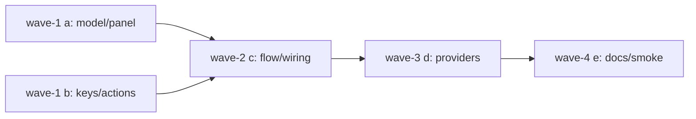

# Quickfix Navigation Subplans (IKY0E8)

Parent plan: [`../quickfix-nav-plan.md`](../quickfix-nav-plan.md)
Rules: [`../../rules/task-orchestration.md`](../../rules/task-orchestration.md), [`../../rules/subagent-workflow.md`](../../rules/subagent-workflow.md).

## Subplan index

| Subplan | File | Responsibility |
|---|---|---|
| a | [`quickfix-nav-model-panel-plan-a.md`](quickfix-nav-model-panel-plan-a.md) | L1 concrete result model + L2 docked panel |
| b | [`quickfix-nav-keys-actions-plan-b.md`](quickfix-nav-keys-actions-plan-b.md) | Global actions, `:commands`, dual key tables, key guard |
| c | [`quickfix-nav-flow-wiring-plan-c.md`](quickfix-nav-flow-wiring-plan-c.md) | L3 orchestration, Editor dock wiring, R11/R15 registration |
| d | [`quickfix-nav-providers-plan-d.md`](quickfix-nav-providers-plan-d.md) | Diagnostics / project search / references providers |
| e | [`quickfix-nav-docs-smoke-plan-e.md`](quickfix-nav-docs-smoke-plan-e.md) | Bilingual docs, manual, smoke scenario, changelog |

## Wave table (strictly serial after wave 1)

| Wave | Parallel members | Gate before next wave |
|---|---|---|
| 1 | a ∥ b | `pytest tests/test_quickfix_model.py tests/test_quickfix_panel.py tests/test_quickfix_keys.py -q` + `pytest tests/test_architecture.py -q` + `pyright` on touched modules |
| 2 | c | `pytest tests/test_quickfix_flow.py tests/test_architecture.py -q` + `pyright` |
| 3 | d | `pytest tests/test_quickfix_providers.py tests/test_app_find_replace.py tests/test_lsp_navigation_flows.py -q` + `pyright` |
| 4 | e | `python -m tools.smoke_test run --jobs 4` + `python -m tools.changelog check` + full gate |

## Dependency graph

## Dispatching rules

- Batch size 2~3, explicit `bypassPermissions` in unattended mode.
- Exclusive file lists are in each subplan; overlapping files across **different** waves are allowed only for `yate/editor_compose.py` and `tests/test_architecture.py` as recorded in the parent plan.
- Only landed files count; every subagent-reported number is re-run by the main agent.
- Every wave is committed separately; no push and no merge during the closed loop.
