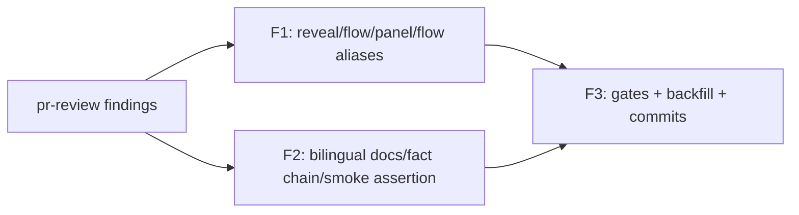

# IKY0E8 pr-review 修复方案

- 来源评审：[`../reviews/2026-11-26-pr-review-quickfix-nav.md`](../reviews/2026-11-26-pr-review-quickfix-nav.md)（`Overall: REQUEST_CHANGES`，0 BLOCKER / 6 MAJOR / 16 MINOR）。
- 父方案：[`quickfix-nav-pr-review-plan.md`](quickfix-nav-pr-review-plan.md)；产品主计划：[`quickfix-nav-plan.md`](quickfix-nav-plan.md)。
- 日期：2026-11-26；状态：已落盘，无人值守自动批准。

## 一、目标与非目标

- 目标：关闭 6 个 MAJOR 与可低成本闭环的 MINOR，重新跑全量门禁，把 pr-review 记录与索引改为 APPROVE 终态。
- 非目标：不改已撤回/降级的 A-3/A-4/A-6/A-12 设计语义；不重写 LSP 引擎；不新增架构守卫；不推送、不合并 master。
- 范围基线：`master...HEAD`（merge-base `81170b8b`）。

## 二、备选方案与否决理由

| 方案 | 做法 | 裁决 |
|---|---|---|
| A（采纳） | F1 产品逻辑单波（共享 reveal 契约 + flow/panel/session 语义 + 低风险别名清理），F2 文档/事实链单波，主代理收尾门禁 | 采纳：F1 文件高度耦合，拆开会产生跨波半成品；F2 与 F1 无文件重叠，可紧接串行 |
| B | 每个 MAJOR 一笔提交、逐波派发 | 否决：6 个 MAJOR 中 4 个共用 reveal / flow 文件，强制拆波会造成反复合并冲突 |
| C | 只修硬门禁相关项，用户可见语义留作 follow-up | 否决：`REQUEST_CHANGES` 的 6 MAJOR 均属用户可见错误或事实链失真，留下即不能 APPROVE |

## 三、分步实施

### F1 — 产品逻辑与类型面（单波，独占文件）

- 独占文件：
  `yate/editor.py`、`yate/editor_components/find_replace.py`、`yate/editor_components/quickfix_panel.py`、`yate/flows/__init__.py`、`yate/flows/quickfix_flows.py`、`yate/flows/lsp_sync.py`、`yate/flows/lsp_navigation_flows.py`、`yate/flows/overlay_flows.py`、`yate/editor_compose.py`、`yate/session.py`、`tests/test_quickfix_flow.py`、`tests/test_quickfix_panel.py`、`tests/test_quickfix_providers.py`、`tests/test_events.py`、`tests/test_app_find_replace.py`、`tests/test_overlay_flows_hex.py`、`tests/test_changelog_view.py`、`tests/test_hex_view.py`、`tests/test_lsp_navigation_flows.py`。
- 具体改动：
  1. `find_replace.py` 的 `RevealFn` 改为 `Callable[[Path, int, int], bool]`；`editor.reveal_match` 返回 `bool`，目标既未打开也不存在时返回 `False` 且不创建幽灵缓冲区；其余 reveal 调用方忽略布尔返回值即可。
  2. `quickfix_flows.py` 复用该 `RevealFn`；`jump_to` 按布尔成败判断，失败时不 push、不刷新、不报成功；`set_results` 仅在整体结果集为空时隐藏；`set_search_results` 的缺失 `hit_lines` 回退 `(no preview)`；删除无调用方的 `toggle()`。
  3. `quickfix_panel.py` 按内容宽度裁剪每条结果为单个物理行（Rich `chop_cells`），使 `_reveal_selection` 的逻辑下标与物理行一致；整理内部导入分组。
  4. `lsp_navigation_flows._jump_to_row` 先捕获 origin，`doc is None` 失败检查后再 push；`lsp_sync` 非标准 severity 显示 `unknown`。
  5. `flows/__init__.py` 增加 `SetQuickFixFn` 共享别名；两个 LSP flow 复用；删除 `LspSync._push_overlay` 死参数及组装/测试实参。
  6. `session.push_jump` docstring 删除 “future” 表述。
  7. 补回归：false-reveal 不 push、跨 provider 空批次不隐藏、窄视口长行只占一行且滚动正确、缺 `hit_lines` 空态、空列表 `next/prev` 提示；更新所有 reveal 测试桩的布尔返回。
- 验收命令：
  `.venv\Scripts\python.exe -m pytest tests/test_quickfix_flow.py tests/test_quickfix_panel.py tests/test_quickfix_providers.py tests/test_app_find_replace.py tests/test_events.py tests/test_lsp_navigation_flows.py -q`
  `.venv\Scripts\python.exe -m pyright yate/ tests/ tools/ pack/`

### F2 — 双语文档、事实链与冒烟断言（独占文件）

- 独占文件：`.trae/reviews/2026-11-26-quickfix-nav.md`、`.trae/reviews/README.md`、`.trae/documents/quickfix-nav-plan.md`、`.trae/documents/quickfix-nav-pr-review-plan.md`、`.trae/documents/quickfix-nav-pr-review-fixes-plan.md`、`.trae/rules/architecture-boundaries.md`、`yate/resources/manual.en.md`、`yate/resources/manual.zh.md`、`tools/smoke_test/scenarios/lsp_navigation.py`、`tests/test_architecture.py`。
- 具体改动：
  1. 双语手册 `:diagnostics` 两处（浮层命令分类 + 功能小节）改为底部 quickfix 面板，并补 `<alt-j>`/`<alt-k>` 导航。
  2. pr-review 相关文档统一基线口径为 `81170b8b`；保留 `b97a695c` 作为功能分支起点历史事实；门禁表标注测量时点 HEAD。
  3. R9 冻结 ID 清单补 `#quickfix-panel`；`tests/test_architecture.py` 模块 docstring `R1-R12` → `R1-R15`。
  4. 冒烟 SVG 断言收紧为两个文件名同时出现且含 `references |` 前缀。
- 验收命令：
  `.venv\Scripts\python.exe -m pytest tools/ -q` （若无对应用例则以 `python -m compileall -q tools/smoke_test/scenarios` 等价替代并登记）
  `git diff --check`

### F3 — 主代理收尾

- 独立复核 F1/F2 落盘结果；亲跑全量门禁：pyright / pytest `-n auto` / 架构 / 覆盖率 / 冒烟 / changelog / diffcheck。
- 回填 pr-review 记录 §7、索引状态、父方案 §5 与本方案回填区；按 scope 分笔提交；只提交不推送。

## 四、风险与回滚

| 风险 | 缓解 | 回滚 |
|---|---|---|
| `RevealFn` 布尔化波及未列测试桩 | 全仓 grep `RevealFn/reveal_match/reveal=` 并逐个更新；pyright 全量复核 | 回退布尔化，改用 flow 内 is_open 后置校验 |
| 裁剪长行导致信息丢失 | 只裁剪显示文本，不裁剪 `QuickFixEntry.label`；窄视口用例保护 | 回退裁剪，改做物理行映射 |
| 双语手册改出新漂移 | en/zh 同处成对修改；`lsp.*.md` 口径复用 | 回退两文件 |
| 事实链自引用导致 HEAD 过期 | 只写“评审时点 HEAD”与“修复后 HEAD”两个时点，不写“当前 HEAD” | 回填更正 |
| 子代理零产出 | 按 `subagent-workflow.md` §五 判死，主代理兜底 | 主代理按独占清单执行 |

## 五、回填区

- 修复提交：`2a67fe4b`（F1 产品逻辑）、`9ca81da8`（F2 文档事实链）、`1bb955e0`（R11 登记与行数表）、`5ee31927`（面板滚动用例时序）、`24fb1068`（冒烟 SVG 断言稳定化）。终态 HEAD `24fb1068`；未推送、未合并 master。
- 修复后门禁：pyright 0；全量 pytest `-n 1` exit 0（4099 collected）；架构 48 passed；覆盖率 `fail-under=75` exit 0、精确值 92.82%；冒烟 129/129 scenarios · 1575/1575 checks；`changelog check` exit 0；`git diff --check master...HEAD` 0。`-n auto` 两次在工具层 idle-timeout，按纪律串行复核，非测试失败。
- 发现处置：6 MAJOR 全部闭环；M4-M11、M13 与 C-04 全修；M1/M2/M3 与 A-12 登记不修；A-7 并入 A-1。F1 引入的 `find_replace` 组件导入按 R11 补登白名单，`editor.py` 行数同步为 875；窄视口用例在并行下暴露布局时序伪影，已改为等待 `max_scroll_y` 后再重绘；SVG provider 断言改为稳定子串后冒烟全绿。
- 子代理情况：F1/F2 两名 `plan-executor` 全部交付；主代理逐条回读并重跑其名下测试与门禁，无零产出。
- 执行进度（F2 执行者登记，2026-11-26）：F1 已落盘（主代理侧）；F2 进行中——
  双语手册 `:diagnostics` 四处、事实链五处（上一轮记录 / 索引 / 主计划 §10 /
  pr-review 方案 / pr-review 记录头部）、R9 `#quickfix-panel` + docstring `R1-R15`、
  冒烟 SVG 断言收紧均已改毕；F2 验收以
  `python -m compileall -q tools/smoke_test/scenarios` 等价替代
  `pytest tools/ -q`（tools/ 无对应用例）+ `git diff --check`，结果见下方登记；
  最终全量门禁由主代理收尾统一执行并回填上文各栏。
- F2 验收登记：
  `python -m compileall -q tools/smoke_test/scenarios` → 退出码 0；
  `git diff --check` → 退出码 0。
