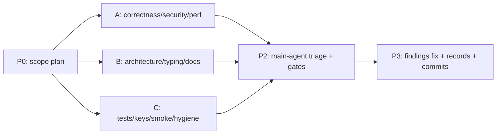

# IKY0E8 合并前 pr-review 方案

- 日期：2026-11-26；状态：已落盘，无人值守自动批准（未向用户询问）。
- 分支：`feature/enh-quickfix-nav`；基线：`master`，merge-base `81170b8b`；HEAD `069408ad`。
- 规模：10 笔本地提交、44 文件、+3263/−49（生成式 changelog 与计划文档占主要行数）。
- 规范来源：[`pr-review/SKILL.md`](../skills/pr-review/SKILL.md)、[`../rules/task-orchestration.md`](../rules/task-orchestration.md)、[`../rules/subagent-workflow.md`](../rules/subagent-workflow.md)、[`../rules/architecture-boundaries.md`](../rules/architecture-boundaries.md)、[`../rules/python-coding-style.md`](../rules/python-coding-style.md)、[`../rules/doc-conventions.md`](../rules/doc-conventions.md)。

## 一、目标与非目标

- 目标：对 `master...HEAD` 的完整分支差异做 Gitee Bot 语义的合并前预评审，覆盖功能正确性、安全、性能、可维护性、架构边界与硬门禁；产出 `Overall` 结论、分级发现、真实门禁数字与评审记录；对 blocker/major 进入迭代直至归零。
- 非目标：不推送、不合并 master、不执行外部 issue 写操作；不重做已闭环的上一轮设计评审；不把纯生成式 changelog 当作手写内容逐行评审；不修改产品代码，除非评审产生 blocker/major 并另行进入修复波。
- 范围过滤：跳过 lock / 二进制 / pyc / 纯重排 hunk；changelog 仅核对“由生成器产生且 check 通过”，不做逐条文案审查。

## 二、备选方案与否决理由

| 方案 | 做法 | 裁决 |
|---|---|---|
| A（采纳） | 3 名只读 `code-review-expert` 并行分域评审（功能/安全/算法性能、架构/类型/风格/文档、测试/键位/冒烟/提交纪律），主代理逐条回读复核并亲跑全部门禁 | 采纳：文件与维度互不重叠，可在无人值守下快速收敛；符合子代理并行纪律 |
| B | 单名评审员串行覆盖六维度 | 否决：44 文件跨 5 层，单轮易漏 cross-layer 与双语同步问题；上一轮已暴露过漏报代价 |
| C | 改走 13 维全仓 multi-dim-review | 否决：用户明确要求 `pr-review`，应按 Gitee Bot 六维语义与 `impact/ask` 模式框架执行；13 维全仓审核不是本次范围 |

## 三、分步实施

### P0 — 方案与范围（本文件）

- 输入：`master...HEAD` diffstat、既有主计划与上一轮评审记录。
- 独占文件：`.trae/documents/quickfix-nav-pr-review-plan.md`。
- 输出：本方案；范围、维度分工、门禁清单与风险表全部落盘。
- 验收：文档存在、链接均为相对路径、`git diff --check` 为 0。

### P1 — 并行只读评审

- 输入：本方案、`.trae/documents/quickfix-nav-plan.md`、`.trae/reviews/2026-11-26-quickfix-nav.md`、`.trae/rules/`。
- 独占文件：无（所有评审员只读，禁止写盘、禁止改产品代码、禁止提交）。
- 三名评审员分工：

| 评审员 | 维度 | 重点 |
|---|---|---|
| A | 功能正确性 / 健壮性 / 安全 / 算法复杂度 / 性能 | L1 `QuickFixList` 原位替换语义、L2 面板重绘与滚动、L3 flow 成功/失败路径、三 provider 发布、jump-list 单点语义 |
| B | 架构边界 R1-R15 / 模块职责 / 类型纪律 / 代码风格 / 双语文档 | `UI_FROZEN_FILES`、六工厂契约、R9 冻 ID、R10 键位透传、R13/R15、PEP 695、ASCII docstring、en/zh 手册与 lsp 文档成对 |
| C | 测试与验证 / 键位动作命令一致性 / 冒烟 / 提交纪律 | 新增 5 个测试文件、架构守卫 48、action/keymap 双表、smoke 新场景、评审记录与索引、changelog 生成器 |

- 每名评审员必须输出：`文件:行号 → 证据 → 候选问题 → 自裁（保留/降级/删除及理由）` 全量清单，不得只报幸存项；不得运行全量门禁（由主代理统一跑）。
- 验收：3 份报告全部回收；任何零产出按 `subagent-workflow.md` §五 判死并由主代理亲自补审，如实登记。

### P2 — 主代理复核与硬门禁

- 输入：P1 三份报告、当前工作树。
- 独占文件：`.trae/reviews/2026-11-26-pr-review-quickfix-nav.md`、`.trae/reviews/README.md`、`.trae/documents/quickfix-nav-plan.md`、本方案回填区。
- 复核动作：逐条重读 `文件:行号`，按证据保留 / 降级 / 撤回；对每条做反证、级别校准与漏报自查；不引用子代理自述数字。
- 门禁命令（全部亲跑，记录退出码）：

```powershell
.venv\Scripts\python.exe -m pyright yate/ tests/ tools/ pack/
.venv\Scripts\python.exe -m pytest tests/ -q -n auto
.venv\Scripts\python.exe -m pytest tests/test_architecture.py -q
.venv\Scripts\python.exe -m pytest tests/ --cov=yate --cov-branch -n auto
.venv\Scripts\python.exe -m tools.smoke_test run --jobs 4
.venv\Scripts\python.exe -m tools.changelog check
git diff --check master...HEAD
```

- 输出：评审记录（含 Overall、六维摘要、分级发现、Strengths）、索引新增一行、主计划与方案回填。
- 验收：门禁全部退出码 0 或如实记录红门禁；`git diff --check` 0；文档相对链接有效。

### P3 — 发现处置与提交

- 输入：P2 评审记录。
- 若出现 blocker/major：另起修复波，独占文件清单单独登记，修复后重跑全量门禁；仅 minor 则登记待办或直接低成本闭环。
- 按 `git-commit-message.md` 分步提交：评审记录/索引/回填一笔，修复波另笔；只提交不推送。
- 验收：工作树干净；`git log origin/master..HEAD` 与方案回填一致。



## 四、风险与回滚

| 风险 | 缓解 | 回滚 |
|---|---|---|
| 评审员模型未注册或零产出 | 按 `task-orchestration.md` §一.3 重试一次仍失败则主代理兜底并登记 | 不重建团队，主代理按同一维度清单补审 |
| 并发评审读文件时被其他进程改动 | 评审前后各取一次 HEAD；主代理以最终 HEAD 复核 | 以最终 HEAD 重跑受影响维度 |
| 覆盖率因 xdist 偶发未回传 | 先确认退出码与 `gw*` 日志；必要时按 `misc-rules` 用 `-n 1` 复核 | 记录环境伪影，不把 flake 当通过 |
| 修复波引入新回归 | 负向演练先红后绿 + 全量门禁复跑 | 回退修复提交，重新评审 |
| 文档链接或索引漂移 | 相对链接自检 + README 单行登记 | 回填修正 |

## 五、回填区（P2/P3 完成后填写）

- 评审结论：
- 门禁数字：
- 发现统计与处置：
- 子代理存活/零产出情况：
- 提交与工作树状态：
