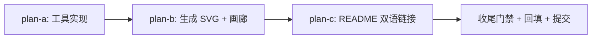

# readme-screenshots 总纲（feat/readme-screenshots）

> 状态：已批准（无人值守，2026-11-02 22:4x，总纲 §二.5 bypass）；**已闭环**
> （2026-11-02，执行记录见文末「## 执行记录」）。
> 需求唯一来源为用户原话；2026-11-02 用户更正：**不把截图逐条内联 README**，
> 改为 `screenshots/` 下生成**一个 MD 画廊文件**集中说明各场景截图，根 README
> 只链接该文件。用户明示：无人值守、所有问题无须过问、子代理派发按
> `subagent-workflow.md` 纪律执行。

## 需求原文（更正后）

> 对所有的features生成截图，并链接到readme中，包括工具的和测试的截图，截图生成于screenshots文件夹下，此目录位于项目根目录
> 更正：在screenshots专门生成一个md文件来说明各个场景的运行截图，然后readme再链接此md文件

## 口径裁决（主代理）

「所有的 features」= README.md「Features」节每条 bullet + FEATURES.md 18 维度中
可视的子集；「工具的截图」= 内置工具视图（文件管理器 / hex / diff / which-key /
集成终端 / shell overlay）+ 维护工具输出（smoke test 报告、`--diag` 报告）；
「测试的截图」= pytest 通过汇总 + pyright 零诊断（**真实命令真实输出**，禁止伪造）。

## 场景清单（25 个，全部 SVG，100x30）

| # | 文件名 | 驱动方式（pilot / subprocess） | 对应 README 锚点 |
|---|---|---|---|
| 1 | welcome-screen.svg | 空 buffer 启动 | Features「Welcome screen」 |
| 2 | layout-explorer.svg | 目录启动 + 打开文件 | 「VS Code-style layout」 |
| 3 | keymap-vsc.svg | 默认 vsc，状态栏 VSC chip | 「Two built-in keymaps」 |
| 4 | keymap-vim.svg | `keymap="vim"` 启动 + `:` 命令行 | 同上 |
| 5 | syntax-highlighting.svg | 打开预置 .py | 「Syntax highlighting」 |
| 6 | theme-onelight.svg | `:set theme=onelight` | 「Eight built-in themes」 |
| 7 | quick-open.svg | `execute_action("quick_open")` | 「Fuzzy finding」 |
| 8 | command-palette.svg | `alt+shift+p` | 同上 |
| 9 | tabs.svg | 依次 `:e` 三个文件 | 「Multi-buffer tabs」 |
| 10 | split-panes.svg | `:vsplit` + `:split` | 「Split panes」 |
| 11 | find-replace.svg | `ctrl+f` 输入模式 | 「Find & replace」 |
| 12 | shell-overlay.svg | `f2` + `python --version` | 「Shell commands」 |
| 13 | integrated-terminal.svg | `:term`（真实 PTY shell） | 「Integrated terminal」 |
| 14 | extensions.svg | 默认启动（状态栏扩展段） | 「Python extensions」 |
| 15 | lsp-completion.svg | `ctrl+space`（buffer 单词回退，如实标注） | 「LSP support」 |
| 16 | screensaver.svg | `alt+shift+s`（whitelist 固定角色） | 「Screensaver mode」 |
| 17 | manual.svg | `f8` 双语手册 | Manual 节 |
| 18 | game-snake.svg | `:game snake`（Lua 扩展） | Extensions / games docs |
| 19 | file-manager.svg | `filemanager_dir=` 启动 | 工具面 |
| 20 | hex-view.svg | `hex_file=` 启动 | 工具面 |
| 21 | diff-view.svg | `diff_files=` 启动 | 工具面 |
| 22 | which-key.svg | `f9` 全键位表 | 工具面 |
| 23 | smoke-report.svg | 子进程真实跑 `--tag view`，FORCE_COLOR 捕获 ANSI → Rich 重渲染 | 维护工具 |
| 24 | diag-report.svg | 子进程真实跑 `yate --diag` | 维护工具 |
| 25 | pytest-pyright.svg | 子进程真实跑 `pytest -q` 与 `pyright`，分两帧渲染 | 测试面 |

不可截图项（非目标）：yaterc 配置文本（非视觉）、LSP 诊断标记（需真实语言服务器
进程，无头环境 flaky）、Nerd Font 字体本身。

## 交付物

- `tools/screenshots/`（包：`__main__.py` CLI、`scenarios.py` 注册表、
  `driver.py` pilot 驱动、`cli_reports.py` 子进程→Rich→SVG、`gallery.py` 画廊生成）
- `screenshots/*.svg`（25 个，确定性可再现，sha256 级稳定）
- `screenshots/README.md`（唯一画廊文件：每场景一节，图 + EN/ZH 说明，
  含生成方式与 Nerd Font 限制说明）
- `README.md` / `README.zh.md`：新增「Screenshots」小节，链接画廊 + 一张 hero 图
- `tests/test_screenshots_tool.py`（注册表完整性 + 画廊生成 + 一个真实端到端小场景）

## 波次（严格串行，依赖链）

| 波次 | 子计划 | 独占文件 |
|---|---|---|
| wave-1 | plan-a | `tools/screenshots/**`、`tests/test_screenshots_tool.py` |
| wave-2 | plan-b | `screenshots/**`（生成产物） |
| wave-3 | plan-c | `README.md`、`README.zh.md` |

## 调研结论（全部带证据，方案的地基）

1. **SVG 确定性已实证**：同状态两次 `save_screenshot` 输出 sha256 一致
   （探针 `_probe_svg.py`，Textual 8.2.8，id 形如 `terminal-478973439-line-N`
   为稳定哈希而非 UUID）；单屏 100x30 ≈ 29 KB。已提交产物可再生、diff 干净。
2. **取屏先例**：`tools/smoke_test/harness.py:182-185`（`snapshot_svg` →
   `app.save_screenshot`）；pilot 尺寸先例 (100,30)/(110,32)。
3. **App 构造全旋钮**：`yate/app.py:85-98` —— `target / keymap / theme_name /
   config / readonly / ext_files / ext_dirs / diff_files / hex_file /
   filemanager_dir`，全部启动形态无需改 yate/ 即可到达。
4. **各场景驱动证据**（smoke scenarios 既有写法，直接沿用按键序列）：
   命令行 `run_command`（`tools/smoke_test/scenarios/_base.py:55`，F5 入口）、
   quick open `app.editor.execute_action("quick_open")`（view.py:299）、
   命令面板 `alt+shift+p`（view.py:23）、which-key `f9`（whichkey.py:34）、
   屏保 `alt+shift+s`（screensaver.py 模块 docstring：Editor.handle_key 按名拦截）、
   终端 `:term` / `ctrl+\``（integration.py:122-125）、shell overlay `f2`
   （integration.py:83）、hex `:e thing.bin`（hexview.py:60）、
   diff `:diff` / `diff_files=`、文件管理器 `filemanager_dir=`
   （harness.py:361-380）、游戏 `:game snake`（extensions/games.lua:26）、
   手册 `f8`（test_app_manual.py:33）、主题内置名 `mocha/macchiato/frappe/
   latte/onedark/onelight/…`（themes.py:388-406，默认 mocha）。
5. **补全弹窗**：`ctrl+space` 手动触发；无服务器时回退 buffer 单词
   （FEATURES.md §11；画廊如实标注回退语义）。驱动先例
   `tests/test_completion_popup.py`。
6. **工具/测试报告 SVG 路线（已定）**：子进程跑真实命令，`FORCE_COLOR=1`
   （rich）/ `--color=yes`（pytest）强制 ANSI 输出 → `rich.text.Text.from_ansi()`
   → 录制型 `Console(record=True)` → `export_svg()`。pyright 无色输出 →
   富文本面板包装渲染。**否决**直接 import `tools.smoke_test.report.Reporter`
   复用渲染：需要构造 ScenarioResult 数据通路、且 Reporter 的 Console 不可注入
   （report.py:134-137 record 绑定 html_path），耦合大于收益。
7. **门禁影响**：`screenshots/` 不进 wheel（`pyproject.toml`
   `[tool.hatch.build.targets.wheel] packages=["yate"]`，仓库根目录天然不在包内）；
   架构测试扫 `yate/`+`tools/`+`tests/`，新工具须过 ASCII 注释（misc-rules §四）、
   ≤800 行（A11）、pyright strict；覆盖率门禁只测 `yate/`（`[tool.coverage.run]
   source=["yate"]`），不受影响。
8. **字体限制（已知，如实记录）**：SVG 内嵌 cdnjs 的 Fira Code @font-face；
   SVG 以  嵌入时浏览器按规范不加载外部资源 → 回退客户端 monospace（正文
   可读）；Nerd Font PUA 文件类型图标在无 Nerd Font 的查看端显示为方框。画廊
   README 说明此限制；不做字体嵌入（非目标）。
9. **报告类 SVG 含运行时间戳/耗时**（真实报告的性质），再生时数值会变——画廊
   说明「报告类截图为真实运行采样」。

## 备选方案与否决理由

- **README 内联逐条插图**（用户更正前方案）：否决——用户明确改为画廊文件集中说明。
- **PNG 截图**（Pillow/PIL 渲染终端）：否决——Textual 原生导出 SVG，PNG 需引
  Pillow 依赖与位图模糊问题，SVG 矢量且 diff 友好。
- **import Reporter 复用 smoke 渲染**：否决（见调研 6）。
- **改 yate/ 加「截图模式」**：否决——违反本任务不改产品源码的硬约束，pilot
  公开 API 已足够。

## 风险与回滚

| 风险 | 缓解 | 回滚 |
|---|---|---|
| 个别场景无头下不稳定（终端 PTY、游戏 Lua、屏保动画帧） | 场景独立、`--only` 单跑调试；失败重试一次；仍失败则该场景登记非目标并从画廊摘除 | 单场景剔除不影响其余 |
| smoke/pytest 子进程在无头窗口下 stdout 编码问题 | 显式 `encoding="utf-8"`、`errors="replace"`；沿用 report.py 的 ASCII 回退判据 | 报告类截图剔除 |
| SVG 里 PUA 图标方框观感 | 画廊说明 + 限制登记 | 无需回滚 |
| 回归风险 | 本任务不改 yate/；README 仅加节 | `git revert` 单提交 |

## 执行纪律备注

- plan-architect-designer spawn 两连败（模型未注册 `qwen-3.7-plus`，任务书指定
  模型无效——已知环境坑）→ 按总纲 §一.3.5 主代理亲自规划，如实标注；
- 内置 code-explorer 中止（code=10003）→ 按 subagent-workflow §五.4 不原样重试，
  调研由主代理只读探针完成；
- 执行/审核子代理照常派发（batch ≤6、spawn 即探活、判死窗口充足、只认落盘结果、
  零产出主代理兜底）；无人值守全程 bypass，产物照常落盘可查。

## 执行记录（2026-11-02 收尾回填，真实数字）

**波次与提交**（全程严格串行，与上表一致）：

| 波次 | 子计划 | 提交 | 实际产出 |
|---|---|---|---|
| wave-1 | plan-a | `0d43285`（+ `2a85b8a` 谓词类型化增量） | tools/screenshots 7 文件 1129 行 + 测试 3 用例；验收三条 exit 0；executor-a 主动探针实跑 22 个 pilot 场景全过；发现并修复 GBK 子进程编码缺陷 |
| wave-2 | plan-b | `509f88f` | 25/25 SVG（约 3 MB）+ 画廊；plan-b 验收数字全达标 |
| wave-3 | plan-c | `2acf2da` | README.md / README.zh.md 各 +8 行同构插入，其余零改动 |
| 修复 | 评审 F1 | `afcaf5f` | 画廊改全量注册表 × SVG 存在性过滤 + 回归用例 |

**偏离记录**（均已在评审记录详述）：

1. **plan-b 流程缺陷**：wave-2 验收后的确定性抽查用旧代码跑 `--only
   welcome-screen`，把画廊覆写成 1 节，提交前未复检——提交的画廊损坏；
   评审 F1 连根修复（代码语义 + 回归用例），gallery 25 节恢复、部分再生
   字节一致（SHA256 实证）。
2. **评审子代理零产出**：code-review-expert spawn 后两轮探活零回信、零产物、
   超 30 分钟窗口 → 判死（§五.3），主代理亲自按剧本评审（含强制自我批判）；
   评审结论 0 blocker / 0 major（F1 当轮修）/ 0 minor 待办。
3. 场景清单与总纲表 25/25 一致，无缩水；LSP 诊断标记截图按总纲登记为非目标。

**收尾门禁（主代理亲跑，CI 并行口径，全 exit 0）**：
pyright 全仓 0 诊断 / 架构 37 passed / pytest 全量全绿（10 skipped）/
覆盖率 92.81%（门槛 75）/ 冒烟 121/121 场景 · 1463/1463 checks。

**评审登记**：`.trae/reviews/2026-11-02-readme-screenshots.md`（索引 #55）。

**用户反馈修复轮（2026-11-03，第三轮）**：修裂图（脱敏占位符 XML 转义 +
which-key 控制字符符化）、图标字体内嵌（bundled Nerd Font 每帧 WOFF2 子集，
dev 依赖 +fonttools/+brotli）、按用户指示移除 pytest-pyright 场景（25→24）。
场景清单以注册表为准；门禁复跑全绿。详见评审记录第八节。
