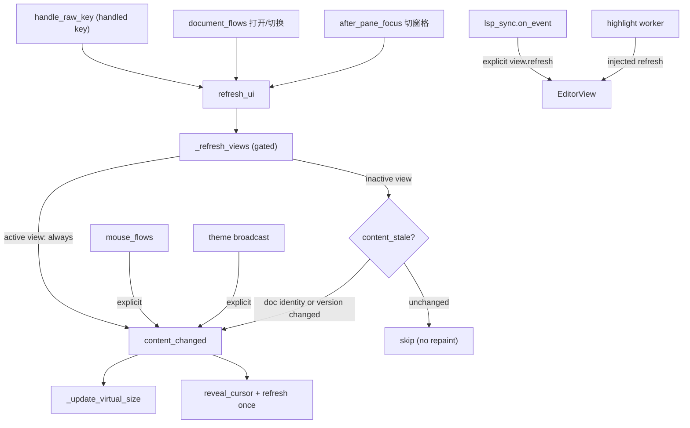

# refresh-views-dirty-plan — `_refresh_views` 按需脏标记（Gitee issue IKQQNQ）

- 来源 issue: <https://gitee.com/jermaine/yate/issues/IKQQNQ>
- 分支: `enh/refresh-views-dirty`（独立 worktree，干净 master 基线 `4a20fc2`）
- 性质: enhancement（性能优化），性能审计 P3/P4 保守部分合入后的遗留非目标项

## 一、目标与非目标

**目标**

1. `yate/editor.py` 的 `_refresh_views` 不再对全部窗格视图无条件调
   `content_changed()`：**活动视图始终刷新**；**非活动视图仅在其文档绑定变化
   （doc 恒等）或 `buffer.content_version` 推进时刷新**。
2. 顺带清理 `content_changed` 内 `reveal_cursor() + refresh()` 双重标脏
   （`reveal_cursor` 末尾的 `self.refresh()` 移除，重绘职责归调用路径）。
3. 新增 pilot 计数用例：双窗格打开 A/B 两文档，仅在 A 打字时 B 的 `refresh`
   计数为 0、A 正常出帧；既有 `tests/test_app_render.py`、
   `tests/test_app_panes.py`、`tests/test_chrome.py` 全绿。
4. 全部标脏来源清单落盘本计划 §四，逐项核对防漏标脏。

**非目标**

- 不改 Textual 合帧机制、不改 `render_line` 渲染管线、不触碰 R9（id 冻结）/
  R10（单次派发）守卫面；
- 不动 `TextBuffer.take_dirty_range`（消费型，高亮专用）与 `dirty_range`
  （只读 peek，补全专用）的既有契约；
- 不做 LSP 增量同步 / tree-sitter 增量解析（已由 IKQQNM / IKQQNO 另行完成）。

## 二、调研事实（文件:行号）

| 事实 | 位置 |
|---|---|
| `_refresh_views` 对全部视图无条件 `content_changed()` | `yate/editor.py:745-752` |
| `handle_raw_key`：handled 键即 `refresh_ui()`（光标移动也走此路） | `yate/editor.py:880-898`（`:896`） |
| `after_pane_focus`：切窗格后 `refresh_ui()`（新活动视图被覆盖） | `yate/editor.py:1008-1011` |
| `content_changed` = `_update_virtual_size` + `reveal_cursor` + `refresh` | `yate/editor_view/editor.py:176-185` |
| `reveal_cursor` 末尾再 `self.refresh()`（双重标脏） | `yate/editor_view/editor.py:318` |
| `_apply_theme` → `content_changed`（主题广播按视图显式） | `yate/editor_view/editor.py:205-209` |
| `apply_doc` / `show_doc` / `document_closed` 重绑叶 doc（含非活动叶） | `yate/editor_view/panes.py:189-247` |
| LSP 事件对 `all_views()` 显式 `view.refresh()`（不走 `content_changed`） | `yate/flows/lsp_sync.py:79-93` |
| 高亮 worker 用注入的 refresh 回调（不走 `content_changed`） | `yate/editor_view/highlighting.py:110-118,439,464` |
| 鼠标路径按视图显式 `content_changed()` | `yate/flows/mouse_flows.py:91,104,132` |
| `reveal_cursor` 其余调用者之后都有重绘 | `yate/editor.py:975`（后接 `:981` refresh_ui）、`yate/flows/prompt_flows.py:306`（后接 `:308` `self._refresh()`） |
| `content_version` 单调递增；`mark_content_changed` 供越带改写 | `yate/editor_core/buffer.py:252-269` |
| `take_dirty_range`（消费）/ `dirty_range`（peek）归高亮与补全 | `yate/editor_core/buffer.py:377-396` |
| 体量守卫：`editor.py` 1229 → 1238 行（豁免名单），`editor_view/editor.py` 实施后 670 行（低于 800 阈值） | `tests/test_architecture.py:341-347`（`SIZE_EXEMPT_FILES`，仅名单、无行数断言） |

## 三、备选方案与否决理由

- **A（采纳）视图侧版本戳**：`EditorView` 记录 `_painted_doc` / `_painted_version`
  两个私有戳，只在 `content_changed()` 末尾写入；暴露只读属性 `content_stale`
  （doc 恒等变化或版本不等）。L3 `_refresh_views` 活动视图无条件、其余按
  `content_stale` 门控。理由：视图本地重绘（滚动 / 高亮 / LSP / 鼠标）不推进
  `content_version`，戳语义自洽；L3 无需维护 per-leaf 影射表；doc 恒等比较天然
  覆盖 `show_doc` / `document_closed` 的重绑（含非活动叶）。
- **B（否决）L3 影射表**：`dict[leaf_id, version]` 放 L3——"上次绘制版本"与
  视图本地重绘路径脱节，状态双写易漂移，且视图重建（分窗 / 重排）时要维护
  影射生命周期；否决。
- **C（否决）`dirty_range` 判脏**：区间会被高亮 worker 经 `take_dirty_range`
  消费，判脏与消费冲突；`content_version` 单调且无消费方，够用；否决。
- **D（否决）非活动视图完全不刷**：双窗格共览同一文档时另一窗格不更新，
  行为回退；否决。

## 四、标脏来源清单（验收硬性要求，逐项核对）

| # | 来源 | 现路径 | 门控后行为 |
|---|---|---|---|
| 1 | 键盘编辑（插入 / 删除 / 撤销 / 重做 / 多点操作） | `handle_raw_key` → `refresh_ui` → `_refresh_views` → 全视图 `content_changed` | 活动视图无条件；非活动视图按版本门控（共览同文档者放行） |
| 2 | 纯光标移动 / 可视选择 | 同 #1（无版本推进） | 活动视图无条件刷新，`reveal_cursor` 照常 |
| 3 | 鼠标（按下 / 拖选 / 双击） | `mouse_flows` 按视图显式 `content_changed()` | 不变（显式单视图，不经门控） |
| 4 | 打开 / 激活 / 切换标签（活动叶） | `document_flows` → `refresh_ui` | 活动视图无条件 |
| 5 | 文档重绑进非活动叶（`document_closed` / `target_leaf` 打开） | `refresh_ui` 全链 | doc 恒等门控放行 → 重绘 + `_update_virtual_size` |
| 6 | 分窗 / 关窗 / `:only` / 切换焦点 | `panes` 结构操作 + `after_pane_focus` → `refresh_ui` | 新视图 mount→`_apply_theme`→`content_changed`（写戳）；新活动视图无条件 |
| 7 | 主题广播 | `theme.subscribe` → 各视图 `_apply_theme` → `content_changed` | 不变（按视图显式，写戳） |
| 8 | LSP 状态 / 诊断事件 | `lsp_sync.on_event` → `all_views()` 显式 `view.refresh()` | 不变（显式，不写戳也不需写——版本未变） |
| 9 | 高亮 worker 产出 tokens | `highlighting.py` 注入 refresh 回调 | 不变（同 #8） |
| 10 | 扩展越带改写 buffer | `mark_content_changed` 推进版本，下一次 `refresh_ui` | 版本门控放行 |
| 11 | 补全 / `:行号` 跳转插入后 | `prompt_flows` 显式 `reveal_cursor()` + `self._refresh()` | `reveal_cursor` 去内层 refresh 后由 `self._refresh()` 覆盖 |
| 12 | 项目搜索定位 | `editor.py` `reveal_match`：`reveal_cursor()` + `refresh_ui()` | 同上，由 `refresh_ui` 覆盖 |
| 13 | 窗口 resize | Textual `Resize` → `on_resize` → `_update_virtual_size` + refresh | 不变 |
| 14 | which-key / 终端 / 状态栏 / chrome | 独立 widget，不经视图 | 不变 |
| 15 | 扩展越带改写且后续**无任何** `refresh_ui`（`mark_content_changed` + `api.message` / `api.actions.run` 均不刷视图） | 无重绘触发 | 非活动窗格要等下一次 `refresh_ui` 才可见——master 既有行为（非本门控回归）；版本门控保证下一次 `refresh_ui` 必然放行受影响窗格 |



## 五、分步实施

### S1 视图侧脏标记 API（`yate/editor_view/editor.py`）

- 输入：本计划 §二 / §四。
- 改动：
  1. `__init__` 增私有戳 `self._painted_doc: Document | None = None` 与
     `self._painted_version: int = -1`；
  2. `content_changed()` 末尾写入两戳（`self.leaf.doc` / 当前
     `self.buffer.content_version`）；
  3. `reveal_cursor()` 删除末尾 `self.refresh()`（三处调用者之后均有重绘，
     见 §二）；docstring 同步说明重绘归调用路径；
  4. 新增只读属性 `content_stale -> bool`：`self.leaf.doc is not self._painted_doc
     or self.buffer.content_version != self._painted_version`，docstring 说明
     门控语义（L3 专用查询，读状态不用操作方法）。
- 输出：L2 侧按需脏标记查询。
- 验收命令：`.venv\Scripts\python.exe -m pyright yate/editor_view/editor.py`

### S2 调度侧门控（`yate/editor.py`）

- 输入：S1 的 `content_stale`。
- 改动：`_refresh_views` 重写为——活动视图无条件 `content_changed()`；
  其余视图 `content_stale` 时才 `content_changed()`。docstring 说明门控语义
  与 `refresh_ui` 全量入口保留（§四 #8/#9 显式路径不经过此门控）。
- 输出：多窗格只重绘内容变更的窗格。
- 验收命令：`.venv\Scripts\python.exe -m pyright yate/editor.py`

### S3 测试（`tests/test_app_panes.py`）

- 输入：S1 / S2 产物；沿用 `pane_root` fixture 与
  `test_vsplit_with_file_and_only` 的分窗先例、`test_app_render.py:93-97`
  的 monkeypatch 计数先例。
- 新增用例：
  1. **计数用例（issue 验收标准）**：双文档双窗格（A/B 两文件，`filetype`
     用纯文本），先等 B 的挂载期高亮 worker 落定（防抖窗口内可能有显式
     `refresh`），清零计数器后仅在 A 打字 → 断言 B 的 `refresh` 计数为 0、
     A 的计数 > 0 且 buffer 内容已含键入字符；切到 B 打字 → B 正常刷新。
  2. **共览用例**：两窗格同一文档，A 编辑 → B 也刷新（版本门控放行）。
  - 防抖落定手段：多轮 `pilot.pause()` / `wait_until` 稳定谓词；仍 flake 时
    把高亮防抖常量 monkeypatch 为 0（按 `python-coding-style.md` §4.7
    禁止真实睡眠断言）。
- 既有回归：`tests/test_app_render.py`、`tests/test_app_panes.py`、
  `tests/test_chrome.py` 全绿。
- 验收命令：
  `.venv\Scripts\python.exe -m pytest tests/test_app_panes.py tests/test_app_render.py tests/test_chrome.py -q -n auto`

### S4 规则文本行数回填（`.trae/rules/architecture-boundaries.md`）

- 改动：S1/S2 落定后量取 `yate/editor.py` 新行数，更新 §三.7 豁免注记中的
  复测行数一行（纯文本同步，不改守卫集合）。
- 验收：`.venv\Scripts\python.exe -m pytest tests/test_architecture.py -q`
  全绿（37 用例数不因本任务新增而减少）。

### S5 收尾门禁（主代理亲自，不在执行者范围）

```powershell
.venv\Scripts\python.exe -m pyright yate/ tests/ tools/ pack/
.venv\Scripts\python.exe -m pytest tests/ -q -n auto
.venv\Scripts\python.exe -m pytest tests/test_architecture.py -q
.venv\Scripts\python.exe -m pytest tests/ --cov=yate --cov-branch -n auto
.venv\Scripts\python.exe -m tools.smoke_test run --jobs 4
```

- 覆盖率：仓库门禁 `--cov-fail-under=75`；issue 要求不低于 92%（当前基线），
  以实测值为准回填 §六。

## 六、执行记录（回填区）

- [x] S1 视图侧 API：结果与实测数字
  `yate/editor_view/editor.py`：`__init__` 增 `_painted_doc: Document | None = None` /
  `_painted_version: int = -1`（:130-134 一带）；`content_changed()` 末尾写两戳；
  `reveal_cursor()` 移除末尾 `self.refresh()` 并在 docstring 声明重绘归调用路径；
  新增只读属性 `content_stale -> bool`（doc 恒等 + 版本比较）。验收
  `pyright yate/editor_view/editor.py` → `0 errors`（exit 0）。
- [x] S2 调度侧门控：结果
  `yate/editor.py` `_refresh_views` 重写：活动视图无条件 `content_changed()`，
  其余视图 `content_stale` 门控；docstring 说明 §四 #8/#9 显式路径不经门控。
  验收 `pyright yate/editor.py` → `0 errors`（exit 0）。
- [x] S3 测试：新增用例名、回归结果
  新增（`tests/test_app_panes.py`）：
  `test_inactive_pane_skips_refresh_while_typing_elsewhere`（双文档双窗格，
  monkeypatch `_HIGHLIGHT_DEBOUNCE_S = 0.0` 防抖归零 + wait_until 高亮落定，
  A 打字 B refresh 计数 0、A > 0；切 B 打字 B 正常刷新——issue 验收标准）、
  `test_shared_document_refreshes_every_showing_pane`（`sp` 共览同文档，
  A 编辑 B 版本门控放行同步刷新）。辅助 `_view_for_path` / `_tracked_refresh`。
  回归：`pytest tests/test_app_panes.py tests/test_app_render.py tests/test_chrome.py -q -n auto`
  → 56 项全过，exit 0。
- [x] S4 规则行数回填：前后行数
  `yate/editor.py` 1229 → **1238 行**（守卫口径 `splitlines()`），
  已回填 `architecture-boundaries.md` §三.7 editor.py 豁免注记。
  `pytest tests/test_architecture.py -q` → 37 passed（点数 37），exit 0。
- [x] S5 门禁（主代理 2026-10-27 实测，统一并行口径）：
  `pyright yate/ tests/ tools/ pack/` → `0 errors`（exit 0）；
  `pytest tests/ -q -n auto` → exit 0（全绿，9 skip 与基线一致）；
  `pytest tests/test_architecture.py -q` → 37 项全过（exit 0）；
  `pytest tests/ --cov=yate --cov-branch -n auto` → TOTAL **92.33%**
  （仓库门禁 75% 达标，issue 要求的 92% 基线达标；exit 0）；
  `tools.smoke_test run --jobs 4` → **117/117 scenarios、1407/1407 checks**
  （exit 0）。
- 偏离记录：无（执行中如偏离必须在此登记并附实测依据）

### 评审记录（code-review-expert R1，2026-10-27）

- 结论：**可合并**——0 blocker / 0 major / 3 minor。评审者独立复核实测：
  全量 3151 tests / 9 skip / exit 0，pyright 0/0/0，架构 37 passed。
- minor 1（已修）：计划 §二 `editor_view/editor.py` 行数漂移 643 → 670，
  本次随评审回填。
- minor 2（已修）：计划 §四补 #15 行——扩展越带改写且后续无任何 `refresh_ui`
  的路径；经评审者判定为 master 既有行为（同样不触发视图重绘），非本门控
  引入的回归，登记为文档补记而非代码改动。修复波 F1 进一步在扩展手册
  （中英双语）补"重绘时机"注记：派发路径外的改动等下一次重绘触发才显示，
  `mark_content_changed()` 只同步缓存、本身不触发重绘。
- minor 3（已修，F1 波）：计数器重构为 `_counting_refresh` 窗口作用域
  contextmanager——`with` 块内计数、退出还原原方法，消除嵌套与跨窗口互串；
  保留严格 refresh 计数语义（issue 验收要求 B 的 refresh 计数为 0）。
  修复波实测：pyright 全量 0 errors（exit 0）、
  `pytest tests/test_app_panes.py tests/test_app_render.py tests/test_chrome.py -q -n auto`
  56 项全过（exit 0）、架构 37 项全过（exit 0）。
- 评审者披露：并行跑法下 1 例 hex 颜色类 flake（主有、与本改动无关，
  串行复跑通过）；主代理全量并行跑 exit 0 未复现。

### CI 修复波（F2，2026-10-28）：py3.12 explorer 打开竞态

- 现象：CI（Windows runner，CPython 3.12.10，xdist 并行）
  `tests/test_app_explorer.py::test_explorer_open_file` 失败——
  `press("ctrl+e","j","l")` 后单次 `pilot.pause()` 断言 docs 为空；py3.13 通过。
- 根因：explorer 的 `l` 经 `open_path_later`（spawned worker，
  `editor.py:221` → `document_flows.open_path_later`）异步打开，单次 pause 在
  CI 重负载下输掉竞态——与同文件 `test_new_file_and_folder_from_explorer`
  既有注释描述的同一竞态。非产品缺陷，与本分支脏门控无关（断言只看
  `session.docs`，不受重绘门控影响）。
- 修复：`test_explorer_open_file` 与同模式的
  `test_rename_updates_open_document_path` 改用 `wait_until` 轮询打开落地
  （仓库既有先例）。
- 验证：本机 NuGet CPython 3.12.10（与 CI 同版本）建临时沙箱——
  原版测试单文件 5 轮并行未复现（本地负载远低于 CI，符合负载竞态特征）；
  修复后 **3.12 全量套件 exit 0**、3.13 explorer 文件 23 项 exit 0、
  pyright 全量 0 errors（exit 0）。临时沙箱已清理。

## 七、风险清单与回滚

- **漏标脏 → 陈旧画面（主要失败模式）**：§四清单逐项核对 + S3 计数与共览
  用例 + 三套既有渲染回归 + S5 全量门禁兜底；
- **非活动窗格 `virtual_size` 失效**：doc 重绑走恒等门控、行数变化走版本
  门控（结构增删行必 `_note_dirty` 且版本推进），均有覆盖；
- **门控过严把显式路径误伤**：§四 #3/#7/#8/#9 均为不经 `_refresh_views` 的
  显式路径，改动不触及；
- **回滚**：单分支顺序提交，`git revert` 对应提交即可，无数据迁移。

## 八、执行波次

S1 → S2 → S3 串行（测试依赖实现 API），S4 在 S1/S2 落定后执行；
单 `plan-executor` 顺序执行 S1-S4，S5 门禁由主代理收尾亲自执行。
