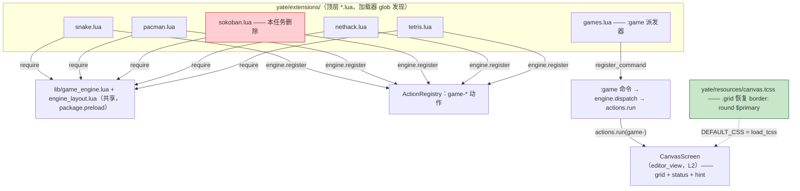

# remove-sokoban-restore-border 总纲

> 状态：已批准（无人值守时段自动批准，依据规则总纲的无人值守条款）
> 分支：`feat/games-pack`（worktree `../yate-games/`，即 `D:/Programming/yate-games`）
> 编制：主代理兜底执行 plan-architect-designer 剧本——spawn 失败
> （`Model "qwen-3.7-plus" not found`，CodeBuddy 会话无模型覆盖接口，
> `.codebuddy/agents/` 按总纲「子代理来源」条款禁作来源），如实标注「子代理零产出」。
> 日期：2026-10-21

## 一、目标

1. 从随包游戏组移除推箱子（sokoban）游戏的全部代码与设计信息：
   游戏本体、共享字形表中的推箱子专属字形、专测与引用点、双语手册中的
   全部条目（效果不理想，用户决定砍掉）。
2. 恢复前一版设计中最外层的细线边框：`yate/resources/canvas.tcss` 中
   `CanvasScreen .grid` 的 `border: round $primary;`（提交 `bbe88ae`
   "drop the canvas chrome" 移除；该提交同时加入的
   `CanvasScreen { overflow: hidden }` 必须保留，二者无耦合）。

## 二、非目标

- 不调整 pacman / snake 等其余游戏的画布尺寸或绘制逻辑；
- 不手改四个 changelog 生成文件（见 §四 否决路线 R1）；
- 不清理早于推箱子引入的未用字形（如 `player = "☻"`——除非实证为推箱子
  提交引入，否则属共享词汇表存量，超出本任务范围）；
- 不改 Python 侧 `yate/editor_view/canvas_screen.py`（边框恢复是纯 CSS）；
- 不推送（闭环内禁止 `git push`）。

## 三、子计划索引与执行波次

| 子计划 | 独占文件 | 波次 |
|---|---|---|
| [plan-a 移除推箱子代码与测试](remove-sokoban-restore-border-plan-a.md) | `yate/extensions/sokoban.lua`（删）、`yate/extensions/lib/engine_layout.lua`、`tests/test_lua_game_sokoban.py`（删）、`tests/test_lua_games_visual.py`、`tests/test_lua_games_app.py`、`tests/test_lua_engine.py` | wave-1 |
| [plan-b 移除推箱子设计信息（双语文档）](remove-sokoban-restore-border-plan-b.md) | `yate/docs/games.en.md`、`yate/docs/games.zh.md`、`yate/docs/extensions.en.md`、`yate/docs/extensions.zh.md` | wave-1 |
| [plan-c 恢复画布细线边框](remove-sokoban-restore-border-plan-c.md) | `yate/resources/canvas.tcss` | wave-1 |

**波次表**：`wave-1: plan-a ∥ plan-b ∥ plan-c`（三者文件互不重叠、可独立
验收）→ `wave-2: 收尾门禁（主代理亲自跑，见 §六）`。

执行方式说明：`plan-executor` 未派发——`subagent-workflow.md` 的文件独占条款禁止
成员修改产品源码（`yate/`），而本任务实现面几乎全部位于 `yate/`；由主代理
按 plan-executor 剧本亲自执行三个子计划。

## 四、备选方案与否决理由

- **R1 changelog 手改**：根 `CHANGELOG.md` / `CHANGELOG.zh.md` 与
  `yate/resources/changelog.*.md` 由 `python -m tools.changelog` 从 git
  历史生成，文件头声明 "do not edit by hand"。推箱子的历史提交仍在分支
  历史中，本次移除提交本身会在下次再生时成为新条目，历史自洽。
  **否决**：手改违反生成器契约，且下次再生即被复活。
- **R2 只删 `box` 系、保留 `light` 字形**：`git log -S` 实证
  `light`/`box`/`box_on_goal`/`goal` 四个字形全部由推箱子提交 `ceaaabb`
  引入，且现无任何游戏使用（字面量与 `engine.glyph.*` 双口径扫描）。
  **否决**：保留即遗留死设计信息，与「移除推箱子相关设计信息」直接冲突。
- **R3 边框恢复时顺带缩小 pacman/snake 画布**：pacman 是 edge-to-edge
  39x23 设计（9ec3e48，晚于边框删除），恢复边框后 80x24 端子上外框会先
  于网格被裁切。**否决**：该裁切语义与用户点名要恢复的「前一版设计」完全
  一致（当时 snake 已是 80x24 自带边框），改尺寸属擅自扩权。
- **R4 实现拆给并行 plan-executor 成员**：见 §三执行方式说明。
  **否决**：成员禁改 `yate/` 产品源码，拆分只对 tests/ 成立且与代码删除
  强耦合，拆了反而引入顺序风险。
- **R5 合并为单笔提交**：三个子计划验收面独立（代码测试 / 文档 lint /
  canvas 冒烟）。**否决**：按提交纪律每步产物单独提交，scope 各自可溯。

## 五、业务流程与改动位置（Mermaid）



删除 `sokoban.lua` 后发现链零改动：加载器按顶层 glob 发现、
`engine.games()` 按已注册 `game-*` action 动态枚举，二者均无需改动。

## 六、收尾门禁（wave-2，主代理亲自跑，统一并行口径）

```powershell
Set-Location D:/Programming/yate-games
.venv/Scripts/python.exe -m pyright yate/ tests/ tools/ pack/
.venv/Scripts/python.exe -m pytest tests/ -q -n auto
.venv/Scripts/python.exe -m pytest tests/test_architecture.py -q
.venv/Scripts/python.exe -m pytest tests/ --cov=yate --cov-branch -n auto
.venv/Scripts/python.exe -m tools.smoke_test run --jobs 4
.venv/Scripts/python.exe -m tools.lint_lua
```

注意：所有命令必须先 `Set-Location` 到 worktree——`python -c` /
`pytest` 会把 cwd 插到 `sys.path` 前列，从主仓根执行会遮蔽成主仓代码
（本会话实测踩坑：`.venv` 自检打印出 `D:\Programming\yate\yate\__init__.py`）。

沙箱自证（已实测通过）：`.venv/Scripts/python.exe -c "import yate; print(yate.__file__)"`
→ `D:\Programming\yate-games\yate\__init__.py`（.venv 曾整体重建一次）。

## 七、风险清单与回滚

| 风险 | 缓解 | 回滚 |
|---|---|---|
| 删 `sokoban.lua` 后动态派发清单变化导致期望串测试失败 | plan-a 同步改 `test_lua_engine.py` 两处期望串 | 按文件 revert 单笔提交 |
| 边框恢复后小端子裁切观感 | 与前一版设计语义一致（R3），`overflow: hidden` 保留不滚动 | 单行 revert（plan-c） |
| 字形误删破坏在用游戏 | 仅删 `git log -S` 实证 ceaaabb 引入且零引用的四个字形；删除后跑全量 lua 测试 | 按文件 revert |
| 文档双语失同步 | plan-b 两语文件同批改、同批验（grep 断言两侧零 sokoban） | 按文件 revert |
| 覆盖率跌破 75（删专测减行数） | 删除的测试与被删代码同源，覆盖分子分母同步缩小；wave-2 实测数字回填 | 不适用（如实上报） |

## 八、提交拆分

1. `docs(plans): plan the sokoban removal and border restore`（本总纲 + 3 子计划）
2. `feat(games): remove the sokoban game from the bundled pack`（plan-a）
3. `docs(games): drop sokoban from the bundled game pack docs`（plan-b）
4. `fix(games): restore the thin border around game canvases`（plan-c）
5. 评审修复（如有）+ `docs(plans): backfill the sokoban removal and border restore results`

## 九、执行记录（回填区）

- **wave-1 执行**（2026-10-21，主代理）：三个子计划全部落地并单独提交——
  plan-a `14c31d5` + `5a24001`（拆分原因见 plan-a 回填）、plan-b `a67ee59`、
  plan-c `54a044b`；各子计划验收与回填见其 §七。
- **wave-2 门禁**（主代理亲自跑，统一并行口径，全部退出码 0）：
  | 门禁 | 实测 |
  |---|---|
  | `pyright yate/ tests/ tools/ pack/` | `0 errors, 0 warnings, 0 informations` |
  | `pytest tests/ -q -n auto` | 全过（含少量平台 skip） |
  | `pytest tests/test_architecture.py -q` | 36 passed |
  | `pytest tests/ --cov=yate --cov-branch -n auto` | 总覆盖 **91.96%**（≥75 达标） |
  | `tools.smoke_test run --jobs 4` | 112/112 场景、1354/1354 检查（126.94s） |
  | `tools.lint_lua` | `0 issue(s)` |
- **偏离记录**（全部显式登记）：
  1. `plan-architect-designer` spawn 失败（`Model "qwen-3.7-plus" not found`；
     本会话无模型覆盖接口，`.codebuddy/agents/` 按总纲禁作来源）→ 主代理按
     剧本亲自完成方案，标注「子代理零产出」；
  2. `plan-executor` 未派发：`subagent-workflow` 文件独占条款禁止成员修改
     `yate/` 产品源码，而实现面几乎全在 `yate/` → 主代理按剧本亲自执行；
  3. plan-a 因 `git add` pathspec 失败拆为两笔提交（不 amend）；
  4. 任务中途 merge `f43870a`（mdlint 分支）推进了分支：核对目标文件零波及、
     行号全部重验；新合入的 mdlint 规则对本任务新增文档生效——13 处违规修复
     至 0（`yate/docs` 存量债按约定不做专项清扫）；
  5. 残留扫描裁定：4 个 changelog 生成文件（否决路线 R1，生成器契约）与
     历史计划文档（`.trae/documents/games-pack-plan.md` 及其子计划、本任务
     自身的移除计划）保留——先例：`split-app-protocol-plan.md` 作为已删除
     `app_features/` 的历史记录留存；产品面（代码/测试/手册）零残留。
- **评审结论**：`code-review-expert`（reviewer）spawn 成功但两次探活无回信，
  按子代理纪律判死、零产出，主代理按剧本兜底完成审核（未重建团队）：
  - blocker / major：无；
  - 残留扫描：`git grep -i sokoban` 命中面 = 4 个 changelog 生成文件 + 历史
    计划文档 + 本任务计划，产品面（`yate/` 代码、`tests/`、双语文档）零残留；
  - 字形清理：`git log -S` 实证 light/box/box_on_goal/goal 均由推箱子提交
    `ceaaabb` 引入，删除后全仓 lua 测试与 lint 全绿，无悬空引用；
  - 双语一致：games.zh/en、extensions.zh/en 镜像改动，重编号后无锚点悬空；
  - 边框恢复：pilot 探针断言 `border_top == ('round', ...)`，`overflow: hidden`
    保留，bbe88ae 的裁切语义未破坏；
  - 提交规范：5 笔提交均符合 `type(scope): subject` 全英文格式；
  - 门禁：主代理亲跑六道全绿（见上表）；
  - minor 登记：games.en.md:38 usage 表格行 102 列仍超 MD013 的 100 列
    （存量债，单元格含运行时字面串不可折行，随下次修改逐步迁移）。
