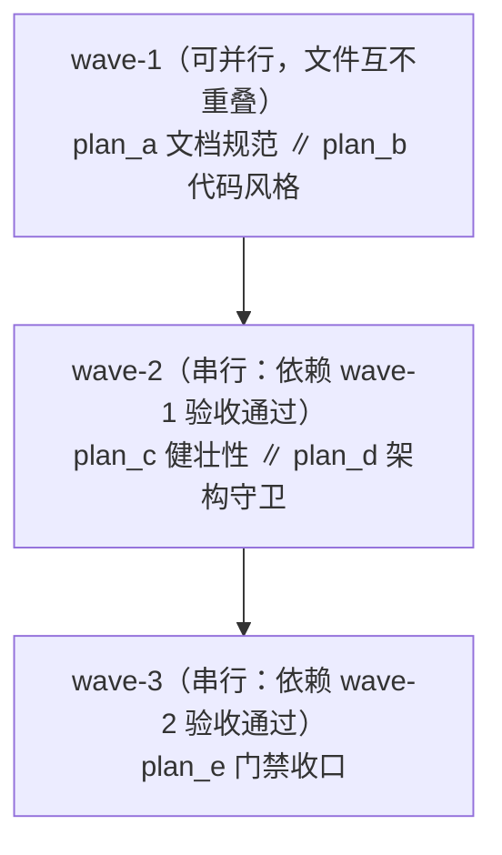
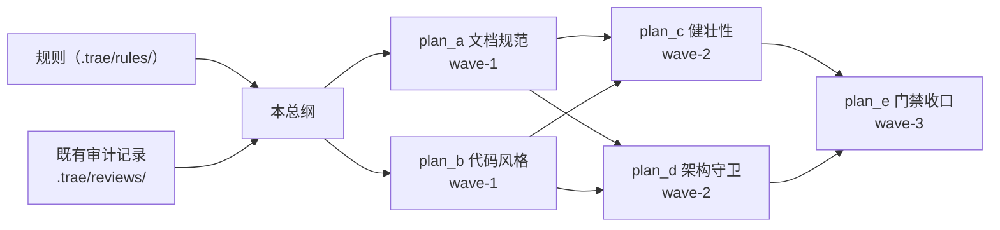

# repo-audit-r2 总纲：全仓多维度深度审核与修复方案

- 分支：`ref/repo-audit-r2`（worktree `../yate-repo-audit-r2`）
- 阶段：**只出方案**（不改 `yate/`、不改 `tests/`）；本目录下全部文档待批准后方可执行
- 唯一规范来源：`.trae/rules/`（8 个规则文件）、`.trae/agents/plan-architect-designer.md`
- 取证方式：主代理亲跑的只读探针（一次性脚本置于 `.tmp_probe/`，验证后删除，**不入库**——
  依据 `misc-rules.md` §二）

---

## 一、目标与非目标

### 目标

对 yate 全仓做一轮**新的**多维度审核（12 个维度，见 §五 覆盖矩阵），对每个新发现产出
**可直接执行的修复方案**（定位到 `文件:行号`、含详细测试用例与可执行验收命令），
并按 `plan-architect-designer.md` 的规模纪律拆成互不重叠的子计划 + 严格波次。

### 非目标（硬边界）

- **不做**结构性重构（`editor_view/` 子域化、`tools/pack` 改名、`editor.py` 拆分）——
  既有审计 [`2026-10-17-repo-structure-layering-audit.md`](../../reviews/2026-10-17-repo-structure-layering-audit.md)
  §四 已判定为「另案立项」，本轮不重开。
- **不做**工作区信任门控 —— F-4 已由仓库拥有者终局裁决（`2026-10-16-full-repo-audit.md`
  §三「2026-10-17 增记」：`2cb30cc` 已 revert），本轮只把它**记为已知取舍**。
- **不做**无 profiler 实测的性能优化（`python-coding-style.md` §6.3 第 1 条）。
- **不新增** `Protocol` / `TYPE_CHECKING` / `Any` 滥用 / `EventBus`（R2 / R6 / §三.1）。

---

## 二、与既有审计的关系（不重复既有结论）

已修复、本轮**复核为零漂移**、不再列为待修的项：

| 既有编号 | 内容 | 本轮复核 |
|---|---|---|
| F-1 | `editor_term/emulator.py` EL1 pen 越界 | 已修：`emulator.py:597` `col = min(col, self.cols - 1)` |
| F-2 | `S`/`T` count 无上界 | 已修：`emulator.py:676,681` 钳 `min(count, bottom - top + 1)` |
| C-1 | §一 依赖图漏画 L2→L3 例外 | 已修：`architecture-boundaries.md:102` 已有 `EV -.-> EXTF` 虚线 |
| C-2 | R12 UI-free 清单漏 `dist_meta.py` | 已修：`architecture-boundaries.md:402` 已列 |
| C-3 | `tests/README.md` 模块计数过期 | 已修（提交 `a9fbebf`） |
| C-4 | emulator S/T 钳制语义 | 已修（提交 `cab9fa3`） |
| C-5 | `keymaps/keys.py` 尾空行 | 已修（提交 `6c92695`） |
| C-6 | §一 清单少 3 个名字 | 已修（提交 `b4df3d8`，`__main__.py`/`yaterc*` 已补） |
| S-1/S-2 | keymaps 层秩 / L2→L3 登记 | 已修（提交 `c525d70`/`e13cce3`） |

**本轮实测复核（架构守卫面）**：`_LAYER_RANKS` + AST 导入图实测向上连线 **3 条**——
`editor_view/statusbar.py → yate.services.extensions`（含 `.bridges`，2 条，在
`UPWARD_EDGES_FROZEN` 内，合规）与 `extensions/python_lsp.py → yate.services.extensions`
（1 条，**插件按 §一 插件条目豁免**，且 `tests/test_architecture.py`
`test_no_unregistered_upward_imports` 显式跳过 `extensions/`，守卫与规则文本一致）。

---

## 三、子计划索引

| 波次 | 子计划 | 主题 | 触碰维度 | 独占文件数 |
|---|---|---|---|---|
| wave-1 | [`repo-audit-r2-doc-hygiene-plan-a.md`](repo-audit-r2-doc-hygiene-plan-a.md) | 文档/注释规范与真实路径脱敏 | 11、12 | 3 |
| wave-1 | [`repo-audit-r2-code-style-plan-b.md`](repo-audit-r2-code-style-plan-b.md) | 行宽、可维护性残留、命名纪律 | 4、11、12 | 5 |
| wave-2 | [`repo-audit-r2-robustness-plan-c.md`](repo-audit-r2-robustness-plan-c.md) | 静默吞异常、定时器生命周期 | 1、5 | 4 |
| wave-2 | [`repo-audit-r2-architecture-plan-d.md`](repo-audit-r2-architecture-plan-d.md) | 架构守卫缺口（新增 3 条用例 + 规则同步） | 9 | 3 |
| wave-3 | [`repo-audit-r2-telemetry-plan-e.md`](repo-audit-r2-telemetry-plan-e.md) | 门禁可绕过弱点（覆盖率/冒烟接入） | 10 | 3 |

## 四、执行波次表（调度唯一依据）



| 波次 | 并行单元 | 进入条件 | 退出条件（全部满足才进下一波） |
|---|---|---|---|
| wave-1 | `plan_a ∥ plan_b` | 方案批准 | 两份子计划的验收命令**退出码均为 0** |
| wave-2 | `plan_c ∥ plan_d` | wave-1 退出条件满足 | 两份子计划的验收命令**退出码均为 0** |
| wave-3 | `plan_e` | wave-2 退出条件满足 | 全量门禁（pyright + pytest + 架构 + 覆盖率 + 冒烟）**退出码 0** |

**文件互不重叠性核对**（wave-1）：

- `plan_a`：`tools/probes/win32im_probe.py`、`tests/test_cells.py`、
  `tests/test_lua_extensions.py`
- `plan_b`：`tools/smoke_test/scenarios/files.py`、
  `tools/smoke_test/scenarios/workspace_nav.py`、`tests/test_app_find.py`、
  `.trae/documents/ext-api-parity-plans/plan_a.md`…`plan_d.md`（改名）

wave-2 的 `plan_c` 与 `plan_d` 独占文件无交集（见各子计划「独占文件清单」节）。

**波次表一经批准不得在执行中临时重排**；确需调整须回填本文件并写明实测依据
（`task-orchestration.md` §二第 6 步）。

---

## 五、维度覆盖矩阵（12 维度逐项留痕）

> 每格给出：核对范围 / 结论（零发现也留痕，写明核对了什么、依据什么）。
> 全部依据为主代理亲跑的只读探针输出，见 §七。

| # | 维度 | 核对范围（命令/文件） | 结论 |
|---|---|---|---|
| 1 | 功能正确性 | `editor_term/emulator.py:586-682`（erase/scroll/insert-delete 全钳制核对）、`editor_core/buffer.py:196-260`（undo 栈/越界钳制/MAX_UNDO_STEPS）、`editor_core/search.py:42-102`、`project_search.py:44-130`、`editor_lsp/manager.py:355-411`（定时器 pop + bg task 追踪 + shutdown 清理）、`editor_view/find_replace.py:342-402`、`diffview.py:157-181`、`manual.py:333-362` | **1 项 MAJOR 新发现**：3 处 `call_later` 防抖**缺卸载清理**（`plan_c`）。其余零发现：count/越界/空输入均有钳制；LSP `shutdown_all` 已 cancel 全部 `_change_timers`（`manager.py:621-623`） |
| 2 | 安全性 | `services/yxp.py:1-120`（`_DRIVE_RE`/zip-slip/摘要双校验）、`editor_view/theme_files.py:52-102`（exec 边界 + `_loaded_theme_files` 去重）、`extensions/loader.py:34-235`（A13 rollback scope + shadow 报告 + trust 门控 `loader.py:287-293`）、`services/extensions/lua/runtime.py:39-97`（chunkname 常量，无用户插值）、`services/shell.py:41-80`（shell=True 但 cwd 不入命令串）、`cli.py:375-400`（rc 执行路径） | **零新增缺陷**。7 项按「输入源→传播→汇点」逐一确认为**已知取舍或已缓解**：项目 rc 无条件 exec（仓库拥有者裁决，§二 非目标）；rc 声明扩展路径无条件加载（`loader.py:282-286` 注释明写 deliberate user action）；lua runtime 未收口 lupa 沙箱（既有 MINOR 观察项，本轮复核无变化） |
| 3 | 性能 | `editor_core/search.py:50-64`（每键全 buffer `finditer`）、`project_search.py:88-130`（`max_file_bytes=2MB` / `max_matches=2000` 封顶 + `progress` 回调）、`workspace.py:112-181`（`_dir_ignore_cache` mtime 键 + 上限清空）、`editor_term/emulator.py:630-682`（逐行平移）、`editor_core/buffer.py:234-240`（undo 上限 1000） | **零新增**。P-1~P-5 既有 MINOR 全部仍在位且**已有封顶/缓存**，无 profiler 实测不做优化（`python-coding-style.md` §6.3 第 1 条）。新增可核对点：`project_search.py:121` 的 `max_matches - total` 在 `total` 触顶后可能为负 —— 但 `:128` 的 `if total >= max_matches: break` 已先行跳出，**实测不可达**，记为「已核对无问题」 |
| 4 | 可维护性 | `services/events.py:120-152`（`unsubscribe` 无去重，VS Code disposables 语义，docstring 明写）、`theme.py:128-158`（subscribe 去重 + 幂等退订）、`editor_core/search.py:42-48`（`_compile` 纯委托 `project_search.compile_query`，单一语义源） | **零新增结构性重复**。`plan_b` 处理 3 处行宽 + 1 处命名纪律残留（`ext-api-parity-plans/plan_a.md` 等 4 个下划线文件名，doc-conventions §一 硬性要求） |
| 5 | 健壮性 | 全仓 `except` handler AST 扫描（裸 `except` **0**）、44 处 `body=[Pass]` 静默块逐处读源、`editor_view/manual.py:175-230`（`MarkdownDocScreen`）、`diffview.py:157`、`find_replace.py:210` | **2 项 MAJOR 新发现**：(a) `MarkdownDocScreen` **无 `on_unmount`**，其 `_search_timer`（`manual.py:219`）在屏幕 dismiss 后仍会触发（`plan_c`）；(b) 既有 F-7 的 4 处静默吞异常**仍未修**（`manager.py:367`、`manager.py:446`、`user_setup.py:279`、`fonts.py:226`）—— 属**既有问题的残留**，本轮收口（`plan_c`） |
| 6 | 可扩展性 | `architecture-boundaries.md` §三.8 接入清单 6 步逐项核对（`editor.py` 类属性声明 / `_build_*` 工厂构造 / 组装注释 / `UI_FROZEN_FILES` 登记）、`services/extensions/__init__.py` 门面 14 名、`flows/__init__.py` 回调别名表 | **零发现**。实测 `flows/` **零** `yate.editor`/`yate.app`/`yate.actions`/`yate.commands` 导入（探针 p4），接入清单成立 |
| 7 | 项目结构合理性 | `yate/` 140 模块目录树、`tools/` 8 子包、`tests/` 平铺、`pack/` vs `tools/pack/` 同名 | **零新增**。S-3（`editor_view` 平铺）/S-5（`pack` 同名）为既有「另案立项」，本轮不重开（§一 非目标） |
| 8 | 模块职责单一性 | `splitlines()` 口径全仓排序、`SIZE_EXEMPT_FILES`（`tests/test_architecture.py:335-341`）与规则 §三.7 名单逐项对照 | **零漂移**。实测 >800 行恰 5 个：`keymaps/vim.py` 1184、`editor_core/buffer.py` 1069、`editor.py` 1023、`editor_syntax/langdefs.py` 813、`tools/pack/wiki.py` 1495 —— 与豁免名单**逐项一致**。逼近阈值观察项 `services/yxp.py` 705 / `editor_view/panes.py` 694（既有登记，本轮复测一致） |
| 9 | 架构边界 R1–R14 | 实测向上连线（探针 p4）、`_LAYER_RANKS` / `UPWARD_EDGES_FROZEN` / `UI_FREE_PACKAGES` / `UI_FREE_FILES` / `UI_FROZEN_FILES` / `EXTENSION_SUBMODULE_FROZEN` 六张表全量比对、R1–R14 逐条 grep | **零违规**，但发现 **3 处守卫缺口**（`plan_d`）：见 §六 A-1~A-3 |
| 10 | 门禁规则 | `.github/workflows/test.yml` 全 125 行、`pyproject.toml:120-159`、`tests/test_architecture.py` 32 用例清单 | **1 项 MAJOR 新发现**：覆盖率门禁 `--cov-fail-under=75` **只存在于 CI 命令行**，本地 `pytest tests/ -q` **完全不触发覆盖率**（`pyproject.toml:127-132` 注释明写这是刻意设计）；`--cov-fail-under` 缺席时无任何本地兜底（`plan_e`）。冒烟 `tools.smoke_test` **不在 CI 任何 job 内**（`plan_e`） |
| 11 | 代码与文档规范 | `from __future__` 全覆盖（**0 缺失**）、行宽 >100 扫描、`# type/pyright: ignore` 20 处逐处读理由注记、裸 `except`/`import *`/`== None`/可变默认参数扫描、中文注释扫描（misc-rules §四） | **3 项新发现**：`tools/probes/win32im_probe.py:7` **本机真实路径**（doc-conventions §五 明文禁止，`plan_a`）；`tests/test_cells.py:68` + `tests/test_lua_extensions.py:470` **注释含非 ASCII 全角字符**（misc-rules §四，`plan_a`）；4 处行宽 >100（`plan_b`）。`editor_syntax/engine.py:83` 等 20 处类型忽略**理由注记全部完备**（逐处核对），核对通过 |
| 12 | 其它规则纪律 | `git log` 最近 40 条全 conventional 英文、`.trae/agents` 与 `.trae/skills` 唯一来源、相对导入扫描（**0**）、PEP 695 `type` 语句守卫、无 `*Feature/*Host/*Ops/*Delegate/*Controller` | **1 项残留**：`.trae/documents/ext-api-parity-plans/plan_a.md`…`plan_d.md` 四个下划线分词文件名违反 doc-conventions §一（「不得新增下划线风格」；存量随下次修改迁移，`plan_b`）。2026-10-16 审计 F-11（`readonly-feature` 文件名）复核仍在位，登记不修（存量证据附件，同 F-10 口径） |

---

## 六、发现汇总（全部为**新**或**既有问题的残留**，逐条带 `文件:行号`）

### MAJOR

| 编号 | 发现 | 位置 | 关系 |
|---|---|---|---|
| M-1 | `MarkdownDocScreen` 缺 `on_unmount`，`_search_timer` 在屏幕 dismiss 后仍触发 | `yate/editor_view/manual.py:219`、`:333-345`；对比 `find_replace.py:210-213`、`diffview.py:157-161` | **全新** |
| M-2 | F-7 的 4 处实质静默吞异常仍未修（无 log 无反馈，字面违反 `python-coding-style.md` §4.5 第 3 条） | `yate/editor_lsp/manager.py:367`、`:446`；`yate/services/user_setup.py:279`；`yate/services/fonts.py:226` | **既有问题的残留**（`2026-10-16-full-repo-audit.md` §二 维度 5 F-7） |
| M-3 | 覆盖率门禁只在 CI 命令行；本地 `pytest tests/ -q` 无任何覆盖率兜底 | `pyproject.toml:127-132`、`.github/workflows/test.yml:82` | **全新**（口径缺口） |
| M-4 | 冒烟 `tools.smoke_test` 完全不在 CI 门禁面内 | `.github/workflows/test.yml` 全 125 行（无 smoke job） | **全新** |

### MINOR

| 编号 | 发现 | 位置 | 关系 |
|---|---|---|---|
| m-1 | 探针脚本含**本机真实路径** `d:\Programming\yate\.venv\...` | `tools/probes/win32im_probe.py:7` | **全新**（doc-conventions §五） |
| m-2 | 注释含非 ASCII 全角字符（misc-rules §四 要求注释全英文） | `tests/test_cells.py:68`（含全角括号 `（）`）、`tests/test_lua_extensions.py:470`（含全角 `§` 的 `§三.5` 引用残留在 ASCII 形态 `??.5`） | **全新** |
| m-3 | 4 处行宽 >100 字符 | `tools/smoke_test/scenarios/files.py:12`(104)、`workspace_nav.py:30`(106)、`tests/test_app_find.py:1`(112)、`tools/probes/win32im_probe.py:7`(107) | **全新**（`python-coding-style.md` §1.1 行宽 100） |
| m-4 | `.trae/documents/ext-api-parity-plans/` 4 个下划线分词子计划文件名 | `plan_a.md`…`plan_d.md` | **既有残留**（F-12） |

### 架构守卫缺口（MAJOR，归 `plan_d`）

| 编号 | 缺口 | 依据 |
|---|---|---|
| A-1 | 无守卫覆盖 **`print()` 用于调试**。实测 `yate/` 内 2 处（`cli.py:266-372` 共 12 处为 CLI 正常输出、`diagnostics.py:125`、`logs.py:104`），均正当；但 `python-coding-style.md` §4.6 明文「禁止 `print()` 用于调试」，无任何 AST 守卫防回潮 | `python-coding-style.md` §4.6；`tests/test_architecture.py` §六 32 用例清单无对应项 |
| A-2 | 无守卫覆盖 **misc-rules §四「注释与代码内注解文档一律英文」**。实测 2 处非 ASCII 注释通过全部门禁（见 m-2），证明缺口真实存在 | `misc-rules.md` §四 |
| A-3 | 无守卫覆盖 **doc-conventions §五「真实路径脱敏」**。实测 m-1 通过全部门禁，证明缺口真实存在 | `doc-conventions.md` §五 |

---

## 七、取证命令（只读，主代理亲跑）

```powershell
# 门禁基线（本轮不重跑覆盖率/冒烟——方案阶段禁止；下列为只读探针）
.venv\Scripts\python.exe -c "import pathlib;print(len(list(pathlib.Path('yate').rglob('*.py'))))"   # → 140
.venv\Scripts\python.exe .tmp_probe\p1.py excepts      # 裸 except / 静默块扫描
.venv\Scripts\python.exe .tmp_probe\p1.py ignore       # 类型忽略点
.venv\Scripts\python.exe .tmp_probe\p1.py future       # from __future__ 覆盖
.venv\Scripts\python.exe .tmp_probe\p2.py               # 行宽/可变默认参数/==None/import *
.venv\Scripts\python.exe .tmp_probe\p3.py               # 绝对路径扫描
.venv\Scripts\python.exe .tmp_probe\p4.py               # 向上连线 + flows 越层导入
```

`.tmp_probe/` 为临时目录，**方案批准后、执行开始前删除**（`misc-rules.md` §二）。

---

## 八、依赖关系图



## 九、批准与回滚

- **批准**：本总纲 + 5 份子计划经用户确认后，按 `task-orchestration.md` §二 第 3 步进入执行。
- **回滚**：每个子计划独立提交（`git-commit-message.md`：`type(scope): subject`，全英文），
  回滚 = `git revert <commit>`；`plan_a`~`plan_d` 为纯增量（新增守卫用例 + 注释/行宽修正 +
  新增 log），不改变运行时行为，回滚零风险；`plan_e` 改 `pyproject.toml` 与 CI 配置，
  回滚需重跑一次全量门禁确认。
