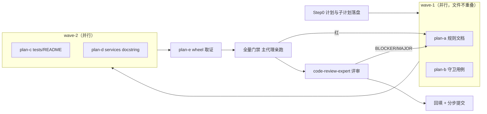

# repo-structure-layering-audit-review-fixes-plan

- 来源：[`../reviews/2026-10-17-repo-structure-layering-audit.md`](../reviews/2026-10-17-repo-structure-layering-audit.md)
  （2026-10-17 仓库结构 / 分层 / 模块组织审计；S-1…S-11 编号沿用该记录）
- 子计划目录：[`repo-structure-layering-audit-review-fixes-plans/overview.md`](repo-structure-layering-audit-review-fixes-plans/overview.md)
  （本主计划定范围与波次，**逐处改动细节以子计划为唯一规范来源**）
- 分支：`enh/full-repo-audit`（worktree `../yate-full-repo-audit` @ `5a7e703` + 计划提交）
- 日期：2026-10-17
- 状态：**已批准执行**（用户指令"拆分详细的子计划，再走闭环流程执行"，2026-10-17）
- 唯一规范来源：本计划 + 子计划目录 + [`../rules/`](../rules/) 全 8 个规则文档（起草前已逐个精读）

## 一、目标与非目标

**目标**（全部为口径/登记/文档一致性修复 + 新增 1 条守卫，不改产品行为）：

1. **S-1**（MAJOR）：`keymaps/base.py`（L0）运行期 `import yate.session`（L1）与规则 §一 L0
   定义冲突 —— **保留既有层秩切分（按文件切分）并登记该例外**，同时把它变成守卫白名单
   （子计划 a + b）。**不重排层秩**，理由见 §四 方案 B 否决；
2. **S-2**（MAJOR）：`editor_view/statusbar.py`（L2）取 L3 扩展门面 —— 登记 L2→L3 例外并纳入同一
   守卫白名单（子计划 a + b）；
3. **S-6 / S-7 / S-8 / S-4**（MINOR）：文档与规则一致性 —— `tests/README.md` 失效路径、
   `editor_view/theme.py` 门面例外、`dist_meta.py` 层级与守卫面、`services/` 门户 docstring 与
   `yxp.py` 归属（子计划 a / c / d）；
4. **S-11**（INFO）：wheel 资源清单纯只读取证（子计划 e）。

交付物形态（硬性）：

- 修复完成后回填本计划 §七 执行记录（真实数字、步骤-提交对照、负向演练输出、wheel 结论、偏离记录），
  并同步审计记录 §四 处置列（S-1/S-2/S-6/S-7/S-8 → 已修；S-4 → 规则与文档侧已修、代码结构侧登记）；
- 每步产物单独提交（`git-commit-message.md`），闭环内**只提交不推送**。

**非目标**（本轮硬性排除，另案立项）：

- **S-3** `editor_view/` 24 模块子域化拆分（牵动 R9 widget id 与 `yate/resources/*.tcss` 选择器、
  `UI_FROZEN_FILES` 键路径）；
- **S-5** `tools/pack/` 与根 `pack/` 同名消歧改名（牵动 `python -m tools.pack` 的全部引用与 CI/文档）；
- **S-9** `yate/editor.py`（1024 行）拆分（审计记录已登记为既有 big-module-split 候选）；
- **S-10**（`tests/` 平铺）与 6 包导入环（INFO）：本轮仅登记，不做结构改动；
- 不新增架构概念；只同步既有规则文本与实现、并补守卫。

## 二、调研取证（本轮实测，worktree 沙箱 `.venv`）

| 取证点 | 实测 | 依据 |
|---|---|---|
| 基线门禁 | `pyright yate/ tests/ tools/` → 0/0/0 exit 0；`pytest tests/test_architecture.py -q` → 31 passed | 亲测 |
| S-1 反例与契约 | `yate/keymaps/base.py:17` `from yate.session import EditorSession`；`:230,233` `ActionContext(session, ui)`；`:191` `type ActionFunc = Callable[[ActionContext], None]`、`:203` `KeyBinding.action: str \| ActionFunc` | 亲测 |
| S-1 下游使用面 | `yate/keyproto/legacy.py:11` `from yate.keymaps.base import SPECIAL_KEYS`（L0 依赖键映射契约表） | 亲测 |
| S-1 实现方自述 | `yate/registries.py:5-6` "…``keymaps.base`` itself imports :mod:`yate.session`" | 亲测 |
| S-2 耦合形态 | `yate/editor_view/statusbar.py:29-30` 两条 import；`:83-84` 构造参数注入（类型注解级，无运行期实例化） | 亲测 |
| 层秩实测（定稿表） | 在"`keymaps/base\|vim\|vsc`=L0、`keymaps/__init__.py` 与 `keymaps/registry.py`=L1、`extensions/` 不参与层秩"的表下，全仓向上连线**恰 3 条**：`keymaps/base.py -> yate.session`、`editor_view/statusbar.py -> yate.services.extensions`、`editor_view/statusbar.py -> yate.services.extensions.bridges` | 亲测（守卫同款算法） |
| 插件面 | `yate/extensions/python_lsp.py:34` 只 `from yate.services.extensions import ExtensionAPI`（门面），其门面纪律由 R14 守卫覆盖 | 亲测 |
| Fix-A 落点 | §一 Mermaid L0 节点（`:64-65`）、§一 L1 文本（`:24-26`）、§一 L0 文本（`:27-33`）、§二 L0 行（`:211`）、§三.5②（`:222-224`）、R14 条目末尾、§六 R4（`:348`）/UI-free 说明（`:370`）、§六 用例计数（`:292`）与文末对照表 | 亲测 |
| Fix-D 落点 | `tests/test_architecture.py`：`UI_FREE_FILES:138`、`ALLOWED_PROTOCOLS:117-121` 之后为常量区、辅助 `_yate_files`/`_yate_imports:319-337`、`leaf_packages:1038`；实测 `def test_` 共 **31** | 亲测 |
| Fix-C1 落点 | `tests/README.md:6`、`:22`（`overlays.py`）、`:26`（`yate/services/extensions.py`）；覆盖表仅列 7 个根模块，实测 92/139 模块无同名测试 | 亲测 |
| Fix-C3 落点 | `yate/services/__init__.py:1` docstring 仅列 3 项，实际 10 模块 | 亲测 |
| S-11 现状 | `pip show hatchling` → 未安装；`yate/resources/`、`yate/docs/` 无 `__init__.py`；`pyproject.toml:166-172` 注释声明 hatchling 自动包含包内非 Python 文件 | 亲测 |

## 三、修复项 × 落点矩阵

| 编号 | 审计项 | 改动面 | 子计划 |
|---|---|---|---|
| Fix-A | S-1 登记 L0→L1 例外（不改层秩切分） | `.trae/rules/architecture-boundaries.md` | a |
| Fix-B | S-2 登记 L2→L3 门面例外 | 同上 | a |
| Fix-C2 | S-7 `editor_view/theme.py` 门面例外登记 | 同上 | a |
| Fix-C4 | S-8 `dist_meta.py` 层级（规则侧 + 守卫面） | 同上 + `tests/test_architecture.py` | a + b |
| Fix-C3 | S-4 `yxp.py` 归属（规则侧）+ 门户 docstring（代码侧） | 同上 + `yate/services/__init__.py` | a + d |
| Fix-C1 | S-6 `tests/README.md` 失效路径与覆盖表口径 | `tests/README.md` | c |
| Fix-D | S-1/S-2 可执行化：层秩向上连线白名单守卫（第 32 用例） | `tests/test_architecture.py` | b |
| Fix-D2 | S-11 wheel 资源清单只读取证 | 无（临时目录产物） | e |

## 四、备选方案与否决理由

- **方案 A（采纳）**：**保留 §一 既有层秩切分**（`keymaps/base|vim|vsc` = L0；
  `keymaps/registry.py` 与包根 = L1），把 `keymaps/base.py -> yate.session` 与两条
  `editor_view/statusbar.py -> L3 门面` 登记为例外，并新增"层秩向上连线白名单"守卫把三条例外冻结；
  其余为文档一致性修复（子计划 a/b/c/d/e）。
  理由：三条例外都是**设计上必要**的耦合（键映射契约承载 `ActionContext`；状态栏需要扩展状态段），
  登记 + 守卫即可消除"漂移无守卫"这一根因；改动面最小、行为零风险。
- **方案 B（否决）**：把 `keymaps/` 整体重排为 L1（主计划 v1 的 Fix-A 原方案）。
  否决理由（**执行前实测新增证据**）：`yate/keyproto/legacy.py:11`（L0）依赖
  `keymaps.base.SPECIAL_KEYS`；重排后该边变成新的向上连线，需再开一条例外——本类问题只是换了命名面，
  而规则改动面反而更大（Mermaid ×2、§一 L1/L0 文本、§二 表格、§三.5③ 的叶包清单、守卫 docstring
  与 `leaf_packages` 语义）。实测对比：方案 A 下向上连线 3 条（与审计发现数一致）；方案 B 下为
  4 条（新增 `keyproto/legacy.py -> yate.keymaps.base`）。
- **方案 C（否决）**：代码侧重构 —— 把 `ActionContext` / `KeyUi` / `ActionFunc` / `ActionRunner`
  迁出 `yate/keymaps/base.py`，使 `keymaps` 成为真 L0。
  否决理由：`ActionFunc` 被 `KeyBinding.action`（`base.py:191,203`）引用，是该契约的组成部分；
  迁出后 `keymaps` 仍须 import L1（换汤不换药），否则退化为 `Callable[..., None]` 丢掉 pyright 约束；
  且会牵动 `actions.py` / `registries.py` / `editor.py` / `flows/*` 与插件手册示例。收益为负。
- **方案 D（否决）**：本轮一并做 S-3 / S-5 / S-9 结构性重构。
  否决理由：跨守卫面的多文件重构（R9 id 与 tcss 选择器、`UI_FROZEN_FILES` 键、CLI 与 CI 引用），
  审计记录已定性"另案立项"；混入本轮会使验收面失控，违反"仅修确证问题、禁止顺手重构"。
- **方案 E（否决）**：只改规则文本、不加守卫。
  否决理由：两处 MAJOR 的根因就是"规则与实现漂移且无守卫"（历史已两度漂移：R11 flows 枚举漏 2 文件、
  豁免行数 5 处），只改文本会再次漂移。

## 五、分步实施计划

### 5.0 执行流程图

### 5.1 子计划索引

| 波次 | 子计划（唯一规范来源） | 独占文件 |
|---|---|---|
| wave-1 | [`...-rules-plan-a.md`](repo-structure-layering-audit-review-fixes-plans/repo-structure-layering-audit-review-fixes-rules-plan-a.md) | `.trae/rules/architecture-boundaries.md` |
| wave-1 | [`...-guard-plan-b.md`](repo-structure-layering-audit-review-fixes-plans/repo-structure-layering-audit-review-fixes-guard-plan-b.md) | `tests/test_architecture.py` |
| wave-2 | [`...-tests-readme-plan-c.md`](repo-structure-layering-audit-review-fixes-plans/repo-structure-layering-audit-review-fixes-tests-readme-plan-c.md) | `tests/README.md` |
| wave-2 | [`...-services-init-plan-d.md`](repo-structure-layering-audit-review-fixes-plans/repo-structure-layering-audit-review-fixes-services-init-plan-d.md) | `yate/services/__init__.py` |
| wave-3 | [`...-wheel-probe-plan-e.md`](repo-structure-layering-audit-review-fixes-plans/repo-structure-layering-audit-review-fixes-wheel-probe-plan-e.md) | 无（只读取证） |

跨子计划一致性契约（守卫白名单逐字、用例计数 32、`extensions/` 跳过）见
[`overview.md` §三](repo-structure-layering-audit-review-fixes-plans/overview.md)。

### 5.2 子代理任务书要点（依据 subagent-workflow §二/§五）

- 唯一规范来源 = 分配给的**子计划**（含逐字锚点与目标文本）+ 总纲 §三；声明"以它为准，不要凭常识猜"；
- 权限：显式 `acceptEdits`（需跑命令时 `bypassPermissions`）；批大小 2（wave-1 两个成员，wave-2 两个成员）；
  spawn 后**同回合探活**；判死则主代理亲自执行并如实标注，最多变更配置后重试一次；
- 独占文件：只改分配文件，不得跨文件；
- 只认落盘结果：主代理复跑该成员名下验收命令（`git diff`、`pytest`、`pyright`、`Select-String`）后才算数；
- 报告格式：改动清单 + 命令与结果（含退出码）+ 未解决项与原因。

### 5.3 步骤与提交纪律

| 步骤 | 内容 | 提交信息 |
|---|---|---|
| Step 0 | 主计划 + 子计划目录落盘（本提交） | `docs(plan): split the audit review fixes into sub-plans` |
| Step 1 | wave-1：plan-a ∥ plan-b | `docs(rules): register the keymaps and statusbar layering exceptions` / `test(architecture): guard unregistered upward imports` |
| Step 2 | wave-2：plan-c ∥ plan-d | `docs(tests): fix the stale coverage map references` / `docs(services): list the service members in the package docstring` |
| Step 3 | plan-e wheel 取证（无提交，结论入文档） | — |
| Step 4 | 全量门禁（§六 验收命令） | — |
| Step 5 | code-review-expert 评审 + 迭代至无 BLOCKER/MAJOR | — |
| Step 6 | 回填本计划 §七 + 审计记录 §四 | `docs(plan): backfill the structure audit fix execution record` |

## 六、风险清单与回滚路径

| 风险 | 缓解 / 回滚 |
|---|---|
| 规则四处互引不同步（§一 Mermaid/§一 文本/§二 表/§六 计数） | plan-a 逐处锚点验收 + `keymaps`/`dist_meta` 命中数断言；回滚单笔 `git revert` |
| 守卫误报（层秩表与实际不符） | 白名单按实测 3 条冻结；未列明模块按 L0 计并在失败信息指引登记；负向演练 + 全量绿 |
| plan-a 与 plan-b 白名单措辞不一致 | 总纲 §三.1 逐字契约 + 主代理收口逐字比对 |
| docstring / 测试改动触发门禁 | 不适用纯文档豁免（misc-rules §三），按 §六 全量执行 |
| `pip wheel` 需网络 | 按 plan-e §二 兜底登记"未验"，不阻塞、不改依赖 |
| 子代理零产出 / 写盘受限 | 同回合探活；判死改主代理亲自执行并如实标注 |
| 顺手重构扩大范围 | 非目标清单硬性排除；评审阶段发现越界即回退 |

## 七、执行记录回填（待 Step 6 回填）

### 7.1 修订记录（执行前，含实测依据）

1. **Fix-A 由"重排 keymaps 为 L1"改为"登记 L0→L1 例外"**（v1 → v2）：执行前用守卫同款算法实测全仓
   向上连线，发现重排会新引入 `keyproto/legacy.py -> yate.keymaps.base`（`legacy.py:11` 依赖
   `SPECIAL_KEYS`），例外数量不减而规则改动面更大 → 采纳方案 A（见 §四 方案 A/B 对比）。
2. **新增 `extensions/` 跳过规则**：`yate/extensions/python_lsp.py:34` 只取门面（插件层），
   其门面纪律由 R14 守卫覆盖，故层秩守卫跳过 `yate/extensions/`（总纲 §三.3）。

### 7.2 门禁实测（待填）

| 门禁 | 基线 | 终态 |
|---|---|---|
| `pyright yate/ tests/ tools/` | 0/0/0，exit 0 | 待填 |
| `pytest tests/test_architecture.py -q` | 31 passed | 待填（期望 32） |
| `pytest tests/ -q` | 分支记录全绿 | 待填 |
| `pytest tests/ -q --cov --cov-fail-under=75` | 91.98%（分支记录） | 待填 |

### 7.3 步骤-提交对照 / 负向演练输出 / wheel 结论 / 偏离记录（待填）
