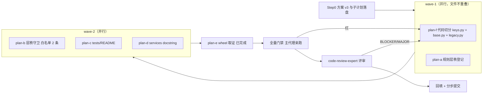

# repo-structure-layering-audit-review-fixes-plan

- 来源：[`../reviews/2026-10-17-repo-structure-layering-audit.md`](../reviews/2026-10-17-repo-structure-layering-audit.md)
  （2026-10-17 仓库结构 / 分层 / 模块组织审计；S-1…S-11 编号沿用该记录）
- 子计划目录：[`repo-structure-layering-audit-review-fixes-plans/overview.md`](repo-structure-layering-audit-review-fixes-plans/overview.md)
  （本主计划定范围与波次，**逐处改动细节以子计划为唯一规范来源**）
- 分支：`enh/full-repo-audit`（worktree `../yate-full-repo-audit`）
- 日期：2026-10-17（v3）
- 状态：**已批准执行**（用户 2026-10-17 指令："修改方案，最好能够分层切分清楚，但是不要违反规则"）
- 唯一规范来源：本计划 + 子计划目录 + [`../rules/`](../rules/) 全 8 个规则文档（起草前已逐个精读）

## 一、目标与非目标

**目标**：

1. **S-1**（MAJOR）—— **把层秩切分干净**（用户指令）：`keymaps/base.py` 目前 L0/L1 混层
   （键位记法 + 持有 `EditorSession` 的 `ActionContext`）。本轮**代码侧切分**：
   - 新建 `yate/keymaps/keys.py`（**L0**）：键位记法（`SPECIAL_KEYS` / `parse_key` / `key_name`），零上层依赖；
   - `yate/keymaps/base.py` 收敛为 **L1**：`Keymap` / `KeyBinding` / `KeyUi` / `ActionContext` /
     `ActionFunc` / `ActionRunner`，并为历史导入面再导出记法符号（向下再导出，合规）；
   - `yate/keyproto/legacy.py`（L0）改从 `yate.keymaps.keys` 取 `SPECIAL_KEYS` —— 切分后
     **全仓零 L0→L1 连线**，不需要任何 L0 例外；
2. **S-2**（MAJOR）：`editor_view/statusbar.py`（L2）读 L3 扩展门面 —— 登记 L2→L3 例外，
   成为切分后**全仓唯一的已登记向上连线**（子计划 a / b）；
3. **S-6 / S-7 / S-8 / S-4**（MINOR）：`tests/README.md` 失效路径、`editor_view/theme.py` 门面例外、
   `dist_meta.py` 层级与守卫面、`services/` 门户 docstring 与 `yxp.py` 归属（子计划 a / c / d）；
4. **S-11**（INFO）：wheel 资源清单取证 —— **已实测完成**（见 §七.3）。

**验收口径（硬性）**：切分后全仓向上连线**恰为 2 条**（均为 `editor_view/statusbar.py → yate.services.extensions`
与 `… → yate.services.extensions.bridges`），由新守卫 `test_no_unregistered_upward_imports`
冻结；`keymaps` 不再有任何 L0/L1 例外。

**非目标**（另案）：S-3 `editor_view/` 子域化、S-5 `tools/pack` 改名、S-9 `editor.py` 拆分、
S-10 `tests/` 目录化、6 包导入环重构；不新增架构概念。

## 二、调研取证（本轮实测，worktree 沙箱 `.venv`）

| 取证点 | 实测 | 依据 |
|---|---|---|
| 基线门禁 | `pyright yate/ tests/ tools/` → 0/0/0 exit 0；`pytest tests/test_architecture.py -q` → 31 passed | 亲测 |
| S-1 混层证据 | `yate/keymaps/base.py:17` `from yate.session import EditorSession`；`:29` `SPECIAL_KEYS`；`:97` `def parse_key`；`:155` `def key_name`；`:191` `type ActionFunc`；`:198` `KeyBinding`；`:230` `ActionContext` —— 记法族（1–189 行）与动作族（191 行起）**天然可切** | 亲测 |
| S-1 记法族外部引用 | `yate/keyproto/legacy.py:11` `from yate.keymaps.base import SPECIAL_KEYS`（**唯一 L0 消费者**）；`yate/keymaps/vim.py:39`、`yate/keymaps/__init__.py:20-21`、`tests/test_editor_core.py:29`、`tests/test_extensions.py:14`、`tests/test_input_assist.py:30` 亦取 `parse_key`/`key_name`（经兼容再导出可零改动） | 亲测 |
| S-1 动作族引用 | `ActionContext`：`actions.py:16` / `editor.py:58` / `registries.py:21`；`KeyUi`：`editor.py:58`；`KeyBinding`：`editor_view/modals.py:13` / `keymaps/vsc.py:7` / `services/extensions/api.py:20`；`ActionRunner`：`editor_view/palette.py:34` / `flows/overlay_flows.py:30`；`Keymap`：`keymaps/registry.py:14` / `vsc.py:7` / `services/extensions/api.py:20` | 亲测 |
| S-1 契约约束 | `KeyBinding.action: str \| ActionFunc`（`:203`）引用 `ActionFunc = Callable[[ActionContext], None]`（`:191`）→ 动作族必须同域，故 `base.py` 归 L1 | 亲测 |
| 层秩实测（v2 旧表，对照用） | 「`base\|vim\|vsc`=L0、registry/包根=L1」表下向上连线恰 3 条（含 `keymaps/base.py -> yate.session`） | 亲测 |
| 切分后预期 | 「`keys.py`=L0、`keymaps/` 其余=L1」表下，`keyproto/legacy.py → keys.py` 同层、`base.py → session` 同层 → 向上连线仅 statusbar 2 条 | 待 plan-f 落地后由守卫实测 |
| S-2 耦合形态 | `yate/editor_view/statusbar.py:29-30` 两条 import；`:83-84` 构造参数注入（类型注解级） | 亲测 |
| S-11 wheel | 隔离构建 `pip wheel . --no-deps` 成功（exit 0）：`yate/resources/` 25 项、`yate/docs/` 9 项、`yate/extensions/` 12 项、总条目 215 —— pyproject 声明成立 | 亲测（§七.3） |

## 三、修复项 × 落点矩阵

| 编号 | 审计项 | 改动面 | 子计划 |
|---|---|---|---|
| Fix-F | S-1 代码切分：记法下沉 `keymaps/keys.py`（L0），`base.py` 收敛 L1，`keyproto/legacy.py` 改指向 | `yate/keymaps/keys.py`(新) / `yate/keymaps/base.py` / `yate/keyproto/legacy.py` | f |
| Fix-A | S-1 层秩登记（新切分）+ S-8 `dist_meta.py` + S-7 `theme.py` 例外 + S-4 `yxp.py` 归属 | `.trae/rules/architecture-boundaries.md` | a |
| Fix-B | S-2 登记 L2→L3 门面例外 | 同上 | a |
| Fix-D | 层秩守卫（白名单 2 条 + `dist_meta.py` 入 UI-free 面） | `tests/test_architecture.py` | b |
| Fix-C1 | S-6 `tests/README.md` 失效路径与覆盖表口径 | `tests/README.md` | c |
| Fix-C3 | S-4 门户 docstring（代码侧） | `yate/services/__init__.py` | d |
| Fix-D2 | S-11 wheel 资源取证 | 无（已完成） | e |

## 四、备选方案与否决理由

- **方案 D（采纳）**：**记法下沉 + 动作族归 L1**（Fix-F）——`keys.py`(L0) 只放键位记法，
  `base.py`(L1) 放 `Keymap`/`KeyBinding`/`KeyUi`/`ActionContext`，`base.py` 为历史导入面再导出记法（向下）；
  L0 消费者（`keyproto/legacy.py`）改指 `keys.py`。
  理由：(1) 层秩**按文件切分清楚**，`keys.py` 是纯 L0、`base.py` 是纯 L1，不再混层；
  (2) **零例外**：切分后全仓向上连线只剩已登记的 statusbar 2 条；
  (3) 变更面极小（新增 1 文件 + base 内部搬移 + **1 行**跨模块改指向），其余引用点经兼容再导出零改动；
  (4) 由层秩守卫生效——将来 L0 代码若再 import `keymaps.base`，守卫立即判失败。
- **方案 A（否决，v2 原方案）**：保留 `base|vim|vsc`=L0 的切分，登记 `keymaps/base.py -> yate.session`
  为例外。否决理由：用户指令要求"分层切分清楚"；例外登记虽合规，但 L0 包内仍 import L1，
  层秩切分依旧混合（一个包内两种层秩靠例外维持）。
- **方案 B（否决）**：把 `keymaps/` 整体重排为 L1、**记法不迁出**。否决理由（实测）：`yate/keyproto/legacy.py:11`
  是 L0 消费者，重排后 `legacy.py → keymaps/base.py` 成为新的向上连线，须再开例外 —— 与"不要违反规则"
  相悖；实测对照：该方案向上连线 4 条（含新增 1 条），方案 D 为 2 条。
- **方案 C（否决）**：只把 `ActionContext`/`KeyUi`/`ActionFunc`/`ActionRunner` 迁出到独立 L1 模块，
  `base.py` 保持 L0。否决理由：`ActionFunc` 被 `KeyBinding.action`（`base.py:191,203`）引用，
  `KeyBinding` 与动作族必须同域；迁出后 `base.py` 仍须 import L1（换汤不换药），且触点更多
  （`actions.py`/`registries.py`/`editor.py`/`flows/*`/`services/extensions/api.py`）。
- **方案 E（否决）**：只改规则文本、不做切分也不加守卫。否决理由：两处 MAJOR 的根因是
  "规则与实现漂移且无守卫"（历史两度漂移：R11 flows 枚举漏 2 文件、豁免行数 5 处）。
- **方案 G（否决）**：本轮一并做 S-3 / S-5 / S-9 结构性重构。否决理由：跨守卫面多文件重构
  （R9 id 与 tcss 选择器、`UI_FROZEN_FILES` 键、CLI/CI 引用），验收面失控。

## 五、分步实施计划

### 5.0 执行流程图



波次依赖（硬性）：**plan-b 必须在 plan-f 之后**（切分前 `legacy.py → keymaps.base` 仍是向上连线，
守卫会红）；plan-a 与 plan-f 文件不重叠，可并行。

### 5.1 子计划索引

| 波次 | 子计划 | 独占文件 |
|---|---|---|
| wave-1 | [`...-keys-split-plan-f.md`](repo-structure-layering-audit-review-fixes-plans/repo-structure-layering-audit-review-fixes-keys-split-plan-f.md) | `yate/keymaps/keys.py`(新)、`yate/keymaps/base.py`、`yate/keyproto/legacy.py` |
| wave-1 | [`...-rules-plan-a.md`](repo-structure-layering-audit-review-fixes-plans/repo-structure-layering-audit-review-fixes-rules-plan-a.md) | `.trae/rules/architecture-boundaries.md` |
| wave-2 | [`...-guard-plan-b.md`](repo-structure-layering-audit-review-fixes-plans/repo-structure-layering-audit-review-fixes-guard-plan-b.md) | `tests/test_architecture.py` |
| wave-2 | [`...-tests-readme-plan-c.md`](repo-structure-layering-audit-review-fixes-plans/repo-structure-layering-audit-review-fixes-tests-readme-plan-c.md) | `tests/README.md` |
| wave-2 | [`...-services-init-plan-d.md`](repo-structure-layering-audit-review-fixes-plans/repo-structure-layering-audit-review-fixes-services-init-plan-d.md) | `yate/services/__init__.py` |
| wave-3 | [`...-wheel-probe-plan-e.md`](repo-structure-layering-audit-review-fixes-plans/repo-structure-layering-audit-review-fixes-wheel-probe-plan-e.md) | 无（已完成） |

跨子计划一致性契约（白名单逐字 2 条、用例计数 32、`extensions/` 跳过）见
[`overview.md` §三](repo-structure-layering-audit-review-fixes-plans/overview.md)。

### 5.2 子代理任务书要点（依据 subagent-workflow §二/§五）

- 唯一规范来源 = 分配的子计划（含逐字锚点/目标文本）+ 总纲 §三；"以它为准，不要凭常识猜"；
- 权限：显式 `acceptEdits`（需跑命令者 `bypassPermissions`）；wave 内批大小 ≤3；spawn 后同回合探活；
  判死或方案变更 → 主代理亲自执行并如实标注；
- 独占文件：只改分配文件；只认落盘结果（主代理复跑验收命令）；报告含命令、输出与退出码。

### 5.3 步骤与提交纪律

| 步骤 | 内容 | 提交信息 |
|---|---|---|
| Step 0 | 方案 v3 + 子计划落盘 | `docs(plan): clean-split the keymaps layer for the audit fixes` |
| Step 1 | wave-1：plan-f ∥ plan-a | `refactor(keymaps): split key notation into the L0 keys module` / `docs(rules): register the clean keymaps split and the L2 facade exception` |
| Step 2 | wave-2：plan-b ∥ plan-c ∥ plan-d | `test(architecture): guard unregistered upward imports` / `docs(tests): fix the stale coverage map references` / `docs(services): list the service members in the package docstring` |
| Step 3 | plan-e：已完成（§七.3） | — |
| Step 4 | 全量门禁（§六） | — |
| Step 5 | code-review-expert 评审 + 迭代 | — |
| Step 6 | 回填本计划 §七 + 审计记录 §四 | `docs(plan): backfill the structure audit fix execution record` |

## 六、验收命令（Step 4，主代理亲跑）

```powershell
.venv\Scripts\python.exe -m pyright yate/ tests/ tools/          # 0 errors / 0 warnings / 0 informations
.venv\Scripts\python.exe -m pytest tests/test_architecture.py -q # 32 passed
.venv\Scripts\python.exe -m pytest tests/ -q
.venv\Scripts\python.exe -m pytest tests/ -q --cov --cov-fail-under=75
```

## 七、风险清单与回滚路径 / 执行记录

### 7.1 风险

| 风险 | 缓解 / 回滚 |
|---|---|
| 切分漏改引用（记法符号被从 base 取走） | `base.py` 保留记法再导出 → 既有引用点零改动；`legacy.py` 单行改指；全量 pytest 兜底 |
| `keys.py` 误带上层依赖 | 守卫层秩表 + pyright；`keys.py` 仅 stdlib（`re`） |
| 规则与守卫白名单不一致 | 总纲 §三.1 逐字契约；主代理收口逐字比对 |
| plan-b 先于 plan-f 落地导致守卫红 | 波次硬性依赖（§五.0）：plan-b 在 wave-2 |
| docstring / 测试 / 产品代码改动触发门禁 | 不适用纯文档豁免（misc-rules §三），跑 §六 全量 |
| 子代理零产出 / 方案变更 | 同回合探活；判死或变更即主代理接手并如实标注（本次已发生一次，见 7.4） |
| 回滚 | 每步单笔提交，`git revert <sha>`；切分本身无数据/行为语义变更 |

### 7.2 修订记录（执行前后各一次）

1. **v1 → v2**：Fix-A 由"重排 keymaps 为 L1"改为"登记 L0→L1 例外"（实测发现重排会新引入
   `keyproto/legacy.py → keymaps/base`）。
2. **v2 → v3（用户指令 2026-10-17）**："修改方案，最好能够分层切分清楚，但是不要违反规则" ——
   采纳方案 D（记法下沉 + 动作族归 L1）：v2 的"L0 包内登记例外"被否（层秩仍混）；
   方案 B（整体 L1 而不迁记法）被否（新增向上连线，与"不违反规则"相悖）。
   变更同时废弃了 wave-1 两个成员基于 v2 的落盘产物（已 shutdown，文件由主代理按 v3 重置后重跑）。

### 7.3 wheel 资源取证结论（plan-e，已完成）

`pip wheel . --no-deps`（隔离构建，exit 0）→ `yate-0.2.11-py3-none-any.whl`：
`yate/resources/` **25** 项（16 tcss + 4 md + fonts 3 + theme_examples 2）、`yate/docs/` **9** 项、
`yate/extensions/` **12** 项、总条目 **215** —— `pyproject.toml` 的资源声明**成立**，S-11 关闭，
无需改动打包配置。

### 7.4 门禁实测（主代理亲跑，worktree 沙箱 `.venv`）

| 门禁 | 基线 | 终态 |
|---|---|---|
| `pyright yate/ tests/ tools/` | 0/0/0，exit 0 | **0/0/0，exit 0**（曾出现 `yate/keymaps/base.py:21` 两处 `reportUnusedImport`，由提交 `a4e9bf0` 修正后归零） |
| `pytest tests/test_architecture.py -q` | 31 passed | **32 passed，exit 0**（含新守卫 `test_no_unregistered_upward_imports`） |
| `pytest tests/ -q --cov --cov-fail-under=75` | 91.98%（分支记录） | **91.92% ≥ 75%，exit 0**（覆盖率运行即全量运行，两命令合并为一次执行） |
| 向上连线实测（切分后） | 3 条（v2 旧表，含 L0 例外） | **2 条**：`editor_view/statusbar.py -> yate.services.extensions`、`… -> yate.services.extensions.bridges` —— 与守卫白名单逐字一致 |
| 负向演练 | — | 临时在 `yate/keyproto/frames.py` 加 `from yate.keymaps.base import SPECIAL_KEYS` → `pytest tests/test_architecture.py -q -k upward` **1 failed，exit 1**，失败体精确报出 `keyproto/frames.py -> yate.keymaps.base` 与"register them in architecture-boundaries.md section 1 / R14"指引；还原后 32 passed、`frames.py` 零 diff |
| 记法导入面核查 | — | `yate.keymaps.base` 的导入方全部位于 L1 及以上（`actions.py`/`editor.py`/`registries.py`/`flows/overlay_flows.py`/`editor_view/{modals,palette}.py`/`services/extensions/api.py`/`keymaps/*`）；L0 侧仅 `keyproto/legacy.py → yate.keymaps.keys` |

### 7.5 步骤-提交对照 / 偏离记录

| 步骤 | 提交 | 内容 |
|---|---|---|
| Step 0a | `0089483` | 主计划 + 子计划目录落盘（v2 拆子计划） |
| Step 0b | `178115d` | 方案 v3：改为干净切分（keys 下沉 L0）+ 子计划 a/b 重写 |
| Step 1（plan-a） | `e13cce3` | 规则层秩登记：`keys.py`=L0 / `keymaps/` 其余=L1、statusbar L2→L3 例外、`theme.py`、`dist_meta.py`、`yxp.py`、用例计数 32 |
| Step 1（plan-c） | `846e5ed` | `tests/README.md` 失效路径与覆盖表口径 |
| Step 1（plan-f） | `c525d70` | 新建 L0 `keymaps/keys.py`、`base.py` 收敛 L1、`keyproto/legacy.py` 改指向 |
| Step 2（plan-d） | `f80727b` | `yate/services/__init__.py` 门户 docstring 成员清单 |
| Step 2（plan-f 修正） | `a4e9bf0` | 显式再导出 `KEY_ALIASES` / `SPECIAL_KEYS`（修 pyright `reportUnusedImport` ×2） |
| Step 2（plan-b） | `a812261` | 层秩守卫用例 + `UI_FREE_FILES` 补 `dist_meta.py`（32 用例） |
| Step 3 | — | plan-e wheel 取证（只读，结论见 §7.3） |
| Step 4 | — | 全量门禁四道全绿（见 §7.4） |
| Step 5 | — | code-review-expert 评审（结论见下） |
| Step 6 | 本提交 | 回填本计划 §7 + 审计记录 §四 |

**评审结论（Step 5）**：**Overall: APPROVE**（0 BLOCKER / 0 MAJOR / 1 MINOR 已当场修复）。
评审由主代理亲自完成——派出的 `code-review-expert` 成员 15 分钟无回报，按
`subagent-workflow.md` §五.3 判死（未落盘任何评审产物），改由主代理执行并如实标注。

| 评审面 | 结论 | 依据（实测） |
|---|---|---|
| 记法搬移是否逐字 | 通过 | 用脚本对 `base.py` 记法块与 `keys.py` 主体做 unified diff：差异仅为主代理取块边界带上的 3 行 `ActionFunc` 注释（`keys.py` 183 行，节 167 行逐字一致） |
| `keys.py` 是否零上层依赖 | 通过 | 全文件导入仅 `from __future__ import annotations` + `import re`；docstring 声明 L0 与"L0 代码从这里导入" |
| `base.py` 是否残留未使用导入/漏引用 | 通过 | `pyright yate/ tests/ tools/` → 0/0/0（曾报 2 处 `reportUnusedImport`，已由 `a4e9bf0` 以 PEP 484 显式再导出修正） |
| L0 侧是否仍 import `keymaps.base` | 通过 | 导入面扫描：`yate.keymaps.base` 的导入方全部为 L1+（`actions.py`/`editor.py`/`registries.py`/`flows/overlay_flows.py`/`editor_view/{modals,palette}.py`/`services/extensions/api.py`/`keymaps/*`）；L0 侧唯一为 `keyproto/legacy.py → yate.keymaps.keys` |
| 守卫是否可执行且无误伤/漏判 | 通过 | 层秩表 14 项与规则 §一 逐项一致（`keymaps/keys.py` 条目先于 `keymaps/`）；白名单恰 2 条；负向演练 `1 failed`（精确报出 `keyproto/frames.py -> yate.keymaps.base` + 登记指引），还原后 32 passed、零 diff |
| 规则文本自洽性 | 通过 | §一 文本/Mermaid、§二 表、§三.5②/③、R14、§六 R4 与用例计数三处（`:49` / `:358` / `:435`）全部为 32，`keymaps/base|vim|vsc` 旧表述 0 命中 |
| 文档越界检查 | 通过 | `tests/README.md` 与 `yate/services/__init__.py` 的 diff 仅落在文档/docstring 区域；docstring 英文、行宽 ≤100 |
| 新增文档路径合规 | **1 MINOR 已修** | 子计划 f §三 曾含本机绝对路径 `cd D:/Programming/yate-full-repo-audit`（doc-conventions §五禁止），已改为可移植写法 |

**偏离记录（均附实测依据）**：

1. **wave 顺序局部调整**：plan-c / plan-d（`tests/README.md` 与 `yate/services/__init__.py` docstring）
   与 wave-1 并行执行——两者文件与 wave-1 完全不重叠且无代码语义变更，仅缩短关键路径；
   **plan-b 严格排在 plan-f 之后**（切分前 `legacy.py → keymaps.base` 仍是向上连线，守卫会红）。
2. **plan-b 负向演练文件更换**：子计划 b §四 原定临时改 `yate/keyproto/legacy.py`，
   为避免与 plan-f 成员并发编辑同一文件，改在 `yate/keyproto/frames.py` 临时插入
   `from yate.keymaps.base import SPECIAL_KEYS`（同一 L0→L1 违规类，拦截效果等价，输出见 §7.4）。
3. **plan-f 首轮未过 pyright**：`c525d70` 落地后 `yate/keymaps/base.py:21` 报 2 处
   `reportUnusedImport`（`KEY_ALIASES` / `SPECIAL_KEYS` 在 base.py 内无引用、且无 `__all__`）。
   由主代理按 PEP 484 显式再导出惯用法（`X as X`）修正并单独提交 `a4e9bf0`。
   子计划 f 的缺口：未把"再导出名必须显式标记"写进验收（仅列了 pyright 0/0/0）。
4. **子计划 a 漏项回填**：同文件另有 2 处 stale "31"（§一 连线图注记、文末对照表标题），
   子计划 a 的 9 处清单未覆盖；主代理裁定并授权成员一并回填为 32 / 2026-10-17（保持文件内计数自洽）。
5. **v2 方案产物作废**：wave-1 首轮两个成员（基于 v2"登记 L0 例外"）已落盘的规则与守卫改动被
   `git checkout` 回退后按 v3 重跑；属用户方案变更（2026-10-17）的既定代价。
6. **plan-e 提前执行**：wheel 取证在 wave-1 期间完成（只读、不占用任何文件）。
7. **主代理接手项**：plan-b 的负向演练（成员 shutdown 后由主代理实施并还原）、plan-f 的 pyright 修正。
