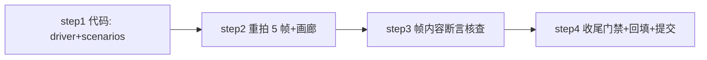

# screenshot-frames-fix 方案（fix/screenshot-frames）

> 状态：待批准（2026-11-04 21:1x，主工作时段——按规则等待用户批准）。
> 需求唯一来源为用户原话（2026-11-04，附 5 张场景截图）。

## 需求原文

> 修复这些场景截图，1. file manager 没有任何内容，需要有内容和预览内容。
> 2. LSP使用python作为示例。3. ScreenSaver 精灵填满 4. HexView 填满一屏。
> 5. Layout Explorer 语法高亮

## 目标与非目标

**目标**（5 张既有场景帧重拍，不加新场景）：

1. `file-manager.svg`：目录列表与预览窗格均已填充（当前帧抓在 listing/preview
   加载管线完成之前，预览停在 "(empty directory)"）。
2. `lsp-completion.svg`：示例从 `words.txt` 换成 Python 文件 `sample.py`，
   补全弹窗展示 Python 标识符（仍是如实标注的 buffer-words 回退来源）。
3. `screensaver.svg`：精灵队列铺满屏幕（当前帧只抓到 1 只刚出生的 snake）。
4. `hex-view.svg`：转储填满一屏（当前 fixture 仅 13 字节 = 1 行）。
5. `layout-explorer.svg`：编辑器区显示 tree-sitter 语法高亮（当前帧抓在
   高亮 worker 落地之前，正文全素色）。

**非目标**：不改 `yate/` 产品源码；不新增场景；不接真实语言服务器
（readme-screenshots 总纲已登记 LSP 诊断/真服务器为非目标）；不追求
screensaver 帧字节级确定（画廊 Report note 已声明动画帧采样逐次变化）。

## 调研事实（全部带 文件:行号 证据）

1. **file-manager 空帧根因**：driver 在 screen push 后只 `pilot.pause()` 一次
   （`tools/screenshots/scenarios.py:315-338`）；而 listing 经
   `_wire_mount` 的 `call_after_refresh` 重试接线后 `_reload()` 才建行
   （`yate/editor_components/file_manager/screen.py:223-243`、`:281-320`），
   预览先写 "loading…" 再由 worker 填充（`screen.py:468-496`）——单次
   pause 抓到的是中间态。可观察态：中列 `#file-manager-list` 的 children
   非空、预览 `PreviewLog.lines` 文本不含 "loading…"。
2. **LSP 场景现状**：`_lsp_completion` 用 `words.txt`（`scenarios.py:240-256`）；
   buffer-words 回退对任何 buffer 生效
   （`yate/flows/completion_flows.py:200-221`、
   `yate/editor_components/completion.py:427-457`，前缀按 `lower()` 匹配），
   `sample.py` 中键入 `gr` 可得 `greet` / `Greeter` / `greeting` 候选。
3. **screensaver 单精灵根因**：`characters=("snake",)` 把花名册钉死为 1 名
   （同名不可同屏，`screensaver.py:262-279`），0.5s 只够 1 只；接替节奏由
   `_DEFAULT_DIST_BOUNDS=(1/8,1/3)` 决定（`screensaver.py:54`）。yaterc 提供
   `dist_lower_bound`/`dist_upper_bound` 显式窗口（`yate/config.py:93-109`），
   收紧到 (0.05, 0.15) 后每 ~0.6-1.1s 接替一只；并发上花名册（27 名）后
   ~10s 可积到 8+ 只横跨全屏。`walkers` 是公开只读属性
   （`screensaver.py:136-138`），可作等待谓词。
4. **hex 单行根因**：fixture 13 字节（`tools/screenshots/driver.py:269`），
   每行 16 字节（`yate/editor_components/hexview.py:54`），100x30 一屏需
   ≥480 字节。冒烟与单测各自自带 fixture（`tools/smoke_test/scenarios/hexview.py:55`、
   `tests/test_overlay_flows_hex.py`），改截图 fixture 零外溢。
5. **高亮缺失根因**：语法 token 由后台 worker 首帧后才落地
   （`yate/editor_components/highlighting.py:192-229` 首帧素色 + `:402-471`
   worker 落地后 refresh）；公开探针 `highlight_probe()`
   （`:367-376`）+ `app.editor.panes.active_view`（`editor.py:651`）可作
   "token 已落地" 谓词：`probe.tokens is not None and probe.doc is view.doc
   and probe.version == view.doc.buffer.content_version`。
   `syntax-highlighting` 场景存在同一竞态，一并对齐加固。

## 备选方案与否决理由

- **file-manager 改为注入更长 sleep**：否决——sleep 猜时长在并行负载下
  flake；用既有 `wait_until` + 公开可观察态（python-coding-style §4.7 禁
  真实睡眠断言的同款纪律）。
- **screensaver 等固定秒数**：否决——同上，且接替节奏是随机的；按
  `walkers` 数量等待更稳。只用默认 (1/8,1/3) 窗口等更久：否决——稳态
  4-6 只、铺不满且帧时长不可控；`dist_bounds` 是文档化 rc 选项，属
  合法旋钮。
- **hex fixture 直接 480 字节**：否决——取 512（`bytes(range(256)) * 2`），
  32 行保满屏 + 出滚动条，且 0x00-0xFF 全值循环把 hexyl 四类字节配色
  （null/whitespace/printable/non-ascii）全部展示。
- **改 yate/ 让高亮同步落地**：否决——违反"截图任务不改产品源码"边界
  （readme-screenshots 总纲已定），worker 异步是产品正确行为。

## 分步实施计划



### step 1：代码改动（独占文件：`tools/screenshots/driver.py`、`tools/screenshots/scenarios.py`）

- `driver.py`：`thing.bin` fixture 换 512 字节确定性模式（实现前先以只读
  探针核实 `RichLog.lines` / `Strip.text` API 形态）。
- `scenarios.py`：
  - `_require` 增加可选 `timeout` 形参（screensaver 需 >5s 预算）；
  - `_layout_explorer` / `_syntax_highlighting` / `_lsp_completion`：save 前
    等待 active view 高亮 token 落地；
  - `_lsp_completion`：目标换 `sample.py`，光标下移至空行、键入 `gr`、
    `ctrl+space`，等弹窗；desc EN/ZH 同步改为 "Python 缓冲区 + 回退来源"；
  - `_screensaver`：配置改全花名册 + `dist_bounds=(0.05, 0.15)`，等
    `len(screen.walkers) >= 8`（timeout 45s）后短 settle 再 save；
    desc EN/ZH 改为 "精灵队列铺满屏幕"；
  - `_file_manager`：push 后等中列 children 非空 **且** 预览文本非
    "loading…"（timeout 10s）；desc EN/ZH 补 "列表与预览已填充"。
- 输出：两文件 diff；验收命令：`.venv\Scripts\python.exe -m pyright tools/screenshots/`。

### step 2：重拍 5 帧 + 画廊

- 命令：`.venv\Scripts\python.exe -m tools.screenshots --only layout-explorer
  --only lsp-completion --only screensaver --only file-manager --only hex-view`
- 画廊按既有语义保持全量 24 节（F1 回归已守卫）。

### step 3：帧内容断言核查（防"状态未达就出图"）

逐帧程序化断言（临时探针脚本，验证后删除）：

| 帧 | 断言 |
|---|---|
| file-manager.svg | 含 "a.txt" 行文本；含预览内容 "alpha"；不含 "empty directory" / "loading" |
| lsp-completion.svg | 含候选 "greet" 与 "Greeter"；状态栏场景为 py |
| screensaver.svg | 含 ≥8 个精灵调色板颜色簇（不同角色色），帧宽高色块覆盖明显增大 |
| hex-view.svg | 含多行偏移列（"00000010:" … "000001f0:"），ASCII 列有可读文本 |
| layout-explorer.svg | 正文区出现多种语法色（fill 色数 > 素色基线），与 syntax-highlighting 帧色板一致 |

外加：`.venv\Scripts\python.exe -m pytest tests/test_screenshots_tool.py -q`。

### step 4：收尾门禁 + 回填 + 提交（主代理亲跑）

```powershell
.venv\Scripts\python.exe -m pyright yate/ tests/ tools/ pack/
.venv\Scripts\python.exe -m pytest tests/ -q -n auto
.venv\Scripts\python.exe -m pytest tests/test_architecture.py -q
.venv\Scripts\python.exe -m pytest tests/ --cov=yate --cov-branch -n auto
.venv\Scripts\python.exe -m tools.smoke_test run --jobs 4
```

- 计划文档回填真实数字与偏离记录；按 `git-commit-message.md` 分笔提交
  （step1 `fix(screenshots): ...`，step2/3 `chore(screenshots): regenerate ...`，
  计划文档 `docs(plan): ...`）；只提交不推送。

## 风险与回滚

| 风险 | 缓解 | 回滚 |
|---|---|---|
| screensaver 等待把全量再生拉长 ~10-15s | 45s 上限 + `walkers` 谓词，超时即 FAIL 不出图 | 单场景剔除 |
| screensaver 帧逐次不同 | 画廊 Report note 已声明；step3 只断言"多精灵"不断言布局 | 无需 |
| `RichLog.lines`/`Strip.text` API 形态与预期不符 | step1 编码前只读探针核实 | 改用 statusbar 文本等价谓词 |
| 5s 高亮等待在极慢机上不足 | worker 是线程内小文件 tokenize，实测毫秒级；`_require` 超时会 FAIL 而非出坏帧 | timeout 提到 10s |
| fixture 变更外溢 | 已核实冒烟/单测 fixture 各自独立（调研 4） | 还原 driver.py 单文件 |

回滚路径：任一提交 `git revert`；SVG 均可由注册表随时再生。
