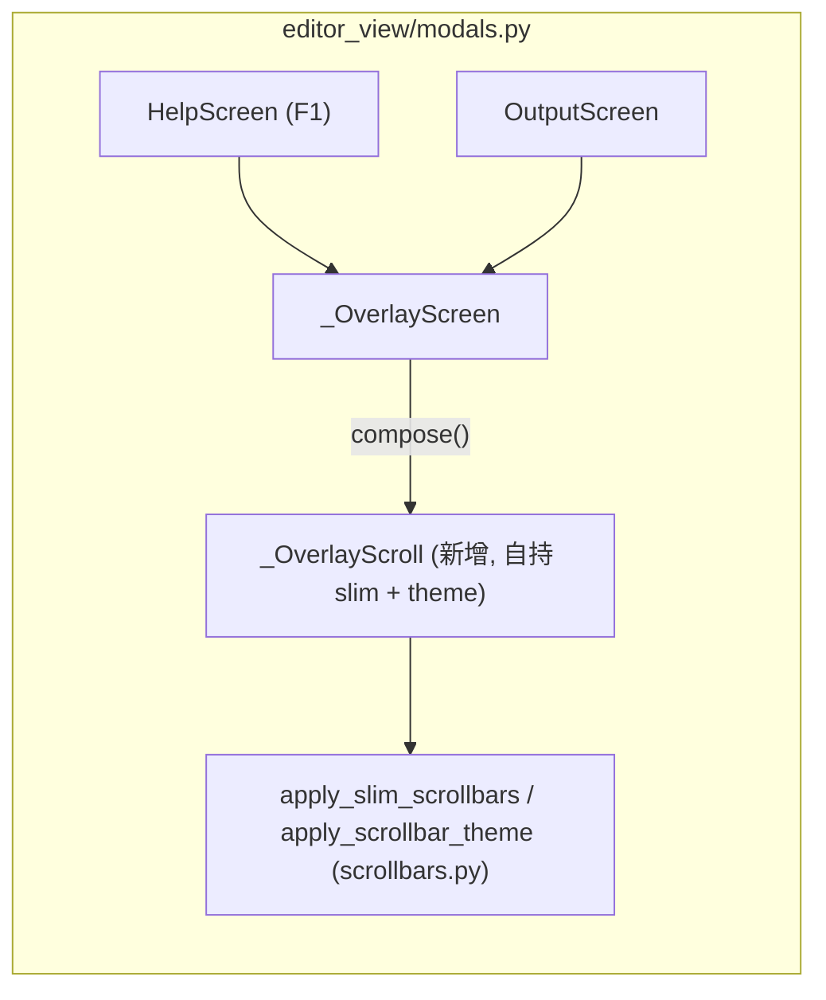

# scrollbar-style-unify-plan

> 状态：已批准并实施完毕 ｜ 分支：`fix/scrollbar-style-unify` ｜ worktree：`../yate-scrollbar-style-unify`
> 执行方式备注：`plan-architect-designer` 子代理 spawn 失败（agent 定义模型 `Qwen3.7-Plus` 在当前运行时未注册，`Model "Qwen3.7-Plus" not found`），按 `task-orchestration.md` §三 兜底由主代理亲自设计，如实标注。方案经用户批准（指示"按 §1.3 指定模型执行"）。

## 一、目标与非目标

**目标**

1. F1 帮助浮层（`HelpScreen`）滚动条改为与 explorer 一致的 slim 样式（细缝 thumb + 透明轨道 + 主题色）；
2. 排查全项目所有滚动条样式定义点，未接入统一样式的全部接入。

**非目标**

- 不改 slim 渲染器本身（`SlimScrollBarRender` 的字形 / 几何 / 鼠标行为）；
- 不改 `apply_scrollbar_theme` 的调色板语义；
- 不改任何 `.tcss`（`app.tcss` 的 `Widget { scrollbar-size-vertical: 1 }` 全局尺寸规则已覆盖浮层）。

## 二、调研取证（文件:行号级事实）

### explorer 的"标准样式"由两部分组成

1. **渲染器注入**：`apply_slim_scrollbars(widget)`（`yate/editor_view/scrollbars.py:94-111`）——per-widget 实例注入 `SlimScrollBarRender`，thumb 画成部分块字符（竖向 `▐`、横向 `▂`），R13 认可的唯一注入方式；
2. **主题调色**：`apply_scrollbar_theme(widget)`（`scrollbars.py:114-130`）——轨道全透明、hover 微 tint、thumb 用 `t.border` / hover `t.fg_dim` / 拖拽 `t.accent`。

### 全项目滚动面清单（逐面核实）

| # | 滚动面 | 实现位置 | slim 注入 | 主题调色 | 结论 |
|---|---|---|---|---|---|
| 1 | 编辑视图 `EditorView` | `editor_view/editor.py:184-201` | ✓ `on_mount` | ✓ | 合规 |
| 2 | 文件树 `ExplorerTree` | `editor_view/explorer.py:243-281` | ✓ | ✓ | 合规（基准样式） |
| 3 | diff 窗格 `DiffPane` | `editor_view/diff_pane.py:250-267` | ✓ | ✓ | 合规 |
| 4 | 命令面板预览 `PreviewLog` | `editor_view/palette.py:121-138` | ✓ | ✓ | 合规 |
| 5 | 手册/更新日志 `DocScroll` | `editor_view/manual.py:154-172` | ✓ | ✓ | 合规 |
| 6 | 查找替换结果 `_ResultsScroll` | `editor_view/find_replace.py:84-99` | ✓ | ✓ | 合规 |
| 7 | **浮层滚动容器 `#overlay`**（F1 `HelpScreen` + 命令输出 `OutputScreen` 共用基类 `_OverlayScreen`） | `editor_view/modals.py:22-41` | **✗ 无** | **✗ 无** | **唯一漏网 —— 本次根因** |

### 根因分析

`_OverlayScreen.compose`（`modals.py:33-38`）用的是裸 `VerticalScroll(id="overlay")`，未做 slim 注入与主题调色，因此滚动条回落到 Textual 默认渲染：不透明轨道 + 整格实心 thumb（`ScrollBarRender.render_bar` 默认 `bar_color="bright_magenta"`，正是截图中的紫色粗 thumb）。

### 既有守卫面

- `tests/test_architecture.py::test_no_class_level_scrollbar_renderer_patch`（T1）：禁类级 patch——本方案仍走 per-widget 注入，不触碰；
- `tests/test_scrollbars.py`：渲染器字形与注入行为的单元测试，不受影响。

## 三、备选方案与否决理由

**方案 A（采纳）：新增自持子类 `_OverlayScroll(VerticalScroll)`**

仿照 `_ResultsScroll`（`find_replace.py:74-99`）与 `DocScroll`（`manual.py:154-172`）的既有惯例：组件自持 `on_mount` 接线 + `theme.attach` 订阅 + `on_unmount` 退订。与 R13"主题着色归组件自持"完全同构，复用项目统一模式。

**方案 B（否决）：`_OverlayScreen.on_mount` 里 `query_one("#overlay")` 后注入**

屏幕层代组件上色，主题订阅挂在屏幕上（需屏幕 `on_unmount` 退订），与"组件自持"惯例相悖；`ManualDocScreen` 等先例都选择组件子类自持。否决。

**方案 C（否决）：改 `app.tcss` 用 CSS 变量调 `scrollbar-*` 颜色**

Textual 的 `scrollbar_background` / `scrollbar_color` 支持 CSS，但 thumb 的"部分块"字形只能由渲染器实现——纯 CSS 达不到 explorer 的细缝视觉。且 `theme.active()` 调色已有统一入口，走 CSS 会造成两套调色来源。否决。

## 四、分步实施

### 步骤 1：`_OverlayScreen` 滚动容器接入统一样式

- **输入**：`yate/editor_view/modals.py`
- **改动**：
  1. 导入 `from yate.editor_view.scrollbars import apply_scrollbar_theme, apply_slim_scrollbars`（`modals.py:18` 附近，保持字母序组内排序）；
  2. 在 `_OverlayScreen` 之前新增组件子类（注释英文，PEP 257 docstring）：
     ```python
     class _OverlayScroll(VerticalScroll):
         """Scrollable overlay body owning its slim scrollbar painting.

         Same self-painting contract as the explorer tree and the manual's
         DocScroll: the renderer sliver plus the theme palette (issue IKINF3
         pattern); a bare VerticalScroll would fall back to Textual's opaque
         default track and full-cell thumb.
         """

         def on_mount(self) -> None:
             """Own the slim-scrollbar wiring and the theme painting."""
             # no super()/@override here: VerticalScroll's MRO has no on_mount
             # to chain (manual.DocScroll precedent).
             apply_slim_scrollbars(self)
             self._apply_theme()
             theme.attach(self, self._apply_theme)

         def on_unmount(self) -> None:
             """Detach from the theme broadcast."""
             theme.detach(self)

         def _apply_theme(self) -> None:
             """Paint the scrollbar palette from the active theme."""
             apply_scrollbar_theme(self)
     ```
  3. `compose` 中 `with VerticalScroll(id="overlay")` 改为 `with _OverlayScroll(id="overlay")`（`modals.py:36`）；
- **输出**：F1 / 命令输出浮层滚动条与 explorer 同款；
- **验收命令**：
  ```powershell
  d:\Programming\yate-scrollbar-style-unify\.venv\Scripts\python.exe -m pytest tests/test_scrollbars.py tests/test_architecture.py -q
  ```

### 步骤 2：新增守卫测试

- **输入**：新文件 `tests/test_modals.py`
- **改动**（命名按 `test_<behavior>_<condition>_<expected>`）：
  - `test_help_screen_overlay_scrollbar_uses_slim_renderer`：`YateApp().run_test` 内 push `HelpScreen`，`query_one("#overlay")` 断言 `vertical_scrollbar.renderer is SlimScrollBarRender`、`scrollbar_color == theme.active().border`、`scrollbar_background` alpha 为 0（透明轨道，与 explorer 同色板）；
  - `test_output_screen_overlay_scrollbar_matches_explorer_palette`：`OutputScreen` 同断言（覆盖基类共用路径）；
  - 前置 fixture：app run_test 上下文；断言三要素齐全（具体值断言，非"应正常"）；
- **输出**：回归守卫，防止浮层滚动面再次漏接；
- **验收命令**：
  ```powershell
  d:\Programming\yate-scrollbar-style-unify\.venv\Scripts\python.exe -m pytest tests/test_modals.py -q --cov-fail-under=0
  ```

### 步骤 3：收尾门禁（主代理亲自跑）

```powershell
d:\Programming\yate-scrollbar-style-unify\.venv\Scripts\python.exe -m pyright yate/ tests/ tools/
d:\Programming\yate-scrollbar-style-unify\.venv\Scripts\python.exe -m pytest tests/ -q --cov-fail-under=75
```

- **输出**：两命令退出码 0；回填本档后按 `git-commit-message.md` 分步提交（`fix(editor_view): ...` + `test(modals): ...`）。

## 五、风险清单与回滚

| 风险 | 概率 | 缓解 |
|---|---|---|
| `VerticalScroll` 换子类后 tcss 选择器失配 | 低 | CSS 仅用 `#overlay` / `_OverlayScreen` / `.hint` 选择器，不按类型选；`overlay-screen.tcss` 零改动 |
| 浮层内 theme 退订遗漏 | 低 | 沿用 `DocScroll` 完全相同的 attach/detach 生命周期（`manual.py:157-169` 已验证模式） |
| Textual 升级给 `VerticalScroll` 加 `on_mount` | 低 | 注释已按 `DocScroll` 先例标注 revisit 条件 |

**回滚路径**：单 commit revert 步骤 1/2 即可，无数据/配置迁移。

## 六、Mermaid（改动位置示意）



## 七、执行记录（回填）

- [x] 步骤 1：实施 + 验收 —— `yate/editor_view/modals.py` 新增 `_OverlayScroll(VerticalScroll)`（`modals.py:22-48`：`on_mount` 注入 slim + 调色 + `theme.attach`，`on_unmount` 退订，`_apply_theme` 走 `apply_scrollbar_theme`），`compose` 改用 `_OverlayScroll(id="overlay")`（`modals.py:63`）。验收 `pytest tests/test_scrollbars.py tests/test_architecture.py -q` → **39 passed, exit 0**。
- [x] 步骤 2：守卫测试 + 验收 —— 新建 `tests/test_modals.py`（共用断言 `_assert_slim_scrollbar_overlay`：renderer 为 `SlimScrollBarRender`、`scrollbar_color.hex == theme.active().border`、`scrollbar_background.a == 0`；两条用例分别走 `YateApp().run_test` + F1 进 `HelpScreen`、`push_screen(OutputScreen(...))`）。验收 `pytest tests/test_modals.py -q --cov-fail-under=0` → **2 passed, exit 0**。
- [x] 步骤 3：全量门禁（pyright / pytest 退出码、覆盖率数字）—— `pyright yate/ tests/ tools/` → **0 errors, 0 warnings, 0 informations, exit 0**；`pytest tests/ -q --cov-fail-under=75` → **EXIT=0**（全绿，无 F/E；8 个 skip 为环境相关既有跳过；`--cov-fail-under=75` 门禁通过，未打印覆盖率明细属该 worktree 的 coverage 配置行为）。
- [ ] 提交记录 —— 按任务要求不执行 `git commit`，由主代理收尾统一提交（`fix(editor_view): ...` + `test(modals): ...`，另含本方案文档）。
- [x] 【审核】`code-review-expert` 评审 —— **PASS（无 blocker / major；1 条 minor 建议）**。评审自跑：pyright 零诊断 exit 0；`pytest tests/ -q --cov=yate --cov-branch --cov-fail-under=75` exit 0，TOTAL 覆盖率 **92.01%**（`modals.py` 100%）；冒烟 `python -m tools.smoke_test run` **112/112 passed, exit 0**。评审 skill（python-code-review / TRAE-code-review）未在本运行时注册，按角色定义自带框架完成，如实标注。minor 建议（登记待办，不阻塞）：`tests/test_modals.py:22` 断言助手形参可由 `Widget` 收窄为 `Screen[None]`。
- [x] 【收尾】主代理独立复核 —— 关键三测试文件 + pyright 复跑 exit 0；全量 `pytest tests/ -q --cov-fail-under=75` 首跑出现 2 个 timing 偶发失败（`test_manual` 防抖计时 / `test_shell` 进程树 kill，均不在改动面），两用例单独重跑两次均 exit 0，全量复跑 **exit 0**（8 skip 为既有环境跳过）——按 `subagent-workflow.md` §三.3 判为偶发，未改编断言。
- [x] 提交记录 —— 主代理按 `git-commit-message.md` 分三笔提交：`fix(editor_view)` / `test(modals)` / `docs(plans)`（只提交不推送）。
