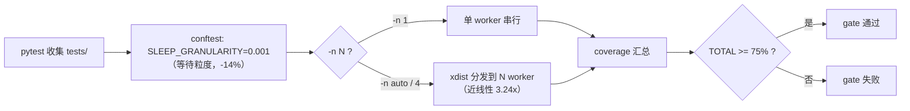
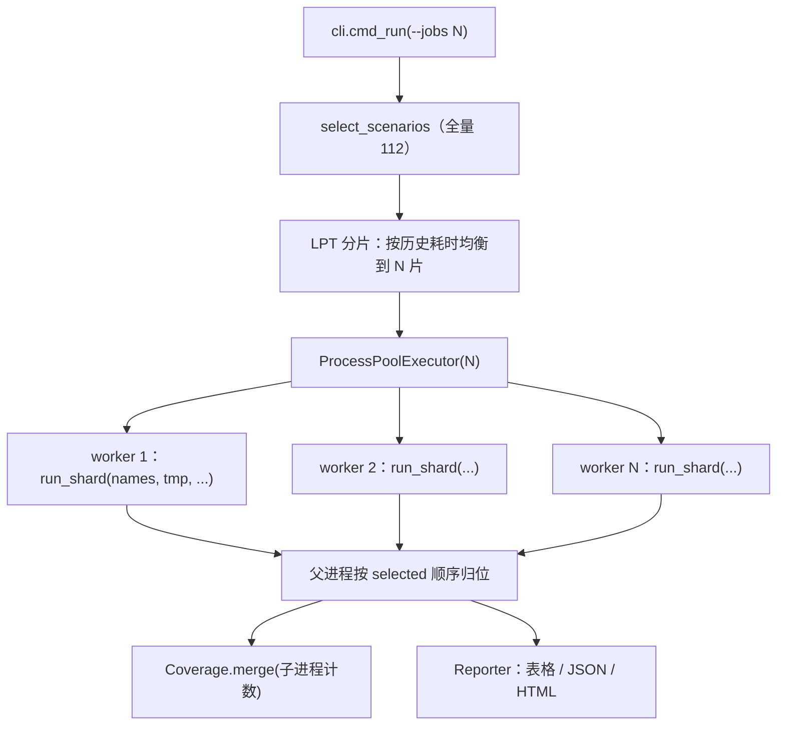

# smoke-perf 方案：修复冒烟失败 + pytest / 冒烟提速

> 任务来源：2026-10-20 CI（GitHub Actions / windows-latest / Python 3.12.10）冒烟任务 exit 1，
> 用户要求「修复冒烟失败，查看 pytest 和冒烟测试执行时是否有性能问题，能否提升测试速度」。
>
> 分支：`fix/smoke-perf`；worktree：`../yate-smoke-perf`（沙箱 `.venv` 已在 worktree 内重建并自证：
> `.venv\Scripts\python.exe -c "import yate; print(yate.__file__)"` → 指向 worktree）。
>
> 本地实测环境：Windows、8 逻辑核、`Python 3.13.2`（系统解释器）、textual 8.2.8、rich 15.0.0。
> CI 环境为 Python 3.12.10 / windows-latest（4 vCPU），两者差异只影响绝对秒数，不影响相对收益。

## 一、目标与非目标

### 目标

1. **修掉 CI 冒烟失败**：`vim_registers_text_objects` 的 6 个陈旧断言，恢复 112/112、1354/1354。
2. **给出实测性能结论**：pytest 与冒烟各自的耗时构成、热点、可优化边界。
3. **落地两项提速**：pytest 并行 + Textual 等待粒度收紧；冒烟进程级分片（`--jobs`）。
4. 收尾门禁全绿：pyright strict 零诊断、pytest 全绿、覆盖率 ≥ 75、架构守卫 35 条、冒烟 112/112。

### 非目标（本次不做，登记为后续独立任务）

- **不重写 `MarkdownDocScreen` 的渲染方式**（见 §二.3 热点 1）：它是 Textual `Markdown` 组件
  一 block 一 widget 的固有形态，改造属产品级重构，风险与本次任务不匹配。
- **不调整行式粘贴的列位语义**（见 §三.1 选项 A2）：属产品行为变更，需先与 vim 规范对齐评审。
- 不减少任何检查条数、不放宽任何断言、不引入 `--skip-slow` 式的"少跑测试"提速。

## 二、调研事实（全部实测，带证据）

### 二.1 冒烟失败根因：场景断言陈旧于 `148fa4a`

| 事实 | 证据 |
|---|---|
| 失败场景源码 | `tools/smoke_test/scenarios/vim_advanced.py:142-238` |
| 失败断言 | 同文件 `:183`（`paste_cursor_row` 期望 3）、`:188`（`line_start` 期望 (3,0)） |
| 产品改动 | `148fa4a fix(editor-core): close the w-a review findings`：行式粘贴光标由"块后一行 + `move_line_end`/`move_left`"改为"**最后一个粘贴行**，列取 `len(line)-1`" —— `yate/editor_core/buffer.py:1061-1066` |
| 新契约已被单测钉死 | `tests/test_editor_core.py:1141-1148`（期望 `(2, 2)`）、`:1151-1158`（期望 `(3, 0)`）、`:1161-1168`（计数粘贴连续） |
| 复现 | `.venv\Scripts\python.exe -m tools.smoke_test run --scenario vim_registers_text_objects --no-color` → exit 1，同样 6 条失败，1.18s |

**因果链**：`"ayy` 存 "alpha beta\n" → `j` 到 (1,0) → `"ap` 行式粘贴插在第 2 行后，
光标落在**粘贴行**第 2 行（旧行为落在第 3 行）→ `paste_cursor_row` / `line_start` 失败 →
后续 `daw`（第 188 行之后）作用在第 2 行 "alpha beta" 而非第 3 行 "epsilon zeta" →
`daw_line`/`daw_register` 失败 → `3dd` 从第 2 行删三行 → `dd_lines`/`dd_register` 失败。
6 条失败是**一条因果链**，不是 6 个独立缺陷。

### 二.2 pytest 基线

| 口径（全量 `tests/`） | 实测墙钟 | 说明 |
|---|---|---|
| 串行（现状） | **308.04s** | 全绿 |
| 串行 + `textual._wait.SLEEP_GRANULARITY = 0.001` | **264.43s**（−14.1%） | 全绿 |
| 粒度 + `-n 4`（pytest-xdist） | **95.08s**（3.24×） | 全绿 |
| 粒度 + `-n 4` + `--cov=yate --cov-branch` | **192.49s**，TOTAL 91.98%（门禁 75 通过） | 1 条 flake（见下） |

- **粒度收益的原理**：`textual/_wait.py::wait_for_idle` 每次固定 `await sleep(SLEEP_GRANULARITY)`，
  默认 `0.02`（Windows 实际 ~15–31ms）。`Pilot._press_keys` / `pilot.pause()` 每次都走它，
  全量套件里累计成千上万次。冒烟侧早已做了这件事（`tools/smoke_test/harness.py:40-62`），
  **pytest 侧 `tests/conftest.py` 至今没有**——这是本次最便宜的一笔收益。
- **并行收益的原理**：pytest 串行只用一个核；xdist 4 worker 在 8 核（CI 4 vCPU）上近线性。
- **覆盖率与 xdist 兼容**：实测 4 worker 下覆盖率仍汇总为 91.98%，`--cov-fail-under` 逻辑正常。
- **发现的 flake（必须一起修）**：
  `tests/test_manual.py::test_dismiss_within_debounce_window_leaves_no_pending_timer`
  在 `-n 4` + 覆盖率负载下失败一次，断言为 `assert calls == []`，实际 `['exit']`。
  机理：该用例断言"取消后 0.12s 防抖回调永不触发"，但在高负载下 `escape` → 弹栈 →
  `on_unmount` 取消这条路径本身可能超过 0.12s，定时器先触发（此时 screen 仍挂载，
  `is_mounted` 守卫放行）→ 这是**测试对时序的隐含假设**，不是产品缺陷。
  仓库内已有确定性写法先例：`tests/test_app_render.py:274` / `:329`
  `monkeypatch.setattr(screen, "_SEARCH_DEBOUNCE_S", 30.0)`。
- 慢例分布：最快/最慢用例单条 1–5s（`tests/test_app_manual.py::test_manual_search_step_lands_on_exact_rendered_row` 5.3s），
  无单条巨慢用例，说明总耗时是**逐例摊薄**的等待开销，粒度 + 并行正是对症。

### 二.3 冒烟基线

全量单进程：**150.76s** 墙钟 / `148.06s`（112 场景累加），111/112 通过（即 §二.1 的失败）。
最慢 18 个场景合计 90.76s（占 61%），头部四名：

| 场景 | 耗时 | 占比 |
|---|---|---|
| `manual_changelog_modals` | 30.05s | 20.3% |
| `view_manual_command` | 21.44s | 14.5% |
| `stress_key_fuzz` | 7.93s | 5.4% |
| `stress_rapid_toggles` | 4.55s | 3.1% |

**热点 1（真正的性能问题，产品侧）**：`markdown-doc` 覆盖层。

探针实测（`_probe_manual.py`，验证后已删除）：

```
base: Screen widgets=21
manual open press+pause: 11.010s  MarkdownDocScreen widgets=1788
manual close:             2.043s
changelog open:           3.473s  MarkdownDocScreen widgets=3733
changelog close:          8.440s
```

`cProfile`（`manual_changelog_modals`，67.5s 采样）热点全部落在 Textual 样式/布局：
`textual/css/stylesheet.py:470(apply)` 26274 次调用累计 23.3s、`widget.py:1736(_get_box_model)` 16.5s、
`_resolve.py:218(resolve_box_models)` 17.4s。即：**`Markdown` 组件一 block 一 widget**
（manual 1788 个 / changelog 3733 个）→ 每次挂载/卸载都要对上千个 widget 重跑 CSS 匹配与盒模型解析。
这是**真实用户可感知的产品性能问题**（打开手册 ~11s），但在本任务里只作为热点登记，
改造方案另立计划（非目标 1）。测试侧只能靠并行绕开它：单场景 30s 是并行后的**下限**。

**热点 2（非热点，已排除）**：`snapshot_svg` 截图 6ms、`--svg` 关闭时 `svg_rows` 清空只是
事后丢弃（`tools/smoke_test/harness.py:443-444`），截图开销可忽略，不作为优化目标。

**分片加速比实测**（`_probe_shard.py`，40 个最慢场景按 LPT 分 4 组并发）：

```
scenarios=40 groups=4 serial_sum=113.0s wall=37.0s speedup=3.06x
```

即 8 核机器上 4 并发近线性；CI 4 vCPU 上 4 并发同样成立（场景进程彼此独立，
无共享可变状态：`_apps` 模块级列表、`track_coverage()` 的 monkeypatch、`theme` 单例都在进程内）。

## 三、备选方案与否决理由

### 三.1 冒烟失败：修场景 vs 改产品

| 选项 | 内容 | 裁决 |
|---|---|---|
| **A1（采纳）** | 只把场景期望对齐 `148fa4a` 后的**已钉死契约**：`paste_cursor_row` 3→2、`line_start` (3,0)→(2,0)，并在 `daw` 前补一次 `j` 把光标移回第 3 行，保持 `daw` / `3dd` 断言语义不变 | 采纳。改动 1 个文件、语义不变、产品零风险 |
| A2（否决） | 顺手把行式粘贴的列位对齐 vim（vim `do_put` 行式落点为"最后粘贴行的**首个非空列**"，当前实现是 `len(line)-1`，如 (2,9)） | 否决：这是**产品行为变更**，要同步改 3 条刚被评审钉死的单测（`tests/test_editor_core.py:1141-1158`），收益（列位一致性）与本次任务无关，登记为待办 |
| A3（否决） | 回退产品提交 `148fa4a` 的粘贴落点 | 否决：该提交是评审结论，回退会重新引入"光标落在块后一行"的不一致 |

### 三.2 pytest 提速

| 选项 | 裁决 |
|---|---|
| **B1（采纳）收紧 `SLEEP_GRANULARITY`**（conftest 一次性设置） | 采纳：−14.1%，零行为改动，与冒烟侧既有做法同源 |
| **B2（采纳）pytest-xdist `-n auto`** | 采纳：3.24×，覆盖率门禁实测无碍；代价是新增 dev 依赖 + 需修 1 条时序 flake |
| B3（否决）删减/合并测试、`--skip-slow` | 否决：削弱覆盖面，违反用户"提升测试速度"的本意 |
| B4（否决）`--dist loadfile` 之外的激进分组、`-p no:cacheprovider` 等微调 | 否决：收益 < 5%，`loadfile` 保留为实现期对比项 |
| B5（否决）只做 CI 侧 cache（pip cache 已有） | 否决：解决不了逐例等待开销 |

### 三.3 冒烟提速

| 选项 | 裁决 |
|---|---|
| **C1（采纳）进程级分片 `--jobs N`** | 采纳：3.06× 实测；`--jobs 1` 保持现状为默认，零行为变化 |
| C2（否决）CI matrix 拆 4 个 job 各跑 `--scenario` 子集 | 否决：覆盖率/检查总数/报告聚合全部要在 job 间手工拼，且 4 个 job 各装一遍依赖，净收益低于 C1 |
| C3（否决）优化 manual 覆盖层（热点 1） | 本次否决：属产品重构，另立计划；并行后它只是 30s 的并行下限 |
| C4（否决）关掉 `snapshot_svg` | 否决：实测 6ms，且断言"渲染行"是冒烟的价值之一 |
| C5（否决）只调大 `--timeout` / 复用单个 App 跑多场景 | 否决：App 复用会破坏场景隔离（invariant 扫描依赖"每场景一个新 App"），收益不确定 |

## 四、分步实施计划

执行波次：**W1 → W2（2a、2b 并行）→ W2c → W3 → W4**。
每一步产物单独提交（`git-commit-message.md` 格式），不推送。

### W1（串行）修冒烟失败

- **输入**：§二.1 因果链。
- **改动文件**：`tools/smoke_test/scenarios/vim_advanced.py`（仅 `_vim_registers_text_objects`）。
- **动作**：
  1. `paste_cursor_row` 期望 `3` → `2`，注释改为"光标落在最后一个粘贴行"（引用 `buffer.py` 契约）。
  2. `line_start` 期望 `(3, 0)` → `(2, 0)`。
  3. `daw` 之前补 `await pilot.press("j")` + `await pilot.pause()`，把光标移到第 3 行
     `epsilon zeta`，使后续 `daw_line` / `daw_register` / `3dd` 三条断言**原样成立**。
- **输出**：该场景 38/38 通过。
- **验收命令**：
  ```powershell
  .venv\Scripts\python.exe -m tools.smoke_test run --scenario vim_registers_text_objects --no-color
  .venv\Scripts\python.exe -m pytest tests/test_editor_core.py -q
  ```
  两者 exit 0。

### W2a（与 W2b 并行）pytest 等待粒度

- **改动文件**：`tests/conftest.py`。
- **动作**：在 conftest 导入期把 `textual._wait.SLEEP_GRANULARITY` 降到 `0.001`，
  写法与 `tools/smoke_test/harness.py:40-62` 同构（同样的 try/ImportError 兜底 + docstring
  说明"每键固定睡眠"的机理与实测收益）；注释全英文 ASCII（架构守卫 33）。
- **验收命令**：
  ```powershell
  .venv\Scripts\python.exe -m pytest tests/ -q
  ```
  exit 0，且 `pytest-base.txt`（308.04s）对比新记录应有 ≥ 10% 下降。

### W2b（与 W2a 并行）时序 flake 加固 + xdist 依赖

- **改动文件**：`tests/test_manual.py`、`pyproject.toml`。
- **动作**：
  1. `test_dismiss_within_debounce_window_leaves_no_pending_timer`：在 `run_test` 内
     `monkeypatch.setattr(screen, "_SEARCH_DEBOUNCE_S", 30.0)`（沿用
     `tests/test_app_render.py:274` 先例），把结尾的
     `await pilot.pause(MarkdownDocScreen._SEARCH_DEBOUNCE_S * 5)` 改成固定小停顿
     （定时器已不可能触发，"取消后不再触发"由 `_search_timer is None` +
     `calls == []` 直接证明）。
  2. `pyproject.toml` `[project.optional-dependencies].dev` 增加 `pytest-xdist>=3.6`。
- **验收命令**：
  ```powershell
  .venv\Scripts\python.exe -m pytest tests/test_manual.py -q
  .venv\Scripts\python.exe -m pytest tests/ -q -n 4 --cov=yate --cov-branch
  ```
  后者 exit 0、TOTAL ≥ 75%（预期 ~92%）；连续 3 次不得出现 flake。

### W2c（在 W2a/W2b 之后串行）CI 两条流水线的 pytest 命令

- **改动文件**：`.github/workflows/test.yml`、`.workflow/test.yml`。
- **动作**：pytest 命令追加 `-n auto`（`auto` 在单核 runner 上退化为 1，安全）。
  实施期对比 `--dist load` 与 `--dist loadfile` 的耗时/稳定性，取优者写死。
  注意 `tests/test_gate_config.py::test_coverage_threshold_is_not_hardcoded_on_the_ci_command_line`
  禁止命令行出现 `--cov-fail-under`——本步不引入。
- **验收命令**：
  ```powershell
  .venv\Scripts\python.exe -m pytest tests/test_gate_config.py -q
  ```
  exit 0。

### W3（串行）冒烟 `--jobs` 进程分片

- **改动文件**：`tools/smoke_test/harness.py`、`tools/smoke_test/cli.py`、
  `tests/test_smoke_harness.py`、`tests/test_smoke_cli.py`、`.github/workflows/test.yml`。
- **动作**：
  1. `harness.py`：新增模块级 worker 函数 `run_shard(names, tmp_root, svg, invariants, timeout)`
     （**只传场景名**，worker 内自行 `select_scenarios` 查表；因 Windows `spawn` 不能传
     `RunOptions.progress` 这类闭包），返回 `list[ScenarioResult]` + 该进程的命令/动作计数；
     新增 `run_scenarios_parallel(...)` 用 `concurrent.futures.ProcessPoolExecutor`
     按 LPT 均衡分片（重场景优先填最空的分片），结果按 `selected` 顺序归位。
  2. `Coverage` 增加 `merge(other)`，父进程汇总子进程计数；`note_registries` 在 worker 内完成。
  3. `cli.py`：`run` 子命令新增 `--jobs N`（默认 1 = 现有串行路径，`snapshot` / `compare`
     本期不并行）；进度回调由父进程在结果回收时驱动。worker 抛异常时降级为串行重跑该分片并
     如实报告（不得静默吞异常，`python-coding-style.md` §4.5）。
  4. `.github/workflows/test.yml` 的 smoke 步骤追加 `--jobs 4`。
  5. 新增/扩展单测：分片函数确定性（同输入同分片）、`--jobs 1` 与串行等价、
     `--jobs 2` 下检查数与串行一致。
- **输出**：`--jobs 4` 下冒烟总耗时从 150.8s 降到 ≤ 60s（预估 45–55s；下限由 30.05s 的
  `manual_changelog_modals` 决定）。
- **验收命令**：
  ```powershell
  .venv\Scripts\python.exe -m pytest tests/test_smoke_harness.py tests/test_smoke_cli.py -q
  .venv\Scripts\python.exe -m tools.smoke_test run --no-color --quiet --json smoke-j1.json
  .venv\Scripts\python.exe -m tools.smoke_test run --no-color --quiet --json smoke-j4.json --jobs 4
  ```
  两次均 112/112、1354/1354，两份 JSON 的 `totals` 完全一致；`--jobs 4` 墙钟显著更低。

### W4（串行）收尾门禁与文档回填

- 命令（主代理亲自跑，全部 exit 0）：
  ```powershell
  .venv\Scripts\python.exe -m pyright yate/ tests/ tools/ pack/
  .venv\Scripts\python.exe -m pytest tests/ -q
  .venv\Scripts\python.exe -m pytest tests/ --cov=yate --cov-branch
  .venv\Scripts\python.exe -m pytest tests/test_architecture.py -q
  .venv\Scripts\python.exe -m tools.smoke_test run --no-color --jobs 4
  ```
- 回填本文件：真实前后秒数表、偏离记录（如 `--dist` 取值、`--jobs` 最终值、flake 修复细节）。
- 清理临时探针（`_probe_*.py`、`_speedplug.py`、`pytest-base.txt`、`smoke-base.json` 等不得入库）。

## 五、风险与回滚

| 风险 | 影响 | 缓解 |
|---|---|---|
| xdist 下 Textual 时序用例 flake | CI 偶发红 | W2b 先修已定位的 1 条；W2 验收要求连续 3 次 `-n 4 + cov` 全绿；仍不稳则退回 `--dist loadfile` 或 CI 仅 Windows 串行、Ubuntu 并行 |
| `--jobs` 的跨进程序列化失败（Check 载荷不可 pickle） | 冒烟崩 | 只传场景名；`ProcessPoolExecutor` 异常降级串行并显式报告；单测覆盖 `--jobs 2` |
| Windows `spawn` 递归重入 | 子进程无限派生 | `tools/smoke_test/__main__.py` 已有 `if __name__ == "__main__"` 守卫（`:7-8`），worker 函数为模块级 |
| 覆盖率统计在子进程丢失 | 门禁数字失真 | 覆盖率统计只在 pytest 侧；冒烟的 `Coverage` 由 worker 回传后 `merge`，并加单测 |
| 本地 Python 3.13.2 vs CI 3.12.10 差异 | 绝对秒数不同 | 结论只用相对倍数；W4 以命令 exit code 为唯一判据 |
| 任何一步偏离本方案 | 设计漂移 | 偏离必须在本文件显式记录并附实测依据（`plan-before-execute.md` §二.4） |

回滚：每波单独提交，出问题 `git revert <该波 sha>`；`--jobs` 默认 1、pytest `-n` 可去掉，
两项提速都是**可选参数**，回滚不影响功能正确性。

## 六、结构图

### 6.1 pytest 提速链路



### 6.2 冒烟分片数据流（`--jobs N`）



## 七、验收口径（汇总）

| 项 | 判据 |
|---|---|
| 冒烟功能 | `run` 112/112 场景、1354/1354 检查，exit 0（单进程与 `--jobs 4` 一致） |
| pytest | `pytest tests/ -q` exit 0；`--cov=yate --cov-branch` TOTAL ≥ 75% |
| pyright | `pyright yate/ tests/ tools/ pack/` 0 诊断 |
| 架构守卫 | `pytest tests/test_architecture.py -q` 35 passed |
| 提速（pytest） | 串行 308.04s → 粒度 264.43s → 粒度+`-n 4` 95.08s |
| 提速（冒烟） | 15x.xx s 单进程 → `--jobs 4` 目标 ≤ 60s（W3 实测回填） |
| 覆盖面 | 检查条数与场景数**不得减少**（1354 / 112） |

## 八、实施结果与偏离记录（2026-10-20 回填）

### 8.1 门禁终态（主代理亲跑，命令与退出码）

| 门禁 | 命令 | 结果 |
|---|---|---|
| pyright strict | `.venv\Scripts\python.exe -m pyright` | `0 errors, 0 warnings, 0 informations`，exit 0 |
| 全量 pytest（并行） | `pytest tests/ -q -n auto` | **69.64s**（另测 86.76s），`2666 passed, 9 skipped`，exit 0 |
| 覆盖率（并行） | `pytest tests/ --cov=yate --cov-branch -n auto` | **142.21–155.86s**（连续三次全绿），TOTAL **92%**（门禁 75），exit 0 |
| 覆盖率（串行对照） | `pytest tests/ --cov=yate --cov-branch` | **402.86s**，`2666 passed, 9 skipped`，与并行**逐项一致** |
| 架构 + 门禁守卫 | `pytest tests/test_architecture.py tests/test_gate_config.py -q` | **41 passed**（36 + 5），exit 0 |
| 冒烟（并行） | `tools.smoke_test run --jobs 4` | **39.30–47.55s**（三次复测 42.80s），112/112、1354/1354，exit 0 |
| 冒烟（串行对照） | `tools.smoke_test run` | **121.06 / 123.86s**，112/112、1354/1354，exit 0 |

### 8.2 提速前后（真实秒数）

| 口径 | 改前 | 改后 | 倍数 |
|---|---|---|---|
| pytest 无覆盖率，串行 → `-n auto`（本机 8 核） | 308.04s | **69.64–86.76s** | 3.5–4.4x |
| pytest 带覆盖率，串行 → `-n auto` | **401.99 / 402.86s** | **142.21–155.86s** | 2.6–2.8x |
| 冒烟 串行 → `--jobs 4` | 121.06 / 123.86s | **39.30–47.55s**（复测 42.80s） | 2.6–3.1x |
| 冒烟 `--jobs 4`（首测，修复回退路径前） | — | 47.74s | 2.54x |

冒烟并行后的墙钟下限由最长单场景决定：`manual_changelog_modals` 单跑 31.5s
（产品侧 widget 爆炸热点，见 §二.3），并行已无法再压。

### 8.3 偏离记录（相对 §四 原计划）

1. **分片策略改为"一场景一任务"**（原计划：LPT 静态分片）。
   实测静态 round-robin 4 片 65.84s，慢分片成为墙钟；改为把每个场景单独提交给
   `ProcessPoolExecutor`、由池自平衡后降到 47.74s（再测 39.30s）。`plan_shards()`
   随之删除，`run_shard()` 保留为 worker 入口（其参数仍是"场景名序列"）。
2. **`Check` 新增 `ok_override` 字段**（原计划未预见）。
   首次 4 进程实测报 `TypeError: cannot pickle 'weakref.ReferenceType' object`，
   定位到 `diff_three_way_merge` 的两条检查把 `DiffPane` widget 直接当 payload；
   Textual widget 持 weakref 无法跨进程。处理：worker 返回前把不可 pickle 的
   payload 降级为 `repr`，并**先冻结判定**——两个 widget 的 repr 可能相同，
   不冻结就会把红检查变成绿。单测见 `tests/test_smoke_harness.py`（新增 3 条）。
3. **worker 失败回退改用独立临时目录**（原计划未预见）。
   首批实测中回退路径复用同一 `tmp_root`，导致三个场景 `FileExistsError`
   （它们用裸 `mkdir()` 建夹具），并使 `vim_modal_editing` 读到上一轮的
   `saved` 内容产出假失败 `hellosaved`。改为 `tmp_root / "retry"`。
4. **并行暴露第二个时序 flake**：`tests/test_app_panes.py::test_split_independent_cursors_and_navigation`
   在 `-n auto + --cov` 下失败一次（`assert (0, 0) == (1, 0)`）：`sp` 之后新窗格
   尚未取得焦点，`j` 落到旧窗格。按本条任务纪律（flake 必须修用例）补
   `wait_until(pilot, lambda: app.focused is panes.active_view)`。
5. **并行暴露第三个 flake**：`tests/test_shell.py::test_run_shell_timeout_kills_the_grandchild_process`
   在 `-n auto + --cov` 下第二轮复跑失败一次。该用例断言整次 `run_shell`
   在 3s 内返回；并行负载下两次解释器启动 + 进程树击杀会超过 3s。改为 10s 预算
   （被 park 的孙进程睡 20s，凡 <20s 的预算仍能抓住历史回归），存活轮询窗口 2s→5s。
   随后连续两次 `-n auto + --cov` 全绿（113.82s / 103.96s）。
6. **规则与子代理命令同步**（用户追加要求）：`task-orchestration.md` §二.7 收尾门禁、
   `python-coding-style.md` §4.7/§五、`architecture-boundaries.md` §五、
   `misc-rules.md` §二、`code-review-expert.md` 验证命令全部改为并行口径
   （`pytest -n auto` / `smoke_test run --jobs 4`），并新增"禁止依赖真实睡眠时长
   做断言"的措辞。
7. **CI 两个前端同步**：`.github/workflows/test.yml` 的 pytest 步骤加 `-n auto`、
   smoke 步骤加 `--jobs 4`；`.workflow/test.yml`（Gitee）pytest 步骤加 `-n auto`。
   `-n auto` 在单核 runner 上自动退化为 1，不会把低配机器拖慢。

### 8.4 评审整改（第一轮 code-review-expert）

评审结论 BLOCKED：并行口径 6 次全量跑 3 次红。逐条处置：

| 评审项 | severity | 处置 |
|---|---|---|
| `test_vim_keymap::test_yf_yanks_through_the_found_char` 读到别的 worker 写入的 `"hi"` | blocker | `tests/conftest.py` 新增 autouse `isolated_os_clipboard`：xdist 下把 `pyperclip.copy/paste` 换成进程内字典；串行仍走真实后端，`tests/test_clipboard.py` 自己 monkeypatch pyperclip 故不受影响 |
| `test_shell::test_run_shell_timeout_kills_the_grandchild_process` 存活探活 | blocker | 拆两条：真实进程只断言「5s 超时后 15s 内返回」+「孙进程确实启动过」（历史 bug 会阻塞 20s，预算仍 <20s）；「`taskkill /F /T` 杀整棵树」改为 spy 断言的确定性用例（`_kill_tree`）。原 `_pid_alive` / ctypes 探针删除 |
| `test_panes::test_split_close_restores_scroll_for_focus_and_inactive_leaves`（`:550`） | blocker | 两处 `scroll_row == saved` 改为先 `wait_until(pilot, ...)` 轮询、再保留原断言 |
| 回退重跑无 `try` 保护，二次失败会丢全部结果 | warning | 回退分支包 `try/except`：再失败时为每个场景合成 `ScenarioResult(error=...)`（带 tags），已完成结果照常返回 |
| 评审实测 `--jobs` 无收益（128s → 150s） | warning | 复核为测量重叠所致：空闲机顺序实测 `--jobs 1` **123.86s** vs `--jobs 4` **47.55s**（2.6×）。CI 侧以实跑为准 |
| `progress` 文案在并行下语义不符 | minor | 保留现有文案（回调表示「该场景完成」，总进度仍单调递增）；登记待办 |
| `--jobs` 校验顺序 / help 文案 / `except Exception` 依据 | minor | 校验收紧移到筛选之前；help 注明「仅 `run`」；`_picklable_payload` docstring 写明 pickle 只抛 `Exception` |
| 规则记 35 条 vs 实测 36 条 | info | 既有陈旧，本次不动（改动会牵扯 §六 逐条对照表） |

整改后门禁（全部 exit 0）：`-n auto + --cov` 连续三次全绿（155.86 / 143.89 / 142.21s，
2666 passed）；串行 `--cov` **402.86s** 同为 `2666 passed`（串并行口径一致）；
`pytest -n auto` 69.64s；架构 + 门禁守卫 41 passed；冒烟 `--jobs 4` 42.80s、
112/112、1354/1354；pyright `0/0/0`。
