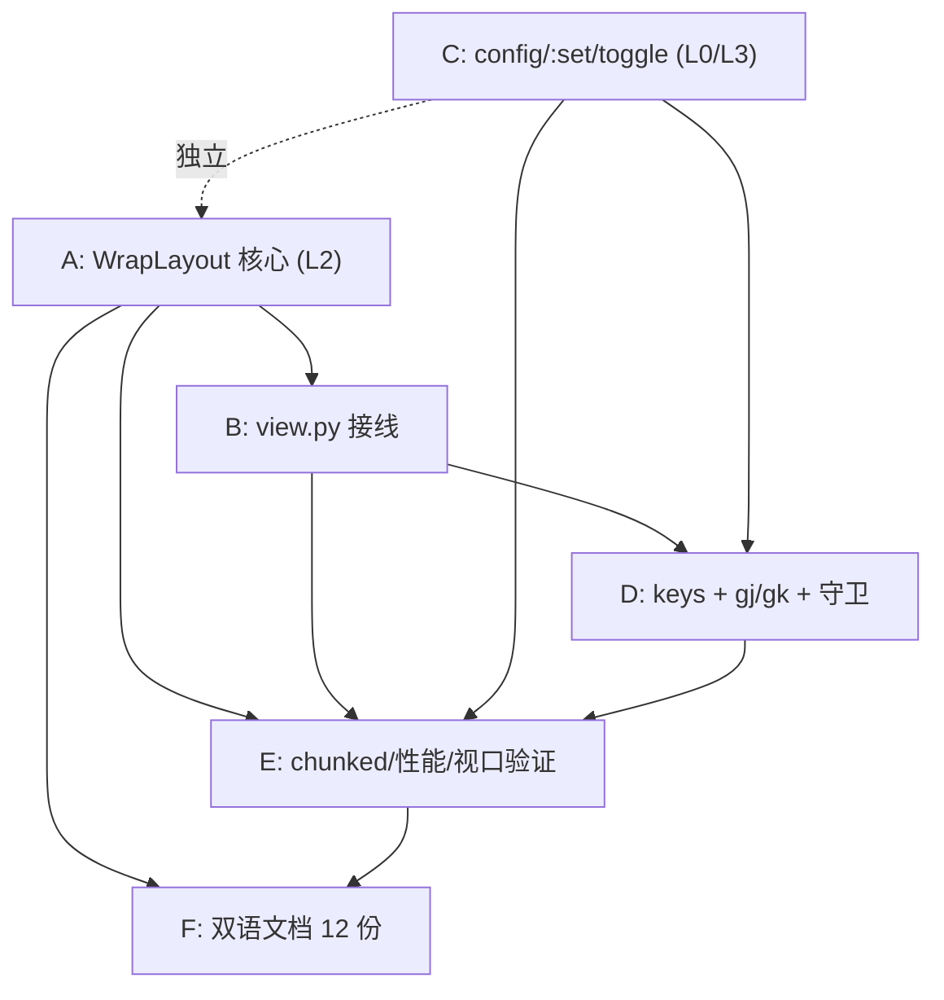

# FEAT - SOFT WRAP（issue IKVRXT）实施总纲

> **实施状态**：✅ 已实施 —— 2026-11-16（6 波 A-F 全部执行并提交、评审 APPROVE、门禁全绿、未合入 master，回填见 §十一。原状态：方案已定稿（总纲 + 6 份子计划 A-F 全部落盘），等待批准后进入执行。）
> 本总纲是压缩安全点：已确认的 `文件:行号` 级事实 + 设计骨架 + 波次表，后续续作
> 凭本文件 + 各子计划无损推进，不凭记忆重建事实。
> 偏离记录：规划子代理产出本总纲后被运行时回收（探活 `Recipient not found`），
> 6 份子计划由主代理按同一总纲兜底续作，事实依据见 §三/§七 的行号级取证。
> 规范来源：`.trae/rules/`（task-orchestration / plan-before-execute /
> architecture-boundaries / python-coding-style / doc-conventions /
> subagent-workflow / git-commit-message / misc-rules），已全部精读。

## 一、任务定位与判据

- issue：Gitee IKVRXT，`feature`，标题 `FEAT - SOFT WRAP`。
- 目标：编辑器**显示层**软换行 + 切换入口（alt+z / yaterc / :set）+ vim gj/gk 显示行移动
  + chunked loading 兼容 + 双语文档同步。
- 大任务判定（三条全中，必须拆子计划，无例外）：
  1. 文件多：产品源码预计改动 ≥ 12 个文件，另加 ≥ 10 个双语文档 + 若干测试文件；
  2. 跨层：改动横跨 L0（`keymaps/keys.py` / `config.py` / `yaterc_options.py` /
     `editor_core`）、L1（`keymaps/vim.py` / `vsc.py` / `base.py` / `session.py`）、
     L2（`editor_components/view.py` 及新增折行模块）、L3（`actions.py` / `commands.py` /
     `editor.py` / `flows/`）；
  3. 底层多处修改：`keymaps`（共享模型被全部上层依赖）、`config` / `yaterc_options`
     等 L0 叶子存在多点改动，必须分波验证、逐波回归。
- 结论：采用 `.trae/documents/soft-wrap-plans/` 子计划目录（总纲 `overview.md` +
  `soft-wrap-<subtask>-plan-<a|b|c...>.md`），命名遵循 `doc-conventions.md` §一。

## 二、需求拆解（九个域）

| 域 | 内容 | 主要落点 |
|---|---|---|
| D1 折行显示 | 按显示单元格宽度折逻辑行为多个显示行；tab 沿用展开口径、宽字符沿用 cell_offsets；内容零修改 | L2 新增折行映射模块 + `view.py` |
| D2 视口重算 | 窗口宽度变化 / 切标签 / 切 keymap 随视口重算并保证光标可见 | `view.py` / `editor.py` / `session.py` |
| D3 关闭回归 | wrap 关闭时长行横向滚动、一逻辑行一显示行、j/k 与横向滚动语义零变化 | `view.py` 分支 |
| D4 折行态正确性 | 行号槽 / 鼠标点击 / 光标曝光 / 语法高亮 / 诊断标记 / 手动横向滚动不错位 | `view.py` / `highlighting.py` |
| D5 切换入口 | alt+z 全局 toggle，vim+vsc；keys.py 共享常量；which-key 提示；保留键检查；键位漂移守卫 | keys.py / vim.py / vsc.py / actions.py / test_architecture.py |
| D6 配置入口 | yaterc `wrap = on|off` + `:set wrap=on|off`，默认 no-wrap，既有 yaterc 零迁移 | config.py / yaterc_options.py / commands.py / editor.py |
| D7 gj/gk 语义 | 仅 vim：wrap on 按显示行、off 退化逻辑行；融入 g 前缀状态机；count 定稿；不破坏 gg/计数/which-key/未知第二键丢弃 | vim.py + 注入回调 |
| D8 chunked 兼容 | 显示行→逻辑行映射后再 ensure_row；wrap/视口变化只触发视图重算；懒加载、区间表、占位、后台扫描、locked 写保护不漂移 | view.py / chunked_flows.py（不改 chunked API / buffer 口径） |
| D9 双语文档 | 8 组文档同轮同步 | manual/yaterc/which-key/FEATURES/README/CHANGELOG 的 en+zh |

## 三、调研取证（已确认事实，`文件:行号`）

### 3.1 渲染主路径（L2 `editor_components/view.py`，668 行）

- `EditorView(ScrollView, HighlightMixin)`（`view.py:72`）：纯渲染器，几何/高亮/每窗格视图状态自持；
  协作者为具体对象（`panes` / `session` / `lsp` / `keymaps`）+ 回调（`handle_key` /
  `handle_mouse` / `ensure_row`）。
- 构造参数（`view.py:90-102`）：`leaf_id, panes, session, lsp, keymaps, handle_key,
  handle_mouse, ensure_row, **kwargs`。`self._ensure_row` 是 chunked 文档渲染路径钩子
  （`view.py:109-111`），`ensure_row=None` 表示普通文档。
- `self.scroll_col = 0`（`view.py:121`）：**手动横向滚动列**（cell 单位）；Textual 的
  `virtual_size.width` 被刻意设成滚动区宽以让 `max_scroll_x` 恒 0（`view.py:230-235`）。
- `content_changed()`（`view.py:179-190`）：`_update_virtual_size()` → `reveal_cursor()` →
  `refresh()` → 记录 `_painted_doc` / `_painted_version`。
- `content_stale`（`view.py:192-204`）：只读 peek，调度层 `_refresh_views` 用它门控非活动窗格。
- `_update_virtual_size()`（`view.py:230-235`）：`virtual_size = Size(width, max(1, buf.line_count))`
  → **现状虚拟高度 == 逻辑行数**。wrap 开启后必须改为「显示行总数」。
- `on_resize()`（`view.py:237-239`）→ `_update_virtual_size()`；视口宽度变化触发点。
- `on_key()`（`view.py:241-250`）：转发 `dispatch_key` 后 `event.stop()` + `prevent_default()`
  （R10：一次按键只派发一次）。
- `buffer_pos_from_mouse()`（`view.py:252-267`）：`row = clamp(event.y + scroll_offset.y)`，
  `cell = event.x - gutter_width() + scroll_col`，`col = theme.cell_to_char(...)`。
  **现状 `scroll_offset.y` 直接当逻辑行号**；wrap 开启后必须先「显示行→(逻辑行, 续行)」映射。
- `reveal_cursor()`（`view.py:312-343`）：按 `row/cell` 调 `scroll_col`（横向）与
  `scroll_to(y=row)`（纵向，`scroll_offset.y` 为逻辑行）。wrap 开启后纵向须按显示行算。
- `page_delta()`（`view.py:345-347`）：按 `size.height` 计算页行数（逻辑行口径）。
- `gutter_width()`（`view.py:349-351`）：`max(3, len(str(line_count))) + 3`（行号列 + 诊断标记 + 空格）。
- `_syntax_kinds()`（`view.py:353-369`）：per-cell token kind，依赖 `offsets` 前缀表；按逻辑行 row 取 token。
- `render_line(y)`（`view.py:373-499`，**折行改造核心**）：
  - `view_w = size.width or 80`（`377`），`gutter_w`（`387`），`text_w = view_w - gutter_w`（`388`）。
  - welcome 页分支（`396-401`）；`y += self.scroll_offset.y`（`405`，可见行→逻辑行）；
  - `if self._ensure_row is not None: self._ensure_row(y)`（`408-409`，**按逻辑行 y 加载 chunk**）；
  - `line = buf.lines[y]`（`414`）；`offsets = theme.cell_offsets(line, tab_width)`（`422`）；
  - `cells` 展开（`425-435`）；`kinds` / `line_diags` / `underlines` / `_row_style_ranges` 均按逻辑行 y（`439-443`）；
  - gutter 行号 `num = str(y+1).rjust(digits)`（`461`）；
  - 文本窗口（`474-499`）：`end = min(self.scroll_col + text_w, n_cells)`，逐 cell 从
    `self.scroll_col` 到 `end` 绘制。**折行只需把这里改成「取逻辑行的第 k 个折行片段的 cell 窗口」**。
- `_row_style_ranges()`（`view.py:563-626`）：selection / matches / cursor / 多光标的 cell 区间；
  全部按逻辑行 `offsets` 计算，折行改动须把这些区间映射到对应续行的 cell 窗口。
- `_diagnostic_underlines()`（`view.py:533-561`）、`_matches_for_row()`（`628-646`）、
  `_cell_style()`（`648-668`）：均按逻辑行 row。

### 3.2 字符几何（L2 `editor_components/cells.py`，148 行；`theme` 门面再导出）

- `cell_width` / `cell_len` / `truncate_to_cells` / `char_to_cell` / `cell_to_char` /
  `cell_offsets` / `expand_char`（`cells.py:31-149`）：tab 展开到下一制表位、宽字符 2 cell、
  combining 0 cell。`cell_offsets(line, tab_width)` 返回 `len(line)+1` 的 char→cell 前缀表。
- 这套口径是 AC2「tab 与宽字符不半截折行」的现成基础，折行映射必须复用，禁止另造宽度算法。

### 3.3 高亮缓存（L2 `editor_components/highlighting.py`，471 行）

- `HighlightMixin._tokens_for(row)`（`192-229`）、`tokens_for(row)`（`357-365`）、
  `_rebuild_tokens_on_edit(row)`（`231-355`）：token 缓存以**逻辑行 row** 为索引，
  key 为 `(doc, filetype, content_version)`。折行不改变 buffer 行 → token 缓存零改动，
  续行共享同一逻辑行的 token，只是 cell 窗口不同。
- 结论：D4「语法高亮不错位」通过「续行取同一逻辑行 tokens + 局部 cell 偏移」实现，
  不改 `highlighting.py`（除非要公开查询接口）。

### 3.4 chunked 机制（L0 + L3）

- `editor_core/chunked.py:159-169` `chunk_for_row(row)`：逻辑行→chunk 索引（bisect）；
  `read_rows(start,count)`（`171-195`）按逻辑行读。
- `flows/chunked_flows.py:34` `ChunkedFlows`；`ensure_row(doc, row)`（`86-117`）以**逻辑行**
  为单位：`rows_loaded` 区间表命中即返回，否则 `chunk_for_row(row)` 读整个 chunk 并
  `fill_lines`；`attach`（`57-72`）首块同步填充；`_scan_to_completion`（`149-176`）
  后台扫描 + `_extend_placeholders`（`178-181`）扩展占位行；`promote_to_full`（`121-136`）。
- `editor.py:302-314` `_ensure_chunked_row(leaf_id, row)`：视图 `ensure_row` 回调的路由，
  仅 chunked 文档才转 `chunked_flows.ensure_row(doc, row)`。
- `editor.py:289-300` `make_view()`：`ensure_row=partial(self._ensure_chunked_row, leaf_id)`。
- **硬契约**：以上全部以逻辑行为单位，不得改口径。视图层负责「显示行→逻辑行」映射后
  再调 `ensure_row`。buffer 的 `_loaded_starts/_loaded_ends/rows_loaded/fill_lines/
  extend_placeholders` 不动（待读 buffer.py 复核行号）。

### 3.5 键位记法与漂移守卫先例（L0 `keymaps/keys.py`，228 行）

- `parse_key`（`108-167`）/ `key_name`（`179-228`）：`<alt-x>` → `"\x1b" + "x"`（`145-146`）。
  ⇒ `<alt-z>` 解析为 `"\x1bz"`（单字符 + ESC 前缀，非 CSI）。
- 共享常量先例：`HOVER_DOC_KEY`（`60`）、`MACRO_RECORD_KEY/PLAY/REPLAY_LAST`（`62-66`）、
  `MACRO_CONTROL_KEYS`（`173-176`）、`MACRO_REGISTER_CHARS`（`70`）。
- ⇒ alt+z 常量 `SOFT_WRAP_KEY`（定稿名，见 §五）落在 `keys.py`，两侧 `build_bindings()`
  只引用常量；守卫对齐 `test_hover_key_is_shared_and_identical` /
  `test_macro_keys_are_shared_and_identical`。

### 3.6 keymap 基类与模型（L1 `keymaps/base.py`，244 行）

- `KeyUi`（`55-69`，frozen dataclass）：`execute_action / message / command_prompt /
  find_prompt / goto_prompt / toggle_keymap`。**新增 UI 能力经此注入**（§四既定机制：
  具体对象 / 回调），keymap 层不 import 组件。
- `ActionContext`（`72-88`）：`session` + `ui` + `buffer` / `doc` 属性。
- `Keymap`（`90-244`）：`bindings` / `_index`；`build_bindings`（`125`）；`add_binding` /
  `remove_binding`（`136-169`，扩展系统）；`lookup`（`171`）；`dispatch`（`177-194`）；
  `handle_key`（`196-201`）；`handle_unbound`（`203-226`）；
  `reserved_keys`（`105`，硬编码分支占用表）、`chord_hints`（`107-119`，which-key 候选）、
  `pending_prefix`（`228-235`）、`take_pending_count`（`237-244`，默认恒 1）。
- ⇒ gj/gk 若要访问「显示行映射」（在 L2 视图），按 R4 不得让 L1 import L2；
  须经 `KeyUi` 注入回调或 action 名 + `execute_action`（待 §四/§五定稿）。

### 3.7 vim keymap（L1 `keymaps/vim.py`，1546 行，>800 行已登记 §三.7 豁免）

- `_MOTION_CODES`（`55`）、`_PREFIX_MOTIONS = ("g","f","F","t","T")`（`65`）、
  `_PREFIX_KEYS`（`66`）、`_ARG_PREFIXES`（`71`）、`_FIND_PREFIX_HINTS`（`75`）、
  `RESERVED_KEYS`（`93-95`）。
- `VimKeymap` 状态字段（`130-138`）：`mode/op/prefix/obj_scope/op_count/count_str/
  last_find/pending_register`；`self.prefix` 即 g 前缀待决状态。
- `build_bindings`（`147-245`）：`gg`（`159`）、hover（`235`）、macro（`237-239`）、
  screensaver（`225-227`）、toggle_keymap（`232`）、toggle_whichkey（`233-234`）。
- `handle_key`（`247-...`）：ctrl+/ 等 raw key 在 mode dispatch 前处理（`255-261`）；
  `_clear_pending`（`293-298`）；`pending_prefix`（`300-334`）；`chord_hints`（`336-...`）。
- **待读**：g 前缀 follower 的具体分派（`gg` / 未知第二键丢弃）、count 累积、
  `take_pending_count` 覆写、`chord_hints` 全文。这是 gj/gk 融入的关键（§七 D7）。

### 3.8 vsc keymap（L1 `keymaps/vsc.py`，132 行）

- 表驱动，`build_bindings`（`42-132`）用 `_k(spec, action, ...)`；`HOVER_DOC_KEY`
  从 `base` re-export 引入（`8`），MACRO_* 从 `keys` 引入（`13`）。无 gj/gk。
- ⇒ vsc 只需新增一行 alt+z 绑定（引用共享常量），零 gj/gk。

### 3.9 action 表（L3 `actions.py`，251 行）

- `populate(registry, editor)`（`26-251`）：`reg(name, lambda ctx: ..., desc)`。
  view 类动作调 editor 方法：`page_up`（`85`）、`toggle_whichkey`（`231`）、
  `toggle_keymap`（`233`）、`toggle_screensaver`（`235`）、`show_hover_docs`（`212`）。
- ⇒ `toggle_soft_wrap` 动作在此注册，指向 `editor.toggle_soft_wrap()`（待定稿，
  见 §五）。macro 动作演示了「editor 属性 + session 状态」的取数方式（`240-249`）。

### 3.10 Editor（L3 `editor.py`，807 行，>800 行已登记 §三.7 豁免）

- 组装经 `editor_compose.py` 的 `_build_*` 工厂（`editor.py:32-39`、调用 `183-188`）；
  按键/鼠标分派经 `editor_dispatch.py`（`40-48`）。
- `make_view`（`289-300`）、`_ensure_chunked_row`（`302-314`）见 §3.4。
- `refresh_ui`（`442-448`）→ `_refresh_views`（`469-485`，活动窗格恒重绘）/ chrome / lsp。
- `page(direction, half)`（`610-618`）：按 `buf.row ± rows` 设逻辑行光标。
- `select_keymap`（`622-629`）：切 keymap 后 `refresh_ui()`。
- `set_readonly`（`692-703`）、`set_filetype`（`705-740`）：`:set xxx=` 的 editor 侧处理范式
  （`command → editor.set_xxx(value) → message + refresh_ui`）。
- **待读**：`editor_compose.py::_build_key_ui`、`editor_dispatch.py::_handle_key /
  _handle_raw_key / _execute_action`、`session.py::ViewState`（scroll_row / scroll_col 持久化）、
  `commands.py::register_commands` 的 `:set` 分派、`config.py` / `yaterc_options.py` 选项链路、
  `test_architecture.py` 守卫常量集合。

## 四、架构边界约束（设计红线，来自 `architecture-boundaries.md`）

- 依赖严格向下；L2 组件不得 import `yate.editor` / `yate.app`（R3）；
  L0/L1 `keymaps` / `config` / `yaterc_options` / `session` 不得 import `editor_components`（R4）。
  ⇒ 「显示行映射」若需被 keymap 查询，只能经 `KeyUi` 注入的 `Callable`（§四既定机制），
  禁止下沉 L2 类型或新协议。
- 禁止新增 `Protocol`（R2，冻结 4 类白名单）/ `TYPE_CHECKING`（R6）/ `Any`（§三.3，
  除现有 `**kwargs: Any` 存量）/ `# type: ignore`；命名守卫禁 `*Feature/*Host/*Ops/
  *Delegate/*Controller`（§五）；ASCII 注释与 docstring（misc-rules §四）；
  绝对导入（R/§一.3）；源码禁家目录路径；R11 flows 冻结耦合；R13 组件自持主题；
  R15 可滚动组件滚动条接线（新增 ScrollView 子类须调 `apply_slim_scrollbars` +
  `apply_scrollbar_theme`——若折行模块仍复用 `EditorView` 这一 ScrollView 则无新增子类）。
- 新增 L3 流程模块须走 §三.8 六条接入清单（本任务倾向**不新增** flows 模块，
  折行属纯渲染计算，归 L2，详见 §五备选方案）。
- 文件 >800 行须处置：`vim.py`(1546) / `editor.py`(807) / `buffer.py`(1565) 已在
  `SIZE_EXEMPT_FILES` + 规则 §三.7 两处登记；新增/膨胀模块须显式给拆分或豁免结论。
  守卫镜像 `test_editor_size_exemption_is_registered`（断言集合长度为 6）。

## 五、5 项定稿（结论待 §六 续作补全，先记倾向与依据）

> issue【七】要求方案阶段逐项定稿并给依据；以下为初稿倾向，须在读完 §3.10 待读清单
> 与选项链路后最终确认，并把「结论 + 依据 + 对应 AC」写入各子计划。

1. yaterc / :set 选项名与默认值：倾向 `wrap`（`on|off`，默认 `off`）。
   依据：issue 示例 `wrap = on|off`；默认保持现状 no-wrap ⇒ 既有 yaterc 零迁移。
   对应 AC1/AC3/AC9。
2. gj/gk 的 count 语义：倾向 `count` 按**显示行**重复（vim 原生 gj/gk 口径），
   wrap off 时退化为逻辑行重复（与 j/k 一致）。依据：vim 惯例 + issue「count 前缀按显示行
   重复口径你定稿」。对应 AC4。
3. 续行行号呈现：倾向**续行行号槽留空**（仅逻辑行首行显示行号，续行显示空格 +
   诊断标记槽保持）。依据：稳定可预期、不占额外宽度、不重复编号、与 gutter 现有
   `digits` 宽度一致。对应 AC6。
4. 折行按字符还是按词边界：倾向**按显示单元格（字符）折行**，不按词。
   依据：issue【六】「不引入按词折行以外复杂排版」+ AC2 要求 tab/宽字符不半截折行
   （字符级 + cell_offsets 口径即可满足）；按词会引入断词规则、CJK 无空格分词、
   与 cell_offsets 口径冲突。对应 AC1/AC2/AC8。
5. wrap 开启时水平滚动处理：倾向 `scroll_col` 恒 0（禁用手动横向滚动，
   `reveal_cursor` 不再调横向分支），alt+z 切回 off 时恢复。依据：折行后一逻辑行
   已完整铺满显示行宽度，横向滚动无内容可看；保留 scroll_col=0 可让「折行态鼠标点击 /
   光标曝光」几何与 off 态共用 `cell = event.x - gutter_width() + scroll_col` 而无需分支。
   对应 AC3/AC6。

## 六、待续作（下一步）

1. 读 `vim.py` g 前缀 follower 分派 / count / take_pending_count / chord_hints 全文段落；
2. 读 `config.py` / `yaterc_options.py` / `commands.py` 选项与 `:set` 链路（定位注册行号）；
3. 读 `editor_compose.py::_build_key_ui` / `editor_dispatch.py` / `session.py::ViewState` /
   `panes.py` scroll 状态 / `document.py`（open_chunked 契约）；
4. 读 `test_architecture.py`：`UI_FROZEN_FILES` / `SIZE_EXEMPT_FILES` / 键位守卫用例 /
   `UPWARD_EDGES_FROZEN` / 命名守卫，确定新增守卫用例落点；
5. 读 `whichkey_flows.py` / `whichkey.py` / `conflicts.py` 确认 which-key 提示与保留键检查；
6. 读 8 组双语文档定位键位表 / :set 选项表 / yaterc 选项表 / 速查表锚点；
7. 定稿 §五 5 项 → 备选方案与否决理由 → 子计划拆分 + 波次表 + Mermaid 图 →
   逐子计划写输入/独占文件/定位改动/测试用例/验证命令/风险回滚；
8. 每份文档落盘后统计行数，向 team-lead 汇报。

## 七、第二批取证与设计定稿（覆盖 §五 的「倾向」，作为子计划唯一依据）

### 7.1 vim g 前缀状态机（gj/gk 融入点，行号级）

- `_handle_normal`（`vim.py:755-...`）：count 累积 `783-789`（数字且 `prefix not in
  _ARG_PREFIXES`；`g` 不在 `_ARG_PREFIXES`(`71`) ⇒ `3gj` 先把 `count_str` 累成 "3"
  再进 g 分支）；`prefix=="g" and key=="g"` → `_resolve_gg(ctx)`（`793-795`）；
  find/r follower（`796-808`）；`if self.prefix is not None: self.prefix=None`
  （`809-811`，**未知第二键丢弃后按新键重新处理** —— 不得破坏）；arm prefix
  （`824-829`）；`_ARROW/_MOTION_CODES` → `_motion(ctx,...,self._typed_count())`
  （`840-843`）；`_clear_pending`（`293-298`）清 prefix + count_str。
- `_handle_visual`（`vim.py:514-693`）：`prefix=="g" and key=="g"` →
  `_resolve_visual_gg`（`549-551`）；未知 follower 丢弃（`576-577`）；motion 分支
  `_motion(..., typed, select=True)`（`681-688`）。
- `chord_hints`（`vim.py:336-396`）：`prefix=="g"` 返回单行
  `(("g","go to line N / first line (gg)"),)`（`377-378`）—— gj/gk which-key 候选
  必须并入此行；`count_str` 分支含 `("g","go-to prefix")`（`391`）。
- `_MOTION_CODES`（`55`）含 j/k/g；`_PREFIX_MOTIONS`（`65`）含 g；
  `RESERVED_KEYS`（`93-95`）为 esc/ctrl 类硬编码占用键，**不含 `\x1bz`**
  ⇒ alt+z 可作表驱动绑定，无需进 reserved。
- ⇒ 融入方式：在 `_handle_normal` 的 `793` 之后新增
  `prefix=="g" and key in ("j","k")` 分支，用 `_typed_count()` 取 count、
  清 `prefix`/`count_str`、调注入回调（见 §7.4）；`_handle_visual` 同位置加
  select 版本；`chord_hints` 的 `377` 行扩为 `("g j k", ...)`。
  未知 g follower 的丢弃语义、`gg`、数字计数不受影响（新分支只多认 j/k 两个键）。

### 7.2 KeyUi 注入面（关键：新增字段带默认值 ⇒ 测试构造零改动）

- `KeyUi`（`base.py:55-69`，`@dataclass(frozen=True)`）现有 6 字段，全部无默认。
- 生产构造唯一一处：`editor_compose.py:397-404`（关键字参数）。
- 测试构造 5 处：`tests/conftest.py:356`、`test_vim_keymap.py:51`、
  `test_registries.py:26`、`test_input_assist.py:76`、`test_editor_core.py:770`
  （均为关键字参数）。
- **注入查询回调的既有先例**：`editor_compose.py:381-382`
  `which_key_enabled=lambda: ed.config.which_key` / `which_key_auto_enabled=...`
  注入 WhichKeyFlows ⇒ 视图读全局配置走「构造注入 `Callable[[], bool]`」是本项目
  既定形态（R4 合规：L2 不 import L0 config，只收回调）。
- ⇒ 定稿：`KeyUi` 末尾新增带默认值字段
  `move_display_line: Callable[[int, int], None] | None = None`
  （direction=±1, count>=1；`None` = headless/legacy 测试，vim 分支退化为逻辑行移动）。
  5 处测试构造零改动；仅 `editor_compose.py:397` 注入真实实现。
  （备选：`execute_action(name)` 循环 —— 否决，count 无法经 `str` 名传递、
  10gj 会 10 次查表、字符串动作名多一层间接；见 §六 B3。）

### 7.3 配置链路（行号级）

- `config.py:34-39` `KNOWN_OPTIONS`（yaterc 已知变量）→ 新增 `"wrap"`；
  `config.py:139-213` `YateConfig` → 新增 `wrap: bool = False`（默认 off，
  既有 yaterc 零迁移）；`config.py:299-370` `SET_OPTION_SPECS` → 新增
  `SetOption("wrap", (), _parse_bool_option, "wrap must be on|off ...",
  "wrap=on|off")`；`parse_bool`（`223-230`）/ `_parse_bool_option`（`290-292`）复用；
  `set_option_names()`（`373-377`）自动派生，补全列表零改动。
- `commands.py:36-40` `SET_OPTION_INDEX`（从 specs 派生）；`:47` `SET_APPLY`；
  `141-151` `SET_APPLY.update(...)` → 新增 `wrap=_apply_wrap`；`_set`（`429-460`）
  分派 `apply(editor, parsed)`；`_apply_support_mouse`（`95-98`）范式：
  `_apply_wrap(editor, value)` → `editor.set_soft_wrap(cast(bool, value))`。
- `editor.py` 的 `set_readonly`（`692-703`）/ `set_filetype`（`705-740`）是
  `:set xxx=` 的 editor 侧范式：改状态 → `message(...)` → `refresh_ui()`。
- **待读**：`yaterc_options.py` 的选项提取/校验（新增 option 的类型校验落点）、
  `commands.py:_set` 全文、`test_set_options.py` 的 specs/apply 覆盖守卫。

### 7.4 5 项定稿（最终结论 + 依据 + 对应 AC）

1. **选项名与默认值**：`wrap`（yaterc `wrap = on|off`，`:set wrap=on|off`），
   默认 `off`。依据：issue 示例口径；默认保持 no-wrap ⇒ 既有 yaterc 零迁移；
   `config.py` 已有 `parse_bool` / `_TRUTHY|_FALSY`（`219-230`）接受
   `on|off|true|false|1|0|yes|no`。对应 AC1/AC3/AC9。
2. **gj/gk count 语义**：count 按**显示行**重复（vim 原生 gj/gk 口径）；
   wrap off 时由视图层退化为逻辑行重复（与 j/k 一致）；headless（回调为 None）
   时 vim 分支直接按逻辑行重复。依据：`_typed_count()` 已在 g 分支前累积
   （`783-789`），复用现有 count 状态机，不破坏 `gg`/数字计数。对应 AC4。
3. **续行行号呈现**：仅逻辑行**首显示行**显示行号；其续行行号槽填空格
   （`digits` 宽度不变），诊断标记槽（`mark`）保持首行判定、续行沿用同一
   逻辑行的 `line_error/line_warn` 标记。依据：稳定可预期、不占额外宽度、
   不重复编号、gutter 几何零变化、诊断归属逻辑行不错位。对应 AC6。
4. **折行粒度**：按**显示单元格（字符）**折行，不按词。依据：AC2 要求
   tab/宽字符不半截折行 —— `cells.py` 的 `cell_offsets`/`expand_char` 口径
   天然按 cell 且宽字符不拆；按词会引入断词规则、CJK 无空格分词、与
   cell_offsets 冲突，且 issue【六】明确不引入复杂排版。对应 AC1/AC2/AC8。
5. **wrap 开启时水平滚动**：`scroll_col` 强制归 0 并禁用手动横向滚动
   （`reveal_cursor` 跳过横向分支、鼠标 `cell` 计算中 scroll_col 恒 0）；
   切回 off 时恢复既有横向滚动（scroll_col 保留在 ViewState）。依据：折行后
   逻辑行已完整铺满显示行宽度，横向无内容可看；scroll_col=0 让折行态鼠标/
   光标曝光几何与 off 态共用同一公式，避免分支错位。对应 AC3/AC6。

### 7.5 关键设计决策（供子计划展开）

- **状态归属**：运行时开关放 `editor` 持有的 `config.wrap`（L0 数据对象，
  与 `support_mouse`/`which_key` 同形态）；`alt+z` 与 `:set wrap=` 都改它并
  `refresh_ui()`。视图不读 config，改由 `make_view` 注入
  `wrap_enabled: Callable[[], bool]`（仿 `which_key_enabled` 先例）。
  折行布局缓存属**视图私有渲染状态**（per-pane），不进 session/buffer。
- **折行映射数据结构**（AC8）：per-pane 缓存 `WrapLayout`，缓存 key =
  `(doc identity, content_version, text_w, wrap_enabled)`；维护「逻辑行 →
  显示行数」数组 + 前缀起点数组（惰性构建到所需逻辑行，扩展增量 O(新增行)）；
  `render_line(y)` 从 `scroll_offset.y`（wrap 时为显示行索引）bisect 定位起点
  逻辑行 + 续行 index，仅 O(log n) + O(可见行) 每帧；内容 version 变化
  （`buffer.py:341` `fill_lines` / `356` `extend_placeholders` 均 bump
  `content_version`）→ 缓存失效按增量重建，不随每次渲染重扫全文。
- **chunked 契约**：`render_line` 在「显示行 → 逻辑行」映射完成后，用**逻辑行**
  y 调 `self._ensure_row(y)`（`view.py:408-409` 位置不变，仅 y 语义由
  「可见行+offset」改为「映射后的逻辑行」）；`chunked_flows.ensure_row` /
  `chunk_for_row` / buffer 区间表全不动。未加载占位行按空行 = 1 显示行。
- **显示行移动**：L2 `EditorView.move_display_line(direction, count)` 用
  WrapLayout 把 (cursor 逻辑行, cell 列) → 当前显示行 index + 续行内 cell 偏移
  → 目标显示行 → (目标逻辑行, char col) → `buf.set_cursor(..., select=...)`；
  保持「续行内 cell 偏移」（软折行下每显示行从屏幕列 0 起，等价于 vim
  screen column，符合跨逻辑行落点惯例）；wrap off 退化为逻辑行移动。
  L3 `editor.py` 新增薄委托 `move_display_line(direction, count)` 转发到
  `panes.active_view`，由 `_build_key_ui` 注入 `KeyUi.move_display_line`。
- **alt+z 接线**：`keys.py` 定 `SOFT_WRAP_KEY = "<alt-z>"`（解析 `"\x1bz"`）；
  `vim.py` / `vsc.py` 的 `build_bindings` 各加一行引用常量绑定
  `toggle_soft_wrap`；`actions.py` 注册 `toggle_soft_wrap` →
  `editor.toggle_soft_wrap()`（翻转 `config.wrap` + `refresh_ui()` +
  message）；which-key 提示经绑定表 `description` 自动呈现（对齐 hover/macro）。
  键位漂移守卫对齐 `test_hover_key_is_shared_and_identical` /
  `test_macro_keys_are_shared_and_identical`。

### 7.6 备选与否决（初稿，§六 展开）

- B1 视图层硬折行（在 buffer 插入 `\n`）：否决 —— 违反 AC1「buffer 文本/undo/
  文件零变化」、改 LSP 位置语义、undo 粒度。
- B2 新 L3 `soft_wrap_flows.py` 流程模块承载折行：否决 —— 折行是纯渲染几何，
  归 L2 更贴合 §二分层职责；新增 flows 须走 §三.8 六条接入清单，无行为收益
  （§四红线：不为假设性需求预造抽象）。
- B3 gj/gk 用 `execute_action("move_display_line_*")` 循环：否决 —— count 无法
  经 `str` 动作名传递，10gj 退化 10 次查表 + 10 次折行定位。

## 九、波次总表（执行唯一依据）

| 波次 | 子计划 | 独占文件 | 依赖 | 核心验收 |
|---|---|---|---|---|
| A | `soft-wrap-core-plan-a.md` | NEW `editor_components/wrap_layout.py` + `tests/test_wrap_layout.py` | 无 | pyright + `pytest tests/test_wrap_layout.py -n 1` |
| B | `soft-wrap-view-plan-b.md` | `editor_components/view.py` | A | 现有渲染测试全绿（AC3）+ 架构守卫（R15/层秩） |
| C | `soft-wrap-config-plan-c.md` | `config.py` / `yaterc_options.py` / `commands.py` / `actions.py` / `editor.py` + `tests/test_set_options.py` + NEW `tests/test_soft_wrap_config.py` | 无（可与 A/B 并行，文件不重叠） | pyright + 选项测试 + 架构守卫（editor.py 体量豁免） |
| D | `soft-wrap-keys-plan-d.md` | `keymaps/{keys,vim,vsc,base}.py` / `editor_compose.py` / `tests/test_architecture.py` + NEW `tests/test_soft_wrap_keys.py` | B（view 显示行移动）+ C（toggle action） | vim 键位测试 + 架构守卫 42 条 + 键位漂移守卫 |
| E | `soft-wrap-robustness-plan-e.md` | NEW `tests/test_soft_wrap_chunked.py`（+ 仅测试暴露 bug 时的最小修复，登记偏离） | A-D | chunked 测试 + 性能 spy + 视口/tab/keymap rewrap |
| F | `soft-wrap-docs-plan-f.md` | 12 个双语文档（6 对 en/zh） | A-E 语义定稿 | `git diff --check` + 双语 grep（纯文档可豁免测试） |

- 并行策略：波次 A/B/C 中 A 与 C 文件完全不重叠（A=新模块+测试，C=配置/动作/editor+测试）→ 可并行一批；
  B 依赖 A 的 `WrapLayout` 模块存在 → A 完成再派 B；C 与 B 文件不重叠（editor.py 在 C，view.py 在 B）→ B/C 可并行一批；
  D 依赖 B+C；E 依赖 A-D；F 依赖语义定稿。批大小 2~3，硬上限 6，全程 `bypassPermissions`。
- 文件独占：每波执行者只能改本波独占文件清单；产品源码 `yate/` 由执行者改（plan-executor 剧本允许范围内），
  主代理保留门禁与提交权。

## 十、风险与回滚总览

- **AC3 回归**（最大风险）：wrap-off 必须与现状逐字节一致 → Plan B 用 Plan A 的 identity span 统一路径，先跑现有渲染测试。
- **AC7 chunked 漂移**：`_ensure_row` 必须收到映射后的**逻辑行** → Plan B/E 双重断言；区间表与 locked 语义不动。
- **AC8 性能**：wrap 缓存 key 比较失败会退化为逐帧全扫 → Plan A 内部 rebuild counter 测试 + Plan E spy。
- **AC2 宽字符**：cell 边界处拆开宽字符 → 复用 `cell_offsets`/`expand_char`，整字推到下一显示行。
- **架构守卫**：L1 keymap 不得 import L2 视图 → 全部经 `KeyUi` 注入回调；无新增 Protocol/TYPE_CHECKING/Any。
- **体量阈值**：`vim.py`(1546)/`editor.py`(840，本任务 soft-wrap 接线 + visual select 转发后复测)/`editor_components/view.py`(816，本任务接线后新登记) 均在 `SIZE_EXEMPT_FILES`，守卫 `test_editor_size_exemption_is_registered` 断言集合长度为 7 且含 editor.py / view.py，规则 §三.7 两处同步。
- 全局回滚：各波独占文件可独立 `git checkout`；Plan A 新模块在 wiring 前无消费者，删除零副作用。

## 十一、执行结果与偏离（2026-11-16 收尾回填）

- **状态**：6 波（A-F）全部执行并提交；评审者零产出后主代理兜底自审，3 个 MAJOR 已修；门禁全绿；结论 APPROVE。评审记录见 [2026-11-16-soft-wrap.md](../../reviews/2026-11-16-soft-wrap.md)。
- **提交**：`11c9f97b` 方案 → `a1e56125`(A) → `525e3738`(C) → `f433e31e`(B) → `144ee9dd`/`451eb106` 主代理补接线与豁免 → `9a73a965`(D) → `0e7f8a66` 测试同步 → `a12a5468`(E) → `cd1011b4`(F) → `f4e3f5b7` 规则行数同步 → `0e25ca48`/`003432e6`/`ed74926f` 自审 3 MAJOR 修复 → `242efe69`/`30a8d02d`/`b9d0a527` 评审与总纲回填。未推送、未合入 master。
- **门禁真实值**：pyright `yate/ tests/ tools/ pack/` 0 errors / 0 warnings；`pytest tests/ -q -n auto` exit 0（覆盖率轮 3822 passed / 10 skipped）；架构 `42 passed`；覆盖率 TOTAL **92.90%**（阈值 75%）；冒烟 124/124 场景 · 1511/1511 checks exit 0；`git diff --check master...HEAD` 0。
- **偏离登记**：
  1. 规划子代理产出总纲后被运行时回收，6 份子计划由主代理兜底续作（事实依据均来自 §三/§七 行号级取证）。
  2. 评审子代理 spawn 成功但探活 >30 分钟零回信零落盘，按 `subagent-workflow.md` §五.3 判死为零产出，主代理按 `task-orchestration.md` §三 兜底自审。
  3. 主代理在波次间接缝亲自补 3 处接线（make_view 注入 wrap_enabled / editor.move_display_line 委托 / view.move_display_line 实现），归属经自审复核正确。
  4. view.py 越 800 行按 §三.7 登记单一职责豁免（规则 + `SIZE_EXEMPT_FILES` 两处同步，集合 6→7）；editor.py 实测行数 807→840 已同步规则文本（`test_size_exemption_rule_and_guard_are_in_sync` 曾两次因此转红，修复后绿）。
  5. E 波次一个测试曾断言 `rebuild_count == rb+1`，因 `pilot.pause()` 期间 Textual 合法重绘导致计数多增而失败；正本清源改为断言缓存键与 >= 下界，不依赖框架渲染调度（避免脆弱断言）。
  6. 自审发现并修复 3 个 MAJOR：WrapLayout 缓存键缺文档身份（切未编辑文档复用旧折行表，`0e25ca48`）、visual gj/gk 丢失选区（注入回调未传 select，`003432e6`）、wrap-off 默认态每击键 O(文档) 重建恒等表（`ed74926f`，改 O(1) identity 快路径；既有 identity 测试的 cell_end 期望改 0 并注明该字段 wrap-off 无人消费）；均带回归用例先红后绿。

## 八、后续待读（续作清单，历史留档；事实已在 §七 补齐）

1. `yaterc_options.py` 选项提取/校验 + `commands.py:_set` 全文 + `test_set_options.py`
   specs/apply 守卫；
2. `session.py::ViewState`（scroll_row/scroll_col 持久化）、`panes.py` 滚动状态、
   `document.py::open_chunked` 契约、`buffer.py` 的 `Pos`/`set_cursor`/`move_up`/
   `move_down` 与 chunked 原语精读；
3. `test_architecture.py` 的 `UI_FROZEN_FILES`/`SIZE_EXEMPT_FILES`/键位守卫/
   `UPWARD_EDGES_FROZEN`/命名守卫常量；
4. `whichkey_flows.py`/`whichkey.py`/`conflicts.py`（保留键检查、which-key 提示）；
5. 8 组双语文档锚点（键位表 / :set 选项表 / yaterc 选项表 / 速查表）；
6. 定稿子计划拆分 + 波次表 + Mermaid 图 + 逐子计划测试用例/验收命令/风险回滚。
