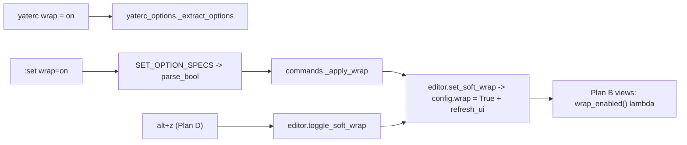

# Soft Wrap - Plan C: config, :set and toggle action (L0/L3)

> Source of truth: `overview.md` + issue IKVRXT. Independent of Plans A/B
> (config data + action plumbing; view reads it in Plan B via injection).
> Approval: unattended (auto-approved).

## 1. Goal / non-goals

- Goal: add `wrap` boolean option (yaterc + `:set wrap=on|off`) defaulting to
  `off` (no-wrap), plus a `toggle_soft_wrap` action flipping it at runtime.
- Non-goals: no key bindings (Plan D), no display-line movement (Plan D),
  no view rendering. Existing yaterc files need no migration (new key optional).

## 2. Facts (verified, file:line)

- `config.py:34-39` `KNOWN_OPTIONS` (yaterc recognized vars) -- add `"wrap"`.
- `config.py:219-230` `_TRUTHY/_FALSY` + `parse_bool()` accepts
  `on|off|true|false|1|0|yes|no`.
- `config.py:290-292` `_parse_bool_option()` wraps `parse_bool`.
- `config.py:176` `YateConfig.which_key: bool = True` -- data field precedent;
  add `wrap: bool = False` near it.
- `config.py:299-370` `SET_OPTION_SPECS` (`:set` single source of truth) --
  add `SetOption("wrap", (), _parse_bool_option,
  "wrap must be on|off ...", "wrap=on|off")` mirroring `which_key` (:356-362).
- `config.py:373-377` `set_option_names()` auto-derives from spec -> completion
  list needs no manual edit.
- `yaterc_options.py:467-469` `_extract_options` iterates `KNOWN_OPTIONS`;
  `:552-559` which_key `isinstance(bool)` validation -> add parallel `wrap`
  validation (bool check, else append config error).
- `commands.py:36-40` `SET_OPTION_INDEX` derived from specs; `:47` `SET_APPLY`;
  `:95-104` `_apply_support_mouse`, `:107-122` `_apply_which_key` are the
  apply-function precedents; `:141-152` `SET_APPLY.update(...)` registers them;
  `:429-460` `_set()` dispatches.
- `actions.py:26-251` `populate(registry, editor)`; `:231` `toggle_whichkey`,
  `:233` `toggle_keymap`, `:235` `toggle_screensaver` are toggle precedents;
  `:240-249` macro actions show the state+refresh pattern.
- `editor.py:622-629` `select_keymap`, `:692-703` `set_readonly`, `:705-740`
  `set_filetype` are editor-side `:set` handlers (state -> message ->
  `refresh_ui()`).
- `test_set_options.py` exists (7.79 KB): asserts specs/apply coverage -- must
  remain green and be extended for `wrap`.

## 3. Design

- `YateConfig.wrap: bool = False` (default off; AC1/AC3, zero yaterc migration).
- `commands.py::_apply_wrap(editor, value)`:
  ```python
  enabled = cast(bool, value)
  editor.set_soft_wrap(enabled)
  editor.message(f"soft wrap {'on' if enabled else 'off'}", kind="ok")
  ```
  Register `wrap=_apply_wrap` in `SET_APPLY.update(...)`.
- `editor.py::set_soft_wrap(enabled: bool) -> None`: set `self.config.wrap`;
  when turning off, reset each pane view's `scroll_col` to 0 (horizontal state
  is only meaningful in no-wrap; keep the previous value? overview §7.4 item 5
  says scroll_col retained in ViewState for off -> keep it, do not reset);
  call `self.refresh_ui()`. Document that Plan B's views read `wrap_enabled=lambda:
  ed.config.wrap` so a single refresh propagates.
- `editor.py::toggle_soft_wrap() -> None`: `self.set_soft_wrap(not self.config.wrap)`
  + message (message inside set_soft_wrap or here -- keep one owner).
- `actions.py::populate`: register `toggle_soft_wrap` -> lambda ctx:
  `ctx` carries editor via closure (`reg("toggle_soft_wrap", lambda ctx:
  editor.toggle_soft_wrap(), ...)`), mirroring `toggle_keymap`.
- Which-key prompt auto-appears via binding `description` (Plan D).

## 4. Files (exclusive)

- `yate/config.py`
- `yate/yaterc_options.py`
- `yate/commands.py`
- `yate/actions.py`
- `yate/editor.py`
- `tests/test_set_options.py` (extend)
- NEW `tests/test_soft_wrap_config.py`

## 5. Steps & acceptance commands

1. Add `KNOWN_OPTIONS`, `YateConfig.wrap`, `SET_OPTION_SPECS` entry.
2. Add `yaterc_options.py` bool validation for `wrap`.
3. Add `_apply_wrap` + `SET_APPLY.update`, extend `test_set_options.py`.
4. Add `editor.set_soft_wrap` / `toggle_soft_wrap` + `actions.populate` entry.
5. Write config tests: default False; yaterc `wrap = on` parses True;
   invalid value produces a config error; `:set wrap=on` flips config;
   `toggle_soft_wrap` action flips twice back to start.
6. Verify:
   - `.venv\Scripts\python.exe -m pyright yate/config.py yate/yaterc_options.py yate/commands.py yate/actions.py yate/editor.py tests/test_set_options.py tests/test_soft_wrap_config.py`
   - `.venv\Scripts\python.exe -m pytest tests/test_set_options.py tests/test_soft_wrap_config.py -q -n 1`
   - `.venv\Scripts\python.exe -m pytest tests/test_architecture.py -q` (editor.py size exemption unchanged; do not cross 810 lines without logging)

## 6. Risks / rollback

- Risk: editor.py 807 lines -> adding methods crosses 800 line exemption must stay
  registered (`SIZE_EXEMPT_FILES` already includes editor.py; guard asserts len==6
  and membership, not exact line count -> OK, no rule change needed; still log
  the new line count in the plan backfill).
- Risk: `:set` completion list drift -> `set_option_names()` auto-derives,
  no manual list; test coverage guard in `test_set_options.py` catches omissions.
- Rollback: revert the five source files; delete new test; restore test_set_options.py.

## 7. Mermaid


