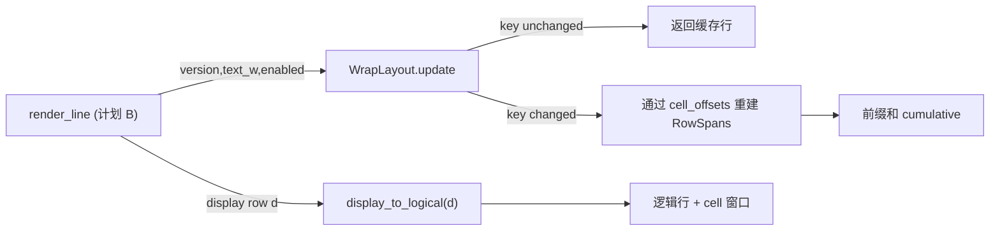

# 软换行 - 计划 A：换行布局核心（L2 纯计算）

> 唯一规范来源：`overview.md`（同目录）+ Gitee issue IKVRXT。
> 本子计划只负责纯显示行映射模块。不要触碰其它文件。负责人：一名执行者。审批：无人值守（自动批准）。

## 1. 目标 / 非目标

- 目标：新增一个纯粹的、按窗格划分的 `WrapLayout`，利用现有的 cell 几何函数将逻辑行映射为
  显示行，并采用以 `(content_version, text_w, wrap_enabled)` 为键的增量式、惰性缓存。
- 非目标：不做视图渲染变更（计划 B），不做按键处理，不做配置。
  不修改缓冲区文本，不插入换行符。不新增 `Protocol` /
  `TYPE_CHECKING` / `Any` / `# type: ignore`。注释与 docstring 使用 ASCII。

## 2. 事实（已核实，文件:行号）

- `yate/editor_components/cells.py:31-149`：`cell_offsets(line, tab_width)`
  返回一个长度为 `len(line)+1` 的 `char -> cell` 前缀表；`expand_char`
  将制表符扩展到下一个制表位，并将宽字符扩展为 2 个 cell。这是唯一的
  宽度权威来源（AC2）。复用它；不要自行发明宽度计算。
- `yate/editor_components/view.py:422` 为每个渲染行构建 `offsets = theme.cell_offsets(...)`；
  `theme` 是重新导出 `cells.py` 函数的门面。
- `buffer.content_version` 由 `fill_lines`（buffer.py:341）和
  `extend_placeholders`（buffer.py:356）以及每次用户编辑递增 —— 安全的缓存键。
- R15 守卫（`test_scrollable_widgets_apply_theme_scrollbar_pair`，AST 扫描
  `editor_components/**/*.py`）：定义 `ScrollView` 子类的新模块
  必须调用滚动条配对函数。`WrapLayout` 是普通类
  （无 Textual 控件基类）-> 不会被标记。`cells.py` 本身就是
  普通 L2 辅助模块的先例。

## 3. 设计

```
WrapLayout (plain class, no widget base, L2)
  fields: logical_rows: list[RowSpan], cumulative: list[int], version_key
  RowSpan = (logical_row: int, cell_start: int, cell_end: int, continuation: int)
  update(version: int, text_w: int, lines: Sequence[str], tab_width: int,
         enabled: bool) -> None   # rebuild only when key changed
  display_count() -> int          # total display rows (for virtual size)
  display_to_logical(d: int) -> RowSpan | None
  logical_to_display(row: int, cell_col: int) -> tuple[int, int]
      # -> (display_row, cell_offset_within_span); used by cursor exposure
  logical_display_rows(row: int) -> int
```

- 算法：对每个逻辑行，用 `cell_offsets` 配合 `expand_char` 遍历其 cell 序列；
  在 `text_w` 个 cell 的边界处切断（字符级换行，
  依照 overview §7.4 第 4 项）。会跨越边界的宽字符被
  整体推到下一个显示行（绝不拆分 -> AC2）。空行
  恰好产生一个显示行。未加载的占位行是空字符串
  -> 每行一个显示行（分块契约，AC7）。
- 增量：维护前缀和数组 `cumulative[i]` = 逻辑行 i 之前的显示行数。
  当 `update` 携带变化的 `content_version` 时，只从第一个变化的逻辑行起
  重建尾部。简单而正确的 v1 规则：
  从两个版本内容首次出现差异的行开始重建；如果
  无法廉价地确定该行，则**每次版本变更仅重建一次全部行**（而非每次渲染）。
  这满足 AC8（无逐帧全量重扫）：`render_line` 每帧调用 `update`，
  但只有键元组变化时才执行重建。在代码 docstring 中明确记录这一点。
- `enabled=False` -> 恒等映射：每个逻辑行 = 一个显示行，
  `cell_start=0`、`cell_end=len(cells)`。这保留了不换行的行为。

## 4. 文件（独占）

- 新建 `yate/editor_components/wrap_layout.py`
- 新建 `tests/test_wrap_layout.py`

## 5. 步骤与验收命令

1. 用上述 API 编写 `wrap_layout.py`，补全所有类型标注、模块 /
   类 / 公共方法 docstring（英文，遵循 coding-style §2 的散文风格）。
2. 编写 `tests/test_wrap_layout.py`：长 ASCII 行的字符换行；
   边界处制表符展开；CJK 宽字符不拆分；空行 -> 1 行；
   `enabled=False` 恒等；`display_to_logical` / `logical_to_display`
   往返一致；version/text_w/enabled 不变时缓存不重建
   （断言内部行列表的同一性或重建计数器）。
3. 验证：
   - `.venv\Scripts\python.exe -m pyright yate/editor_components/wrap_layout.py tests/test_wrap_layout.py`
   - `.venv\Scripts\python.exe -m pytest tests/test_wrap_layout.py -q -n 1`

## 6. 风险 / 回滚

- 风险：宽字符边界逻辑差一 -> AC2 失败。缓解措施：
  使用带精确 `cell_offsets` 期望值的表驱动测试。
- 风险：每帧意外执行 O(n) 重建 -> AC8 失败。缓解措施：上述键
  比较测试；对 `update` 守卫进行代码审查。
- 回滚：删除两个新文件；目前尚无其它模块导入它们。

## 7. Mermaid


