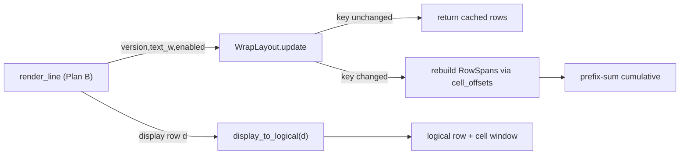

# Soft Wrap - Plan A: wrap layout core (L2 pure computation)

> Source of truth: `overview.md` (same directory) + Gitee issue IKVRXT.
> This sub-plan owns the pure display-line mapping module only. Do not touch
> other files. Owner: one executor. Approval: unattended (auto-approved).

## 1. Goal / non-goals

- Goal: add a pure, per-pane `WrapLayout` that maps a logical line into
  display rows using the existing cell-geometry functions, with incremental,
  lazy caching keyed by `(content_version, text_w, wrap_enabled)`.
- Non-goals: no view rendering changes (Plan B), no key handling, no config.
  No buffer text mutation, no newline insertion. No new `Protocol` /
  `TYPE_CHECKING` / `Any` / `# type: ignore`. Comments and docstrings ASCII.

## 2. Facts (verified, file:line)

- `yate/editor_components/cells.py:31-149`: `cell_offsets(line, tab_width)`
  returns a `char -> cell` prefix table of length `len(line)+1`; `expand_char`
  expands tab to next tab stop and wide chars to 2 cells. This is the only
  width authority (AC2). Reuse it; do not invent width math.
- `yate/editor_components/view.py:422` builds `offsets = theme.cell_offsets(...)`
  per rendered row; `theme` is the facade re-exporting `cells.py` functions.
- `buffer.content_version` is bumped by `fill_lines` (buffer.py:341) and
  `extend_placeholders` (buffer.py:356) and by every user edit -- safe cache key.
- R15 guard (`test_scrollable_widgets_apply_theme_scrollbar_pair`, AST scans
  `editor_components/**/*.py`): a new module defining a `ScrollView`
  subclass must call the scrollbar pair. `WrapLayout` is a plain class
  (no Textual widget base) -> not flagged. `cells.py` itself is the precedent
  for a plain L2 helper module.

## 3. Design

```
WrapLayout (plain class, no widget base, L2)
  fields: logical_rows: list[RowSpan], cumulative: list[int], version_key
  RowSpan = (logical_row: int, cell_start: int, cell_end: int, continuation: int)
  update(version: int, text_w: int, lines: Sequence[str], tab_width: int,
         enabled: bool) -> None   # rebuild only when key changed
  display_count() -> int          # total display rows (for virtual size)
  display_to_logical(d: int) -> RowSpan | None
  logical_to_display(row: int, cell_col: int) -> tuple[int, int]
      # -> (display_row, cell_offset_within_span); used by cursor exposure
  logical_display_rows(row: int) -> int
```

- Algorithm: for each logical line, walk its cell sequence with `cell_offsets`
  plus `expand_char`; cut at `text_w` cell boundaries (character-level wrap,
  per overview §7.4 item 4). A wide char that would straddle a boundary is
  pushed wholly to the next display row (never split -> AC2). An empty line
  yields exactly one display row. Unloaded placeholder rows are empty strings
  -> one display row each (chunked contract, AC7).
- Incremental: keep a prefix-sum array `cumulative[i]` = display rows before
  logical line i. On `update` with a changed `content_version`, rebuild only
  the tail from the first changed logical row. The simple, correct v1 rule:
  rebuild from the row where the two versions' content first diverges; if
  that cannot be determined cheaply, rebuild all rows **once per version
  change** (not per render). This satisfies AC8 (no per-frame full re-scan):
  `render_line` calls `update` every frame but rebuild executes only when the
  key tuple differs. Document this explicitly in the code docstring.
- `enabled=False` -> identity mapping: every logical line = one display row,
  `cell_start=0`, `cell_end=len(cells)`. This preserves no-wrap behavior.

## 4. Files (exclusive)

- NEW `yate/editor_components/wrap_layout.py`
- NEW `tests/test_wrap_layout.py`

## 5. Steps & acceptance commands

1. Write `wrap_layout.py` with the API above, full annotations, module /
   class / public method docstrings (English, prose style per coding-style §2).
2. Write `tests/test_wrap_layout.py`: character wrap of a long ASCII line;
   tab expansion at boundary; CJK wide char not split; empty line -> 1 row;
   `enabled=False` identity; `display_to_logical` / `logical_to_display`
   round trip; cache not rebuilt when version/text_w/enabled unchanged
   (assert internal row list identity or a rebuild counter).
3. Verify:
   - `.venv\Scripts\python.exe -m pyright yate/editor_components/wrap_layout.py tests/test_wrap_layout.py`
   - `.venv\Scripts\python.exe -m pytest tests/test_wrap_layout.py -q -n 1`

## 6. Risks / rollback

- Risk: wide-char boundary logic off-by-one -> AC2 failure. Mitigation:
  table-driven tests with exact `cell_offsets` expectations.
- Risk: accidental O(n) rebuild each frame -> AC8 failure. Mitigation: key
  comparison test above; code review of `update` guard.
- Rollback: delete the two new files; no other module imports them yet.

## 7. Mermaid


